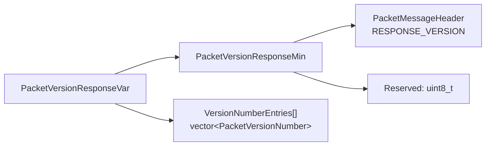
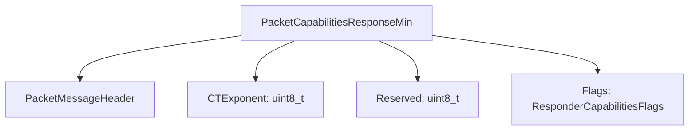
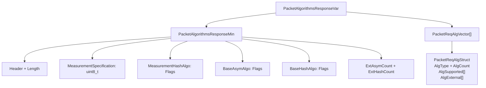
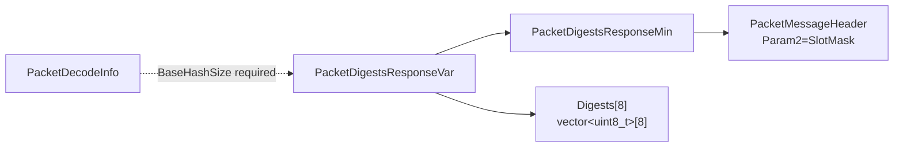
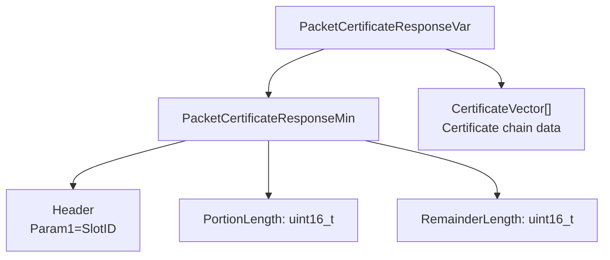
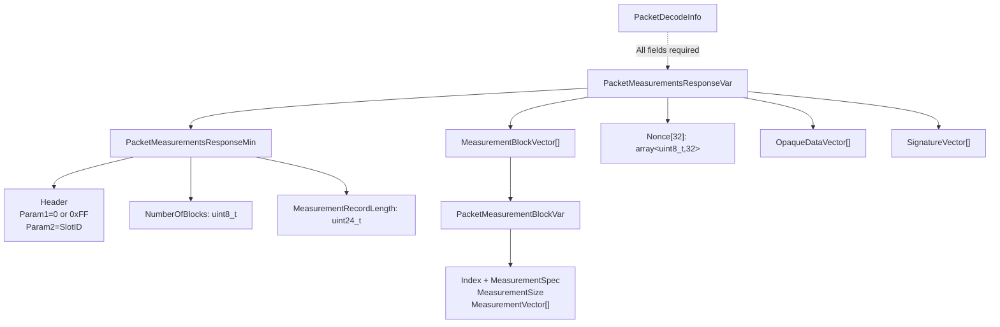
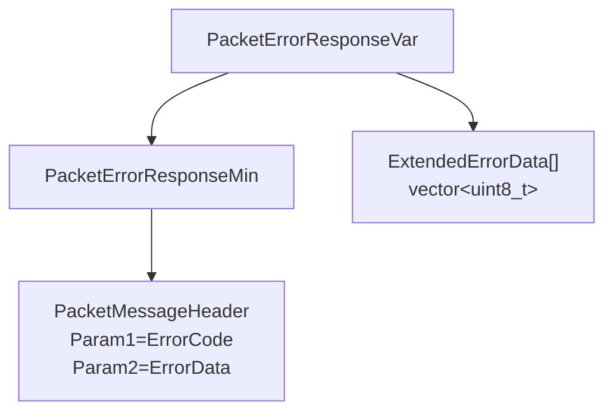

<!-- source: DeepWiki mcp.deepwiki.com · repo NVIDIA/spdm · extra page Response Packets · fetched 2026-10-26 -->

# Response Packets

<details>
<summary>Relevant source files</summary>

The following files were used as context for generating this wiki page:

- [libspdmcpp/headers_public/spdmcpp/internal/request/packet_negotiate_algorithms_request.hpp](libspdmcpp/headers_public/spdmcpp/internal/request/packet_negotiate_algorithms_request.hpp)
- [libspdmcpp/headers_public/spdmcpp/internal/response/packet_algorithms_response.hpp](libspdmcpp/headers_public/spdmcpp/internal/response/packet_algorithms_response.hpp)
- [libspdmcpp/headers_public/spdmcpp/internal/response/packet_error_response.hpp](libspdmcpp/headers_public/spdmcpp/internal/response/packet_error_response.hpp)
- [libspdmcpp/headers_public/spdmcpp/internal/response/packet_version_response.hpp](libspdmcpp/headers_public/spdmcpp/internal/response/packet_version_response.hpp)
- [libspdmcpp/headers_public/spdmcpp/packet.hpp](libspdmcpp/headers_public/spdmcpp/packet.hpp)
- [libspdmcpp/tests/packet_basic_test.cpp](libspdmcpp/tests/packet_basic_test.cpp)

</details>


## Purpose and Scope

This page documents the SPDM response packet structures defined in `libspdmcpp`. Response packets are sent by SPDM responder devices in reply to request messages from requesters. Each response packet type corresponds to a specific SPDM protocol operation.

For information about request packet structures, see [Request Packets](#2.3.1). For the overall packet structure and serialization system, see [Packet Structures and Serialization](#2.3).

**Sources:** [libspdmcpp/headers_public/spdmcpp/packet.hpp:1-153]()

---

## Response Packet Type Hierarchy

The following diagram shows the inheritance and composition relationships of response packet structures:

```mermaid
graph TB
    subgraph "Base Components"
        PMH["PacketMessageHeader<br/>requestResponseCode<br/>Param1, Param2"]
        PDI["PacketDecodeInfo<br/>BaseHashSize<br/>SignatureSize<br/>GetMeasurementsParam1"]
    end
    
    subgraph "VERSION Response"
        VRM["PacketVersionResponseMin<br/>Header + Reserved"]
        VRV["PacketVersionResponseVar<br/>Min + VersionNumberEntries[]"]
    end
    
    subgraph "CAPABILITIES Response"
        CPM["PacketCapabilitiesResponseMin<br/>Header + Flags + CTExponent"]
        CPV["PacketCapabilitiesResponseVar<br/>(same as Min)"]
    end
    
    subgraph "ALGORITHMS Response"
        ALM["PacketAlgorithmsResponseMin<br/>Header + Length + Algo Flags"]
        ALV["PacketAlgorithmsResponseVar<br/>Min + PacketReqAlgVector[]"]
    end
    
    subgraph "DIGESTS Response"
        DGM["PacketDigestsResponseMin<br/>Header only"]
        DGV["PacketDigestsResponseVar<br/>Min + Digests[8]"]
    end
    
    subgraph "CERTIFICATE Response"
        CRM["PacketCertificateResponseMin<br/>Header + PortionLength + RemainderLength"]
        CRV["PacketCertificateResponseVar<br/>Min + CertificateVector[]"]
    end
    
    subgraph "MEASUREMENTS Response"
        MSM["PacketMeasurementsResponseMin<br/>Header + NumberOfBlocks + RecordLength"]
        MSV["PacketMeasurementsResponseVar<br/>Min + Blocks[] + Nonce + OpaqueData + Signature"]
    end
    
    subgraph "ERROR Response"
        ERM["PacketErrorResponseMin<br/>Header only"]
        ERV["PacketErrorResponseVar<br/>Min + ExtendedErrorData[]"]
    end
    
    PMH --> VRM
    PMH --> CPM
    PMH --> ALM
    PMH --> DGM
    PMH --> CRM
    PMH --> MSM
    PMH --> ERM
    
    VRM --> VRV
    CPM --> CPV
    ALM --> ALV
    DGM --> DGV
    CRM --> CRV
    MSM --> MSV
    ERM --> ERV
    
    PDI -.->|"decoding context"| DGV
    PDI -.->|"decoding context"| MSV
```



**Sources:** [libspdmcpp/headers_public/spdmcpp/packet.hpp:104-144](), [libspdmcpp/headers_public/spdmcpp/packet.hpp:89-94]()

---

## Min/Var Pattern

All response packets follow a consistent **Min/Var pattern** to handle variable-length data:

| Component | Purpose | Size | `sizeIsConstant` |
|-----------|---------|------|------------------|
| **Min Structure** | Fixed-size header and core fields | Fixed | `true` |
| **Var Structure** | Min + variable-length vectors | Variable | `false` |

### Common Structure Members

Every response packet structure includes:

```cpp
static constexpr RequestResponseEnum requestResponseCode  // Packet type identifier
static constexpr bool sizeIsConstant                      // true for Min, false for Var
```

### Common Methods

| Method | Purpose |
|--------|---------|
| `printMl(LogClass& log)` | Multi-line formatted logging output |
| `operator==()` | Equality comparison for testing |
| `getSize()` | Calculate total packet size (Var only) |
| `finalize()` | Update size/count fields before encoding (Var only) |

**Sources:** [libspdmcpp/headers_public/spdmcpp/internal/response/packet_version_response.hpp:24-52](), [libspdmcpp/headers_public/spdmcpp/internal/response/packet_algorithms_response.hpp:24-70]()

---

## VERSION Response

Returns the SPDM protocol versions supported by the responder.

### Structure Definition



### Fields

| Field | Type | Description |
|-------|------|-------------|
| `Header` | `PacketMessageHeader` | Request/response code = `RESPONSE_VERSION` |
| `Reserved` | `uint8_t` | Reserved field (0) |
| `VersionNumberEntries` | `vector<PacketVersionNumber>` | Supported SPDM versions (Var only) |

### Encoding Behavior

- The count of version entries is encoded as a separate `uint8_t` field after the Min structure
- Each `PacketVersionNumber` contains major and minor version numbers
- Maximum 255 version entries can be encoded

### Example Structure

```
[Header: 3 bytes][Reserved: 1 byte][Count: 1 byte][Version1][Version2]...
```

**Sources:** [libspdmcpp/headers_public/spdmcpp/internal/response/packet_version_response.hpp:24-157]()

---

## CAPABILITIES Response

Returns the capabilities and configuration parameters of the responder.

### Structure Definition



### Key Fields

| Field | Type | Description |
|-------|------|-------------|
| `Header` | `PacketMessageHeader` | Request/response code = `RESPONSE_CAPABILITIES` |
| `CTExponent` | `uint8_t` | Cache timeout exponent for timing |
| `Flags` | `ResponderCapabilitiesFlags` | Capability flags bitfield |

### Capability Flags

The `ResponderCapabilitiesFlags` bitfield indicates supported features:
- Certificate support
- Measurement support
- Encryption/MAC support
- Key exchange support
- Handshake-in-the-clear support

**Note:** For SPDM 1.0/1.1, use `PacketGetCapabilities_1_0_ResponseMin` variant.

**Sources:** [libspdmcpp/headers_public/spdmcpp/internal/response/packet_capabilities_response.hpp]() (referenced but not provided in detail)

---

## ALGORITHMS Response

Returns the cryptographic algorithms selected by the responder after negotiation.

### Structure Definition



### PacketAlgorithmsResponseMin Fields

| Field | Type | Size | Description |
|-------|------|------|-------------|
| `Header` | `PacketMessageHeader` | 3 bytes | RESPONSE_ALGORITHMS |
| `Length` | `uint16_t` | 2 bytes | Total response length |
| `MeasurementSpecification` | `uint8_t` | 1 byte | Measurement hash specification |
| `Reserved0` | `uint8_t` | 1 byte | Reserved |
| `MeasurementHashAlgo` | `MeasurementHashAlgoFlags` | 4 bytes | Selected measurement hash |
| `BaseAsymAlgo` | `BaseAsymAlgoFlags` | 4 bytes | Selected asymmetric algorithm |
| `BaseHashAlgo` | `BaseHashAlgoFlags` | 4 bytes | Selected hash algorithm |
| `Reserved1-3` | `uint32_t[3]` | 12 bytes | Reserved fields |
| `ExtAsymCount` | `uint8_t` | 1 byte | Extended asym algorithm count |
| `ExtHashCount` | `uint8_t` | 1 byte | Extended hash algorithm count |
| `Reserved4` | `uint16_t` | 2 bytes | Reserved |

### PacketReqAlgStruct

The variable portion contains algorithm structures shared with the request:

| Field | Description |
|-------|-------------|
| `AlgType` | Algorithm type enum (DHE, AEAD, ReqBaseAsymAlg, KeySchedule, etc.) |
| `AlgCount` | Fixed algorithm count (upper 4 bits) + external count (lower 4 bits) |
| `AlgSupported[]` | Array of supported algorithm bytes (max 14) |
| `AlgExternal[]` | Array of external algorithm IDs (max 15) |

### Finalization

The `finalize()` method must be called before encoding to:
- Set `Header.Param1` to the count of `PacketReqAlgVector` entries
- Calculate and set the `Length` field

**Sources:** [libspdmcpp/headers_public/spdmcpp/internal/response/packet_algorithms_response.hpp:24-197](), [libspdmcpp/headers_public/spdmcpp/internal/request/packet_negotiate_algorithms_request.hpp:24-134]()

---

## DIGESTS Response

Returns certificate slot digests for the responder's provisioned certificates.

### Structure Definition



### Fields

| Field | Type | Description |
|-------|------|-------------|
| `Header` | `PacketMessageHeader` | RESPONSE_DIGESTS |
| `Header.Param2` | `uint8_t` | Bitmask indicating which slots contain digests |
| `Digests[8]` | `vector<uint8_t>[8]` | Digest for each of 8 certificate slots |

### Decoding Context

The `PacketDecodeInfo.BaseHashSize` must be set before decoding to determine digest lengths:
- SHA-256: 32 bytes
- SHA-384: 48 bytes
- SHA-512: 64 bytes

Only slots with bits set in `Param2` will have populated digest vectors.

**Sources:** [libspdmcpp/tests/packet_basic_test.cpp:355-376](), [libspdmcpp/headers_public/spdmcpp/internal/response/packet_digests_response.hpp]() (referenced)

---

## CERTIFICATE Response

Returns a portion of a certificate chain from the specified slot.

### Structure Definition



### Fields

| Field | Type | Description |
|-------|------|-------------|
| `Header` | `PacketMessageHeader` | RESPONSE_CERTIFICATE |
| `Header.Param1` | `uint8_t` | Certificate slot ID (0-7) |
| `PortionLength` | `uint16_t` | Length of certificate data in this response |
| `RemainderLength` | `uint16_t` | Bytes remaining in subsequent responses |
| `CertificateVector` | `vector<uint8_t>` | Certificate chain chunk (Var only) |

### Chunking Protocol

Large certificate chains are retrieved in multiple requests:
1. First response: `PortionLength` bytes, `RemainderLength` = total - portion
2. Subsequent responses: Continue until `RemainderLength` = 0

The `finalize()` method updates the `PortionLength` field based on vector size.

**Sources:** [libspdmcpp/tests/packet_basic_test.cpp:378-390](), [libspdmcpp/headers_public/spdmcpp/internal/response/packet_certificate_response.hpp]() (referenced)

---

## MEASUREMENTS Response

Returns attestation measurements from the responder device.

### Structure Definition



### Key Fields

| Field | Type | Conditional | Description |
|-------|------|-------------|-------------|
| `Header.Param1` | `uint8_t` | Always | 0=return all, 0xFF=return count only, 1-254=specific index |
| `Header.Param2` | `uint8_t` | Always | Certificate slot ID used for signing |
| `NumberOfBlocks` | `uint8_t` | Always | Number of measurement blocks |
| `MeasurementRecordLength` | 24-bit | Always | Total length of measurement record |
| `MeasurementBlockVector` | `vector<PacketMeasurementBlockVar>` | If Param1 != 0xFF | Actual measurement blocks |
| `Nonce` | `array<uint8_t,32>` | If nonce in request | Nonce from request |
| `OpaqueDataVector` | `vector<uint8_t>` | Optional | Device-specific opaque data |
| `SignatureVector` | `vector<uint8_t>` | If signature requested | Signature over measurements |

### Decoding Context Requirements

All three `PacketDecodeInfo` fields are required:

| Field | Purpose |
|-------|---------|
| `GetMeasurementsParam1` | Determines presence of measurement blocks (0 or 1) vs count-only (0xFF) |
| `BaseHashSize` | Size of hash fields in measurement blocks |
| `SignatureSize` | Size of signature vector if present |

### Measurement Block Structure

Each `PacketMeasurementBlockVar` contains:
- `Index`: Measurement index (1-254)
- `MeasurementSpec`: Measurement specification bitfield
- `MeasurementSize`: Size of measurement data
- `MeasurementVector`: Raw measurement bytes

**Sources:** [libspdmcpp/tests/packet_basic_test.cpp:450-509](), [libspdmcpp/headers_public/spdmcpp/internal/response/packet_measurements_response.hpp]() (referenced)

---

## ERROR Response

Returns error information when a request cannot be processed successfully.

### Structure Definition



### Fields

| Field | Type | Description |
|-------|------|-------------|
| `Header` | `PacketMessageHeader` | RESPONSE_ERROR |
| `Header.Param1` | `uint8_t` | Error code |
| `Header.Param2` | `uint8_t` | Error-specific data |
| `ExtendedErrorData` | `vector<uint8_t>` | Additional error information (Var only) |

### Error Codes

Defined in `PacketErrorResponseVar::ErrorCodes`:

| Code | Name | Value | Description |
|------|------|-------|-------------|
| `ErrorCodeInvalidRequest` | 0x01 | Invalid request format or parameters |
| `ErrorCodeBusy` | 0x03 | Responder is busy, requester should retry |
| `ErrorCodeResponseNotReady` | 0x42 | Response not ready, use RESPOND_IF_READY |

### Extended Error Data Offsets

For `ErrorCodeResponseNotReady`, `ExtendedErrorData` contains:

| Offset | Field | Description |
|--------|-------|-------------|
| 0 | `ExtErrOffsNotReadyRTDExponent` | Request-to-device time exponent |
| 1 | `ExtErrOffsReadyRequestCode` | Original request code |
| 2 | `ExtErrOffsNotReadyToken` | Token for RESPOND_IF_READY |
| 3 | `ExtErrOffsNotReadyRTDM` | Request-to-device time mantissa |

**Sources:** [libspdmcpp/headers_public/spdmcpp/internal/response/packet_error_response.hpp:24-142]()

---

## Encoding and Decoding Functions

### Function Signatures

Each response packet type has corresponding encode/decode functions:

```cpp
// Encoding
RetStat packetEncodeInternal(const PacketXxxResponseVar& p, 
                            std::vector<uint8_t>& buf, 
                            size_t& off)

// Decoding
RetStat packetDecodeInternal(LogClass& logg, 
                            PacketXxxResponseVar& p,
                            const std::vector<uint8_t>& buf, 
                            size_t& off)

// Context-sensitive decoding
RetStat packetDecodeInternal(LogClass& logg,
                            PacketXxxResponseVar& p,
                            const std::vector<uint8_t>& buf,
                            size_t& off,
                            const PacketDecodeInfo& info)
```

### Encoding Process Flow

```mermaid
sequenceDiagram
    participant App as "Application"
    participant Var as "PacketXxxResponseVar"
    participant Enc as "packetEncodeInternal"
    participant Buf as "vector&lt;uint8_t&gt;"
    
    App->>Var: Set Min fields
    App->>Var: Populate variable vectors
    App->>Var: finalize()
    Var->>Var: Update counts/lengths
    
    App->>Enc: packetEncodeInternal(packet, buf, off)
    Enc->>Buf: Encode Min structure
    Enc->>Buf: Encode additional size field (if needed)
    loop For each vector element
        Enc->>Buf: Encode element
    end
    Enc-->>App: RetStat::OK
```

### Decoding Process Flow

```mermaid
sequenceDiagram
    participant App as "Application"
    participant Dec as "packetDecodeInternal"
    participant Var as "PacketXxxResponseVar"
    participant Buf as "vector&lt;uint8_t&gt;"
    
    App->>Dec: packetDecodeInternal(log, packet, buf, off, [info])
    Dec->>Buf: Decode Min structure
    Dec->>Var: Store Min fields
    
    alt Variable-length packet
        Dec->>Buf: Read count/size field
        Dec->>Var: Resize vectors
        loop For each element
            Dec->>Buf: Decode element
            Dec->>Var: Store element
        end
    end
    
    Dec-->>App: RetStat::OK or ERROR
```

### Return Status Values

| RetStat | Meaning |
|---------|---------|
| `RetStat::OK` | Success |
| `RetStat::ERROR_BUFFER_TOO_SMALL` | Input buffer too small |
| `RetStat::WARNING_BUFFER_TOO_BIG` | Extra data after packet (warning) |
| `RetStat::ERROR_UNKNOWN` | Other error |

**Sources:** [libspdmcpp/headers_public/spdmcpp/internal/response/packet_version_response.hpp:103-155](), [libspdmcpp/headers_public/spdmcpp/internal/response/packet_algorithms_response.hpp:152-196](), [libspdmcpp/tests/packet_basic_test.cpp:190-228]()

---

## Endianness Handling

Each response packet has an `endianHostSpdmCopy()` function for byte order conversion:

```cpp
void endianHostSpdmCopy(const PacketXxxResponseMin& src, 
                        PacketXxxResponseMin& dst)
```

These functions handle conversion between host byte order and SPDM (little-endian) byte order for:
- Multi-byte integers (`uint16_t`, `uint32_t`)
- Flag bitfields
- Nested structures

**Sources:** [libspdmcpp/headers_public/spdmcpp/internal/response/packet_version_response.hpp:54-61](), [libspdmcpp/headers_public/spdmcpp/internal/response/packet_algorithms_response.hpp:72-89]()

---

## Testing Pattern

### Round-Trip Encode/Decode Testing

The test suite validates response packets through encode/decode cycles:

```cpp
template <class T, typename... Targs>
bool packetEncodeDecode(const T& src, Targs... fargs)
{
    // 1. Encode packet to buffer
    std::vector<uint8_t> buf;
    auto rs = packetEncode(src, buf);
    
    // 2. Decode buffer back to packet
    T dst;
    size_t off = 0;
    rs = packetDecode(log, dst, buf, off, fargs...);
    
    // 3. Verify equality
    return src == dst;
}
```

### Example Test Case

```cpp
TEST(packet_pseudorandom_encode_decode, PacketAlgorithmsResponseVar)
{
    PacketAlgorithmsResponseVar p;
    fillPseudoRandomPacket(p.Min);
    
    p.PacketReqAlgVector.push_back(
        PacketReqAlgStruct::buildAlgSupported(AlgTypeEnum::DHE, 0x1b, 0x00));
    p.PacketReqAlgVector.push_back(
        PacketReqAlgStruct::buildAlgSupported(AlgTypeEnum::AEADCipherSuite, 0x06, 0x00));
    
    EXPECT_EQ(p.finalize(), RetStat::OK);
    EXPECT_TRUE(packetEncodeDecode(p));
}
```

**Sources:** [libspdmcpp/tests/packet_basic_test.cpp:190-228](), [libspdmcpp/tests/packet_basic_test.cpp:336-353]()

---

## Summary Table

| Response Type | Min Structure | Variable Data | Requires Context | Key Use |
|--------------|---------------|---------------|------------------|---------|
| VERSION | Header + Reserved | Version entries | No | Protocol negotiation |
| CAPABILITIES | Header + flags | None | No | Feature discovery |
| ALGORITHMS | Header + algo flags | Algorithm structures | No | Crypto negotiation |
| DIGESTS | Header | 8 digest vectors | Yes (BaseHashSize) | Certificate discovery |
| CERTIFICATE | Header + lengths | Certificate chunk | No | Certificate retrieval |
| MEASUREMENTS | Header + counts | Blocks + signature | Yes (All 3 fields) | Attestation |
| ERROR | Header | Extended error data | No | Error reporting |

**Sources:** [libspdmcpp/headers_public/spdmcpp/packet.hpp:130-136](), [libspdmcpp/headers_public/spdmcpp/packet.hpp:89-94]()

---

