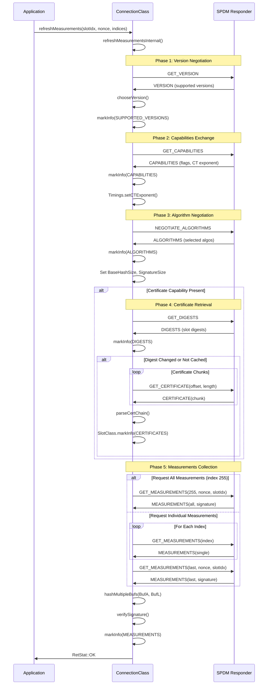
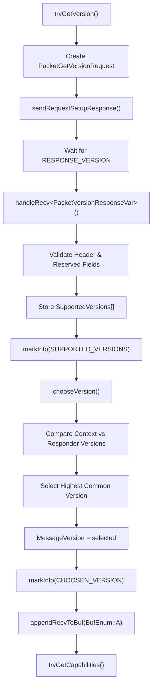
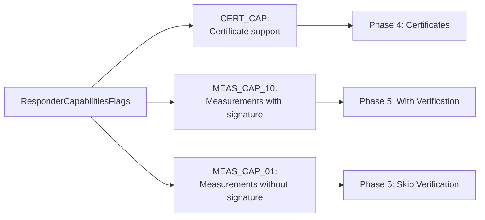
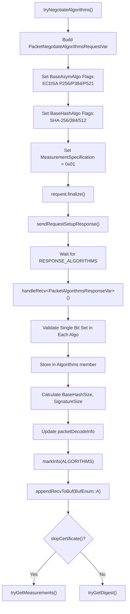
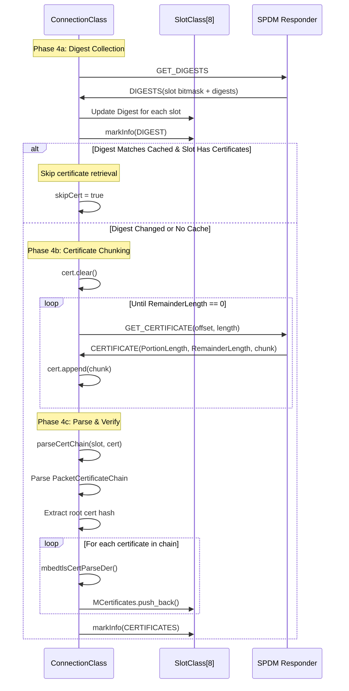
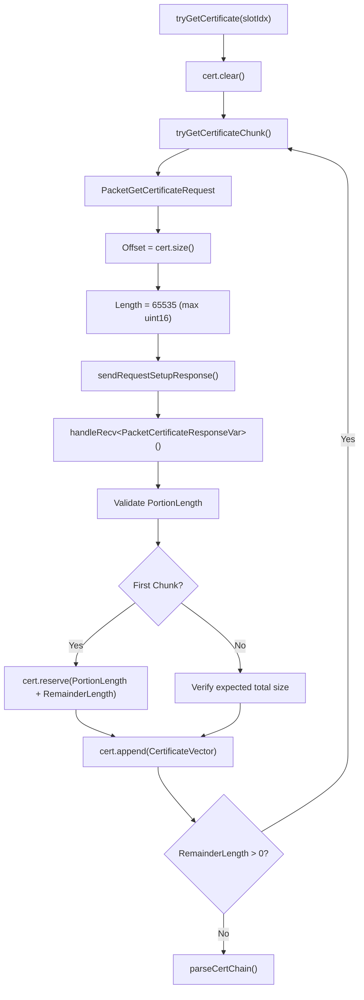
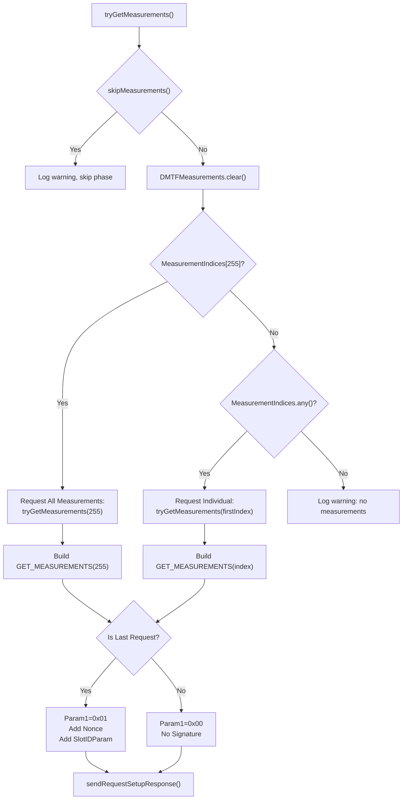
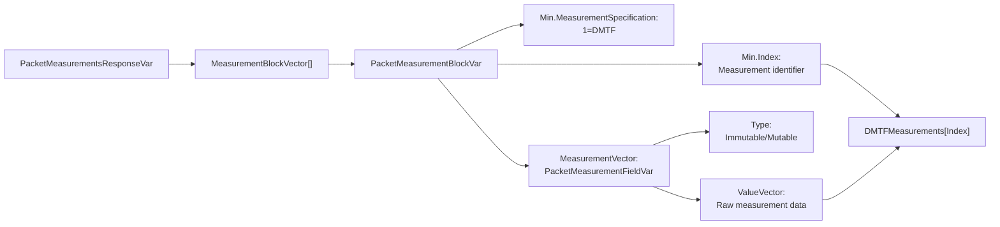
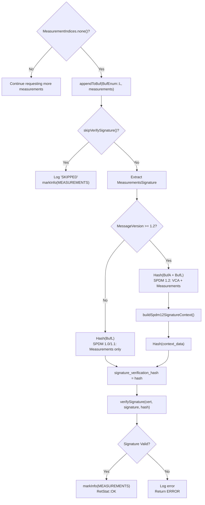
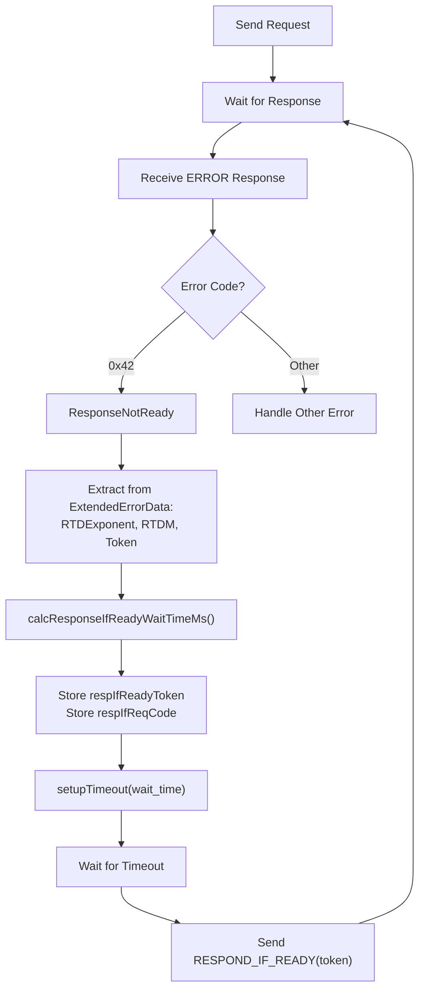

<!-- source: DeepWiki mcp.deepwiki.com · repo NVIDIA/spdm · extra page SPDM Protocol Phases · fetched 2026-10-26 -->

# SPDM Protocol Phases

<details>
<summary>Relevant source files</summary>

The following files were used as context for generating this wiki page:

- [libspdmcpp/connection.cpp](libspdmcpp/connection.cpp)
- [libspdmcpp/headers_public/spdmcpp/connection.hpp](libspdmcpp/headers_public/spdmcpp/connection.hpp)
- [libspdmcpp/headers_public/spdmcpp/connection_inl.hpp](libspdmcpp/headers_public/spdmcpp/connection_inl.hpp)
- [libspdmcpp/headers_public/spdmcpp/internal/request/packet_negotiate_algorithms_request.hpp](libspdmcpp/headers_public/spdmcpp/internal/request/packet_negotiate_algorithms_request.hpp)
- [libspdmcpp/headers_public/spdmcpp/internal/response/packet_algorithms_response.hpp](libspdmcpp/headers_public/spdmcpp/internal/response/packet_algorithms_response.hpp)
- [libspdmcpp/headers_public/spdmcpp/internal/response/packet_error_response.hpp](libspdmcpp/headers_public/spdmcpp/internal/response/packet_error_response.hpp)
- [libspdmcpp/headers_public/spdmcpp/internal/response/packet_version_response.hpp](libspdmcpp/headers_public/spdmcpp/internal/response/packet_version_response.hpp)
- [libspdmcpp/tests/connection_test.cpp](libspdmcpp/tests/connection_test.cpp)

</details>


## Purpose and Scope

This document describes the sequential protocol phases that `ConnectionClass` executes during SPDM communication. The SPDM (Security Protocol and Data Model) handshake consists of five distinct phases: version negotiation, capabilities exchange, algorithm negotiation, certificate retrieval, and measurements collection. Each phase builds upon information obtained in previous phases to establish secure attestation of a remote device.

For details on the `ConnectionClass` implementation and event handling mechanisms, see [2.1](#2.1). For information about certificate slot management specifically, see [2.1.2](#2.1.2). For buffer management and transcript hashing, see [2.1.3](#2.1.3).

## Protocol Phase Overview

The following diagram illustrates the complete SPDM protocol flow as orchestrated by `ConnectionClass::refreshMeasurementsInternal()`:



**Sources:** [libspdmcpp/connection.cpp:148-164](), [libspdmcpp/connection.cpp:354-1097]()

## Phase State Tracking

`ConnectionClass` uses the `GotInfo` bitmask to track which protocol phases have been successfully completed:

| ConnectionInfoEnum | Set By Phase | Checked By |
|-------------------|--------------|------------|
| `SUPPORTED_VERSIONS` | Version Negotiation | `hasInfo()` |
| `CHOOSEN_VERSION` | Version Negotiation | `hasInfo()` |
| `CAPABILITIES` | Capabilities Exchange | `hasInfo()` |
| `ALGORITHMS` | Algorithm Negotiation | `hasInfo()` |
| `DIGESTS` | Certificate Retrieval | `hasInfo()` |
| `MEASUREMENTS` | Measurements Collection | `hasInfo()` |

**Sources:** [libspdmcpp/headers_public/spdmcpp/connection.hpp:266-283](), [libspdmcpp/connection.cpp:409-614]()

## Phase 1: Version Negotiation

### Purpose

Version negotiation establishes the SPDM specification version to use for subsequent communication. The responder advertises all versions it supports, and the requester selects the highest mutually compatible version.

### Request-Response Flow



### Implementation Details

The version negotiation is implemented in `tryGetVersion()` and `handleRecv<PacketVersionResponseVar>()`:

**Request Transmission:**
- Method: `ConnectionClass::tryGetVersion()` [libspdmcpp/connection.cpp:354-371]()
- Packet Type: `PacketGetVersionRequest`
- Buffer: Appended to `BufEnum::A` for transcript hash
- Timeout: `Timings.getT1()` (T1 timing requirement)

**Response Processing:**
- Method: `ConnectionClass::handleRecv<PacketVersionResponseVar>()` [libspdmcpp/connection.cpp:372-424]()
- Packet Type: `PacketVersionResponseVar`
- Validation:
  - Header `MessageVersion` must be 1.0, 1.1, or 1.2 [libspdmcpp/connection.cpp:390-396]()
  - `Param1` and `Param2` must be 0 [libspdmcpp/connection.cpp:397-400]()
  - `Reserved` field must be 0 [libspdmcpp/connection.cpp:402-406]()

**Version Selection:**
- Method: `ConnectionClass::chooseVersion()` [libspdmcpp/connection.cpp:426-460]()
- Algorithm: Select highest version supported by both requester and responder
- Supported versions defined by `ContextClass::getSupportedVersions()`
- Selected version stored in `MessageVersion` member

**Data Structures:**

```cpp
// Version number entry in response
PacketVersionNumber {
    uint8_t: Major version (4 bits) + Minor version (4 bits)
}

// Response contains variable-length list
PacketVersionResponseVar {
    PacketVersionResponseMin Min;
    vector<PacketVersionNumber> VersionNumberEntries;
}
```

**Sources:** [libspdmcpp/connection.cpp:354-460](), [libspdmcpp/headers_public/spdmcpp/connection.hpp:456](), [libspdmcpp/headers_public/spdmcpp/internal/response/packet_version_response.hpp:1-158]()

## Phase 2: Capabilities Exchange

### Purpose

Capabilities exchange determines what optional features the responder supports. This includes certificate support, measurement capabilities, and signature requirements. The responder also provides its CT (computation time) exponent, which is used to calculate timeout values for subsequent operations.

### Request-Response Flow

The request differs based on the negotiated SPDM version:

| SPDM Version | Request Packet | Key Differences |
|--------------|----------------|-----------------|
| 1.0 | `PacketGetCapabilities10Request` | No flags, no transfer sizes |
| 1.1+ | `PacketGetCapabilitiesRequest` | Includes requester flags |
| 1.2+ | `PacketGetCapabilitiesRequest` | Adds DataTransferSize, MaxSPDMmsgSize |

### Implementation Details

**Request Transmission:**
- Method: `ConnectionClass::tryGetCapabilities()` [libspdmcpp/connection.cpp:462-495]()
- Version-specific handling:
  - SPDM 1.0: Uses `PacketGetCapabilities10Request` [libspdmcpp/connection.cpp:471-476]()
  - SPDM 1.1+: Uses `PacketGetCapabilitiesRequest` with flags [libspdmcpp/connection.cpp:478-492]()
  - SPDM 1.2+: Includes transfer size parameters [libspdmcpp/connection.cpp:484-488]()
- Buffer: Appended to `BufEnum::A`
- Timeout: `Timings.getT1()`

**Response Processing:**
- Method: `ConnectionClass::handleRecv<PacketCapabilitiesResponse>()` [libspdmcpp/connection.cpp:496-530]()
- Validation:
  - `Param1` and `Param2` must be 0 [libspdmcpp/connection.cpp:503-507]()
  - Reserved fields must be 0 [libspdmcpp/connection.cpp:508-512]()
  - CERT_CAP must be set if signature verification is required [libspdmcpp/connection.cpp:519-523]()

**Key Capability Flags:**



**Timing Configuration:**
- The `CTExponent` value is used by `TimingClass::setCTExponent()` [libspdmcpp/connection.cpp:525]()
- Converts microseconds to milliseconds: `CT = 2^(CTExponent-10)` [libspdmcpp/headers_public/spdmcpp/connection.hpp:104-122]()
- Used to calculate T2 timeout: `T2 = RTT + CT` [libspdmcpp/headers_public/spdmcpp/connection.hpp:99-102]()

**Sources:** [libspdmcpp/connection.cpp:462-530](), [libspdmcpp/headers_public/spdmcpp/connection.hpp:86-133]()

## Phase 3: Algorithm Negotiation

### Purpose

Algorithm negotiation establishes the cryptographic algorithms to use for all subsequent operations. This includes asymmetric algorithms for signatures, hash algorithms for transcript hashing, and measurement hash algorithms for measurement digests.

### Negotiation Flow



### Implementation Details

**Request Construction:**
- Method: `ConnectionClass::tryNegotiateAlgorithms()` [libspdmcpp/connection.cpp:532-573]()
- Packet: `PacketNegotiateAlgorithmsRequestVar`
- Requester advertises support for:
  - BaseAsymAlgo: ECDSA P256, P384, P521 [libspdmcpp/connection.cpp:542-544]()
  - BaseHashAlgo: SHA-256, SHA-384, SHA-512 [libspdmcpp/connection.cpp:545-547]()
  - MeasurementSpecification: DMTF (bit 0) [libspdmcpp/connection.cpp:540]()

**Response Processing:**
- Method: `ConnectionClass::handleRecv<PacketAlgorithmsResponseVar>()` [libspdmcpp/connection.cpp:574-658]()
- Validation ensures exactly one bit set for each algorithm type [libspdmcpp/connection.cpp:594-612]()
- Critical validations:
  - `MeasurementHashAlgo`: Must have ≤1 bit set [libspdmcpp/connection.cpp:594-600]()
  - `BaseAsymAlgo`: Must have exactly 1 bit set [libspdmcpp/connection.cpp:601-606]()
  - `BaseHashAlgo`: Must have exactly 1 bit set [libspdmcpp/connection.cpp:607-612]()

**Size Calculation:**

The negotiated algorithms determine sizes for subsequent packet fields:

```cpp
// BaseHashSize affects:
// - Certificate digest size
// - Measurement hash size  
// - Transcript hash size
if (auto hsize = getHashSize(resp.Min.BaseHashAlgo); hsize != invalidFlagSize) {
    packetDecodeInfo.BaseHashSize = hsize;
}

// SignatureSize affects:
// - Measurement signature field size
if (auto ssize = getSignatureSize(resp.Min.BaseAsymAlgo); ssize != invalidFlagSize) {
    packetDecodeInfo.SignatureSize = ssize;
}
```

**Algorithms Response Structure:**

| Field | Type | Purpose |
|-------|------|---------|
| `MeasurementHashAlgo` | `MeasurementHashAlgoFlags` | Hash for measurement digests |
| `BaseAsymAlgo` | `BaseAsymAlgoFlags` | Asymmetric signature algorithm |
| `BaseHashAlgo` | `BaseHashAlgoFlags` | Hash for transcripts and signatures |
| `PacketReqAlgVector` | `vector<PacketReqAlgStruct>` | Additional algorithm details |

**Sources:** [libspdmcpp/connection.cpp:532-658](), [libspdmcpp/headers_public/spdmcpp/internal/response/packet_algorithms_response.hpp:1-199](), [libspdmcpp/headers_public/spdmcpp/internal/request/packet_negotiate_algorithms_request.hpp:1-368]()

## Phase 4: Certificate Retrieval (Optional)

### Purpose

Certificate retrieval obtains the responder's certificate chain for signature verification. This phase is skipped if the responder does not have the `CERT_CAP` capability flag set. The process involves two steps: getting certificate digests for all slots, then retrieving the certificate chain for the selected slot.

### Certificate Retrieval Sequence



### Digest Phase Implementation

**Request Transmission:**
- Method: `ConnectionClass::tryGetDigest()` [libspdmcpp/connection.cpp:660-673]()
- Packet: `PacketGetDigestsRequest`
- Buffer: Appended to `BufEnum::B` (used for M1/M2 hash)
- Timeout: `Timings.getT1()`

**Response Processing:**
- Method: `ConnectionClass::handleRecv<PacketDigestsResponseVar>()` [libspdmcpp/connection.cpp:674-725]()
- Response structure:
  - `Param2`: 8-bit slot availability bitmask [libspdmcpp/connection.cpp:686-709]()
  - `Digests[8]`: Array of digest values for available slots
- Digest comparison for cache hit:
  ```cpp
  if (i == CertificateSlotIdx &&
      slotHasInfo(i, SlotInfoEnum::DIGEST) &&
      slotHasInfo(i, SlotInfoEnum::CERTIFICATES) &&
      resp.Digests[i] == Slots[i].Digest) {
      skipCert = true;  // Certificate already cached
  }
  ```

**Sources:** [libspdmcpp/connection.cpp:660-725]()

### Certificate Chunk Retrieval

**Chunking Strategy:**

Certificates may be large and must be retrieved in chunks due to packet size limitations:



**Implementation Details:**

- Method: `ConnectionClass::tryGetCertificateChunk()` [libspdmcpp/connection.cpp:727-753]()
- First chunk reserves buffer space: [libspdmcpp/connection.cpp:792-795]()
  ```cpp
  cert.shrink_to_fit();
  cert.reserve(resp.Min.PortionLength + resp.Min.RemainderLength);
  ```
- Subsequent chunks append data [libspdmcpp/connection.cpp:807-809]()
- Retry logic: Up to 3 retries on certificate errors [libspdmcpp/connection.cpp:757-841]()

**Sources:** [libspdmcpp/connection.cpp:727-877]()

### Certificate Chain Parsing

**Certificate Chain Structure:**

```
PacketCertificateChain {
    uint16_t Length;           // Total chain length
    uint16_t Reserved;
    uint8_t[HashSize] RootHash; // Hash of root certificate
    uint8_t[] Certificates;     // DER-encoded certs (root, intermediate, leaf)
}
```

**Parsing Implementation:**
- Method: `ConnectionClass::parseCertChain()` [libspdmcpp/connection.cpp:264-319]()
- Steps:
  1. Decode `PacketCertificateChain` header [libspdmcpp/connection.cpp:270-271]()
  2. Extract root certificate hash [libspdmcpp/connection.cpp:282-298]()
  3. Store `CertificateOffset` (where DER data begins) [libspdmcpp/connection.cpp:300]()
  4. Parse each certificate with `mbedtlsCertParseDer()` [libspdmcpp/connection.cpp:307-316]()
  5. Store parsed certificates in `slot.MCertificates[]` [libspdmcpp/connection.cpp:315]()

**Certificate Slot Storage:**

| SlotClass Member | Type | Purpose |
|-----------------|------|---------|
| `Digest` | `vector<uint8_t>` | SPDM digest of certificate chain |
| `Certificates` | `vector<uint8_t>` | Raw certificate chain bytes |
| `MCertificates` | `vector<unique_ptr<mbedtls_x509_crt_raii>>` | Parsed X.509 certificates |
| `CertificateOffset` | `size_t` | Offset where DER data starts |

**Sources:** [libspdmcpp/connection.cpp:264-319](), [libspdmcpp/headers_public/spdmcpp/connection.hpp:488-571]()

## Phase 5: Measurements Collection

### Purpose

Measurements collection retrieves attestation data from the responder and verifies its authenticity via a digital signature. Measurements can be requested all at once (index 255) or individually (indices 1-254). The final measurement request includes a nonce and requests a signature over all collected measurements.

### Measurement Collection Strategies



### Individual Measurement Request Flow

**Request Construction:**
- Method: `ConnectionClass::tryGetMeasurements(uint8_t idx)` [libspdmcpp/connection.cpp:911-945]()
- Packet: `PacketGetMeasurementsRequestVar`
- Key parameters:
  - `Param2`: Measurement index (1-254 for individual, 255 for all) [libspdmcpp/connection.cpp:939]()
  - `Param1`: 0x01 if signature requested, 0x00 otherwise [libspdmcpp/connection.cpp:925-936]()
  - `Nonce`: Random 32-byte nonce (only on last request) [libspdmcpp/connection.cpp:928]()
  - `SlotIDParam`: Certificate slot to use for verification [libspdmcpp/connection.cpp:929]()

**Signature Request Logic:**
```cpp
const bool isLast = (MeasurementIndices.count() == 1 || MeasurementIndices[255]);
if (isLast && !skipVerifySignature()) {
    // This is the last measurement request, so:
    // 1. Set Param1 = 0x01 to request signature
    // 2. Include nonce for freshness
    // 3. Specify certificate slot for verification
}
```

**Sources:** [libspdmcpp/connection.cpp:911-945]()

### Measurement Response Processing

**Response Handling:**
- Method: `ConnectionClass::handleRecv<PacketMeasurementsResponseVar>()` [libspdmcpp/connection.cpp:947-1097]()
- Packet: `PacketMeasurementsResponseVar`

**Measurement Block Parsing:**



**DMTF Measurement Extraction:**
[libspdmcpp/connection.cpp:955-984]()
```cpp
for (const auto& block : resp.MeasurementBlockVector) {
    if (block.Min.MeasurementSpecification == 1) {  // DMTF spec
        size_t off = 0;
        rs = packetDecodeInternal(Log, DMTFMeasurements[block.Min.Index],
                                  block.MeasurementVector, off);
    }
}
```

**Measurement Index Tracking:**
- For index 255: Reset all indices [libspdmcpp/connection.cpp:986-989]()
- For individual index: Reset only that index [libspdmcpp/connection.cpp:990-993]()
- Continue requesting until `MeasurementIndices.none()` [libspdmcpp/connection.cpp:996]()

**Sources:** [libspdmcpp/connection.cpp:947-1097]()

### Signature Verification

When all measurements are collected, the signature is verified:



**Transcript Hashing:**

SPDM 1.2 changed the transcript hash calculation to include VCA (Version, Capabilities, Algorithms):

[libspdmcpp/connection.cpp:1030-1040]()
```cpp
if (MessageVersion >= MessageVersionEnum::SPDM_1_2) {
    // SPDM 1.2+: Hash(VCA || Measurements)
    hashMultipleBufs(hash, getSignatureHashEnum(), {BufEnum::A, BufEnum::L});
} else {
    // SPDM 1.0/1.1: Hash(Measurements only)
    hashBuf(hash, getSignatureHashEnum(), BufEnum::L);
}
```

**SPDM 1.2 Signature Context:**

For SPDM 1.2+, the hash is wrapped in a signature context structure:
[libspdmcpp/connection.cpp:1062-1068]()
```cpp
if (MessageVersion >= MessageVersionEnum::SPDM_1_2) {
    auto context_data = buildSpdm12SignatureContext(
        SPDM_MEASUREMENTS_SIGN_CONTEXT, false, hash);
    signature_verification_hash.resize(hash.size());
    hashBuf(signature_verification_hash, getSignatureHashEnum(), context_data);
}
```

**Signature Verification Call:**
[libspdmcpp/connection.cpp:1074-1076]()
```cpp
auto ret = verifySignature(Slots[CertificateSlotIdx].getLeafCert(),
                          resp.SignatureVector, 
                          signature_verification_hash);
```

**Sources:** [libspdmcpp/connection.cpp:996-1097]()

## Buffer Management Across Phases

`ConnectionClass` maintains three transcript buffers for hash computation:

| Buffer | Enum | Contents | Used For |
|--------|------|----------|----------|
| Buffer A | `BufEnum::A` | Version + Capabilities + Algorithms | VCA transcript (M1 hash, SPDM 1.2+ measurement signature) |
| Buffer B | `BufEnum::B` | Digests + Certificates | M2 hash (challenge-response, not used in basic measurement flow) |
| Buffer L | `BufEnum::L` | GET_MEASUREMENTS requests + MEASUREMENTS responses | L1/L2 hash (measurement signature verification) |

**Buffer Operations:**

| Phase | Buffer | Operation |
|-------|--------|-----------|
| Version Negotiation | A | Append VERSION request + response |
| Capabilities | A | Append GET_CAPABILITIES request + response |
| Algorithms | A | Append NEGOTIATE_ALGORITHMS request + response |
| Digests | B | Append GET_DIGESTS request + response |
| Certificates | B | Append GET_CERTIFICATE requests + responses |
| Measurements | L | Append GET_MEASUREMENTS requests + responses (without signature) |

**Buffer Clearing:**

Buffers are cleared at the start of `refreshMeasurementsInternal()` if `stateEnabled` is true:
[libspdmcpp/connection.cpp:358-364]()
```cpp
if (stateEnabled) {
    for (auto& b : Bufs) {
        b.clear();
    }
}
```

**Sources:** [libspdmcpp/headers_public/spdmcpp/connection.hpp:477-486](), [libspdmcpp/connection.cpp:358-364]()

## Error Handling and State Transitions

### Error Response Handling

SPDM responders may return `RESPONSE_ERROR` packets instead of expected responses. The `ConnectionClass` handles several error codes:

| Error Code | Name | Handling |
|------------|------|----------|
| 0x01 | InvalidRequest | Abort with `ERROR_RESPONSE` |
| 0x03 | Busy | Retry request after delay |
| 0x42 | ResponseNotReady | Wait and retry with RESPOND_IF_READY |

**Response-If-Ready Flow:**



**Response-If-Ready Implementation:**
[libspdmcpp/connection.cpp:1279-1300]()
- Extracts RTD (Response Time to Data) parameters
- Calculates wait time: `((2^RTDExp) * RTDM + 2^RTDExp) / 2 / 1000` ms
- Stores token and original request code
- Sends `RESPOND_IF_READY` with token after delay

**Sources:** [libspdmcpp/connection.cpp:1158-1374]()

### Retry Logic

**Packet-Level Retries:**

Each request can be retried if no response is received:
[libspdmcpp/connection.cpp:1424-1494]()
- Default retry count: 4 attempts
- Retry delay: 3000ms (configurable)
- Managed by `retryPktCount` counter

**Version-Specific Retries:**

GET_VERSION has special retry handling:
[libspdmcpp/connection.cpp:374-382]()
```cpp
if (!stateEnabled) {
    if (retryGetVersionCount > maxGetVersionRetries) {
        return RetStat::ERROR_RESPONSE;
    }
    return RetStat::OK;
}
```

**Certificate Retries:**

Certificate retrieval has dedicated retry logic:
[libspdmcpp/connection.cpp:770-841]()
- Up to 3 retries on parsing errors or invalid chunk sizes
- Clears certificate buffer and restarts from offset 0
- Managed by `retryCertCount` counter

**Sources:** [libspdmcpp/connection.cpp:374-382](), [libspdmcpp/connection.cpp:770-841](), [libspdmcpp/connection.cpp:1424-1494]()

### Phase Restart on Error

Certain errors cause the protocol to restart from Phase 1 (Version Negotiation):

[libspdmcpp/connection.cpp:49-62]()
```cpp
#define SPDMCPP_CONNECTION_RS_ERROR_RETURN_WITH_VERSION(rs)
    do {
        if (isError(rs)) {
            SPDMCPP_LOG_TRACE(Log, (rs));
            // ... logging ...
            stateEnabled = false;
            return tryGetVersion();  // Restart from Phase 1
        }
    } while (false)
```

**Error Categories Triggering Restart:**
- Invalid response header fields
- Wrong algorithm bit counts
- Unsupported SPDM version
- Certificate verification failures
- Signature verification failures

This macro is used extensively in response handlers to ensure protocol consistency after errors.

**Sources:** [libspdmcpp/connection.cpp:49-62](), [libspdmcpp/connection.cpp:386-839]()

---

