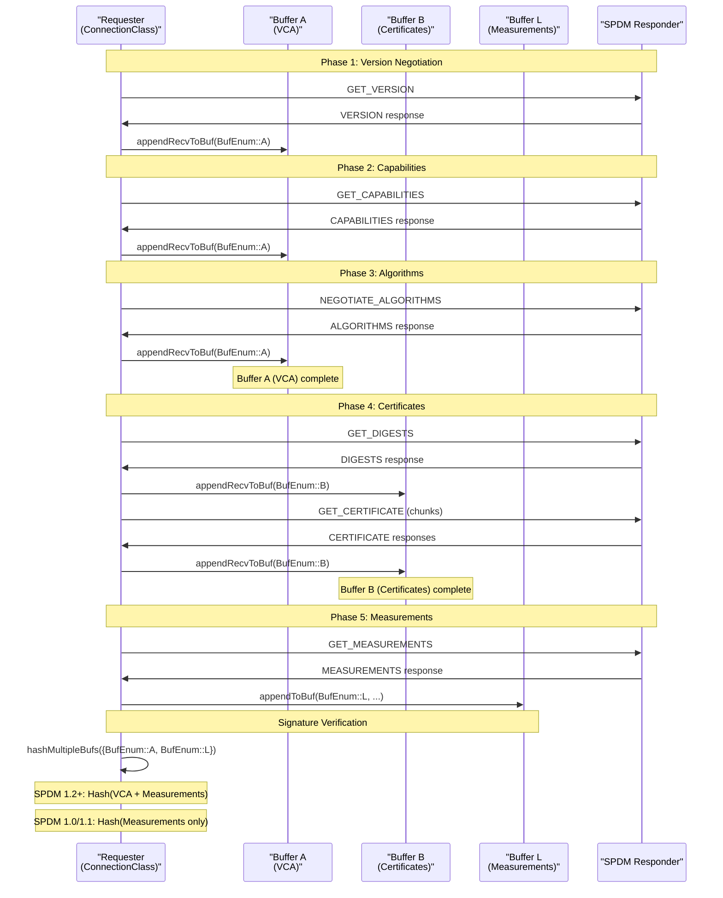
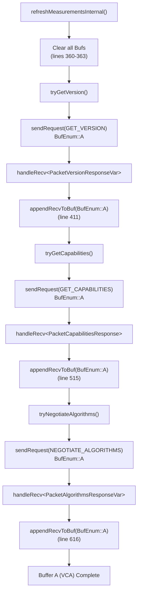
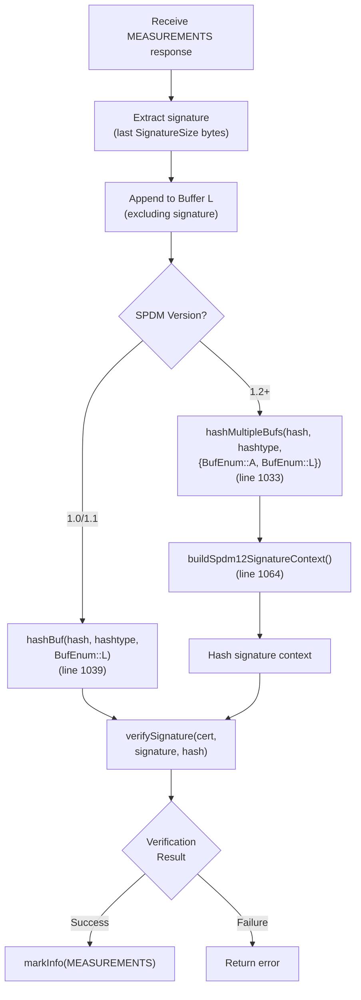
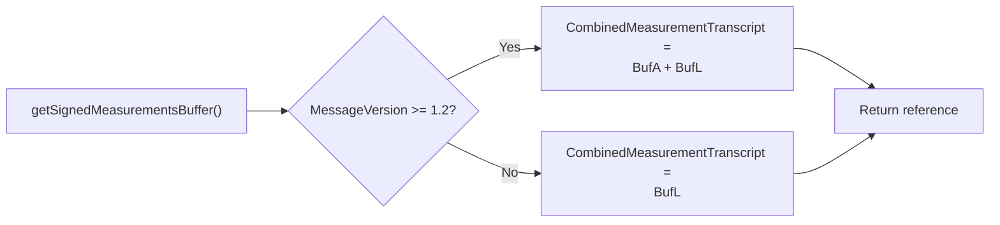

<!-- source: DeepWiki mcp.deepwiki.com · repo NVIDIA/spdm · extra page Buffer Management and Transcript Hashing · fetched 2026-10-26 -->

# Buffer Management and Transcript Hashing

<details>
<summary>Relevant source files</summary>

The following files were used as context for generating this wiki page:

- [libspdmcpp/connection.cpp](libspdmcpp/connection.cpp)
- [libspdmcpp/headers_public/spdmcpp/connection.hpp](libspdmcpp/headers_public/spdmcpp/connection.hpp)
- [libspdmcpp/headers_public/spdmcpp/connection_inl.hpp](libspdmcpp/headers_public/spdmcpp/connection_inl.hpp)
- [libspdmcpp/tests/connection_test.cpp](libspdmcpp/tests/connection_test.cpp)

</details>


## Purpose and Scope

This page documents the buffer management system used by `ConnectionClass` for computing transcript hashes across SPDM protocol phases. Transcript hashing is required by the SPDM specification (DSP0274) for signature verification of measurements and certificates. The library maintains separate buffers for different message sequences and combines them according to SPDM version-specific rules.

For information about the overall protocol flow and state machine, see [SPDM Protocol Phases](#2.1.1). For certificate storage and slot management, see [Certificate Management and Slots](#2.1.2).

---

## Buffer Architecture Overview

`ConnectionClass` maintains four distinct buffers for accumulating protocol messages during communication with an SPDM Responder. These buffers are used to compute cryptographic hashes over specific message sequences, which are then verified against signatures provided by the Responder.

### Buffer Enumeration

The buffer types are defined by the `BufEnum` enumeration:

**Buffer Types:**

| Buffer | Enum Value | Purpose | Used For |
|--------|-----------|---------|----------|
| **A** | `BufEnum::A` | VCA Transcript (Version/Capabilities/Algorithms) | M1/M2 hash, SPDM 1.2+ measurements |
| **B** | `BufEnum::B` | Certificate Transcript (Digests/Certificates) | M1/M2 hash (certificate verification) |
| **C** | `BufEnum::C` | Reserved for future use | Currently unused |
| **L** | `BufEnum::L` | Measurements Transcript | L1/L2 hash (measurement verification) |

Sources: [libspdmcpp/headers_public/spdmcpp/connection.hpp:476-486]()

### Storage Implementation

Buffers are stored as an array of `std::vector<uint8_t>` within `ConnectionClass`:

```cpp
std::array<std::vector<uint8_t>, static_cast<size_t>(BufEnum::NUM)> Bufs;
```

Helper methods provide access to individual buffers:
- `refBuf(BufEnum bufidx)`: Returns a reference to the specified buffer
- `appendToBuf(BufEnum bufidx, uint8_t* data, size_t size)`: Appends data to a buffer
- `appendRecvToBuf(BufEnum bufidx)`: Appends the received SPDM response to a buffer

Sources: [libspdmcpp/headers_public/spdmcpp/connection.hpp:689-760]()

---

## Diagram: Buffer Flow Through Protocol Phases



Sources: [libspdmcpp/connection.cpp:354-1107]()

---

## Buffer A: VCA Transcript

Buffer A accumulates the **Version, Capabilities, and Algorithms** (VCA) messages. This transcript is used for computing the M1/M2 hash in certificate verification and, in SPDM 1.2+, is prepended to measurement data for signature verification.

### Messages Appended to Buffer A

| Message | Request Code | Response Code | Append Location |
|---------|-------------|---------------|-----------------|
| Version | `GET_VERSION` | `VERSION` | Response only |
| Capabilities | `GET_CAPABILITIES` | `CAPABILITIES` | Response only |
| Algorithms | `NEGOTIATE_ALGORITHMS` | `ALGORITHMS` | Response only |

**Key Implementation Details:**

1. **Buffer Initialization**: Buffer A is cleared at the start of each `refreshMeasurements()` flow when `stateEnabled` is true.
2. **Request Handling**: Requests are appended to Buffer A during `sendRequest()`, except for VERSION requests when `stateEnabled` is false (to avoid duplicate VERSION entries).
3. **Response Handling**: Responses are appended after successful interpretation via `appendRecvToBuf(BufEnum::A)`.

**Code Flow:**



Sources: [libspdmcpp/connection.cpp:148-164](), [libspdmcpp/connection.cpp:354-658](), [libspdmcpp/connection_inl.hpp:59-72]()

---

## Buffer B: Certificate Transcript

Buffer B accumulates **certificate-related messages** including digests and certificate chains. This buffer is used for computing the M1/M2 hash during certificate authentication.

### Messages Appended to Buffer B

| Message | Request Code | Response Code | Append Location |
|---------|-------------|---------------|-----------------|
| Digests | `GET_DIGESTS` | `DIGESTS` | Response only |
| Certificate | `GET_CERTIFICATE` | `CERTIFICATE` | Response (all chunks) |

**Certificate Chunking:**

The SPDM specification allows large certificate chains to be retrieved in multiple chunks. Buffer B accumulates all CERTIFICATE response chunks:

1. First chunk triggers buffer reservation: `cert.reserve(resp.Min.PortionLength + resp.Min.RemainderLength)`
2. Each chunk is appended to the certificate buffer and to Buffer B
3. When `RemainderLength` reaches 0, certificate retrieval is complete

Sources: [libspdmcpp/connection.cpp:660-876]()

---

## Buffer L: Measurements Transcript

Buffer L accumulates **measurement messages** including GET_MEASUREMENTS requests and MEASUREMENTS responses. This buffer is the primary input for the L1/L2 hash, which is signed by the Responder to attest to measurement authenticity.

### Messages Appended to Buffer L

| Message | Request Code | Response Code | Append Location |
|---------|-------------|---------------|-----------------|
| Measurements | `GET_MEASUREMENTS` | `MEASUREMENTS` | Request and partial response |

**Special Handling:**

Unlike Buffers A and B, Buffer L requires careful handling of the MEASUREMENTS response:

1. **Partial Response Append**: Only the SPDM message portion is appended, **excluding the signature** (if present)
2. **Signature Extraction**: The signature is extracted separately and stored in `MeasurementsSignature`
3. **Calculation**: 
   ```cpp
   const auto measSize = ResponseBuffer.size() - ResponseBufferSPDMOffset -
                         (skipVerifySignature() ? 0 : packetDecodeInfo.SignatureSize);
   appendToBuf(BufEnum::L, &ResponseBuffer[ResponseBufferSPDMOffset], measSize);
   ```

Sources: [libspdmcpp/connection.cpp:878-1107]()

---

## Transcript Hash Computation

The library computes cryptographic hashes over buffer contents using the `HashClass`. Hash computation differs based on SPDM version and the type of signature being verified.

### Hash Computation Methods

**Single Buffer Hash:**
```cpp
void hashBuf(std::vector<uint8_t>& hash, HashEnum hashtype, BufEnum bufidx)
```

**Multiple Buffer Hash:**
```cpp
void hashMultipleBufs(std::vector<uint8_t>& hash, HashEnum hashtype,
                      const std::vector<BufEnum>& bufIndices)
```

The `hashMultipleBufs()` method incrementally updates a hash context over multiple buffers, effectively computing `Hash(Buf1 || Buf2 || ... || BufN)`.

Sources: [libspdmcpp/headers_public/spdmcpp/connection.hpp:704-742]()

### Measurement Signature Verification Flow



Sources: [libspdmcpp/connection.cpp:995-1099]()

---

## SPDM Version Differences

The buffer management and hashing strategy differs significantly between SPDM versions:

### SPDM 1.0 and 1.1

**Measurement Signature Hash:**
- **Input**: Buffer L only (measurements transcript)
- **Formula**: `Hash(L)` where L = GET_MEASUREMENTS requests + MEASUREMENTS responses (without signature)
- **Code Location**: [libspdmcpp/connection.cpp:1036-1040]()

```cpp
// SPDM 1.0/1.1: Hash(Measurements only)
hashBuf(hash, getSignatureHashEnum(), BufEnum::L);
```

### SPDM 1.2 and Later

**Measurement Signature Hash:**
- **Input**: Buffer A (VCA) concatenated with Buffer L (measurements)
- **Formula**: `Hash(A || L)` where:
  - A = VERSION + CAPABILITIES + ALGORITHMS responses
  - L = GET_MEASUREMENTS requests + MEASUREMENTS responses (without signature)
- **Additional Step**: The hash is then included in a signature context structure before final hashing
- **Code Location**: [libspdmcpp/connection.cpp:1030-1073]()

```cpp
// SPDM 1.2+: Hash(VCA || Measurements)
hashMultipleBufs(hash, getSignatureHashEnum(), {BufEnum::A, BufEnum::L});

// Build signature context and hash again
auto context_data = buildSpdm12SignatureContext(
    SPDM_MEASUREMENTS_SIGN_CONTEXT, false, hash);
signature_verification_hash.resize(hash.size());
hashBuf(signature_verification_hash, getSignatureHashEnum(), context_data);
```

**Rationale**: SPDM 1.2 introduced VCA inclusion to prevent certain replay attacks by binding measurements to the negotiated protocol parameters.

Sources: [libspdmcpp/connection.cpp:1030-1073]()

### Comparison Table

| Aspect | SPDM 1.0/1.1 | SPDM 1.2+ |
|--------|--------------|-----------|
| **Buffers Used** | L only | A + L |
| **Hash Input** | Measurements only | VCA + Measurements |
| **Signature Context** | Direct hash | Hash wrapped in context structure |
| **Protection** | Measurement integrity | Measurement + negotiation binding |
| **Code Branch** | Line 1038-1040 | Line 1030-1035 |

---

## Combined Measurement Transcript

The `getSignedMeasurementsBuffer()` method provides a unified view of the transcript data used for signature verification, handling version differences automatically.

### Implementation



**Code:**
```cpp
const std::vector<uint8_t>& getSignedMeasurementsBuffer() const
{
    CombinedMeasurementTranscript.clear();
    
    if (MessageVersion >= MessageVersionEnum::SPDM_1_2)
    {
        const auto& bufA = refBuf(BufEnum::A);
        const auto& bufL = refBuf(BufEnum::L);
        CombinedMeasurementTranscript.reserve(bufA.size() + bufL.size());
        CombinedMeasurementTranscript.insert(
            CombinedMeasurementTranscript.end(), bufA.begin(), bufA.end());
        CombinedMeasurementTranscript.insert(
            CombinedMeasurementTranscript.end(), bufL.begin(), bufL.end());
    }
    else
    {
        const auto& bufL = refBuf(BufEnum::L);
        CombinedMeasurementTranscript.assign(bufL.begin(), bufL.end());
    }
    
    return CombinedMeasurementTranscript;
}
```

This method is used by external consumers (e.g., `spdmd::dbus_api::Responder`) that need to expose the signed transcript data via D-Bus interfaces.

Sources: [libspdmcpp/headers_public/spdmcpp/connection.hpp:385-407]()

---

## Buffer Lifecycle

### Initialization

Buffers are cleared at the start of each `refreshMeasurements()` flow:

```cpp
if (stateEnabled)
{
    for (auto& b : Bufs)
    {
        b.clear();
    }
}
```

This occurs in `tryGetVersion()` when entering a new protocol flow.

Sources: [libspdmcpp/connection.cpp:358-364]()

### Reset

All buffers are cleared when `resetConnection()` is called or when the connection needs to be re-established:

```cpp
for (auto& b : Bufs)
{
    b.clear();
}
```

Sources: [libspdmcpp/connection.cpp:193-196]()

---

## Debugging and Observability

The library includes logging for buffer contents during signature verification:

```cpp
if (MessageVersion >= MessageVersionEnum::SPDM_1_2)
{
    Log.iprint("SPDM 1.2: VCA included in measurement transcript. ");
    Log.iprint("Buffer A size = ");
    Log.print(refBuf(BufEnum::A).size());
    Log.iprint(", Buffer L size = ");
    Log.println(refBuf(BufEnum::L).size());
    Log.iprint("Buffer A (VCA) hex: ");
    Log.println(refBuf(BufEnum::A));
    Log.iprint("Buffer L (Measurements) hex: ");
    Log.println(refBuf(BufEnum::L));
}
Log.iprint("computed l2 hash = ");
Log.println(hash);
```

This logging output helps diagnose signature verification failures by exposing the exact data that was hashed.

Sources: [libspdmcpp/connection.cpp:1042-1059]()

---

## Summary

The buffer management system in `ConnectionClass` implements SPDM transcript hashing requirements:

- **Buffer A (VCA)**: Accumulates version, capabilities, and algorithms for protocol negotiation binding
- **Buffer B**: Accumulates certificate-related messages for M1/M2 hash computation
- **Buffer L**: Accumulates measurement messages for L1/L2 hash computation
- **Version-Specific Logic**: SPDM 1.2+ includes VCA in measurement signatures; earlier versions do not
- **Hash Computation**: Uses `hashBuf()` for single buffers and `hashMultipleBufs()` for concatenated buffers

This design ensures that signature verification follows the SPDM specification correctly across all supported protocol versions while maintaining clear separation between different message classes.

---

