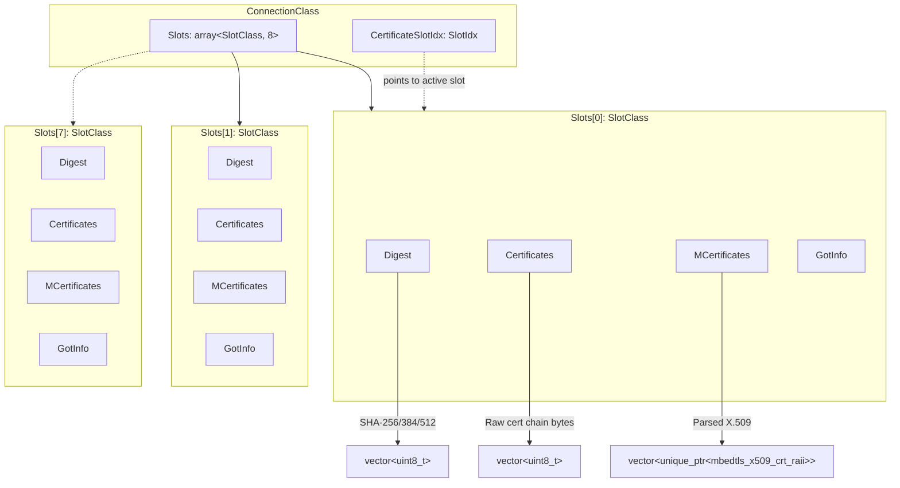
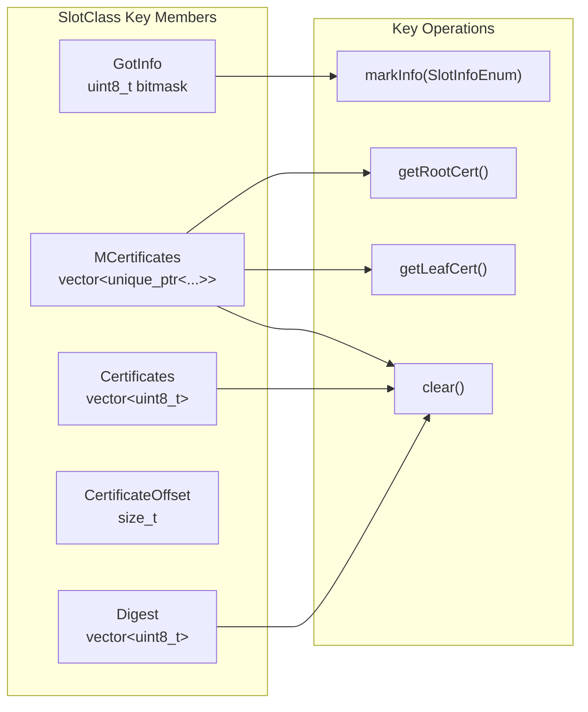
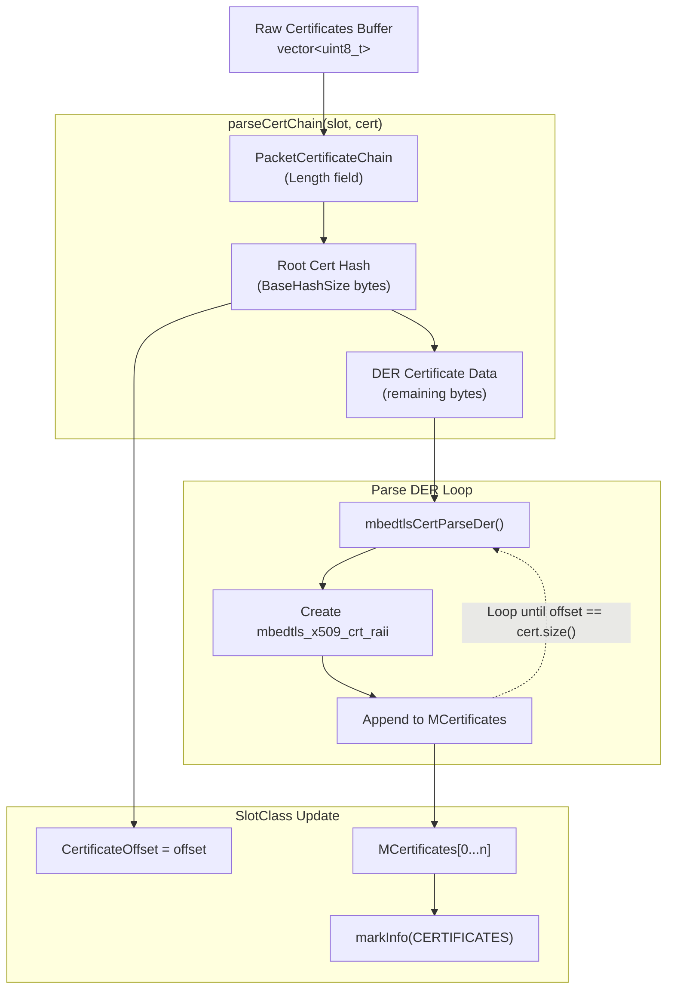
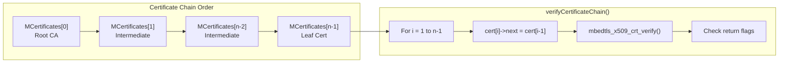
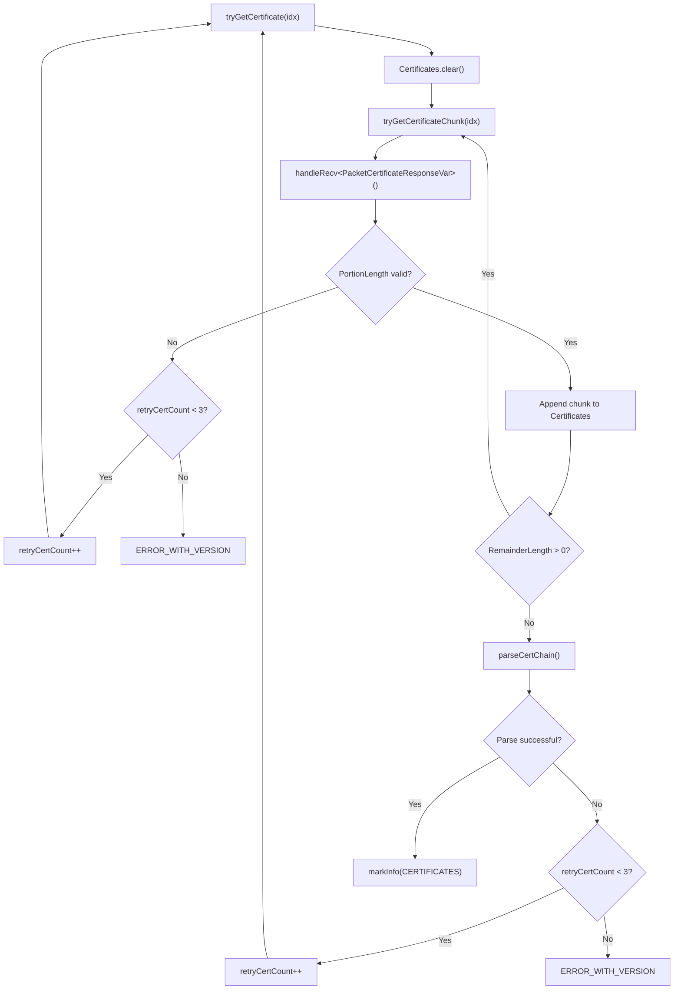
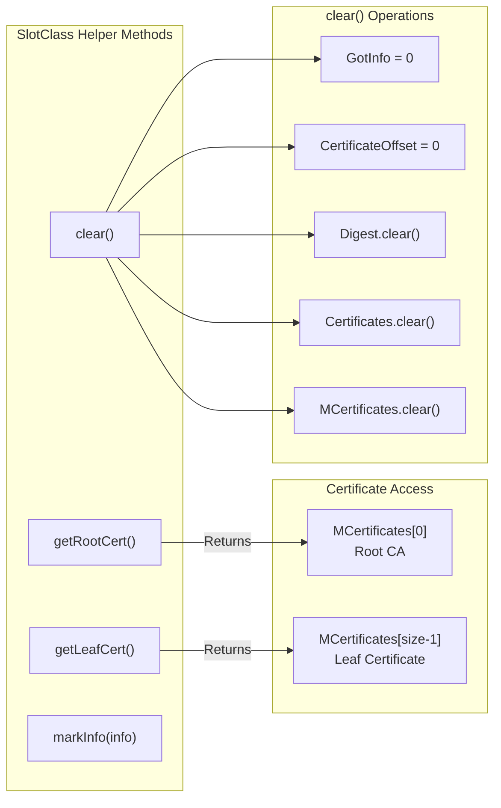
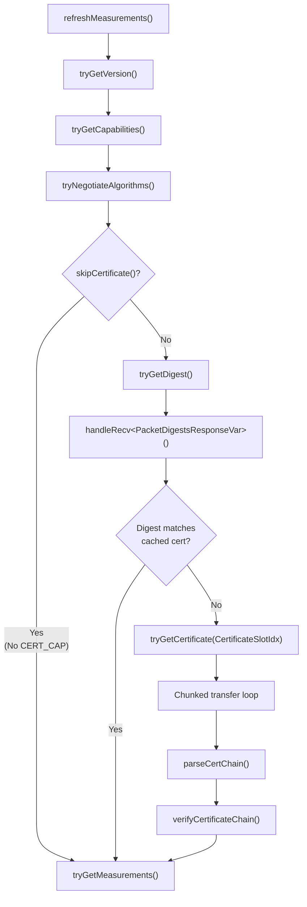

<!-- source: DeepWiki mcp.deepwiki.com · repo NVIDIA/spdm · extra page Certificate Management and Slots · fetched 2026-10-26 -->

# Certificate Management and Slots

<details>
<summary>Relevant source files</summary>

The following files were used as context for generating this wiki page:

- [libspdmcpp/connection.cpp](libspdmcpp/connection.cpp)
- [libspdmcpp/headers_public/spdmcpp/connection.hpp](libspdmcpp/headers_public/spdmcpp/connection.hpp)
- [libspdmcpp/headers_public/spdmcpp/connection_inl.hpp](libspdmcpp/headers_public/spdmcpp/connection_inl.hpp)
- [libspdmcpp/tests/connection_test.cpp](libspdmcpp/tests/connection_test.cpp)

</details>


## Purpose and Scope

This page documents the certificate slot management system within `ConnectionClass`, which implements the SPDM specification's 8-slot certificate architecture. It covers how certificates are stored, retrieved from responders, cached via digest comparison, and parsed into usable formats.

For information about the overall SPDM protocol flow that uses these certificates, see [SPDM Protocol Phases](#2.1.1). For details on buffer management used during certificate-based signature verification, see [Buffer Management and Transcript Hashing](#2.1.3).

---

## Slot Architecture Overview

The SPDM specification defines up to 8 certificate slots per responder device. Each slot can hold a complete certificate chain (root CA → intermediate(s) → leaf certificate). The `ConnectionClass` maintains an array of `SlotClass` instances to manage these slots.



**Diagram: Slot Array Structure in ConnectionClass**

Sources: [libspdmcpp/headers_public/spdmcpp/connection.hpp:155](), [libspdmcpp/headers_public/spdmcpp/connection.hpp:682](), [libspdmcpp/headers_public/spdmcpp/connection.hpp:493-571]()

---

## SlotClass Structure

Each `SlotClass` instance maintains certificate data in three parallel representations plus metadata:

| Member | Type | Purpose |
|--------|------|---------|
| `Digest` | `std::vector<uint8_t>` | SPDM digest of the entire certificate chain |
| `Certificates` | `std::vector<uint8_t>` | Raw certificate_chain bytes as received from responder |
| `MCertificates` | `std::vector<std::unique_ptr<mbedtls_x509_crt_raii>>` | Parsed X.509 certificates (root → intermediate(s) → leaf) |
| `CertificateOffset` | `size_t` | Offset into `Certificates` where DER data starts |
| `GotInfo` | `uint8_t` | Bitmask tracking which `SlotInfoEnum` flags are available |



**Diagram: SlotClass Member Variables and Operations**

The `GotInfo` bitmask tracks whether the slot has valid data:
- `SlotInfoEnum::DIGEST` - Digest has been retrieved
- `SlotInfoEnum::CERTIFICATES` - Certificate chain has been retrieved and parsed

Sources: [libspdmcpp/headers_public/spdmcpp/connection.hpp:493-571]()

---

## Certificate Retrieval Flow

Certificate retrieval follows a multi-phase protocol orchestrated by `ConnectionClass`. The process involves digest retrieval, optional caching, and chunked certificate transfer.

```mermaid
sequenceDiagram
    participant Conn as ConnectionClass
    participant Resp as SPDM Responder
    participant Slot as Slots[slotIdx]
    
    Note over Conn: After algorithm negotiation
    
    Conn->>Conn: tryGetDigest()
    Conn->>Resp: GET_DIGESTS
    Resp->>Conn: DIGESTS (all 8 slots)
    Conn->>Conn: handleRecv&lt;PacketDigestsResponseVar&gt;()
    
    loop For each slot bit set in Param2
        Conn->>Slot: Compare resp.Digests[i] with Slot.Digest
        alt Digest matches AND slot has CERTIFICATES
            Note over Conn: skipCert = true (reuse cached)
        else Digest differs OR no cached cert
            Conn->>Slot: Update Slot.Digest
            Conn->>Slot: markInfo(SlotInfoEnum::DIGEST)
        end
    end
    
    alt skipCert == false
        Conn->>Conn: tryGetCertificate(CertificateSlotIdx)
        Conn->>Slot: Certificates.clear()
        Conn->>Conn: tryGetCertificateChunk(slotIdx)
        
        loop While RemainderLength > 0
            Conn->>Resp: GET_CERTIFICATE(offset, length)
            Resp->>Conn: CERTIFICATE(PortionLength, RemainderLength)
            Conn->>Conn: handleRecv&lt;PacketCertificateResponseVar&gt;()
            Conn->>Slot: Append chunk to Certificates
            
            alt RemainderLength > 0
                Conn->>Conn: tryGetCertificateChunk(slotIdx)
            end
        end
        
        Conn->>Conn: parseCertChain(slot, cert)
        Conn->>Slot: Parse PacketCertificateChain
        Conn->>Slot: Extract root cert hash
        Conn->>Slot: Parse DER certificates into MCertificates
        Conn->>Slot: markInfo(SlotInfoEnum::CERTIFICATES)
    end
```

**Diagram: Certificate Retrieval Sequence with Digest Caching**

### Phase 1: Digest Retrieval

The `tryGetDigest()` function sends a `GET_DIGESTS` request to retrieve SHA-256/384/512 digests for all populated certificate slots.

**Function:** `tryGetDigest()`
- Sends: `PacketGetDigestsRequest`
- Expects: `PacketDigestsResponseVar`
- Buffer: Appends to `BufEnum::B`

Sources: [libspdmcpp/connection.cpp:660-673]()

### Phase 2: Digest Comparison and Caching

In `handleRecv<PacketDigestsResponseVar>()`, the received digests are compared with cached values:

**Caching Logic:**
```
For each slot i where (Param2 & (1 << i)):
    if (i == CertificateSlotIdx AND 
        slotHasInfo(i, DIGEST) AND 
        slotHasInfo(i, CERTIFICATES) AND
        resp.Digests[i] == Slots[i].Digest)
    {
        skipCert = true;  // Reuse cached certificate
    }
```

Sources: [libspdmcpp/connection.cpp:686-709]()

### Phase 3: Chunked Certificate Transfer

If caching is not possible, `tryGetCertificate()` initiates certificate retrieval. Large certificate chains are transferred in multiple chunks due to packet size limitations.

**Chunking Implementation:**
1. First chunk request sets `Offset = 0`, `Length = 0xFFFF`
2. Response contains `PortionLength` (bytes in this chunk) and `RemainderLength` (bytes remaining)
3. Subsequent chunks increment offset by accumulated size
4. Loop continues while `RemainderLength > 0`

Sources: [libspdmcpp/connection.cpp:727-753](), [libspdmcpp/connection.cpp:754-858]()

---

## Certificate Chain Parsing

After all chunks are received, `parseCertChain()` decodes the certificate_chain structure and parses individual X.509 certificates.



**Diagram: Certificate Chain Parsing Pipeline**

### Certificate Chain Structure

The certificate_chain format (per DSP0274 spec pages 54-55):

| Field | Size | Description |
|-------|------|-------------|
| Length | 2 bytes | Total length of certificate_chain |
| Reserved | 2 bytes | Must be 0 |
| RootHash | BaseHashSize | SHA-256/384/512 of root certificate |
| Certificates | Variable | Concatenated DER-encoded X.509 certificates |

**Parsing Implementation:**

```
parseCertChain(SlotClass& slot, const vector<uint8_t>& cert):
    1. Decode PacketCertificateChain header
    2. Validate Length == cert.size()
    3. Extract RootHash (size determined by BaseHashAlgo)
    4. Store offset where DER data begins
    5. Loop: Parse each DER certificate until all bytes consumed
    6. Store parsed certificates in slot.MCertificates
```

Sources: [libspdmcpp/connection.cpp:264-319]()

---

## Certificate Chain Verification

While not currently enabled by default, the `verifyCertificateChain()` function verifies the certificate chain's cryptographic validity.



**Diagram: Certificate Chain Verification Process**

The verification links each certificate to its parent and validates signatures:

```
For i = 1 to MCertificates.size():
    MCertificates[i]->next = MCertificates[i-1]
    mbedtls_x509_crt_verify(MCertificates[i-1], MCertificates[i], ...)
    if (ret != 0): return ERROR_CERTIFICATE_CHAIN_VERIFY_FAILED
```

Sources: [libspdmcpp/connection.cpp:321-352]()

---

## Certificate Access Methods

`ConnectionClass` provides methods to retrieve certificates in different formats:

### getCertificatesDER()

Returns the raw DER-encoded certificate chain for a given slot.

**Signature:** `bool getCertificatesDER(std::vector<uint8_t>& buf, SlotIdx slotidx)`

**Behavior:**
- Checks `slotHasInfo(slotidx, SlotInfoEnum::CERTIFICATES)`
- Validates `CertificateOffset` is valid
- Copies bytes from `Certificates[CertificateOffset]` onward
- Returns `false` if certificate data is unavailable

Sources: [libspdmcpp/connection.cpp:199-223]()

### getCertificatesPEM()

Converts the parsed certificate chain to PEM format suitable for display or storage.

**Signature:** `bool getCertificatesPEM(std::string& str, SlotIdx slotidx)`

**Implementation:**
```
For each cert in reverse(MCertificates):  // Leaf first, then intermediates, then root
    Allocate 4096-byte buffer
    Call mbedtls_pem_write_buffer() to convert DER → PEM
    Append PEM text to output string
```

The reverse iteration ensures the leaf certificate appears first in the PEM output, which is conventional for certificate chain presentation.

Sources: [libspdmcpp/connection.cpp:225-262]()

---

## Retry and Error Handling

Certificate retrieval includes retry logic to handle transient failures:



**Diagram: Certificate Retrieval Retry Logic**

**Retry Scenarios:**
1. Invalid chunk size detected → retry up to 3 times
2. Certificate parsing failure → retry up to 3 times
3. After max retries → return error with version reset

Sources: [libspdmcpp/connection.cpp:754-858](), [libspdmcpp/connection.cpp:860-876]()

---

## Slot Helper Methods

`SlotClass` provides convenience methods for accessing specific certificates:



**Diagram: SlotClass Helper Methods**

### getRootCert()

Returns the first certificate in the chain (root CA).

**Implementation:** `return MCertificates.empty() ? nullptr : *MCertificates[0]`

Sources: [libspdmcpp/headers_public/spdmcpp/connection.hpp:533-541]()

### getLeafCert()

Returns the last certificate in the chain (responder's leaf certificate). This is used during signature verification.

**Implementation:** `return MCertificates.empty() ? nullptr : *MCertificates[size - 1]`

Sources: [libspdmcpp/headers_public/spdmcpp/connection.hpp:545-553]()

### clear()

Resets all slot data, called when a slot is invalidated or during connection reset.

Sources: [libspdmcpp/headers_public/spdmcpp/connection.hpp:557-565]()

---

## Integration with Protocol Flow

Certificate retrieval is triggered during the `refreshMeasurements()` flow after algorithm negotiation:



**Diagram: Certificate Retrieval in refreshMeasurements Flow**

**Key Decision Points:**

1. **skipCertificate()** - Checks if responder has `CERT_CAP` capability
2. **Digest comparison** - Determines if cached certificate can be reused
3. **Certificate retrieval** - Only fetches if digest differs or no cache exists

The retrieved certificate's leaf certificate is later used to verify measurement signatures.

Sources: [libspdmcpp/connection.cpp:648-658](), [libspdmcpp/connection.cpp:686-724]()

---

## Summary

The certificate slot management system provides:

| Feature | Implementation |
|---------|----------------|
| **Slot capacity** | 8 slots per responder (`slotNum = 8`) |
| **Storage formats** | Raw bytes, parsed X.509, DER/PEM export |
| **Digest caching** | Avoids re-fetching unchanged certificates |
| **Chunked transfer** | Handles large certificate chains via multiple packets |
| **Retry logic** | Up to 3 retries for parsing/transfer errors |
| **Verification** | Optional cryptographic chain validation |
| **Access methods** | `getCertificatesDER()`, `getCertificatesPEM()`, `getRootCert()`, `getLeafCert()` |

The slot system enables efficient certificate management while adhering to SPDM specification requirements for multi-slot responders.

Sources: [libspdmcpp/headers_public/spdmcpp/connection.hpp:143-904](), [libspdmcpp/connection.cpp:1-1400]()

---

