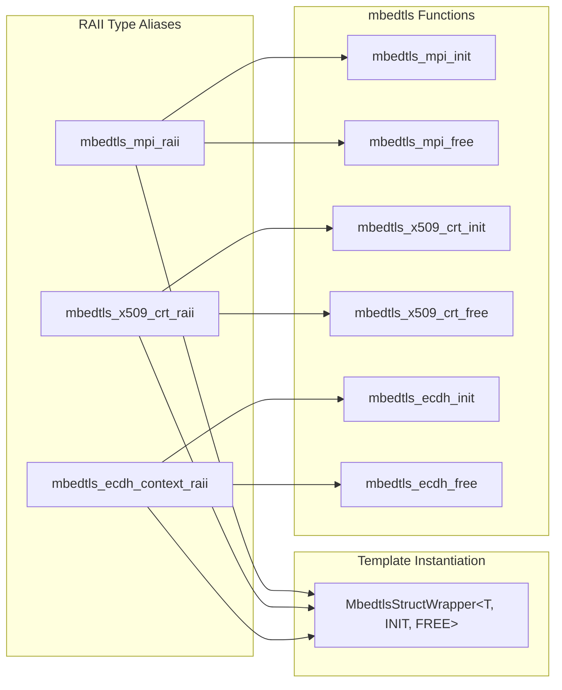
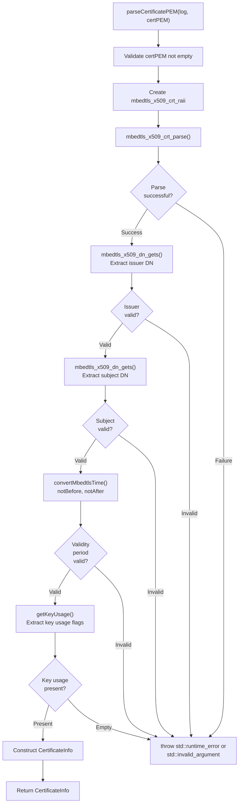
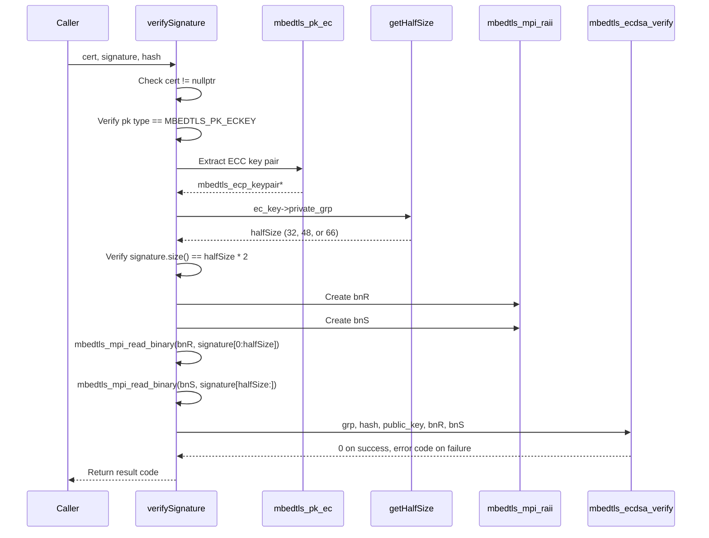

<!-- source: DeepWiki mcp.deepwiki.com · repo NVIDIA/spdm · extra page Certificate Parsing and Verification · fetched 2026-10-26 -->

# Certificate Parsing and Verification

Relevant source files

The following files were used as context for generating this wiki page:

- [libspdmcpp/headers_public/spdmcpp/hash.hpp](libspdmcpp/headers_public/spdmcpp/hash.hpp)
- [libspdmcpp/headers_public/spdmcpp/mbedtls_support.hpp](libspdmcpp/headers_public/spdmcpp/mbedtls_support.hpp)

## Purpose and Scope

This page documents the X.509 certificate parsing and ECDSA signature verification capabilities provided by the libspdmcpp library. The implementation uses mbedtls as the underlying cryptographic library and provides RAII-safe wrappers, PEM/DER format conversion, and certificate chain validation.

For cryptographic hashing operations, see [Hashing](#2.4.1). For the broader context of how certificates are retrieved and stored during the SPDM protocol flow, see [Certificate Management and Slots](#2.1.2).

---

## mbedtls Integration Architecture

The certificate parsing and verification system wraps mbedtls C APIs with C++ RAII patterns to ensure proper resource cleanup. All mbedtls operations are exposed through inline utility functions in the `spdmcpp` namespace.

```mermaid
graph TB
    subgraph "High-Level API"
        parseCertificatePEM["parseCertificatePEM()<br/>Parse PEM certificate"]
        verifySignature["verifySignature()<br/>Verify ECDSA signature"]
        mbedtlsCertParseDer["mbedtlsCertParseDer()<br/>Parse DER certificate"]
    end
    
    subgraph "RAII Wrappers"
        mbedtls_x509_crt_raii["mbedtls_x509_crt_raii<br/>Certificate chain wrapper"]
        mbedtls_mpi_raii["mbedtls_mpi_raii<br/>Big integer wrapper"]
        mbedtls_ecdh_context_raii["mbedtls_ecdh_context_raii<br/>ECDH context wrapper"]
        MbedtlsStructWrapper["MbedtlsStructWrapper&lt;T, INIT, FREE&gt;<br/>Generic RAII template"]
    end
    
    subgraph "Utility Functions"
        mbedtlsPrintErrorString["mbedtlsPrintErrorString()<br/>Error logging"]
        mbedtlsToInfoString["mbedtlsToInfoString()<br/>Certificate info string"]
        convertMbedtlsTime["convertMbedtlsTime()<br/>Time conversion"]
        getKeyUsage["getKeyUsage()<br/>Extract key usage flags"]
        toMbedtlsGroupID["toMbedtlsGroupID()<br/>Map SignatureEnum to ECP group"]
        getHalfSize["getHalfSize()<br/>Get signature component size"]
    end
    
    subgraph "mbedtls C Library"
        mbedtls_x509_crt_parse["mbedtls_x509_crt_parse()<br/>Parse certificate"]
        mbedtls_x509_crt_parse_der["mbedtls_x509_crt_parse_der()<br/>Parse DER"]
        mbedtls_ecdsa_verify["mbedtls_ecdsa_verify()<br/>Verify signature"]
        mbedtls_x509_dn_gets["mbedtls_x509_dn_gets()<br/>Get DN string"]
        mbedtls_x509_crt_check_key_usage["mbedtls_x509_crt_check_key_usage()<br/>Check usage"]
    end
    
    subgraph "Data Structures"
        CertificateInfo["CertificateInfo struct<br/>Parsed certificate metadata"]
        mbedtls_x509_crt["mbedtls_x509_crt<br/>Certificate structure"]
        mbedtls_ecp_keypair["mbedtls_ecp_keypair<br/>ECC key pair"]
    end
    
    parseCertificatePEM --> mbedtls_x509_crt_raii
    parseCertificatePEM --> getKeyUsage
    parseCertificatePEM --> convertMbedtlsTime
    parseCertificatePEM --> CertificateInfo
    
    verifySignature --> mbedtls_mpi_raii
    verifySignature --> getHalfSize
    
    mbedtlsCertParseDer --> mbedtls_x509_crt_raii
    
    mbedtls_x509_crt_raii --> MbedtlsStructWrapper
    mbedtls_mpi_raii --> MbedtlsStructWrapper
    mbedtls_ecdh_context_raii --> MbedtlsStructWrapper
    
    mbedtls_x509_crt_raii --> mbedtls_x509_crt
    
    parseCertificatePEM --> mbedtls_x509_crt_parse
    mbedtlsCertParseDer --> mbedtls_x509_crt_parse_der
    verifySignature --> mbedtls_ecdsa_verify
    parseCertificatePEM --> mbedtls_x509_dn_gets
    getKeyUsage --> mbedtls_x509_crt_check_key_usage
    
    verifySignature --> mbedtls_ecp_keypair
```

**Sources:** [libspdmcpp/headers_public/spdmcpp/mbedtls_support.hpp:42-462]()

---

## RAII Wrapper Pattern

The library uses a generic template `MbedtlsStructWrapper` to provide automatic resource management for mbedtls C structures. This ensures that initialization and cleanup functions are called correctly without manual memory management.

### MbedtlsStructWrapper Template

| Component | Description |
|-----------|-------------|
| Template Parameters | `T` (struct type), `INIT` (init function), `FREE` (free function) |
| Constructor | Calls `INIT(&obj)` to initialize the mbedtls structure |
| Destructor | Calls `FREE(&obj)` to clean up resources |
| Copy/Move | Deleted to prevent resource double-free issues |
| Access | Provides `get()`, `operator T*()`, `operator T&()`, `operator->()` |

**Sources:** [libspdmcpp/headers_public/spdmcpp/mbedtls_support.hpp:144-190]()

---

## Certificate Parsing

The library supports parsing certificates in both DER (binary) and PEM (ASCII-armored) formats.

### DER Format Parsing

The `mbedtlsCertParseDer()` function parses a DER-encoded certificate from a buffer and automatically advances the offset to point past the parsed certificate.

| Parameter | Type | Description |
|-----------|------|-------------|
| `buf` | `const std::vector<uint8_t>&` | Buffer containing DER-encoded certificate(s) |
| `off` | `size_t&` | Offset to start parsing (updated after parsing) |
| **Return** | `std::pair<int, std::unique_ptr<mbedtls_x509_crt_raii>>` | mbedtls result code and certificate (or nullptr on error) |

The function uses ASN.1 parsing to determine the exact certificate length and updates the offset accordingly.

**Sources:** [libspdmcpp/headers_public/spdmcpp/mbedtls_support.hpp:267-290]()

### PEM Format Parsing with Metadata Extraction

The `parseCertificatePEM()` function is the primary high-level interface for parsing PEM certificates. It extracts comprehensive metadata and validates the certificate structure.

**Sources:** [libspdmcpp/headers_public/spdmcpp/mbedtls_support.hpp:387-460]()

### CertificateInfo Structure

The parsed certificate data is returned in a `CertificateInfo` struct:

| Field | Type | Description |
|-------|------|-------------|
| `certificate` | `std::string` | The original PEM certificate string |
| `issuer` | `std::string` | Issuer Distinguished Name (DN) |
| `subject` | `std::string` | Subject Distinguished Name (DN) |
| `notBefore` | `uint64_t` | Validity start time (milliseconds since epoch) |
| `notAfter` | `uint64_t` | Validity end time (milliseconds since epoch) |
| `keyUsage` | `std::vector<std::string>` | List of key usage flags |

**Sources:** [libspdmcpp/headers_public/spdmcpp/mbedtls_support.hpp:369-378]()

---

## ECDSA Signature Verification

The `verifySignature()` function verifies an ECDSA signature over a hash using the public key from an X.509 certificate. SPDM uses ECDSA signatures to authenticate measurements and other protocol messages.

### Signature Format

SPDM ECDSA signatures use a concatenated R||S format (raw format), where each component is a fixed-size big-endian integer. This differs from the DER-encoded format used in some other protocols.

| ECC Curve | Half Size (R or S) | Total Signature Size |
|-----------|-------------------|---------------------|
| NIST P-256 (secp256r1) | 32 bytes | 64 bytes |
| NIST P-384 (secp384r1) | 48 bytes | 96 bytes |
| NIST P-521 / BP512R1 | 66 bytes | 132 bytes |

### Verification Process

**Sources:** [libspdmcpp/headers_public/spdmcpp/mbedtls_support.hpp:192-255]()

### ECC Group Mapping

The `toMbedtlsGroupID()` function maps SPDM signature algorithm enumerations to mbedtls ECC group identifiers:

| SPDM SignatureEnum | mbedtls Group | Curve |
|-------------------|---------------|-------|
| `TPM_ALG_ECDSA_ECC_NIST_P256` | `MBEDTLS_ECP_DP_SECP256R1` | NIST P-256 |
| `TPM_ALG_ECDSA_ECC_NIST_P384` | `MBEDTLS_ECP_DP_SECP384R1` | NIST P-384 |
| `TPM_ALG_ECDSA_ECC_NIST_P521` | `MBEDTLS_ECP_DP_BP512R1` | Brainpool P-512 |

**Sources:** [libspdmcpp/headers_public/spdmcpp/mbedtls_support.hpp:90-105]()

---

## Certificate Information Extraction

### Time Conversion

X.509 certificates store validity periods as calendar date/time values. The `convertMbedtlsTime()` function converts mbedtls time structures to Unix timestamps (milliseconds since epoch).

| mbedtls Field | std::tm Field | Conversion |
|--------------|---------------|------------|
| `year` (full year, e.g., 2024) | `tm_year` (years since 1900) | `t.year - 1900` |
| `mon` (1-12) | `tm_mon` (0-11) | `t.mon - 1` |
| `day`, `hour`, `min`, `sec` | `tm_mday`, `tm_hour`, `tm_min`, `tm_sec` | Direct copy |

The function uses `timegm()` to perform the conversion to UTC time, then multiplies by 1000 to get milliseconds.

**Sources:** [libspdmcpp/headers_public/spdmcpp/mbedtls_support.hpp:301-317]()

### Key Usage Extraction

The `getKeyUsage()` function extracts human-readable key usage flags from the certificate. These flags indicate what cryptographic operations the certificate is authorized for.

```mermaid
graph TB
    subgraph "X.509 Key Usage Flags"
        DIGITAL_SIG["MBEDTLS_X509_KU_DIGITAL_SIGNATURE<br/>0x80"]
        NON_REP["MBEDTLS_X509_KU_NON_REPUDIATION<br/>0x40"]
        KEY_ENC["MBEDTLS_X509_KU_KEY_ENCIPHERMENT<br/>0x20"]
        DATA_ENC["MBEDTLS_X509_KU_DATA_ENCIPHERMENT<br/>0x10"]
        KEY_CERT_SIGN["MBEDTLS_X509_KU_KEY_CERT_SIGN<br/>0x04"]
        CRL_SIGN["MBEDTLS_X509_KU_CRL_SIGN<br/>0x02"]
        ENCIPHER_ONLY["MBEDTLS_X509_KU_ENCIPHER_ONLY<br/>0x01"]
        DECIPHER_ONLY["MBEDTLS_X509_KU_DECIPHER_ONLY<br/>0x8000"]
    end
    
    subgraph "String Representation"
        DigitalSignature["DigitalSignature"]
        NonRepudiation["NonRepudiation"]
        KeyEncipherment["KeyEncipherment"]
        DataEncipherment["DataEncipherment"]
        KeyCertSign["KeyCertSign"]
        CRLSigning["CRLSigning"]
        EncipherOnly["EncipherOnly"]
        DecipherOnly["DecipherOnly"]
    end
    
    DIGITAL_SIG --> DigitalSignature
    NON_REP --> NonRepudiation
    KEY_ENC --> KeyEncipherment
    DATA_ENC --> DataEncipherment
    KEY_CERT_SIGN --> KeyCertSign
    CRL_SIGN --> CRLSigning
    ENCIPHER_ONLY --> EncipherOnly
    DECIPHER_ONLY --> DecipherOnly
```

**Sources:** [libspdmcpp/headers_public/spdmcpp/mbedtls_support.hpp:335-367]()

---

## Error Handling

### Error Logging Utilities

The library provides utilities for logging mbedtls errors in a human-readable format:

| Function | Purpose |
|----------|---------|
| `mbedtlsPrintErrorString(log, error)` | Prints just the error message string |
| `mbedtlsPrintErrorLine(log, prefix, error)` | Prints prefix, error code, and error message |
| `mbedtlsToInfoString(cert)` | Converts certificate to multi-line info string |

These functions use `mbedtls_strerror()` to convert numeric error codes to descriptive strings.

**Sources:** [libspdmcpp/headers_public/spdmcpp/mbedtls_support.hpp:45-88]()

### Exception Handling

The high-level `parseCertificatePEM()` function uses exceptions for error reporting:

- `std::invalid_argument` - Invalid input data (empty certificate, missing DN fields, invalid validity period, no key usage)
- `std::runtime_error` - mbedtls parsing or extraction failures

Lower-level functions like `verifySignature()` and `mbedtlsCertParseDer()` return integer error codes compatible with mbedtls conventions (0 = success, negative = error).

**Sources:** [libspdmcpp/headers_public/spdmcpp/mbedtls_support.hpp:387-460]()

---

## Integration with SPDM Protocol

The certificate parsing and verification functions are used throughout the SPDM protocol flow:

1. **Certificate Chain Retrieval** - `mbedtlsCertParseDer()` is used to parse individual certificates from chunked GET_CERTIFICATE responses. See [Certificate Management and Slots](#2.1.2) for details.

2. **Measurement Signature Verification** - `verifySignature()` is used to verify the signature over measurements in SPDM 1.2+ protocol. The signature covers the transcript hash of all prior protocol messages. See [SPDM Protocol Phases](#2.1.1) for the complete flow.

3. **D-Bus Certificate Exposure** - `parseCertificatePEM()` is used by the spdmd daemon to extract certificate metadata for D-Bus property exposure. See [Certificate and Measurement Data Processing](#3.2.3) for details.

The certificate verification depends on hash computation, which is documented in [Hashing](#2.4.1).

---

