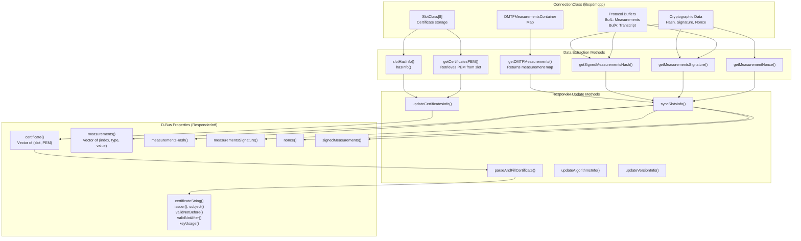
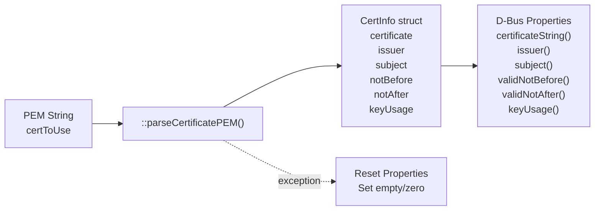
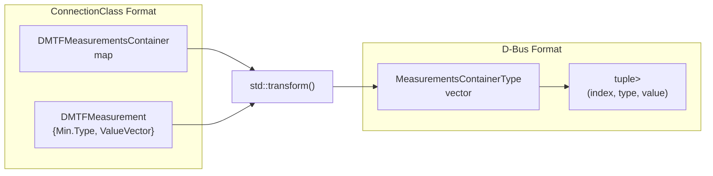
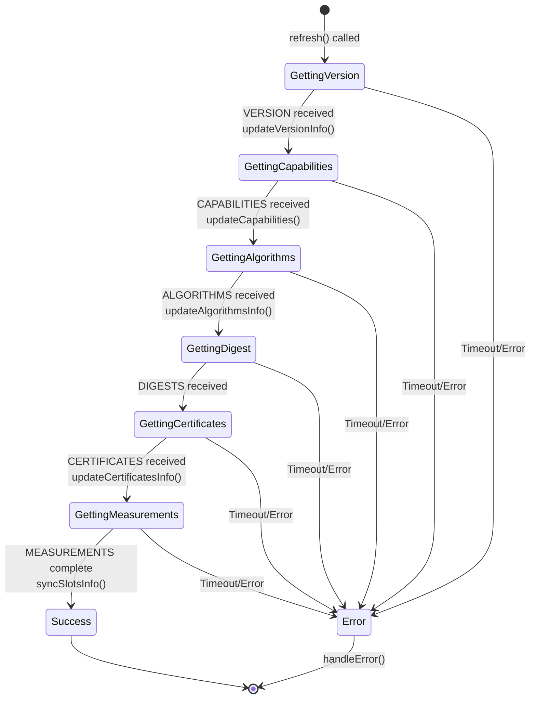

<!-- source: DeepWiki mcp.deepwiki.com · repo NVIDIA/spdm · extra page Certificate and Measurement Data Processing · fetched 2026-10-26 -->

# Certificate and Measurement Data Processing

<details>
<summary>Relevant source files</summary>

The following files were used as context for generating this wiki page:

- [spdmd/dbus_impl_responder.cpp](spdmd/dbus_impl_responder.cpp)
- [spdmd/dbus_impl_responder.hpp](spdmd/dbus_impl_responder.hpp)

</details>


## Purpose and Scope

This page documents how the `dbus_api::Responder` class transforms SPDM protocol data from the underlying `ConnectionClass` into D-Bus properties for consumption by OpenBMC services. The transformation includes certificate retrieval and PEM formatting, measurement data extraction, and metadata synchronization. 

For information about the overall D-Bus responder architecture and interfaces, see [D-Bus Responder Interface](#3.2). For details on the SPDM protocol flow that produces this data, see [ConnectionClass and Protocol Flow](#2.1).

**Sources:** [spdmd/dbus_impl_responder.cpp](), [spdmd/dbus_impl_responder.hpp]()

---

## Data Flow Architecture

The data transformation occurs after the SPDM protocol exchange completes. The `ConnectionClass` accumulates protocol responses in internal buffers and slot structures, which the `Responder` class then extracts and formats for D-Bus exposure.

**Diagram: Certificate and Measurement Data Flow**



**Sources:** [spdmd/dbus_impl_responder.cpp:220-266](), [spdmd/dbus_impl_responder.cpp:168-195]()

---

## Certificate Data Processing

### Slot Iteration and Retrieval

The SPDM specification defines up to 8 certificate slots per responder. The `Responder` iterates through all slots to find valid certificates and convert them to PEM format.

**Key Function: `updateCertificatesInfo()`**

This function [spdmd/dbus_impl_responder.cpp:168-195]() performs the following steps:

1. **Slot Enumeration**: Iterates through all 8 slots using `ConnectionClass::slotNum`
2. **Validity Check**: Uses `connection.slotHasInfo(idx, SlotInfoEnum::CERTIFICATES)` to verify slot contains valid certificate data
3. **PEM Conversion**: Calls `connection.getCertificatesPEM(cert, idx)` to retrieve certificate chain in PEM format
4. **D-Bus Storage**: Accumulates certificates in a vector of `(slotIndex, pemString)` tuples
5. **Property Update**: Sets the `certificate()` D-Bus property with the complete certificate container

| Step | ConnectionClass Method | Purpose |
|------|----------------------|---------|
| Validity Check | `slotHasInfo(idx, SlotInfoEnum::CERTIFICATES)` | Verifies slot has parsed certificate data |
| Retrieval | `getCertificatesPEM(cert, idx)` | Converts internal DER format to PEM string |
| Storage | `certificate(std::move(certs))` | Updates D-Bus property with vector of (slot, PEM) |

**Code Flow:**

```cpp
// Iterate all 8 slots
for (ConnectionClass::SlotIdx idx = 0; idx < ConnectionClass::slotNum; ++idx)
{
    if (connection.slotHasInfo(idx, SlotInfoEnum::CERTIFICATES))
    {
        std::string cert;
        if (connection.getCertificatesPEM(cert, idx))
        {
            certToUse = cert;  // Last valid cert for parsing
            certs.emplace_back(idx, std::move(cert));
        }
    }
}
certificate(std::move(certs));  // D-Bus property update
```

**Sources:** [spdmd/dbus_impl_responder.cpp:168-195]()

---

### Certificate Parsing and Metadata Extraction

After retrieving PEM-formatted certificates, the responder parses the first valid certificate to extract metadata for additional D-Bus properties.

**Key Function: `parseAndFillCertificate()`**

This function [spdmd/dbus_impl_responder.cpp:588-623]() extracts X.509 certificate metadata using mbedtls:



**Certificate Metadata Properties:**

| D-Bus Property | Source Field | Type | Description |
|----------------|--------------|------|-------------|
| `certificateString()` | `certInfo.certificate` | string | PEM-encoded certificate |
| `issuer()` | `certInfo.issuer` | string | X.509 Issuer DN |
| `subject()` | `certInfo.subject` | string | X.509 Subject DN |
| `validNotBefore()` | `certInfo.notBefore` | uint64_t | Unix timestamp (seconds) |
| `validNotAfter()` | `certInfo.notAfter` | uint64_t | Unix timestamp (seconds) |
| `keyUsage()` | `certInfo.keyUsage` | vector<string> | X.509 Key Usage extensions |

The parsing uses the `parseCertificatePEM()` helper function from libspdmcpp, which wraps mbedtls certificate parsing. On failure, all certificate properties are reset to empty/zero values to avoid stale data.

**Sources:** [spdmd/dbus_impl_responder.cpp:588-623](), [spdmd/dbus_impl_responder.cpp:194]()

---

### Verification Status

The `updateResponderVerificationStatus()` function [spdmd/dbus_impl_responder.cpp:197-218]() determines identity authentication status based on certificate availability:

```cpp
// Default to Unknown
responderVerificationStatus(VerificationStatus::Unknown);

// Check all slots for valid certificates
for (SlotIdx idx = 0; idx < slotNum; ++idx)
{
    if (connection.slotHasInfo(idx, SlotInfoEnum::CERTIFICATES))
    {
        responderVerificationStatus(VerificationStatus::Success);
        return;
    }
}

// No certificates found
responderVerificationStatus(VerificationStatus::Failed);
```

**Verification Status Values:**

| Status | Condition |
|--------|-----------|
| `Unknown` | Default state before check |
| `Success` | At least one slot contains valid certificates |
| `Failed` | No slots contain valid certificates |

**Sources:** [spdmd/dbus_impl_responder.cpp:197-218]()

---

## Measurement Data Processing

### DMTF Measurements Transformation

SPDM measurements follow the DMTF specification format. The `syncSlotsInfo()` function [spdmd/dbus_impl_responder.cpp:230-241]() transforms the internal measurement container to D-Bus format.

**Data Structure Transformation:**



**Transformation Code:**

```cpp
if (connection.hasInfo(ConnectionInfoEnum::MEASUREMENTS))
{
    const ConnectionClass::DMTFMeasurementsContainer& src =
        connection.getDMTFMeasurements();
    
    std::transform(src.begin(), src.end(), std::back_inserter(meas),
                   [](const auto& field) {
                       return MeasurementsContainerType::value_type(
                           field.first,          // Measurement index
                           field.second.Min.Type,  // Measurement type
                           field.second.ValueVector);  // Value bytes
                   });
}
measurements(std::move(meas));
```

**Measurement Tuple Fields:**

| Position | Field | Type | Description |
|----------|-------|------|-------------|
| 0 | Index | `uint8_t` | SPDM measurement index (0-254, 255=all) |
| 1 | Type | `uint8_t` | DMTF measurement type (e.g., 0x82 for hardware config) |
| 2 | Value | `vector<uint8_t>` | Raw measurement value bytes |

**Sources:** [spdmd/dbus_impl_responder.cpp:230-241]()

---

### Hash and Signature Data

SPDM 1.2+ includes signed measurements for attestation. The responder extracts the hash, signature, and combined signed buffer.

**Key Extraction Points in `syncSlotsInfo()`:**

```cpp
// Hash of signed measurements (transcript hash)
measurementsHash(connection.getSignedMeasurementsHash());

// Signed buffer (L2 + signature)
const std::vector<uint8_t>& l2 = connection.getSignedMeasurementsBuffer();
const std::vector<uint8_t>& sig = connection.getMeasurementsSignature();

// Concatenate for signedMeasurements property
std::vector<uint8_t> buf;
buf.reserve(l2.size() + sig.size());
buf.insert(buf.end(), l2.begin(), l2.end());
buf.insert(buf.end(), sig.begin(), sig.end());

signedMeasurements(std::move(buf));
measurementsSignature(sig);
```

**D-Bus Properties for Attestation:**

| Property | ConnectionClass Method | Contents |
|----------|----------------------|----------|
| `measurementsHash()` | `getSignedMeasurementsHash()` | Hash of transcript (BufA + BufL) |
| `measurementsSignature()` | `getMeasurementsSignature()` | Signature bytes from responder |
| `signedMeasurements()` | `getSignedMeasurementsBuffer()` + signature | Complete signed buffer (L2 ‖ sig) |

**Sources:** [spdmd/dbus_impl_responder.cpp:242-255]()

---

### Nonce Handling

Nonces provide replay protection for measurements. The responder extracts the 32-byte nonce used in the measurement request:

```cpp
const nonce_array_32& arr = connection.getMeasurementNonce();
std::vector<uint8_t> nonc;
nonc.reserve(arr.size());
nonc.insert(nonc.end(), arr.begin(), arr.end());
nonce(std::move(nonc));
```

The nonce is either:
- Requester-provided: Passed to `refresh()` method
- Responder-generated: If no nonce specified in refresh call

**Sources:** [spdmd/dbus_impl_responder.cpp:258-263]()

---

## Protocol Metadata Processing

### Version Information

**Function: `updateVersionInfo()`** [spdmd/dbus_impl_responder.cpp:110-115]()

Converts SPDM protocol version from internal enum to D-Bus properties:

```cpp
version(static_cast<uint8_t>(connection.getMessageVersion()));
typeVersion(getVersionStr(static_cast<uint8_t>(connection.getMessageVersion())));
```

**Version Mapping:**

| Raw Value | `version()` | `typeVersion()` | SPDM Spec |
|-----------|-------------|-----------------|-----------|
| 0x10 | 16 | "1.0.0" | SPDM 1.0 |
| 0x11 | 17 | "1.1.0" | SPDM 1.1 |
| 0x12 | 18 | "1.2.0" | SPDM 1.2 |

**Sources:** [spdmd/dbus_impl_responder.cpp:110-115](), [spdmd/dbus_impl_responder.cpp:39-52]()

---

### Capabilities

**Function: `updateCapabilities()`** [spdmd/dbus_impl_responder.cpp:117-122]()

Extracts responder capability flags as a bitmask:

```cpp
capabilities(
    static_cast<std::underlying_type_t<ResponderCapabilitiesFlags>>(
        connection.getCapabilitiesFlags()));
```

The capabilities bitmask indicates supported operations (e.g., CERT_CAP, MEAS_CAP, CHAL_CAP).

**Sources:** [spdmd/dbus_impl_responder.cpp:117-122]()

---

### Algorithm Information

**Function: `updateAlgorithmsInfo()`** [spdmd/dbus_impl_responder.cpp:124-166]()

Maps negotiated cryptographic algorithms to D-Bus enum values:

**Hash Algorithm Mapping:**

| `HashEnum` | D-Bus `HashingAlgorithms` |
|------------|---------------------------|
| `TPM_ALG_SHA_256` | `TPM_ALG_SHA_256` |
| `TPM_ALG_SHA_384` | `TPM_ALG_SHA_384` |
| `TPM_ALG_SHA_512` | `TPM_ALG_SHA_512` |
| `NONE`/`INVALID` | `None` |

**Signature Algorithm Mapping:**

The function uses a macro to map 9 signature types (RSA-2048/3072/4096 with SSA/PSS, ECDSA P-256/384/521):

```cpp
#define DTYPE(name)                                                            
    case SignatureEnum::name:                                                  
        signingAlgorithm(SigningAlgorithms::name);                             
        break;
DTYPE(TPM_ALG_RSASSA_2048)
DTYPE(TPM_ALG_RSAPSS_2048)
// ... etc
```

**Sources:** [spdmd/dbus_impl_responder.cpp:124-166]()

---

## Update Coordination

The `handleEventForRefresh()` function [spdmd/dbus_impl_responder.cpp:330-384]() orchestrates the data transformation process as SPDM protocol phases complete.

**Diagram: Progressive Property Updates**



**Update Sequence:**

The function checks connection state in **reverse protocol order** to determine which properties to update:

1. **Protocol Complete** (`!isWaitingForResponse()`): Call `syncSlotsInfo()` to update all measurements and related properties
2. **Certificates Available** (`slotHasInfo(CERTIFICATES)`): Update certificate properties
3. **Digests Available** (`hasInfo(DIGESTS)`): No property update, transition to certificate phase
4. **Algorithms Negotiated** (`hasInfo(ALGORITHMS)`): Update algorithm properties
5. **Capabilities Received** (`hasInfo(CAPABILITIES)`): Update capability properties
6. **Version Negotiated** (`hasInfo(CHOOSEN_VERSION)`): Update version properties

**Key Code Section:**

```cpp
if (!connection.isWaitingForResponse())
{
    syncSlotsInfo();  // Complete: update all measurements
    updateLastUpdateTime();
    status(SPDMStatus::Success);
}
else if (connection.slotHasInfo(slotidx, SlotInfoEnum::CERTIFICATES))
{
    updateCertificatesInfo();  // Partial: certificates ready
    status(SPDMStatus::GettingMeasurements);
}
else if (connection.hasInfo(ConnectionInfoEnum::DIGESTS))
{
    status(SPDMStatus::GettingCertificates);
}
// ... etc for each protocol phase
```

**Sources:** [spdmd/dbus_impl_responder.cpp:330-384]()

---

## Complete Data Transformation Summary

**Table: ConnectionClass to D-Bus Property Mapping**

| D-Bus Property | Update Function | ConnectionClass Source | Data Type |
|----------------|-----------------|------------------------|-----------|
| `version()` | `updateVersionInfo()` | `getMessageVersion()` | uint8_t |
| `typeVersion()` | `updateVersionInfo()` | `getMessageVersion()` | string |
| `capabilities()` | `updateCapabilities()` | `getCapabilitiesFlags()` | uint32_t |
| `hashingAlgorithm()` | `updateAlgorithmsInfo()` | `getMeasurementHashEnum()` | enum |
| `signingAlgorithm()` | `updateAlgorithmsInfo()` | `getSignatureEnum()` | enum |
| `certificate()` | `updateCertificatesInfo()` | `getCertificatesPEM()` | vector<tuple> |
| `certificateString()` | `parseAndFillCertificate()` | PEM parsing | string |
| `issuer()` | `parseAndFillCertificate()` | PEM parsing | string |
| `subject()` | `parseAndFillCertificate()` | PEM parsing | string |
| `validNotBefore()` | `parseAndFillCertificate()` | PEM parsing | uint64_t |
| `validNotAfter()` | `parseAndFillCertificate()` | PEM parsing | uint64_t |
| `keyUsage()` | `parseAndFillCertificate()` | PEM parsing | vector<string> |
| `measurements()` | `syncSlotsInfo()` | `getDMTFMeasurements()` | vector<tuple> |
| `measurementsHash()` | `syncSlotsInfo()` | `getSignedMeasurementsHash()` | vector<uint8_t> |
| `measurementsSignature()` | `syncSlotsInfo()` | `getMeasurementsSignature()` | vector<uint8_t> |
| `signedMeasurements()` | `syncSlotsInfo()` | buffer + signature concat | vector<uint8_t> |
| `nonce()` | `syncSlotsInfo()` | `getMeasurementNonce()` | vector<uint8_t> |
| `responderVerificationStatus()` | `updateResponderVerificationStatus()` | `slotHasInfo()` | enum |
| `status()` | `handleEventForRefresh()` | Protocol state | enum |
| `lastUpdate()` | `updateLastUpdateTime()` | `system_clock::now()` | uint64_t |

**Sources:** [spdmd/dbus_impl_responder.cpp:110-266](), [spdmd/dbus_impl_responder.cpp:330-384](), [spdmd/dbus_impl_responder.cpp:588-623]()

---

