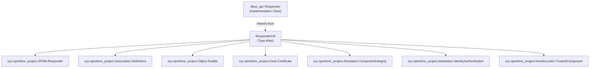
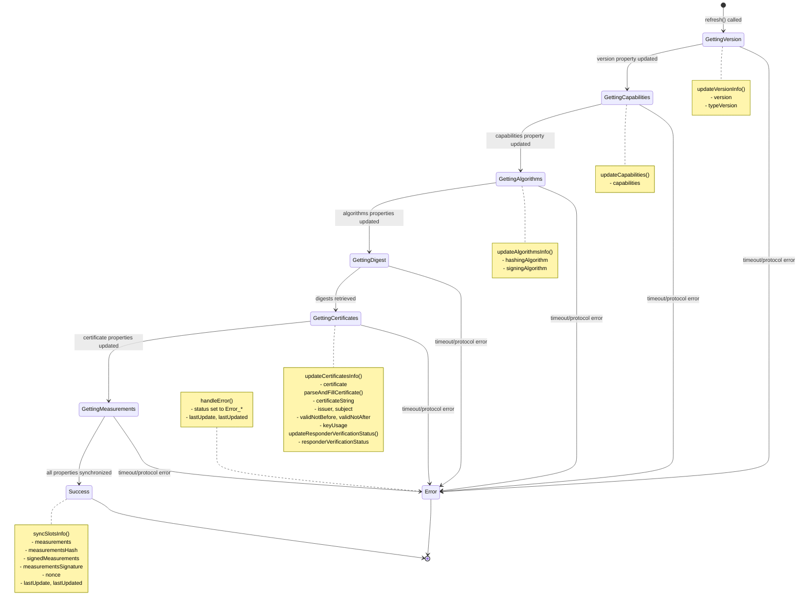
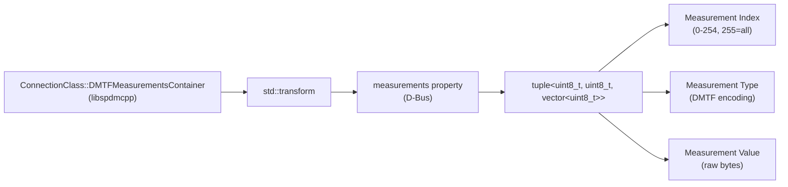
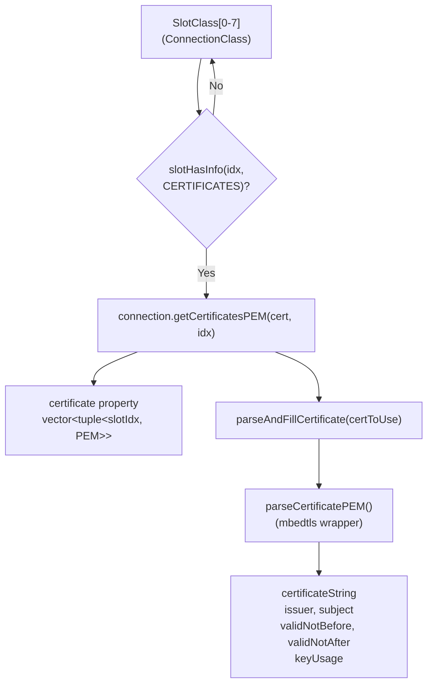

<!-- source: DeepWiki mcp.deepwiki.com · repo NVIDIA/spdm · extra page D-Bus Interfaces and Properties · fetched 2026-10-26 -->

# D-Bus Interfaces and Properties

<details>
<summary>Relevant source files</summary>

The following files were used as context for generating this wiki page:

- [spdmd/dbus_impl_responder.cpp](spdmd/dbus_impl_responder.cpp)
- [spdmd/dbus_impl_responder.hpp](spdmd/dbus_impl_responder.hpp)

</details>


This page documents the D-Bus interfaces implemented by the `dbus_api::Responder` class and the properties exposed on each interface. The `Responder` class serves as the primary D-Bus-accessible representation of an SPDM-capable device, exposing SPDM protocol state, cryptographic information, attestation data, and certificate details through standard OpenBMC D-Bus interfaces.

For information about the overall D-Bus responder architecture and lifecycle management, see [D-Bus Responder Interface](#3.2). For details on the refresh mechanism and event handling flow, see [Refresh Method and Event Handling](#3.2.2). For certificate and measurement data processing, see [Certificate and Measurement Data Processing](#3.2.3).

---

## Interface Inheritance Hierarchy

The `Responder` class implements multiple D-Bus server interfaces through multi-inheritance via the `ResponderIntf` type alias. This design allows a single D-Bus object to expose properties and methods from seven distinct OpenBMC interfaces.



**Sources:** [spdmd/dbus_impl_responder.hpp:96-104]()

---

## Interface Definitions

### xyz.openbmc_project.SPDM.Responder

The primary SPDM interface exposes core protocol information, negotiated algorithms, and attestation data.

| Property | Type | Description | Updated By |
|----------|------|-------------|------------|
| `version` | `uint8_t` | SPDM protocol version (0x10=1.0, 0x11=1.1, 0x12=1.2) | `updateVersionInfo()` |
| `capabilities` | `uint32_t` | Responder capability flags bitfield | `updateCapabilities()` |
| `hashingAlgorithm` | `enum HashingAlgorithms` | Negotiated hashing algorithm (SHA-256/384/512) | `updateAlgorithmsInfo()` |
| `signingAlgorithm` | `enum SigningAlgorithms` | Negotiated signature algorithm (RSA/ECDSA variants) | `updateAlgorithmsInfo()` |
| `measurements` | `vector<tuple<uint8_t, uint8_t, vector<uint8_t>>>` | DMTF measurement blocks (index, type, value) | `syncSlotsInfo()` |
| `measurementsHash` | `vector<uint8_t>` | Hash of all measurements | `syncSlotsInfo()` |
| `signedMeasurements` | `vector<uint8_t>` | BufL + signature concatenated | `syncSlotsInfo()` |
| `measurementsSignature` | `vector<uint8_t>` | Signature over measurements | `syncSlotsInfo()` |
| `nonce` | `vector<uint8_t>` | Nonce used in measurement request | `syncSlotsInfo()` |
| `status` | `enum SPDMStatus` | Current protocol state (GettingVersion, Success, Error_*) | `handleEventForRefresh()`, `handleError()` |
| `slot` | `uint8_t` | Active certificate slot index (0-7) | `refresh()` |
| `lastUpdate` | `uint64_t` | Timestamp of last property update (seconds since epoch) | `updateLastUpdateTime()` |

**Method:**
- `refresh(uint8_t slot, vector<uint8_t> nonce, vector<uint8_t> indices, uint32_t sessionId)` - Initiate SPDM measurement refresh

**Sources:** [spdmd/dbus_impl_responder.cpp:110-115](), [spdmd/dbus_impl_responder.cpp:117-122](), [spdmd/dbus_impl_responder.cpp:124-166](), [spdmd/dbus_impl_responder.cpp:220-266](), [spdmd/dbus_impl_responder.cpp:386-481]()

---

### xyz.openbmc_project.Certs.Certificate

Provides X.509 certificate information extracted from the SPDM certificate chain.

| Property | Type | Description | Updated By |
|----------|------|-------------|------------|
| `certificate` | `vector<tuple<uint8_t, string>>` | Certificate chain (slot index, PEM string) | `updateCertificatesInfo()` |
| `certificateString` | `string` | Primary certificate PEM format | `parseAndFillCertificate()` |
| `issuer` | `string` | Certificate issuer DN | `parseAndFillCertificate()` |
| `subject` | `string` | Certificate subject DN | `parseAndFillCertificate()` |
| `validNotBefore` | `uint64_t` | Certificate validity start (Unix timestamp) | `parseAndFillCertificate()` |
| `validNotAfter` | `uint64_t` | Certificate validity end (Unix timestamp) | `parseAndFillCertificate()` |
| `keyUsage` | `vector<string>` | Certificate key usage extensions | `parseAndFillCertificate()` |

**Sources:** [spdmd/dbus_impl_responder.cpp:168-195](), [spdmd/dbus_impl_responder.cpp:588-623]()

---

### xyz.openbmc_project.Attestation.ComponentIntegrity

Attestation interface for component integrity verification.

| Property | Type | Description | Updated By |
|----------|------|-------------|------------|
| `type` | `enum SecurityTechnologyType` | Security technology (always `SPDM`) | Constructor |
| `typeVersion` | `string` | Human-readable SPDM version ("1.0.0", "1.1.0", "1.2.0") | `updateVersionInfo()` |
| `enabled` | `bool` | Component integrity verification enabled | Constructor |
| `lastUpdated` | `uint64_t` | Last attestation update timestamp | `updateLastUpdateTime()` |

**Sources:** [spdmd/dbus_impl_responder.cpp:77-81](), [spdmd/dbus_impl_responder.cpp:99-100](), [spdmd/dbus_impl_responder.cpp:110-115]()

---

### xyz.openbmc_project.Attestation.IdentityAuthentication

Identity authentication interface for responder verification status.

| Property | Type | Description | Updated By |
|----------|------|-------------|------------|
| `responderVerificationStatus` | `enum VerificationStatus` | Verification result (Unknown, Success, Failed) | `updateResponderVerificationStatus()` |

The verification status is set to `Success` if any certificate slot contains valid certificate information, `Failed` if all slots are empty or invalid, and `Unknown` initially.

**Sources:** [spdmd/dbus_impl_responder.cpp:197-218]()

---

### xyz.openbmc_project.Inventory.Item.TrustedComponent

Inventory interface for trusted component classification.

| Property | Type | Description | Updated By |
|----------|------|-------------|------------|
| `trustedComponentType` | `enum ComponentAttachType` | Component attachment (Discrete/Integrated) | Constructor |

The attachment type is determined heuristically from the inventory path: paths containing "ERoT" are marked as `Discrete`, all others as `Integrated`.

**Sources:** [spdmd/dbus_impl_responder.cpp:82-93]()

---

### xyz.openbmc_project.Object.Enable

Standard enable/disable interface for object visibility control.

| Property | Type | Description | Updated By |
|----------|------|-------------|------------|
| `enabled` | `bool` | Object visibility in D-Bus hierarchy | Constructor |

The `enabled` property is read from the per-EID configuration (`visible` key in `/etc/spdmd_conf.json`), defaulting to `true`.

**Sources:** [spdmd/dbus_impl_responder.cpp:96-98]()

---

### xyz.openbmc_project.Association.Definitions

Defines D-Bus associations linking the responder to related objects.

| Property | Type | Description | Updated By |
|----------|------|-------------|------------|
| `associations` | `vector<tuple<string, string, string>>` | Forward/reverse/endpoint associations | Constructor |

Two associations are created:
1. `("transport_object", "spdm_responder_object", <mctpPath>)` - Links to MCTP endpoint
2. `("inventory_object", "spdm_responder_object", <invPath>)` - Links to inventory item

**Sources:** [spdmd/dbus_impl_responder.cpp:67-73]()

---

## Property Update Flow

Properties are updated at specific phases during the SPDM protocol flow, triggered by the `handleEventForRefresh()` callback as protocol phases complete.



**Sources:** [spdmd/dbus_impl_responder.cpp:330-384]()

---

## Status Enumeration Values

The `status` property uses the `SPDMStatus` enumeration to track protocol progress and errors:

| Status Value | Meaning | Set By |
|--------------|---------|--------|
| `GettingVersion` | Negotiating SPDM version | `refresh()` |
| `GettingCapabilities` | Retrieving responder capabilities | `handleEventForRefresh()` after version |
| `GettingAlgorithms` | Negotiating crypto algorithms | `handleEventForRefresh()` after capabilities |
| `GettingDigest` | Retrieving certificate digests | `handleEventForRefresh()` after algorithms |
| `GettingCertificates` | Downloading certificate chain | `handleEventForRefresh()` after digests |
| `GettingMeasurements` | Collecting measurements | `handleEventForRefresh()` after certificates |
| `Success` | Protocol completed successfully | `handleEventForRefresh()` after final measurement |
| `Error_RequesterCommunication` | Request encoding or response parsing error | `handleError()` |
| `Error_Responder` | Responder returned error response | `handleError()` |
| `Error_CertificateValidation` | Certificate verification failed | `handleError()` |
| `Error_AuthenticationFailed` | Authentication signature invalid | `handleError()` |
| `Error_MeasurementsSignatureVerificationFailed` | Measurement signature invalid | `handleError()` |
| `Error_ConnectionTimeout` | No response within timeout period | `handleError()` |
| `Error_InvalidArguments` | Invalid parameters to `refresh()` | `refresh()` |
| `Error_Other` | Other protocol or parsing error | `handleError()` |

**Sources:** [spdmd/dbus_impl_responder.cpp:268-328](), [spdmd/dbus_impl_responder.cpp:407-481]()

---

## Algorithm Enumeration Mapping

The `hashingAlgorithm` and `signingAlgorithm` properties map from internal `spdmcpp` enumerations to D-Bus enumerations.

### Hashing Algorithms

| `HashEnum` (libspdmcpp) | `HashingAlgorithms` (D-Bus) |
|-------------------------|------------------------------|
| `TPM_ALG_SHA_256` | `TPM_ALG_SHA_256` |
| `TPM_ALG_SHA_384` | `TPM_ALG_SHA_384` |
| `TPM_ALG_SHA_512` | `TPM_ALG_SHA_512` |
| `NONE`, `INVALID` | `None` |

### Signing Algorithms

| `SignatureEnum` (libspdmcpp) | `SigningAlgorithms` (D-Bus) |
|------------------------------|------------------------------|
| `TPM_ALG_RSASSA_2048` | `TPM_ALG_RSASSA_2048` |
| `TPM_ALG_RSAPSS_2048` | `TPM_ALG_RSAPSS_2048` |
| `TPM_ALG_RSASSA_3072` | `TPM_ALG_RSASSA_3072` |
| `TPM_ALG_RSAPSS_3072` | `TPM_ALG_RSAPSS_3072` |
| `TPM_ALG_RSASSA_4096` | `TPM_ALG_RSASSA_4096` |
| `TPM_ALG_RSAPSS_4096` | `TPM_ALG_RSAPSS_4096` |
| `TPM_ALG_ECDSA_ECC_NIST_P256` | `TPM_ALG_ECDSA_ECC_NIST_P256` |
| `TPM_ALG_ECDSA_ECC_NIST_P384` | `TPM_ALG_ECDSA_ECC_NIST_P384` |
| `TPM_ALG_ECDSA_ECC_NIST_P521` | `TPM_ALG_ECDSA_ECC_NIST_P521` |
| `NONE`, `INVALID` | `None` |

**Sources:** [spdmd/dbus_impl_responder.cpp:124-166]()

---

## Measurements Data Structure

The `measurements` property contains DMTF-formatted measurement blocks extracted from SPDM `GET_MEASUREMENTS` responses:



The transformation from `ConnectionClass::getDMTFMeasurements()` to the D-Bus property occurs in `syncSlotsInfo()`:

```cpp
std::transform(src.begin(), src.end(), std::back_inserter(meas),
    [](const auto& field) {
        return MeasurementsContainerType::value_type(
            field.first,              // Index
            field.second.Min.Type,    // Type
            field.second.ValueVector  // Value
        );
    });
```

**Sources:** [spdmd/dbus_impl_responder.cpp:230-241]()

---

## Certificate Chain Processing

Certificates are retrieved from `ConnectionClass` for all 8 slots and converted to PEM format:



The certificate at the first populated slot is used to fill detailed X.509 properties via `parseAndFillCertificate()`, which calls the global `parseCertificatePEM()` function (see [Certificate Parsing and Verification](#2.4.2)) that uses mbedtls to extract certificate fields.

**Sources:** [spdmd/dbus_impl_responder.cpp:168-195](), [spdmd/dbus_impl_responder.cpp:588-623]()

---

## Version String Conversion

The `typeVersion` property provides a human-readable SPDM version string:

| Binary Version (`version`) | String Version (`typeVersion`) |
|----------------------------|--------------------------------|
| `0x10` | `"1.0.0"` |
| `0x11` | `"1.1.0"` |
| `0x12` | `"1.2.0"` |
| Other | `"unknown"` |

**Sources:** [spdmd/dbus_impl_responder.cpp:39-52]()

---

## Property Update Timing

All property updates occur within the `handleEventForRefresh()` callback, which is invoked by `handleEvent()` after the `ConnectionClass` processes each SPDM response. This ensures properties are synchronized with the underlying protocol state.

The `updateLastUpdateTime()` function is called at multiple points to maintain accurate timestamps:
- At the start of `refresh()`
- After each successful protocol phase
- After errors in `handleError()`
- At the end of `syncSlotsInfo()`

**Sources:** [spdmd/dbus_impl_responder.cpp:330-384](), [spdmd/dbus_impl_responder.cpp:530-541]()

---

## Optional Serial Number Fetching

When `FETCH_SERIALNUMBER_FROM_RESPONDER` is configured to a non-zero measurement index, the daemon fetches the serial number from that measurement and writes it to the inventory's `SerialNumber` property asynchronously via D-Bus method calls to the ObjectMapper.

**Sources:** [spdmd/dbus_impl_responder.cpp:483-527](), [spdmd/dbus_impl_responder.cpp:625-722]()

---

