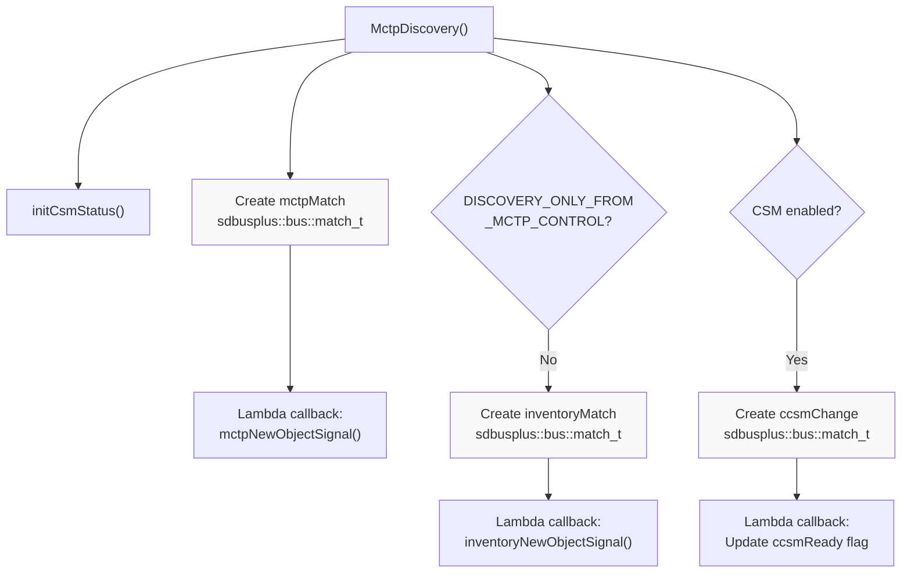
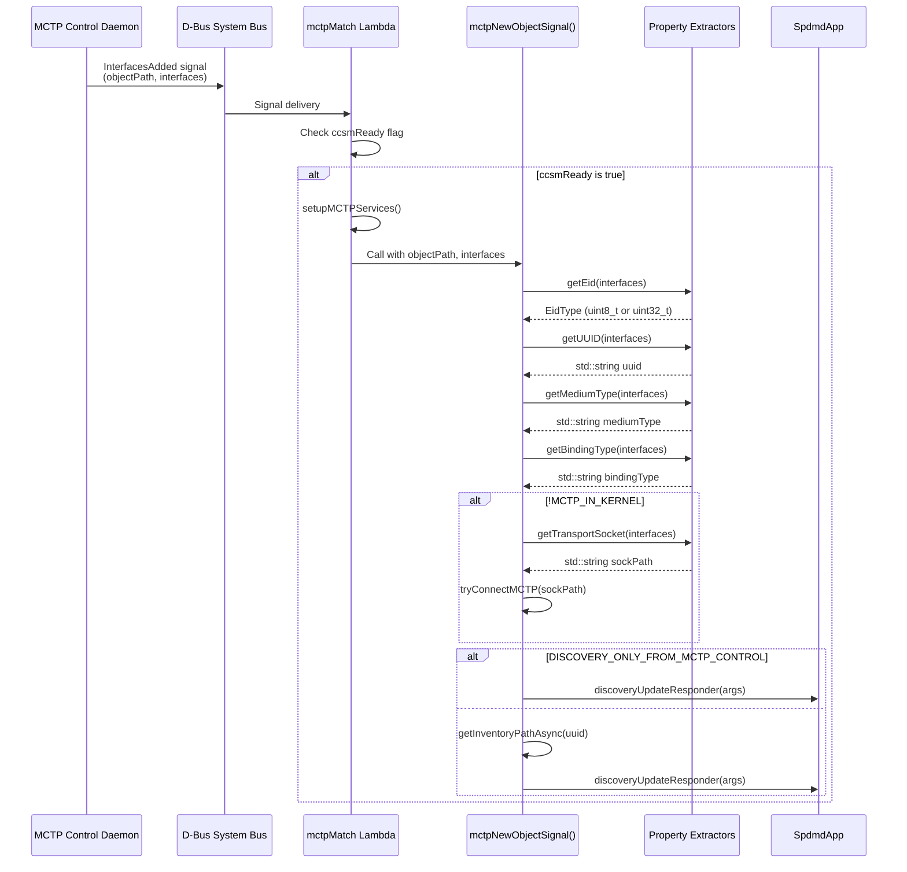
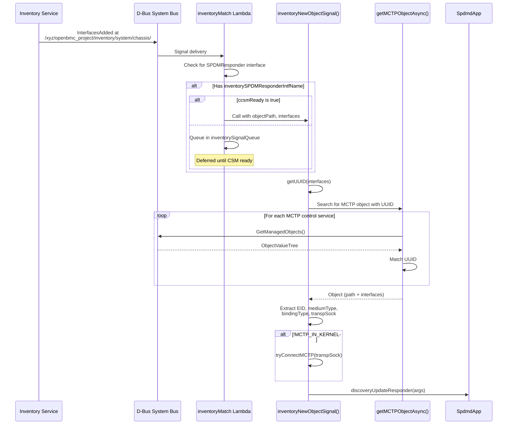
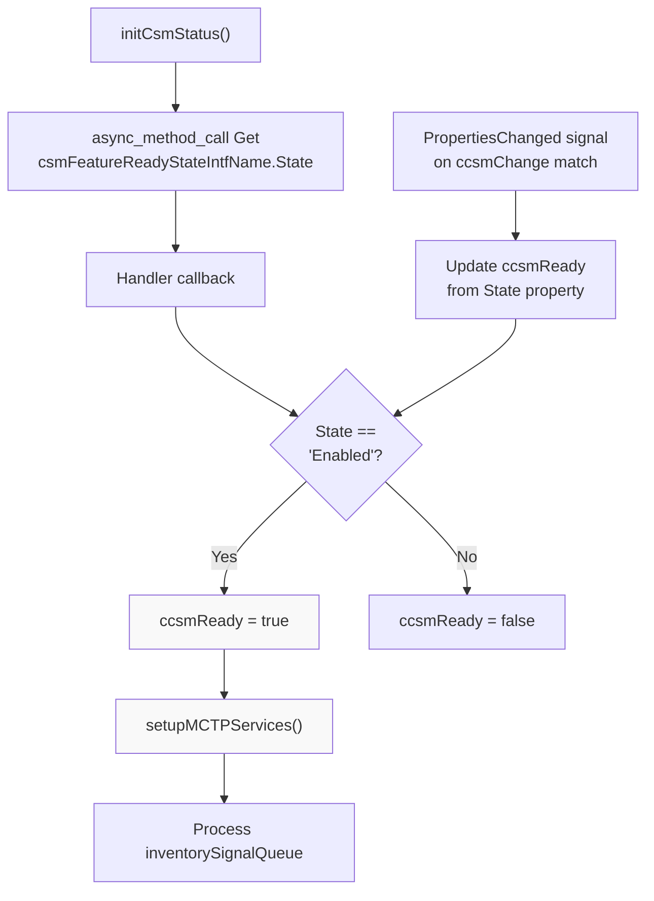
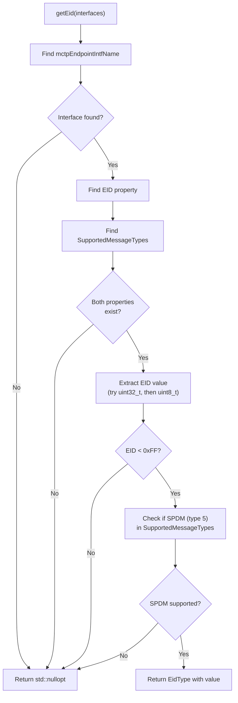
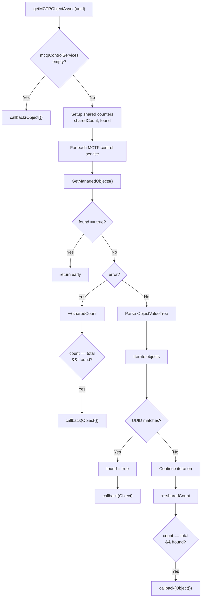
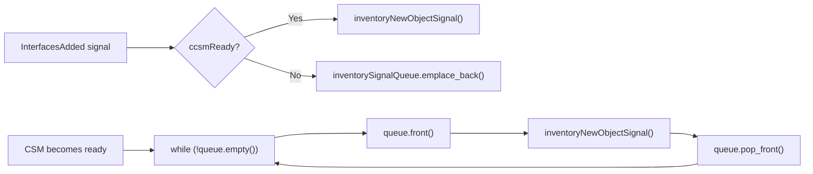

<!-- source: DeepWiki mcp.deepwiki.com · repo NVIDIA/spdm · extra page D-Bus Signal Monitoring · fetched 2026-10-26 -->

# D-Bus Signal Monitoring

<details>
<summary>Relevant source files</summary>

The following files were used as context for generating this wiki page:

- [spdmd/mctp_endpoint_discovery.cpp](spdmd/mctp_endpoint_discovery.cpp)
- [spdmd/mctp_endpoint_discovery.hpp](spdmd/mctp_endpoint_discovery.hpp)

</details>


## Purpose and Scope

This page documents how the `MctpDiscovery` class monitors D-Bus signals to detect SPDM-capable endpoints. The discovery system relies on `InterfacesAdded` signals from both MCTP control services and inventory management services to identify new devices. For information about how discovered endpoints are correlated and prioritized, see [Discovery Modes](#3.3.1).

The signal monitoring subsystem is implemented in the `MctpDiscovery` constructor and associated handler methods. It establishes D-Bus signal matches that trigger callbacks when new MCTP endpoints or inventory items appear on the system bus.

**Sources:** [spdmd/mctp_endpoint_discovery.cpp:40-116](), [spdmd/mctp_endpoint_discovery.hpp:34-273]()

---

## Signal Handler Registration

The `MctpDiscovery` constructor registers up to three different D-Bus signal handlers depending on compile-time configuration:

| Signal Handler | D-Bus Rule | Condition | Purpose |
|----------------|-----------|-----------|---------|
| `mctpMatch` | `interfacesAdded` at `/xyz/openbmc_project/mctp` or `/au/com/codeconstruct/mctp1` | Always | Detect new MCTP endpoints |
| `inventoryMatch` | `interfacesAddedAtPath` at `/xyz/openbmc_project/inventory/system/chassis/` | `!DISCOVERY_ONLY_FROM_MCTP_CONTROL` | Detect new inventory SPDM responders |
| `ccsmChange` | `propertiesChanged` for CSM ready state | `CSM_SERVICE_ENABLED` | Monitor MCTP service readiness |

### Signal Handler Initialization Flow



The MCTP signal match uses `sdbusplus::bus::match::rules::interfacesAdded(mctpPath)` where `mctpPath` is `/xyz/openbmc_project/mctp` for userspace MCTP or `/au/com/codeconstruct/mctp1` for kernel MCTP. The inventory match targets the specific base path `/xyz/openbmc_project/inventory/system/chassis/`.

**Sources:** [spdmd/mctp_endpoint_discovery.cpp:40-116](), [spdmd/mctp_endpoint_discovery.hpp:165-169](), [spdmd/mctp_endpoint_discovery.hpp:134-139]()

---

## MCTP Endpoint Signal Monitoring

When a new MCTP endpoint is added to the system, the MCTP control daemon publishes an `InterfacesAdded` signal that triggers the `mctpMatch` handler. The handler extracts endpoint properties and initiates responder creation.

### MCTP Signal Processing Flow



The `mctpNewObjectSignal()` method validates that the EID is valid (less than 0xFF) and that SPDM is listed in the `SupportedMessageTypes` property. In userspace MCTP mode, it also attempts to connect to the UNIX socket provided in the `xyz.openbmc_project.Common.UnixSocket` interface.

**Sources:** [spdmd/mctp_endpoint_discovery.cpp:277-494](), [spdmd/mctp_endpoint_discovery.cpp:259-275]()

---

## Inventory Item Signal Monitoring

When `DISCOVERY_ONLY_FROM_MCTP_CONTROL` is not defined, the daemon also monitors the inventory service for new SPDM responder objects. This enables bidirectional discovery where either the MCTP endpoint or the inventory item can appear first.

### Inventory Signal Processing Flow



The inventory signal handler ensures the `xyz.openbmc_project.Inventory.Item.SPDMResponder` interface is present before processing. If CSM is not ready, the signal is queued in `inventorySignalQueue` and processed later when CSM becomes ready.

**Sources:** [spdmd/mctp_endpoint_discovery.cpp:42-67](), [spdmd/mctp_endpoint_discovery.cpp:497-626]()

---

## CSM State Monitoring

When `CSM_SERVICE_ENABLED` is defined, the discovery system waits for the Configurable State Manager (CSM) to signal that MCTP services are ready before processing endpoint discoveries.

### CSM Ready State Handling



The CSM monitoring ensures that SPDM discovery doesn't begin until the MCTP infrastructure is fully initialized. The `ccsmChange` match monitors the property `State` on the interface `xyz.openbmc_project.State.FeatureReady` at path `/xyz/openbmc_project/state/configurableStateManager/MCTP`. When the state becomes `xyz.openbmc_project.State.FeatureReady.States.Enabled`, discovery proceeds.

**Sources:** [spdmd/mctp_endpoint_discovery.cpp:87-115](), [spdmd/mctp_endpoint_discovery.cpp:1133-1185]()

---

## Property Extraction Methods

The discovery handlers extract multiple properties from the D-Bus `InterfaceMap` to construct `ResponderArgs` for creating responder instances.

### Property Extraction Overview

| Property | Method | D-Bus Interface | D-Bus Property | Type |
|----------|--------|----------------|----------------|------|
| EID | `getEid()` | `xyz.openbmc_project.MCTP.Endpoint` | `EID` | `uint8_t` or `uint32_t` |
| UUID | `getUUID()` | `xyz.openbmc_project.MCTP.UUID` or `xyz.openbmc_project.Common.UUID` | `UUID` | `std::string` |
| Medium Type | `getMediumType()` | `xyz.openbmc_project.MCTP.Endpoint` | `MediumType` | `std::string` |
| Binding Type | `getBindingType()` | `xyz.openbmc_project.MCTP.Binding` | `BindingType` | `std::string` |
| Transport Socket | `getTransportSocket()` | `xyz.openbmc_project.Common.UnixSocket` | `Address` | `std::vector<uint8_t>` |

### EID Extraction Logic

The `getEid()` method handles both `uint8_t` and `uint32_t` EID types and validates SPDM support:



The EID extraction uses `std::variant<uint32_t, uint8_t>` to accommodate different MCTP control daemon implementations. The constant `mctpTypeSPDM = 5` is used to filter endpoints that support SPDM messages.

**Sources:** [spdmd/mctp_endpoint_discovery.cpp:629-726](), [spdmd/mctp_endpoint_discovery.hpp:117]()

---

## Asynchronous Property Resolution

Several property extraction operations require asynchronous D-Bus method calls to resolve cross-references between MCTP objects and inventory items.

### Inventory Path Resolution

```mermaid
graph TB
    Start["getInventoryPathAsync(uuid)"]
    GetSubTree["ObjectMapper.GetSubTree<br/>for SPDMResponder interface"]
    
    ProcessResp["Process response map"]
    BuildCandidates["Build candidates list<br/>(objectPath, serviceName, interface)"]
    
    CheckEmpty{candidates.empty()?}
    ReturnEmpty["callback(empty path)"]
    
    IterCandidates["Iterate candidates"]
    GetProp["getPropertyValueAsync<br/>Get UUID property"]
    
    CheckMatch{UUID matches?}
    ReturnPath["callback(objectPath)"]
    NextCandidate["Next candidate"]
    
    AllChecked{All checked?}
    
    Start --> GetSubTree
    GetSubTree --> ProcessResp
    ProcessResp --> BuildCandidates
    BuildCandidates --> CheckEmpty
    
    CheckEmpty -->|Yes| ReturnEmpty
    CheckEmpty -->|No| IterCandidates
    
    IterCandidates --> GetProp
    GetProp --> CheckMatch
    CheckMatch -->|Yes| ReturnPath
    CheckMatch -->|No| NextCandidate
    NextCandidate --> AllChecked
    AllChecked -->|No| GetProp
    AllChecked -->|Yes| ReturnEmpty
```

The `getInventoryPathAsync()` method searches the inventory tree for objects implementing `xyz.openbmc_project.Inventory.Item.SPDMResponder` and matching the provided UUID. It uses the ObjectMapper service to discover candidates and then queries each candidate's UUID property until a match is found.

**Sources:** [spdmd/mctp_endpoint_discovery.cpp:923-1057]()

### MCTP Object Resolution



The `getMCTPObjectAsync()` method queries all registered MCTP control services in parallel using shared atomic counters to track completion. When a UUID match is found in any service, the callback is invoked immediately with the matching object.

**Sources:** [spdmd/mctp_endpoint_discovery.cpp:852-921]()

---

## MCTP Service Discovery

Before processing endpoint signals, the discovery system must identify available MCTP control services.

### MCTP Service Setup Flow

```mermaid
graph TB
    Start["setupMCTPServices()"]
    CheckReady{ccsmReady?}
    Return["return"]
    
    GetServices["getMCTPServicesAsync()"]
    Callback["Callback with service names"]
    
    CheckEmpty{svcNames.empty()?}
    LogError["Log error"]
    
    IterServices["For each service name"]
    CheckExists{Service already<br/>in mctpControlServices?}
    Skip["continue to next"]
    
    CreateHelper["Create ServiceHelper"]
    Store["Store in mctpControlServices map"]
    
    GetManaged["async_method_call<br/>GetManagedObjects"]
    ProcessObjs["For each object"]
    CallNewObj["mctpNewObjectSignal()"]
    
    Start --> CheckReady
    CheckReady -->|No| Return
    CheckReady -->|Yes| GetServices
    GetServices --> Callback
    Callback --> CheckEmpty
    CheckEmpty -->|Yes| LogError
    CheckEmpty -->|No| IterServices
    
    IterServices --> CheckExists
    CheckExists -->|Yes| Skip
    CheckExists -->|No| CreateHelper
    CreateHelper --> Store
    Store --> GetManaged
    GetManaged --> ProcessObjs
    ProcessObjs --> CallNewObj
```

The `getMCTPServicesAsync()` method queries the ObjectMapper at `/xyz/openbmc_project/object_mapper` using the `GetSubTree` method to find all services implementing the `xyz.openbmc_project.MCTP.Endpoint` interface. Each discovered service is wrapped in a `dbus::ServiceHelper` and stored in the `mctpControlServices` map for future queries.

**Sources:** [spdmd/mctp_endpoint_discovery.cpp:118-193](), [spdmd/mctp_endpoint_discovery.cpp:195-257]()

---

## Signal Queue Management

When CSM is not ready but signals arrive, they are queued for later processing.

### Inventory Signal Queuing

The `inventorySignalQueue` is a `std::deque` that stores `(objectPath, InterfaceMap)` pairs:



When CSM transitions to ready state (either in `initCsmStatus()` or via the `ccsmChange` signal), all queued inventory signals are processed in FIFO order.

**Sources:** [spdmd/mctp_endpoint_discovery.cpp:58-66](), [spdmd/mctp_endpoint_discovery.cpp:104-111](), [spdmd/mctp_endpoint_discovery.cpp:1154-1161]()

---

## Error Handling and Validation

Each property extraction method includes robust error handling for missing interfaces, malformed properties, and type mismatches.

### Common Error Patterns

| Scenario | Validation | Action |
|----------|-----------|--------|
| Missing interface | `interfaces.find() == end()` | Return empty/nullopt |
| Missing property | `properties.contains()` check | Return empty/nullopt |
| Type mismatch | `std::get_if<T>()` returns nullptr | Return empty/nullopt |
| Invalid EID | `eid >= invalidEid (0xFF)` | Log error, return nullopt |
| Empty UUID | `uuid.empty()` | Log error, skip processing |
| SPDM not supported | SPDM type not in `SupportedMessageTypes` | Return nullopt |

The `tryConnectMCTP()` method wraps socket connection attempts in a try-catch block. If the connection fails, the exception is re-thrown to crash the application rather than silently failing, ensuring MCTP connectivity issues are immediately visible.

**Sources:** [spdmd/mctp_endpoint_discovery.cpp:259-275](), [spdmd/mctp_endpoint_discovery.cpp:311-317](), [spdmd/mctp_endpoint_discovery.cpp:394-399]()

---

