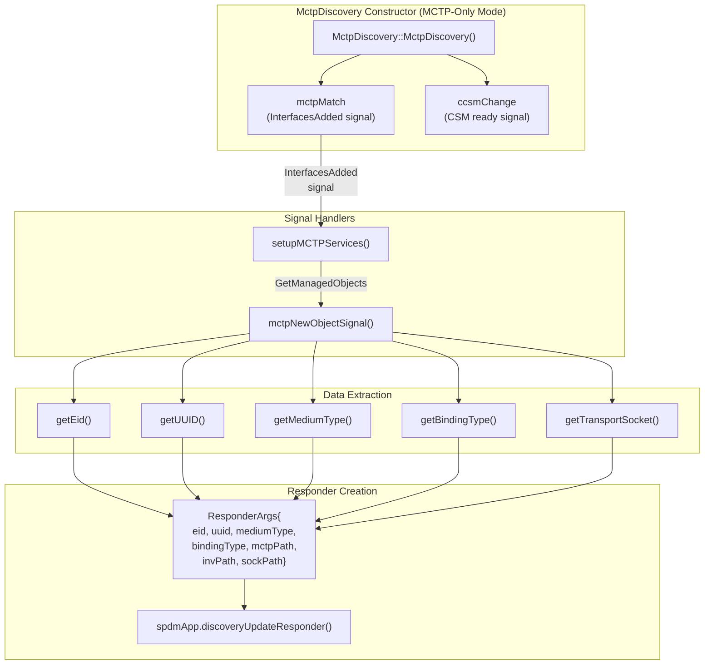
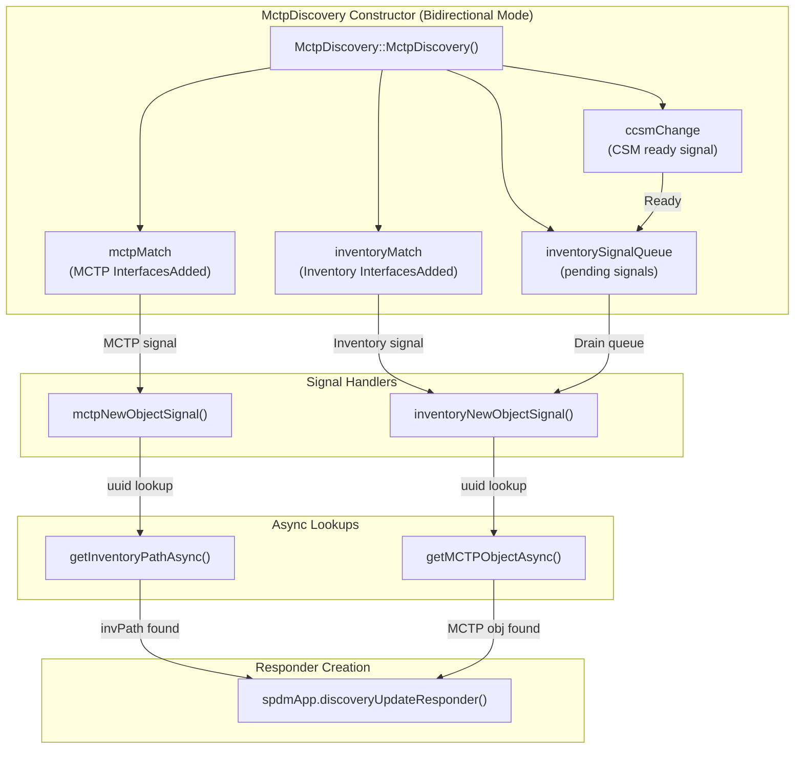
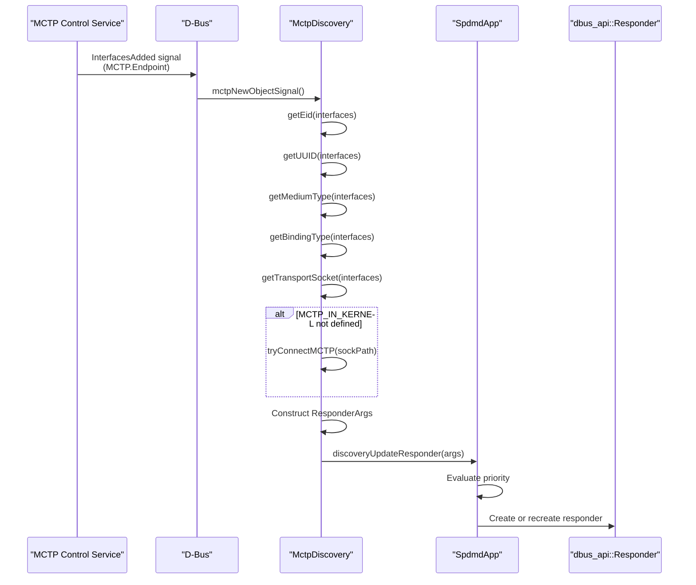
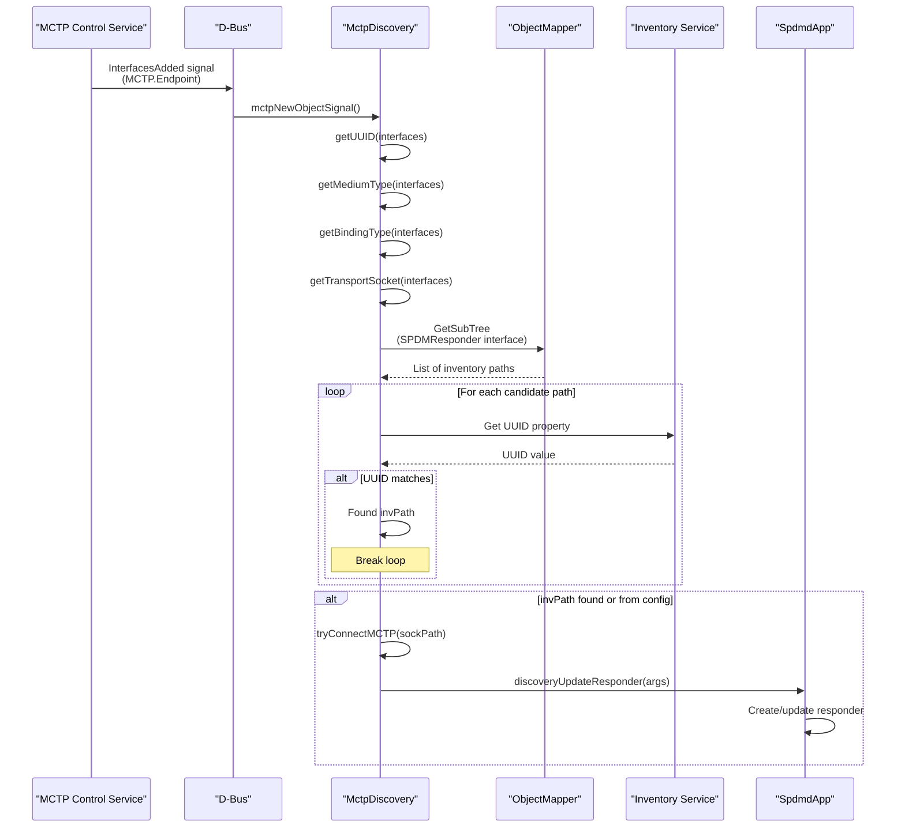
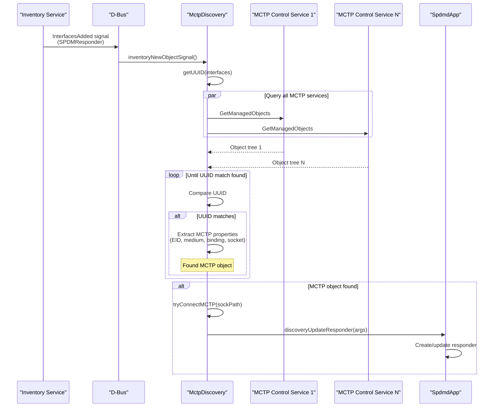

<!-- source: DeepWiki mcp.deepwiki.com · repo NVIDIA/spdm · extra page Discovery Modes · fetched 2026-10-26 -->

# Discovery Modes

<details>
<summary>Relevant source files</summary>

The following files were used as context for generating this wiki page:

- [spdmd/mctp_endpoint_discovery.cpp](spdmd/mctp_endpoint_discovery.cpp)
- [spdmd/mctp_endpoint_discovery.hpp](spdmd/mctp_endpoint_discovery.hpp)

</details>


## Purpose and Scope

This document explains the two discovery modes available in `spdmd` for identifying SPDM responder devices on the system. The discovery mode is selected at compile time via the `DISCOVERY_ONLY_FROM_MCTP_CONTROL` flag and determines whether the daemon discovers responders exclusively through MCTP control signals or through bidirectional discovery that correlates MCTP endpoints with inventory items.

For information about the overall discovery system architecture and signal monitoring mechanisms, see [MCTP Endpoint Discovery](#3.3). For details on responder lifecycle management after discovery, see [Responder Lifecycle Management](#3.1.2).

---

## Overview

The `MctpDiscovery` class implements two distinct discovery modes:

| Discovery Mode | Compile Flag | Discovery Sources | UUID Correlation |
|---------------|--------------|-------------------|------------------|
| **MCTP-Only** | `DISCOVERY_ONLY_FROM_MCTP_CONTROL` defined | MCTP control signals only | Not required |
| **Bidirectional** | `DISCOVERY_ONLY_FROM_MCTP_CONTROL` not defined | MCTP control signals + Inventory signals | Required |

The mode is selected at build time and cannot be changed at runtime. The choice affects which D-Bus signals are monitored and how responder information is collected.

**Sources:** [spdmd/mctp_endpoint_discovery.hpp:74-96](), [spdmd/mctp_endpoint_discovery.cpp:42-68]()

---

## MCTP-Only Discovery Mode

### Configuration

When `DISCOVERY_ONLY_FROM_MCTP_CONTROL` is defined, the daemon discovers responders exclusively through MCTP control service signals. The `inventoryMatch` signal handler and related inventory discovery logic are excluded at compile time.



**Diagram: MCTP-Only Discovery Flow**

**Sources:** [spdmd/mctp_endpoint_discovery.cpp:40-116](), [spdmd/mctp_endpoint_discovery.cpp:321-390]()

### Discovery Process

In MCTP-only mode, the `mctpNewObjectSignal` function performs the following steps:

1. **Extract Endpoint ID (EID)** - Retrieves the EID from the `xyz.openbmc_project.MCTP.Endpoint` interface [spdmd/mctp_endpoint_discovery.cpp:294-317]()

2. **Extract UUID** - Obtains the UUID from either `xyz.openbmc_project.MCTP.UUID` or `xyz.openbmc_project.Common.UUID` interface [spdmd/mctp_endpoint_discovery.cpp:319]()

3. **Extract Medium Type** - Reads the `MediumType` property to determine transport medium (PCIe, USB, etc.) [spdmd/mctp_endpoint_discovery.cpp:322-332]()

4. **Extract Binding Type** - Reads the `BindingType` property from `xyz.openbmc_project.MCTP.Binding` interface [spdmd/mctp_endpoint_discovery.cpp:334-345]()

5. **Extract Socket Path** - When `MCTP_IN_KERNEL` is not defined, retrieves the Unix socket path for userspace MCTP stack [spdmd/mctp_endpoint_discovery.cpp:346-361]()

6. **Create Responder** - Constructs `ResponderArgs` and calls `discoveryUpdateResponder` with the collected information [spdmd/mctp_endpoint_discovery.cpp:362-389]()

### Data Structures

The MCTP-only mode populates a `ResponderArgs` structure with data extracted directly from the MCTP endpoint:

```cpp
dbus_api::ResponderArgs{
    eid,           // uint8_t from MCTP.Endpoint.EID
    uuid,          // string from MCTP.UUID or Common.UUID
    mediumType,    // string from MCTP.Endpoint.MediumType
    bindingType,   // string from MCTP.Binding.BindingType
    objPath,       // MCTP D-Bus object path
    invPath,       // Empty in MCTP-only mode
    sockPath       // Unix socket path (userspace only)
}
```

**Sources:** [spdmd/mctp_endpoint_discovery.cpp:362-389]()

---

## Bidirectional Discovery Mode

### Configuration

When `DISCOVERY_ONLY_FROM_MCTP_CONTROL` is not defined, the daemon monitors both MCTP control signals and inventory signals. This mode requires UUID-based correlation between MCTP endpoints and inventory items to construct complete responder information.



**Diagram: Bidirectional Discovery Flow**

**Sources:** [spdmd/mctp_endpoint_discovery.cpp:42-116](), [spdmd/mctp_endpoint_discovery.hpp:74-96]()

### MCTP-First Discovery Path

When an MCTP endpoint appears first, the daemon follows this asynchronous flow:

1. **Receive MCTP Signal** - `mctpNewObjectSignal` is triggered with MCTP endpoint information [spdmd/mctp_endpoint_discovery.cpp:277-294]()

2. **Extract UUID** - Extracts UUID from the MCTP endpoint [spdmd/mctp_endpoint_discovery.cpp:319](), [spdmd/mctp_endpoint_discovery.cpp:392-399]()

3. **Extract MCTP Properties** - Collects EID, medium type, binding type, and socket path [spdmd/mctp_endpoint_discovery.cpp:400-439]()

4. **Async Inventory Lookup** - Calls `getInventoryPathAsync` to find matching inventory item by UUID [spdmd/mctp_endpoint_discovery.cpp:440-442]()

5. **Create Responder** - When inventory path is found (or fallback to config), constructs and registers responder [spdmd/mctp_endpoint_discovery.cpp:459-491]()

### Inventory-First Discovery Path

When an inventory item appears first, the daemon follows this asynchronous flow:

1. **Receive Inventory Signal** - `inventoryNewObjectSignal` is triggered with inventory item information [spdmd/mctp_endpoint_discovery.cpp:497-512]()

2. **Extract UUID** - Extracts UUID from the inventory item's `xyz.openbmc_project.Inventory.Item.SPDMResponder` interface [spdmd/mctp_endpoint_discovery.cpp:505-512]()

3. **Async MCTP Lookup** - Calls `getMCTPObjectAsync` to find matching MCTP endpoint by UUID [spdmd/mctp_endpoint_discovery.cpp:514]()

4. **Extract MCTP Properties** - Collects EID, medium type, binding type, and socket path from the MCTP object [spdmd/mctp_endpoint_discovery.cpp:523-594]()

5. **Create Responder** - Constructs and registers responder with both MCTP and inventory information [spdmd/mctp_endpoint_discovery.cpp:596-624]()

**Sources:** [spdmd/mctp_endpoint_discovery.cpp:391-626]()

### CSM Gating and Signal Queuing

Both discovery paths respect the Configurable State Manager (CSM) readiness state:

- When `CSM_SERVICE_ENABLED` is defined, discovery waits until the CSM MCTP state is `Enabled` [spdmd/mctp_endpoint_discovery.cpp:87-115]()
- Inventory signals received before CSM readiness are queued in `inventorySignalQueue` [spdmd/mctp_endpoint_discovery.cpp:64-66]()
- Once CSM is ready, queued signals are processed [spdmd/mctp_endpoint_discovery.cpp:104-111]()

**Sources:** [spdmd/mctp_endpoint_discovery.cpp:87-115](), [spdmd/mctp_endpoint_discovery.cpp:1133-1185]()

---

## UUID-Based Correlation

### UUID Extraction

The `getUUID` function attempts to extract UUID from two possible D-Bus interfaces:

| Interface | Priority | Use Case |
|-----------|----------|----------|
| `xyz.openbmc_project.MCTP.UUID` | 1st | MCTP endpoints |
| `xyz.openbmc_project.Common.UUID` | 2nd | Inventory items and fallback |

The function searches for the `UUID` property and returns the string value. If neither interface is present, an empty string is returned and discovery fails for that object.

**Sources:** [spdmd/mctp_endpoint_discovery.cpp:773-804]()

### Async Correlation Methods

#### getInventoryPathAsync

This method searches for an inventory item matching a given UUID:

1. Queries the object mapper for all objects implementing `xyz.openbmc_project.Inventory.Item.SPDMResponder` [spdmd/mctp_endpoint_discovery.cpp:923-956]()
2. For each candidate, checks both `xyz.openbmc_project.MCTP.UUID` and `xyz.openbmc_project.Common.UUID` interfaces [spdmd/mctp_endpoint_discovery.cpp:990-1002]()
3. Asynchronously retrieves the UUID property using `getPropertyValueAsync` [spdmd/mctp_endpoint_discovery.cpp:1033-1050]()
4. Returns the inventory path of the first matching UUID [spdmd/mctp_endpoint_discovery.cpp:1038-1043]()

**Sources:** [spdmd/mctp_endpoint_discovery.cpp:923-1057]()

#### getMCTPObjectAsync

This method searches for an MCTP endpoint matching a given UUID:

1. Iterates through all registered MCTP control services [spdmd/mctp_endpoint_discovery.cpp:855-866]()
2. Calls `GetManagedObjects` on each service to retrieve all MCTP endpoints [spdmd/mctp_endpoint_discovery.cpp:868-920]()
3. Compares extracted UUIDs from each object until a match is found [spdmd/mctp_endpoint_discovery.cpp:901-910]()
4. Returns the complete `Object` with path and interfaces [spdmd/mctp_endpoint_discovery.cpp:907-908]()

The method uses shared atomic counters to track completion across multiple asynchronous calls and short-circuits once a match is found.

**Sources:** [spdmd/mctp_endpoint_discovery.cpp:852-921]()

---

## Comparison Matrix

The following table summarizes the key differences between the two discovery modes:

| Aspect | MCTP-Only Mode | Bidirectional Mode |
|--------|----------------|-------------------|
| **Compile Flag** | `DISCOVERY_ONLY_FROM_MCTP_CONTROL` defined | `DISCOVERY_ONLY_FROM_MCTP_CONTROL` not defined |
| **Signal Sources** | MCTP control only | MCTP control + Inventory |
| **UUID Usage** | Optional, extracted from MCTP endpoint | Required for correlation |
| **Inventory Path** | Empty or from config | Retrieved via UUID lookup |
| **Async Lookups** | None | `getInventoryPathAsync`, `getMCTPObjectAsync` |
| **Discovery Latency** | Lower (single signal) | Higher (requires correlation) |
| **Robustness** | Depends on MCTP signal order | Order-independent |
| **Signal Queue** | Not used | `inventorySignalQueue` for CSM gating |

**Sources:** [spdmd/mctp_endpoint_discovery.cpp:42-68](), [spdmd/mctp_endpoint_discovery.cpp:321-626]()

---

## Discovery Flow Sequence

### MCTP-Only Mode Sequence



**Diagram: MCTP-Only Discovery Sequence**

**Sources:** [spdmd/mctp_endpoint_discovery.cpp:277-390]()

### Bidirectional Mode: MCTP-First Sequence



**Diagram: Bidirectional MCTP-First Sequence**

**Sources:** [spdmd/mctp_endpoint_discovery.cpp:440-491]()

### Bidirectional Mode: Inventory-First Sequence



**Diagram: Bidirectional Inventory-First Sequence**

**Sources:** [spdmd/mctp_endpoint_discovery.cpp:497-626]()

---

## Configuration Selection

The discovery mode is selected at build time using the Meson build option:

```
-Ddiscovery-only-from-mctp-control=[true|false]
```

This flag is processed in the build system and generates a corresponding preprocessor definition in `config.h`:

- When `true`: `#define DISCOVERY_ONLY_FROM_MCTP_CONTROL`
- When `false`: DISCOVERY_ONLY_FROM_MCTP_CONTROL is not defined

The choice should be based on the deployment environment:

| Environment | Recommended Mode | Reason |
|-------------|------------------|--------|
| Systems with complete inventory | Bidirectional | Provides richer metadata from inventory |
| MCTP-centric deployments | MCTP-Only | Simpler, lower latency |
| Systems without inventory service | MCTP-Only | Inventory correlation would fail |
| Development/testing | Bidirectional | More flexible for testing scenarios |

For more information on build configuration, see [Build System and Configuration](#1.2).

**Sources:** [spdmd/mctp_endpoint_discovery.cpp:42](), [spdmd/mctp_endpoint_discovery.cpp:321](), [spdmd/mctp_endpoint_discovery.cpp:496]()

---

