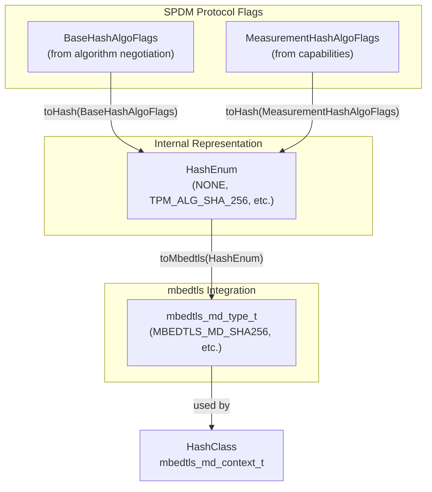
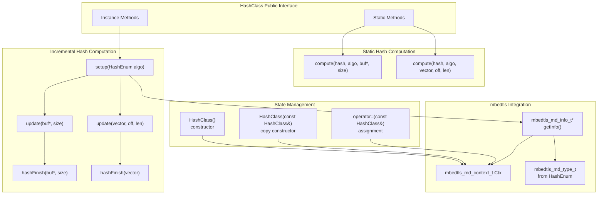
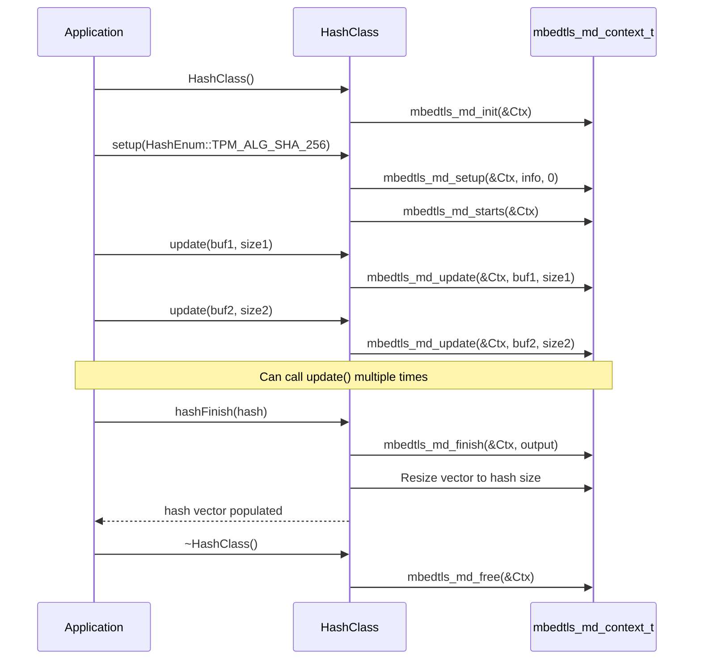

<!-- source: DeepWiki mcp.deepwiki.com · repo NVIDIA/spdm · extra page Hashing · fetched 2026-10-26 -->

# Hashing

<details>
<summary>Relevant source files</summary>

The following files were used as context for generating this wiki page:

- [libspdmcpp/headers_public/spdmcpp/hash.hpp](libspdmcpp/headers_public/spdmcpp/hash.hpp)
- [libspdmcpp/headers_public/spdmcpp/mbedtls_support.hpp](libspdmcpp/headers_public/spdmcpp/mbedtls_support.hpp)

</details>


## Purpose and Scope

This page documents the hashing subsystem within libspdmcpp's cryptographic support layer. The hashing functionality provides SHA-256, SHA-384, and SHA-512 hash computation through mbedtls integration, supporting both one-shot and incremental hashing operations.

For certificate parsing and signature verification, see [Certificate Parsing and Verification](#2.4.2). For the overall cryptographic architecture, see [Cryptographic Support](#2.4).

---

## Hash Algorithm Support

The library supports three SHA-2 family hash algorithms through mbedtls:

| Algorithm | mbedtls Type | Output Size | SPDM Usage |
|-----------|--------------|-------------|------------|
| SHA-256 | `MBEDTLS_MD_SHA256` | 32 bytes | Base hash, measurement hash |
| SHA-384 | `MBEDTLS_MD_SHA384` | 48 bytes | Base hash, measurement hash |
| SHA-512 | `MBEDTLS_MD_SHA512` | 64 bytes | Base hash, measurement hash |

These algorithms are selected during the SPDM algorithm negotiation phase and used throughout the protocol for:
- **Transcript hashing**: Computing hashes over message sequences in BufA, BufB, and BufL buffers
- **Certificate digest computation**: Generating digests for certificate slots
- **Measurement hashing**: Computing hashes of device measurements
- **Signature context generation**: Building signature verification contexts in SPDM 1.2+

**Note**: SHA-3 variants (SHA3-256, SHA3-384, SHA3-512) are defined in the SPDM specification but not currently supported due to mbedtls limitations. See [libspdmcpp/headers_public/spdmcpp/hash.hpp:48-53]() and [libspdmcpp/headers_public/spdmcpp/hash.hpp:72-78]().

Sources: [libspdmcpp/headers_public/spdmcpp/hash.hpp:84-98]()

---

## Hash Algorithm Type System

### HashEnum Enumeration

The `HashEnum` type identifies hash algorithms within the library. Valid values include:
- `HashEnum::NONE` - No hashing (used for raw bit stream measurements)
- `HashEnum::TPM_ALG_SHA_256` - SHA-256 algorithm
- `HashEnum::TPM_ALG_SHA_384` - SHA-384 algorithm
- `HashEnum::TPM_ALG_SHA_512` - SHA-512 algorithm
- `HashEnum::INVALID` - Invalid/unsupported algorithm

Sources: [libspdmcpp/headers_public/spdmcpp/hash.hpp:37-57]()

### Hash Algorithm Conversion Functions

The library provides conversion functions between different hash type representations:



**Diagram**: Hash algorithm type conversion flow showing how SPDM protocol flags are converted to internal representation and mbedtls types

**Conversion Functions**:
- `toHash(BaseHashAlgoFlags)` [libspdmcpp/headers_public/spdmcpp/hash.hpp:37-57]() - Converts base hash algorithm flags (from NEGOTIATE_ALGORITHMS response) to HashEnum
- `toHash(MeasurementHashAlgoFlags)` [libspdmcpp/headers_public/spdmcpp/hash.hpp:59-82]() - Converts measurement hash algorithm flags (from capabilities) to HashEnum
- `toMbedtls(HashEnum)` [libspdmcpp/headers_public/spdmcpp/hash.hpp:84-98]() - Converts HashEnum to mbedtls message digest type

These conversions enforce that only a single bit is set in the flags (checked via `countBits()` assertion), ensuring a single hash algorithm is selected.

Sources: [libspdmcpp/headers_public/spdmcpp/hash.hpp:37-98]()

---

## HashClass API

`HashClass` is the primary hashing abstraction that wraps mbedtls hash functionality. It supports both one-shot and incremental hashing patterns.



**Diagram**: HashClass architecture showing public API methods and internal mbedtls integration

Sources: [libspdmcpp/headers_public/spdmcpp/hash.hpp:100-261]()

### One-Shot Hashing

For simple hash computation, use the static `compute()` method:

**Method Signatures**:
```cpp
static void compute(std::vector<uint8_t>& hash, HashEnum algo,
                    const uint8_t* buf, size_t size)

static void compute(std::vector<uint8_t>& hash, HashEnum algo,
                    const std::vector<uint8_t>& buf, size_t off = 0,
                    size_t len = std::numeric_limits<size_t>::max())
```

These methods create a temporary `HashClass` instance, initialize it with the specified algorithm, hash the input data, and return the computed hash in the output vector.

Sources: [libspdmcpp/headers_public/spdmcpp/hash.hpp:116-150]()

### Incremental Hashing

For hashing data across multiple chunks (used extensively in SPDM transcript hashing):



**Diagram**: Incremental hashing flow showing the sequence of operations for computing a hash over multiple data chunks

**Incremental Hashing Methods**:

1. **`setup(HashEnum algo)`** [libspdmcpp/headers_public/spdmcpp/hash.hpp:194-201]() - Initializes the hash context with the specified algorithm. Must be called before `update()`.

2. **`update(const uint8_t* buf, size_t size)`** [libspdmcpp/headers_public/spdmcpp/hash.hpp:205-209]() - Adds data to the hash computation. Can be called multiple times to hash data incrementally.

3. **`update(const std::vector<uint8_t>& buf, size_t off, size_t len)`** [libspdmcpp/headers_public/spdmcpp/hash.hpp:213-229]() - Vector-based update with optional offset and length parameters. Returns `RetStat::ERROR_BUFFER_TOO_SMALL` if offset is invalid.

4. **`hashFinish(uint8_t* buf, size_t size)`** [libspdmcpp/headers_public/spdmcpp/hash.hpp:235-240]() - Finalizes the hash and writes to the provided buffer. Buffer size must match hash output size.

5. **`hashFinish(std::vector<uint8_t>& buf)`** [libspdmcpp/headers_public/spdmcpp/hash.hpp:246-250]() - Finalizes the hash and writes to a vector, automatically resizing it to the correct hash size.

Sources: [libspdmcpp/headers_public/spdmcpp/hash.hpp:194-250]()

### Hash State Cloning

`HashClass` supports copying mid-computation, allowing hash state to be cloned at any point:

**Copy Constructor**: [libspdmcpp/headers_public/spdmcpp/hash.hpp:162-165]()
```cpp
HashClass(const HashClass& other)
```

**Assignment Operator**: [libspdmcpp/headers_public/spdmcpp/hash.hpp:169-181]()
```cpp
HashClass& operator=(const HashClass& other)
```

Both operations use `mbedtls_md_clone()` to duplicate the internal hash state, enabling scenarios where:
- The same hash prefix is used for multiple computations (e.g., BufA is shared across certificate and measurement phases)
- Hash state needs to be saved and restored
- Parallel hash computations from a common starting point are needed

**Note**: Move semantics are explicitly deleted [libspdmcpp/headers_public/spdmcpp/hash.hpp:183-184]() to prevent resource management issues.

Sources: [libspdmcpp/headers_public/spdmcpp/hash.hpp:162-184]()

---

## Integration with SPDM Protocol

### Transcript Hash Buffers

The `ConnectionClass` uses `HashClass` for computing transcript hashes across SPDM protocol phases:

| Buffer | Purpose | Hash Content |
|--------|---------|--------------|
| BufA | Version, Capabilities, Algorithms | VCA transcript (Version + Capabilities + Algorithms messages) |
| BufB | Certificates | Certificate chain data for signature verification |
| BufL | Measurements | Measurement data and signatures |

These buffers are maintained as `HashClass` instances and cloned at various protocol phases to compute different hash combinations (e.g., `hash(BufA + BufB)` for certificate verification, `hash(BufA + BufL)` for measurement verification).

### Algorithm Negotiation

During the NEGOTIATE_ALGORITHMS phase:
1. Requester proposes supported hash algorithms via `BaseHashAlgoFlags`
2. Responder selects one algorithm and returns it in the ALGORITHMS response
3. `ConnectionClass` converts the selected flag to `HashEnum` using `toHash(BaseHashAlgoFlags)`
4. The selected hash algorithm is stored and used for all subsequent hashing operations

The selected algorithm is used to set `BaseHashSize` in `ConnectionClass`, which determines buffer sizes for digests, transcript hashes, and signature contexts.

### Measurement Hash Algorithm

Separately from the base hash algorithm, devices may negotiate a measurement-specific hash algorithm:
1. Responder advertises measurement hash capabilities via `MeasurementHashAlgoFlags` in CAPABILITIES
2. This is converted to `HashEnum` using `toHash(MeasurementHashAlgoFlags)`
3. If `RAW_BIT_STREAM_ONLY` is set, measurements are returned without hashing (`HashEnum::NONE`)
4. Otherwise, measurements are hashed using the negotiated measurement algorithm

Sources: [libspdmcpp/headers_public/spdmcpp/hash.hpp:37-82]()

---

## Usage Patterns and Examples

### Pattern 1: Simple Hash Computation

For computing a single hash over complete data:

```cpp
// Example from code (conceptual)
std::vector<uint8_t> data = /* ... */;
std::vector<uint8_t> hash;
HashClass::compute(hash, HashEnum::TPM_ALG_SHA_256, data);
// hash now contains SHA-256(data)
```

This pattern is suitable when all data is available at once.

Sources: [libspdmcpp/headers_public/spdmcpp/hash.hpp:122-129]()

### Pattern 2: Incremental Hash with Multiple Updates

For computing a hash over data that arrives in chunks (used in transcript hashing):

```cpp
// Example from SPDM protocol flow (conceptual)
HashClass bufA;
bufA.setup(negotiatedHashAlgo);

// Phase 1: Add VERSION messages
bufA.update(versionRequest);
bufA.update(versionResponse);

// Phase 2: Add CAPABILITIES messages
bufA.update(capabilitiesRequest);
bufA.update(capabilitiesResponse);

// Phase 3: Add ALGORITHMS messages
bufA.update(algorithmsRequest);
bufA.update(algorithmsResponse);

// At this point, bufA contains hash state for VCA transcript
```

This pattern is used throughout `ConnectionClass` to maintain transcript hashes across multiple protocol phases.

Sources: [libspdmcpp/headers_public/spdmcpp/hash.hpp:194-229]()

### Pattern 3: Hash State Cloning for Multiple Computations

For computing multiple hashes from a common prefix (used in SPDM signature verification):

```cpp
// Example from certificate verification (conceptual)
HashClass bufA = /* ... VCA transcript hash */;

// Clone BufA to compute hash(BufA + BufB)
HashClass certHash = bufA;  // Clone constructor
certHash.update(certificateData);

std::vector<uint8_t> hashForCertVerification;
certHash.hashFinish(hashForCertVerification);

// bufA is still intact and can be cloned again for measurements
HashClass measHash = bufA;  // Clone constructor again
measHash.update(measurementData);

std::vector<uint8_t> hashForMeasVerification;
measHash.hashFinish(hashForMeasVerification);
```

This pattern enables efficient hash computation when multiple hashes share a common prefix, avoiding redundant rehashing of the prefix data.

Sources: [libspdmcpp/headers_public/spdmcpp/hash.hpp:162-181]()

---

## Internal Implementation Details

### mbedtls Context Management

`HashClass` wraps `mbedtls_md_context_t` and manages its lifecycle:

**Initialization**: [libspdmcpp/headers_public/spdmcpp/hash.hpp:155-158]()
- Constructor calls `mbedtls_md_init(&Ctx)` to initialize the context

**Setup**: [libspdmcpp/headers_public/spdmcpp/hash.hpp:194-201]()
- `mbedtls_md_setup(&Ctx, info, 0)` configures the context for the selected algorithm
- `mbedtls_md_starts(&Ctx)` begins the hash computation

**Updates**: [libspdmcpp/headers_public/spdmcpp/hash.hpp:205-229]()
- `mbedtls_md_update(&Ctx, buf, size)` adds data to the hash

**Finalization**: [libspdmcpp/headers_public/spdmcpp/hash.hpp:235-250]()
- `mbedtls_md_finish(&Ctx, output)` completes the hash and writes output

**Cleanup**: [libspdmcpp/headers_public/spdmcpp/hash.hpp:186-189]()
- Destructor calls `mbedtls_md_free(&Ctx)` to release resources

### Hash Info Retrieval

The private `getInfo()` method [libspdmcpp/headers_public/spdmcpp/hash.hpp:256-259]() retrieves the `mbedtls_md_info_t*` for the configured algorithm:

```cpp
const mbedtls_md_info_t* getInfo() const
{
    return mbedtls_md_info_from_type(toMbedtls(algorithm));
}
```

This info structure is used to:
- Determine hash output size via `mbedtls_md_get_size(getInfo())`
- Configure the mbedtls context during setup
- Query algorithm capabilities

Sources: [libspdmcpp/headers_public/spdmcpp/hash.hpp:252-259]()

---

## Summary

The hashing subsystem provides a clean abstraction over mbedtls hash functionality with support for SHA-256, SHA-384, and SHA-512 algorithms. Key features include:

- **Type-safe algorithm selection** through `HashEnum` and conversion functions
- **Flexible hashing patterns** supporting both one-shot and incremental computation
- **State cloning** for efficient multi-hash scenarios with shared prefixes
- **SPDM protocol integration** for transcript hashing, certificate digests, and measurement hashing
- **Clean resource management** through RAII wrappers over mbedtls contexts

The incremental hashing capability is essential for SPDM protocol implementation, where transcript hashes (BufA, BufB, BufL) are computed across multiple message exchanges, and hash state cloning enables efficient computation of multiple hashes from shared prefixes.

Sources: [libspdmcpp/headers_public/spdmcpp/hash.hpp:1-263](), [libspdmcpp/headers_public/spdmcpp/mbedtls_support.hpp:1-463]()

---

