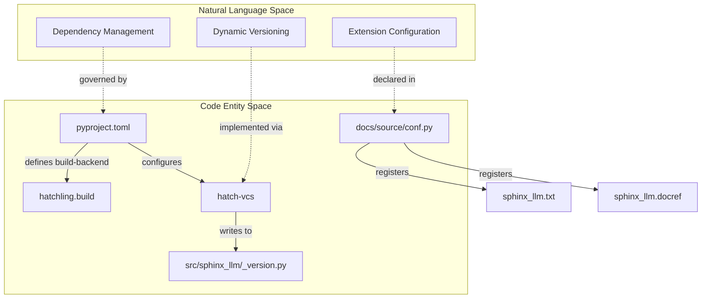
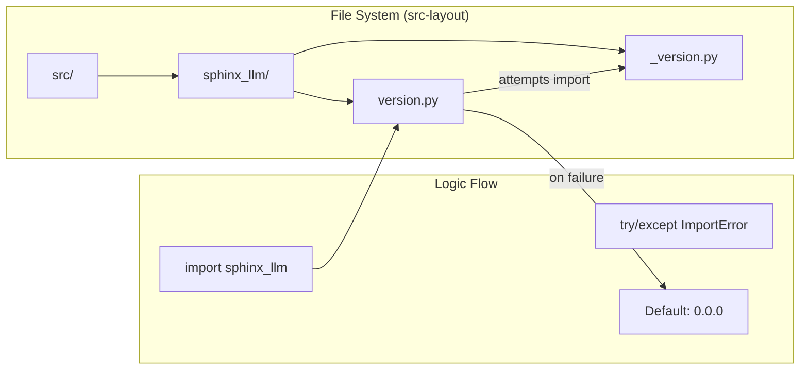

<!-- source: DeepWiki mcp.deepwiki.com · repo NVIDIA/sphinx-llm · page 1.2 Project Layout and Configuration · fetched 2026-10-26 -->

# Project Layout and Configuration

Relevant source files

The following files were used as context for generating this wiki page:

- [docs/source/conf.py](docs/source/conf.py)
- [pyproject.toml](pyproject.toml)
- [src/sphinx_llm/__init__.py](src/sphinx_llm/__init__.py)
- [src/sphinx_llm/version.py](src/sphinx_llm/version.py)

This page details the structural organization of the `sphinx-llm` repository, its build configuration, and the dependency management strategy. It provides a technical overview of how the project is packaged and how the example documentation project serves as a reference implementation.

## Repository Structure (src-layout)

The `sphinx-llm` repository adopts the `src` layout to ensure that tests run against the installed package rather than the local source directory. This prevents accidental reliance on local files that might not be included in the distribution.

### Directory Organization

| Path | Purpose |
| :--- | :--- |
| `src/sphinx_llm/` | Primary package source containing extension logic. |
| `src/sphinx_llm/txt.py` | Implementation of the `sphinx_llm.txt` extension. |
| `src/sphinx_llm/docref.py` | Implementation of the `sphinx_llm.docref` extension. |
| `src/sphinx_llm/_version.py` | Autogenerated version file managed by `hatch-vcs`. |
| `docs/source/` | Example Sphinx project and documentation source. |
| `tests/` | Pytest suite exercising the extensions. |

**Sources:** `src/sphinx_llm/` [src/sphinx_llm/__init__.py:1-3](), [src/sphinx_llm/version.py:1-11]().

## Build System and Versioning

The project uses `hatchling` as the build backend and `hatch-vcs` for dynamic versioning based on Git tags.

### Versioning Implementation
Versioning is handled dynamically through the `vcs` source in `pyproject.toml` [pyproject.toml:37-38](). The `hatch-vcs` hook is configured to write the version information to `src/sphinx_llm/_version.py` [pyproject.toml:40-41]().

At runtime, the package attempts to import this generated version. If the file is missing (e.g., in a local development environment without a build step), it defaults to `0.0.0` [src/sphinx_llm/version.py:5-10]().

### Project Metadata
The project specifies a minimum Python version of `3.9` [pyproject.toml:9](). It declares a dependency on `sphinx-markdown-builder` (version `0.6.8` or higher) and `sphinx` (version `5` or higher) [pyproject.toml:24]().

**Sources:** [pyproject.toml:1-42](), [src/sphinx_llm/version.py:1-11]().

## Dependency Groups

`sphinx-llm` categorizes dependencies into three distinct tiers to minimize the footprint for users who only need specific features.

| Group | Key Dependencies | Purpose |
| :--- | :--- | :--- |
| **Core** | `sphinx`, `sphinx-markdown-builder` | Required for `sphinx_llm.txt` functionality. |
| **gen** (Optional) | `langchain-ollama` | Required for the `sphinx_llm.docref` LLM summarization. |
| **dev** (Internal) | `pytest`, `pytest-cov`, `sphinx-autobuild` | Used for local development and testing. |

### Configuration in pyproject.toml
The optional `gen` group is defined under `project.optional-dependencies` [pyproject.toml:26-27](), while development tools are managed under `dependency-groups` [pyproject.toml:29-30]().

**Sources:** [pyproject.toml:24-31]().

## Example Configuration (`conf.py`)

The project includes a reference `conf.py` located in `docs/source/` that demonstrates the standard integration of both extensions.

### Extension Registration
To enable the full suite of capabilities, both extensions must be added to the `extensions` list [docs/source/conf.py:18-21]().

### Global Options
The configuration allows for global settings via the `sphinx_llm_options` dictionary and specific metadata for the LLM sitemap.

*   **`sphinx_llm_options`**: Sets the default model for summarization (e.g., `llama3.2:3b`) [docs/source/conf.py:23-25]().
*   **`llms_txt_description`**: Provides a high-level summary that appears at the top of the generated `llms.txt` file [docs/source/conf.py:26-30]().

**Sources:** [docs/source/conf.py:18-30]().

## System Configuration Mapping

The following diagram bridges the high-level configuration concepts to the specific code entities and files that manage them.

### Configuration and Build Flow
"Project Configuration to Build System Mapping"

**Sources:** [pyproject.toml:1-3](), [pyproject.toml:37-41](), [docs/source/conf.py:18-21]().

### Source Layout and Import Logic
"Source Structure and Version Resolution"

**Sources:** [src/sphinx_llm/version.py:5-10](), [pyproject.toml:41]().

## Development Tooling

The repository includes configurations for various quality assurance tools to maintain code standards.

### Linting and Formatting
Configuration for `ruff` is defined in `pyproject.toml`, specifying a line length of 88 and a selection of rules including `isort` (I), `flake8-bugbear` (B), and `pyupgrade` (UP) [pyproject.toml:61-72]().

### Type Checking
Static type checking is facilitated by `mypy`. A specific `hatch` environment (`types`) is defined to run `mypy` against the `src/sphinx_llm` and `tests` directories [pyproject.toml:43-46]().

### Coverage
Test coverage is configured to track branches and parallel execution, specifically targeting the `sphinx_llm` package while omitting internal metadata files like `__about__.py` [pyproject.toml:48-52]().

**Sources:** [pyproject.toml:43-87]().

---

