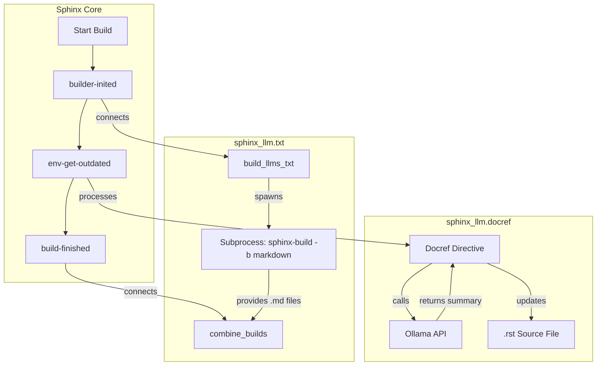
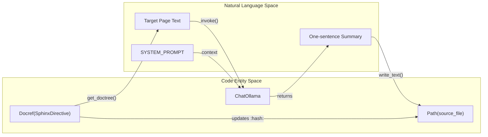

<!-- source: DeepWiki mcp.deepwiki.com · repo NVIDIA/sphinx-llm · page 2 Core Extensions · fetched 2026-10-26 -->

# Core Extensions

Relevant source files

The following files were used as context for generating this wiki page:

- [README.md](README.md)
- [src/sphinx_llm/docref.py](src/sphinx_llm/docref.py)
- [src/sphinx_llm/txt.py](src/sphinx_llm/txt.py)

The `sphinx-llm` package provides two primary extensions designed to enhance documentation for Large Language Models (LLMs) and leverage LLMs for content generation. These extensions integrate directly into the Sphinx build lifecycle to automate the production of LLM-friendly artifacts and summaries.

| Extension | Purpose | Key Feature |
| --- | --- | --- |
| `sphinx_llm.txt` | **LLM Consumption** | Generates `llms.txt` and `llms-full.txt` alongside HTML. |
| `sphinx_llm.docref` | **LLM Generation** | Uses Ollama to create and cache page summaries in-place. |

---

## Extension Integration Architecture

The extensions hook into different stages of the Sphinx application. While `sphinx_llm.txt` primarily operates during the `builder-inited` and `build-finished` phases to manage secondary build processes, `sphinx_llm.docref` functions as a directive that executes during the parsing of source documents.

### Build Lifecycle Integration
The following diagram illustrates how the extensions interact with the standard Sphinx build flow.

**Diagram: Sphinx Build Lifecycle Hooks**

**Sources:**
- `src/sphinx_llm/txt.py:44-46` (builder-inited connection)
- `src/sphinx_llm/txt.py:81-83` (build-finished connection)
- `src/sphinx_llm/docref.py:167-168` (directive registration)

---

## sphinx_llm.txt — LLM-Consumable Output Generation

The `sphinx_llm.txt` extension implements the [llms.txt](https://llmstxt.org/) standard. It ensures that for every HTML page generated, a corresponding Markdown version is available, typically with a `.md` suffix (e.g., `index.html.md`).

This extension uses a `MarkdownGenerator` class to manage a "shadow build." It spawns a separate `sphinx-build` process using the `markdown` builder to ensure high-quality Markdown output without interfering with the primary HTML rendering.

**Key Responsibilities:**
- **Parallel Execution**: Spawns a background subprocess to build Markdown while the main HTML build continues `[src/sphinx_llm/txt.py:155-159]()`.
- **Sitemap Generation**: Creates an `llms.txt` file that acts as a Markdown-formatted sitemap for LLM crawlers `[src/sphinx_llm/txt.py:119-119]()`.
- **Corpus Concatenation**: Optionally creates `llms-full.txt`, a single file containing the entire documentation set for easy ingestion `[src/sphinx_llm/txt.py:115-116]()`.

For details, see [sphinx_llm.txt — LLM-Consumable Output Generation](#2.1).

**Sources:**
- `src/sphinx_llm/txt.py:28-40` (MarkdownGenerator definition)
- `src/sphinx_llm/txt.py:130-138` (Subprocess command configuration)
- `README.md:30-42` (Extension purpose)

---

## sphinx_llm.docref — LLM-Powered Page Summaries

The `sphinx_llm.docref` extension provides the `.. docref::` directive. This directive allows authors to reference other pages while automatically generating a concise summary of the target page using a local LLM via Ollama.

**Core Workflow:**
1. **Extraction**: The directive extracts the text content of the target document using the Sphinx environment `[src/sphinx_llm/docref.py:71-73]()`.
2. **Generation**: It sends the content to an Ollama instance (defaulting to `llama3.2:3b`) with a specific `SYSTEM_PROMPT` `[src/sphinx_llm/docref.py:94-108]()`.
3. **Caching**: It computes an MD5 hash of the source document. If the hash matches the `:hash:` option in the directive, it skips regeneration to save time `[src/sphinx_llm/docref.py:76-78]()`.
4. **Write-back**: On the first run or when the target changes, the extension modifies the original `.rst` file on disk to include the generated summary and the new hash `[src/sphinx_llm/docref.py:162-163]()`.

**Diagram: Docref Data Flow**

For details, see [sphinx_llm.docref — LLM-Powered Page Summaries](#2.2).

**Sources:**
- `src/sphinx_llm/docref.py:25-29` (Docref class and options)
- `src/sphinx_llm/docref.py:21-21` (SYSTEM_PROMPT)
- `src/sphinx_llm/docref.py:129-163` (update_content logic)
- `README.md:120-124` (Extension overview)

---

