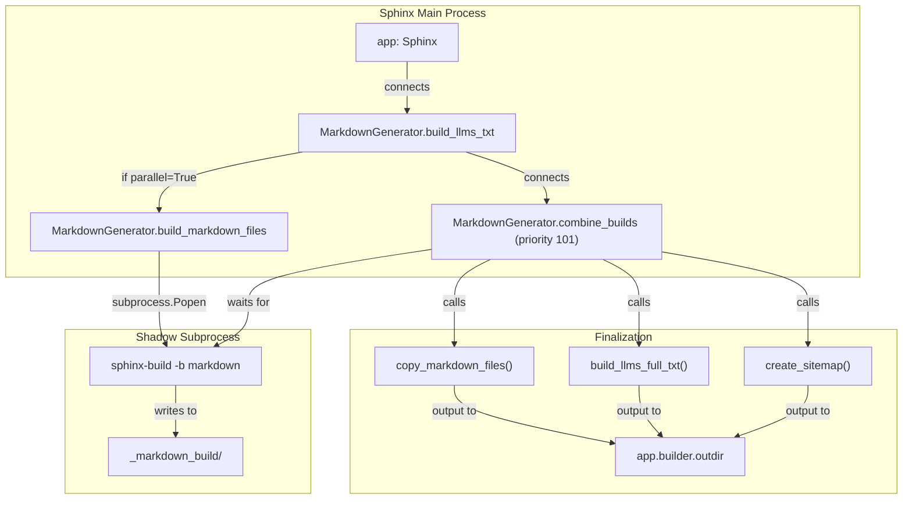
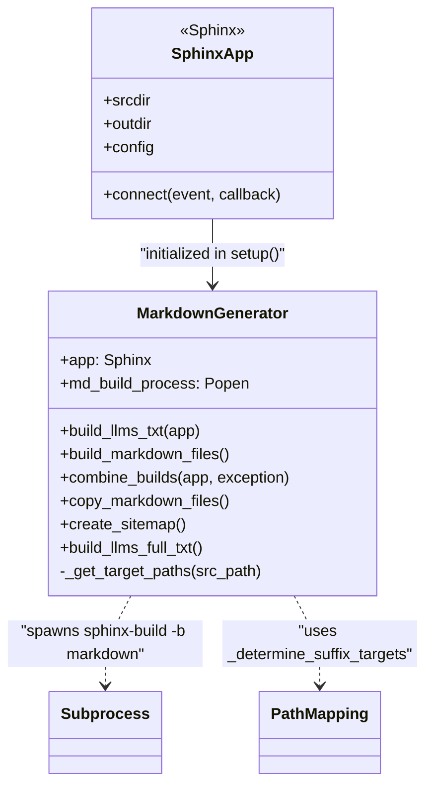

<!-- source: DeepWiki mcp.deepwiki.com · repo NVIDIA/sphinx-llm · page 2.1 sphinx_llm.txt — LLM-Consumable Output Generation · fetched 2026-10-26 -->

# sphinx_llm.txt — LLM-Consumable Output Generation

Relevant source files

The following files were used as context for generating this wiki page:

- [README.md](README.md)
- [src/sphinx_llm/txt.py](src/sphinx_llm/txt.py)

The `sphinx_llm.txt` extension is designed to make Sphinx-based documentation easily consumable by Large Language Models (LLMs) and AI agents. It implements the [llms.txt](https://llmstxt.org/) standard by generating a suite of Markdown-based artifacts alongside the standard HTML build. This ensures that documentation is well-indexed for model training and provides high-quality context for RAG (Retrieval-Augmented Generation) systems.

## Overview of LLM Artifacts

When integrated into a Sphinx project, `sphinx_llm.txt` produces three primary types of output:

1.  **Individual Markdown Pages**: A Markdown version of every HTML page, typically using an `.html.md` or `.md` suffix.
2.  **llms.txt (Sitemap)**: A Markdown-formatted index of the entire documentation site, including titles and brief descriptions for each page.
3.  **llms-full.txt (Concatenated Corpus)**: A single, large Markdown file containing the full text of every page in the project, optimized for providing comprehensive context in a single request.

### High-Level Architecture
The extension operates by spawning a "shadow build" using `sphinx-markdown-builder`. This process runs in the background while the primary HTML build proceeds.

**Process Flow: Markdown Generation and Merging**

Sources: [src/sphinx_llm/txt.py:28-124](), [README.md:54-65]()

## Build Pipeline and Subprocess Management

The core of the extension is the `MarkdownGenerator` class [src/sphinx_llm/txt.py:28-30](). It manages a background `subprocess.Popen` call to `sphinx-build` using the `markdown` builder [src/sphinx_llm/txt.py:155-159](). 

Key behaviors include:
*   **Parallel Execution**: By default, the Markdown build runs concurrently with the HTML build to minimize total build time [src/sphinx_llm/txt.py:50-50]().
*   **Doctree Reuse**: If `llms_txt_build_parallel` is set to `False`, the subprocess reuses the existing `doctreedir` to speed up processing [src/sphinx_llm/txt.py:142-144]().
*   **Logging**: Subprocess output is captured in a temporary log file, which is printed to the main console only if the Markdown build fails [src/sphinx_llm/txt.py:102-108]().

For details, see [Build Pipeline and Subprocess Management](#2.1.1).

Sources: [src/sphinx_llm/txt.py:46-84](), [src/sphinx_llm/txt.py:125-164]()

## Suffix Modes and Path Mapping

The extension must map HTML output paths to corresponding Markdown paths. This is complicated by different Sphinx builders like `html` (which produces `page.html`) and `dirhtml` (which produces `page/index.html`).

The `llms_txt_suffix_mode` configuration option controls this behavior:
*   **auto**: The default; provides broad compatibility [src/sphinx_llm/txt.py:177-179]().
*   **file-suffix**: Appends `.md` to the physical filename (e.g., `index.html.md`) [src/sphinx_llm/txt.py:173-174]().
*   **url-suffix**: Creates a file that matches a clean URL (e.g., `page.md` for a directory `page/`) [src/sphinx_llm/txt.py:175-176]().
*   **replace**: Replaces `.html` with `.md` entirely [src/sphinx_llm/txt.py:182-183]().

The internal `_get_target_paths` method [src/sphinx_llm/txt.py:186-186]() handles the logic of translating these modes across different builder types.

For details, see [Suffix Modes and Path Mapping](#2.1.2).

Sources: [src/sphinx_llm/txt.py:51-63](), [README.md:89-100]()

## llms.txt and llms-full.txt Output Files

Once individual Markdown files are generated, the extension aggregates them into two standard files:

| File | Role | Content |
| :--- | :--- | :--- |
| `llms.txt` | **Sitemap** | Project title, description, and a list of links to all Markdown pages [src/sphinx_llm/txt.py:239-281](). |
| `llms-full.txt` | **Concatenated Corpus** | Every page's content separated by headers, allowing LLMs to read the entire docset at once [src/sphinx_llm/txt.py:214-237](). |

The extension automatically extracts project descriptions from `pyproject.toml` or `conf.py` [src/sphinx_llm/txt.py:283-306]() and uses Markdown headers to structure the concatenated output.

For details, see [llms.txt and llms-full.txt Output Files](#2.1.3).

Sources: [src/sphinx_llm/txt.py:115-119](), [README.md:34-41]()

## Code Entity Map

The following diagram maps the logical components of the `sphinx_llm.txt` extension to the specific Python classes and functions that implement them.

Sources: [src/sphinx_llm/txt.py:28-44](), [src/sphinx_llm/txt.py:165-212]()

---

