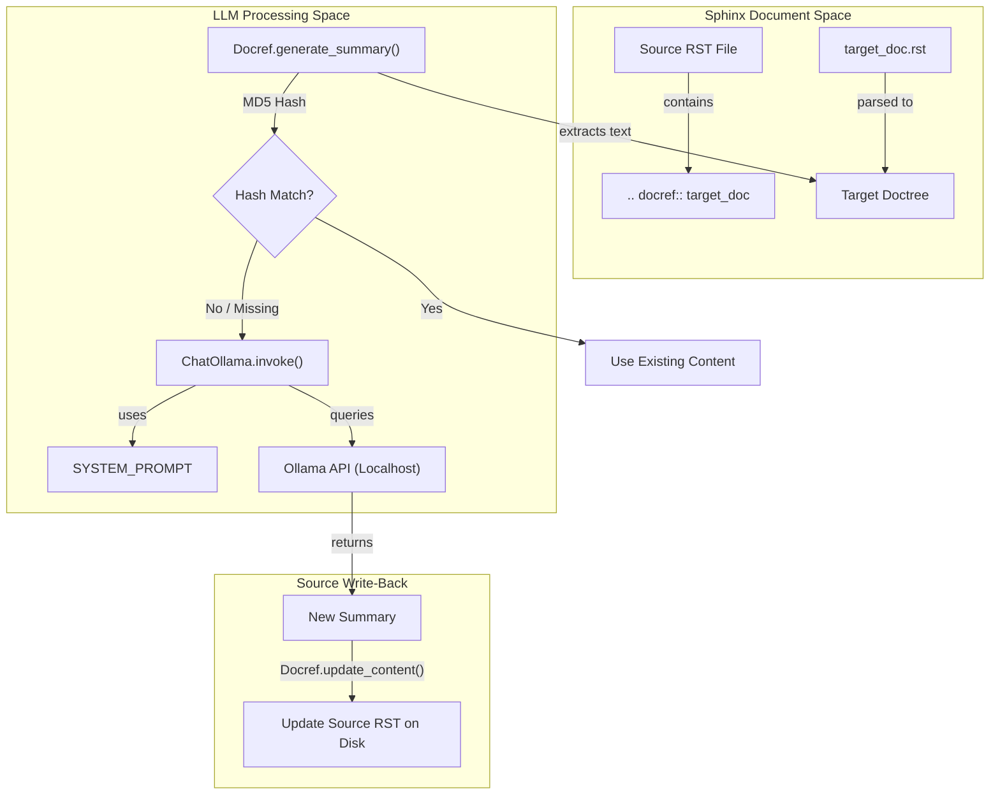
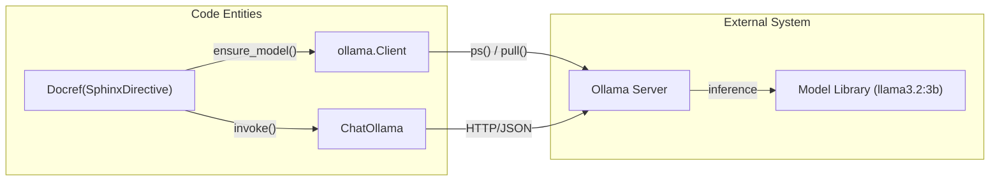

<!-- source: DeepWiki mcp.deepwiki.com · repo NVIDIA/sphinx-llm · page 2.2 sphinx_llm.docref — LLM-Powered Page Summaries · fetched 2026-10-26 -->

# sphinx_llm.docref — LLM-Powered Page Summaries

Relevant source files

The following files were used as context for generating this wiki page:

- [README.md](README.md)
- [src/sphinx_llm/docref.py](src/sphinx_llm/docref.py)

The `sphinx_llm.docref` extension provides a mechanism to generate and embed AI-powered summaries of other documentation pages directly into your reStructuredText (RST) files [src/sphinx_llm/docref.py:120-123](). Unlike standard cross-references that only provide a title link, `docref` uses a Large Language Model (LLM) via **Ollama** to create a concise summary of the target page's content, which is then rendered as an admonition with a "Read more >>" link [src/sphinx_llm/docref.py:51-66]().

## Core Components and Workflow

The extension revolves around the `Docref` class, which inherits from both `BaseAdmonition` and `SphinxDirective` [src/sphinx_llm/docref.py:25](). When Sphinx encounters a `.. docref::` directive, the extension performs a lookup of the target document, calculates a hash of its content, and determines if a new summary needs to be generated or if a cached version can be used [src/sphinx_llm/docref.py:70-78]().

### Docref Build Process

The following diagram illustrates how the `Docref` directive bridges the gap between the Sphinx document tree (Code/Doc Space) and the LLM generation (Natural Language Space).

**Docref Summary Generation Flow**

Sources: [src/sphinx_llm/docref.py:30-43](), [src/sphinx_llm/docref.py:69-110](), [src/sphinx_llm/docref.py:129-163]()

## The Docref Directive

The `.. docref::` directive requires a single argument: the name of the document to be summarized [src/sphinx_llm/docref.py:27-32](). It supports two primary options:
*   `:hash:`: An MD5 hash of the target document's content used for caching [src/sphinx_llm/docref.py:28]().
*   `:model:`: The specific LLM model to use for this summary (defaults to `llama3.2:3b`) [src/sphinx_llm/docref.py:20-28]().

When rendered, the directive produces a standard Sphinx admonition node [src/sphinx_llm/docref.py:26](). The extension automatically appends a `pending_xref` node to the end of the summary, which Sphinx later resolves into a "Read more >>" hyperlink pointing to the referenced document [src/sphinx_llm/docref.py:52-66]().

For detailed syntax and usage examples, see [Docref Directive Reference](#2.2.1).

Sources: [src/sphinx_llm/docref.py:25-67]()

## Ollama Integration and Caching

The extension integrates with [Ollama](https://github.com/ollama/ollama) to run LLMs locally [README.md:125-126](). It uses `langchain_ollama.ChatOllama` to communicate with the Ollama server, typically hosted at `http://localhost:11434` [src/sphinx_llm/docref.py:22, 94-98]().

### Caching and Write-Back Mechanism
To avoid redundant LLM calls and associated latency, `docref` implements a hash-based caching system:
1.  **Hash Calculation**: It generates an MD5 hash of the target document's text [src/sphinx_llm/docref.py:76]().
2.  **Verification**: If the `:hash:` option in the RST file matches the calculated hash, the existing summary in the file is reused [src/sphinx_llm/docref.py:77-78]().
3.  **In-Place Update**: If the hashes differ, the extension calls the LLM, generates a new summary, and **modifies the original RST source file on disk** to include the new summary and the updated hash [src/sphinx_llm/docref.py:132-163]().

**System Integration Mapping**

Sources: [src/sphinx_llm/docref.py:93-108](), [src/sphinx_llm/docref.py:112-127]()

For details on configuring the LLM connection and managing the cache, see [Ollama Integration and Summary Caching](#2.2.2).

Sources: [src/sphinx_llm/docref.py:69-110](), [src/sphinx_llm/docref.py:129-165]()

---

