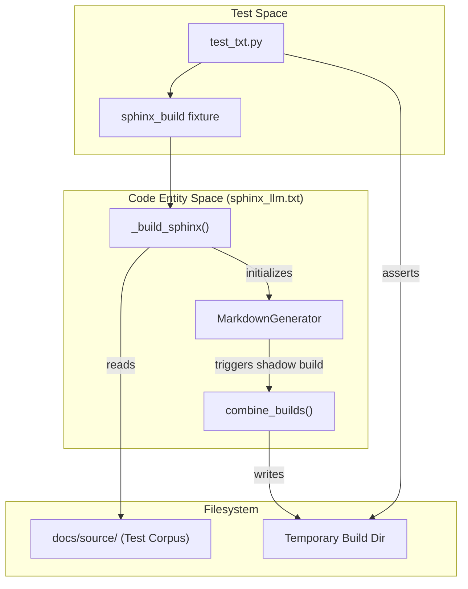
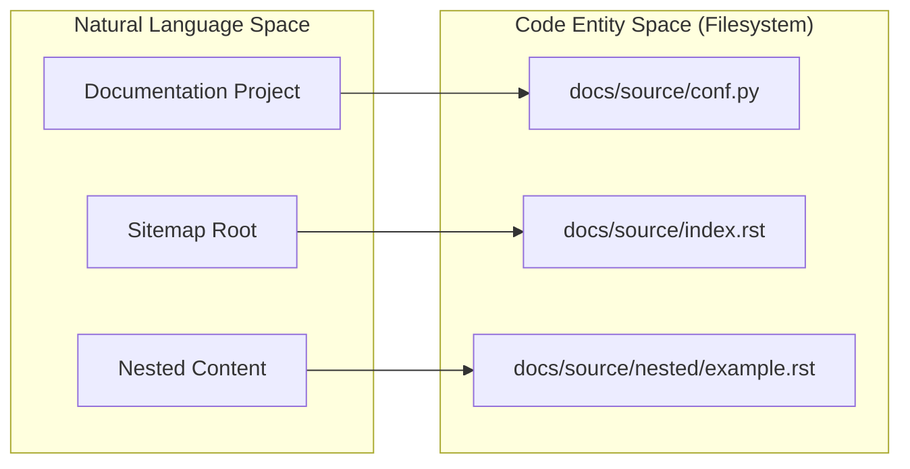

<!-- source: DeepWiki mcp.deepwiki.com · repo NVIDIA/sphinx-llm · page 3 Testing · fetched 2026-10-26 -->

# Testing

Relevant source files

The following files were used as context for generating this wiki page:

- [src/sphinx_llm/tests/__init__.py](src/sphinx_llm/tests/__init__.py)
- [src/sphinx_llm/tests/test_txt.py](src/sphinx_llm/tests/test_txt.py)

The `sphinx-llm` test suite is designed to ensure that both the `sphinx_llm.txt` and `sphinx_llm.docref` extensions integrate correctly with the Sphinx build lifecycle. The testing strategy relies heavily on integration tests that execute real Sphinx builds against a dedicated example project, verifying the generation of LLM-consumable artifacts and the correctness of internal logic like path mapping and subprocess management.

### Test Architecture Overview

The test suite uses `pytest` and leverages the `Sphinx` application class to programmatically trigger builds. It specifically targets the interaction between the standard HTML builders and the custom Markdown generation pipeline.

The following diagram illustrates how the test infrastructure exercises the code entities:

**Test Execution Flow**

Sources: [src/sphinx_llm/tests/test_txt.py:21-50](), [src/sphinx_llm/tests/test_txt.py:66-78]()

### Key Fixtures and Helpers

The primary engine for testing is the `sphinx_build` fixture. It allows the test suite to matrix across different Sphinx configurations to ensure compatibility across common documentation patterns.

| Fixture / Helper | Role |
| :--- | :--- |
| `sphinx_build` | Parametrized fixture that runs builds for `html` and `dirhtml` builders in both sequential and parallel modes [src/sphinx_llm/tests/test_txt.py:66-78](). |
| `_build_sphinx` | Internal helper that creates a `tempfile.TemporaryDirectory`, initializes the `Sphinx` app, and executes `app.build()` [src/sphinx_llm/tests/test_txt.py:21-50](). |
| `assert_file_exists_with_content` | Utility to verify that output artifacts (like `llms.txt`) are not only present but contain data [src/sphinx_llm/tests/test_txt.py:53-57](). |

### Testing Scope

The test suite validates several critical behaviors of the extensions:
*   **Artifact Integrity**: Ensuring every `.rst` file in the source results in a corresponding `.html.md` file in the output [src/sphinx_llm/tests/test_txt.py:122-141]().
*   **Sitemap Accuracy**: Parsing the generated `llms.txt` to verify that all listed URLs point to valid files on disk [src/sphinx_llm/tests/test_txt.py:144-159]().
*   **Suffix Mode Logic**: Verifying that `llms_txt_suffix_mode` (e.g., `file-suffix`, `url-suffix`) correctly places files in the expected directory structure [src/sphinx_llm/tests/test_txt.py:178-210]().
*   **Error Handling**: Confirming that the `MarkdownGenerator` handles build exceptions gracefully without crashing the main Sphinx process [src/sphinx_llm/tests/test_txt.py:115-120]().

### Integration with Example Project

Rather than using mock objects, the tests use the `docs/source` directory as a live test corpus. This directory contains a variety of Sphinx features (nested directories, static assets, various RST directives) to ensure the extensions work in real-world scenarios.

**Test Corpus Mapping**

Sources: [src/sphinx_llm/tests/test_txt.py:29-29](), [src/sphinx_llm/tests/test_txt.py:59-63]()

---

### Detailed Sub-Pages

For more specific information on the test implementation and the corpus used, see the following pages:

*   **[Test Suite for sphinx_llm.txt](#3.1)**: Detailed breakdown of `test_txt.py`, including the parametrization of builders and specific assertion logic for the LLM output files.
*   **[Example Documentation Project](#3.2)**: A guide to the `docs/source` directory, explaining how the different RST files exercise specific parts of the extension.

---

