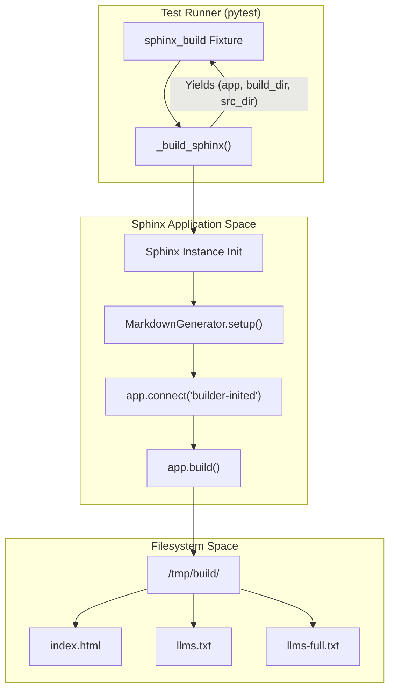
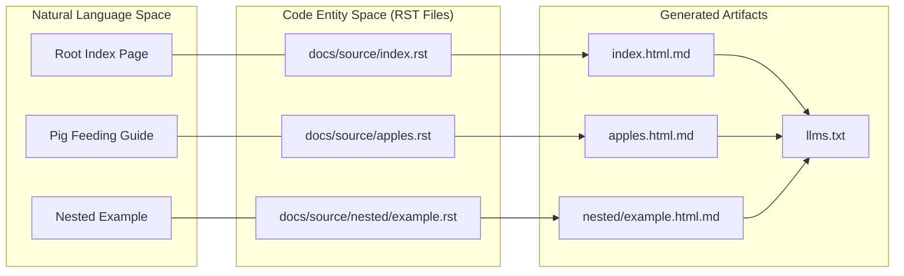

<!-- source: DeepWiki mcp.deepwiki.com · repo NVIDIA/sphinx-llm · page 3.1 Test Suite for sphinx_llm.txt · fetched 2026-10-26 -->

# Test Suite for sphinx_llm.txt

Relevant source files

The following files were used as context for generating this wiki page:

- [docs/source/_static/images/pig-feeding-summary.png](docs/source/_static/images/pig-feeding-summary.png)
- [docs/source/apples.rst](docs/source/apples.rst)
- [docs/source/index.rst](docs/source/index.rst)
- [docs/source/nested/example.rst](docs/source/nested/example.rst)
- [docs/source/test.rst](docs/source/test.rst)
- [src/sphinx_llm/tests/test_txt.py](src/sphinx_llm/tests/test_txt.py)

This page documents the test suite for the `sphinx_llm.txt` extension, primarily contained within `test_txt.py`. The suite ensures that the extension correctly generates LLM-consumable Markdown artifacts, maintains sitemap integrity, and respects various configuration modes across different Sphinx builders and execution environments.

## Test Infrastructure and Fixtures

The test suite leverages a centralized Sphinx build fixture that parametrizes the build environment to cover common production scenarios.

### The `sphinx_build` Fixture
The `sphinx_build` function is a parametrized fixture that executes a full Sphinx build for each test case. It cycles through combinations of HTML builders and execution modes to ensure the extension's subprocess management is robust.

| Parameter | Values | Description |
| :--- | :--- | :--- |
| **Builder** | `html`, `dirhtml` | Tests standard file-based output and directory-based (clean URL) output. |
| **Parallel** | `True`, `False` | Toggles the `llms_txt_build_parallel` configuration to test both threaded and sequential shadow builds. |

The fixture uses a temporary directory for each run, isolating `build` and `doctrees` artifacts [src/sphinx_llm/tests/test_txt.py:34-43](). It points to the project's own documentation source (`docs/source`) as the test corpus [src/sphinx_llm/tests/test_txt.py:29-29]().

### Data Flow: Test Execution
The following diagram illustrates how the `sphinx_build` fixture initializes the `Sphinx` application and triggers the `MarkdownGenerator` logic.

**Sphinx Test Build Lifecycle**

Sources: [src/sphinx_llm/tests/test_txt.py:21-50](), [src/sphinx_llm/tests/test_txt.py:66-78]()

## Key Test Cases

### 1. File Existence and Content Integrity
The suite verifies that for every source `.rst` file in the documentation project, the extension produces a corresponding `.html.md` file [src/sphinx_llm/tests/test_txt.py:122-142]().
* **Logic**: It maps source paths to expected output paths based on whether the builder is `html` (flat) or `dirhtml` (folder-based) [src/sphinx_llm/tests/test_txt.py:132-138]().
* **Assertion**: `assert_file_exists_with_content` ensures files are not only present but have a non-zero size [src/sphinx_llm/tests/test_txt.py:53-56]().

### 2. llms.txt Sitemap Validation
The test `test_llms_txt_sitemap_links_exist` parses the generated `llms.txt` file using regex to extract all Markdown links [src/sphinx_llm/tests/test_txt.py:144-159]().
* **Link Verification**: Every URL found in the sitemap must point to a file that exists in the build directory [src/sphinx_llm/tests/test_txt.py:157-158]().
* **Description Filtering**: A specific test ensures that empty anchor tags (e.g., ``) are not accidentally extracted as page descriptions in the sitemap [src/sphinx_llm/tests/test_txt.py:161-176]().

### 3. Suffix Mode Configuration
The suite tests the `llms_txt_suffix_mode` configuration, which determines the naming convention for Markdown files in `dirhtml` builds.

| Mode | Expected Output for `test.rst` |
| :--- | :--- |
| `file-suffix` | `test/index.html.md` |
| `url-suffix` | `test.md` |
| `auto` | Both of the above |

The `test_dirhtml_suffix_mode_configuration` test uses `indirect=True` parametrization to verify that only the requested files are created and that `both` acts as a backward-compatible alias for `auto` [src/sphinx_llm/tests/test_txt.py:178-216]().

### 4. Error Handling
The suite includes safety checks for the build lifecycle:
* **Initialization**: Verifies `MarkdownGenerator` correctly stores the app reference [src/sphinx_llm/tests/test_txt.py:89-94]().
* **Event Connection**: Confirms the `builder-inited` event is hooked during setup [src/sphinx_llm/tests/test_txt.py:96-113]().
* **Exception Resilience**: `test_combine_builds_with_exception` ensures that if the primary Sphinx build fails, the `combine_builds` method returns early without attempting to merge artifacts [src/sphinx_llm/tests/test_txt.py:115-120]().

Sources: [src/sphinx_llm/tests/test_txt.py:53-216]()

## Example Project as Test Corpus

The `docs/source` directory serves as the primary test project. It contains a variety of structures to exercise the extension's path logic:
* **Root Files**: `index.rst`, `test.rst`, `apples.rst` [docs/source/index.rst:13-14]().
* **Nested Files**: `nested/example.rst` [docs/source/nested/example.rst:1-5]().
* **Static Assets**: Images like `pig-feeding-summary.png` [docs/source/_static/images/pig-feeding-summary.png:1-1]().

**Code Entity to Document Mapping**

Sources: [docs/source/index.rst:9-15](), [docs/source/apples.rst:1-2](), [docs/source/nested/example.rst:1-2]()

---

