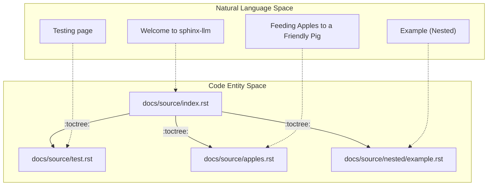
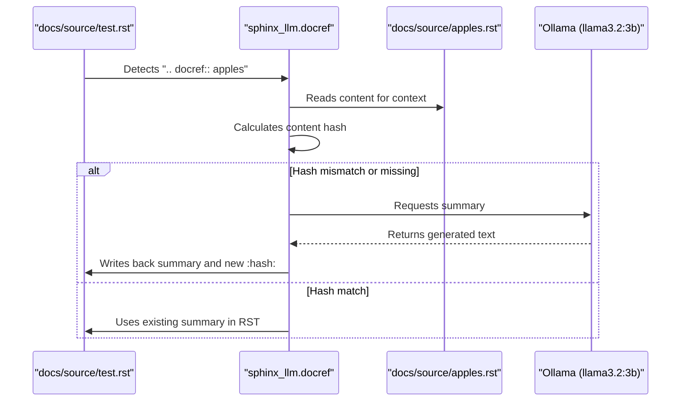

<!-- source: DeepWiki mcp.deepwiki.com · repo NVIDIA/sphinx-llm · page 3.2 Example Documentation Project · fetched 2026-10-26 -->

# Example Documentation Project

Relevant source files

The following files were used as context for generating this wiki page:

- [docs/Makefile](docs/Makefile)
- [docs/make.bat](docs/make.bat)
- [docs/source/_static/.gitkeep](docs/source/_static/.gitkeep)
- [docs/source/_static/images/pig-feeding-summary.png](docs/source/_static/images/pig-feeding-summary.png)
- [docs/source/_templates/.gitkeep](docs/source/_templates/.gitkeep)
- [docs/source/apples.rst](docs/source/apples.rst)
- [docs/source/conf.py](docs/source/conf.py)
- [docs/source/index.rst](docs/source/index.rst)
- [docs/source/nested/example.rst](docs/source/nested/example.rst)
- [docs/source/test.rst](docs/source/test.rst)

The `docs/source/` directory contains a complete Sphinx project that serves a dual purpose: it acts as the primary documentation for the `sphinx-llm` repository and functions as the ground-truth test corpus for the suite's integration tests. This project demonstrates the configuration and usage of both the `sphinx_llm.txt` and `sphinx_llm.docref` extensions.

## Project Structure and Configuration

The project follows a standard Sphinx layout, utilizing an `index.rst` file as the root of the documentation tree. The configuration is centralized in `conf.py`, which enables the `sphinx-llm` extensions and defines global parameters for LLM integration.

### Configuration (`conf.py`)

The `conf.py` file integrates the core extensions and provides the necessary metadata for the `llms.txt` generation.

| Parameter | Value / Description |
| :--- | :--- |
| `extensions` | Includes `sphinx_llm.docref` and `sphinx_llm.txt` [docs/source/conf.py:18-21](). |
| `sphinx_llm_options` | Sets the default model to `llama3.2:3b` [docs/source/conf.py:23-25](). |
| `llms_txt_description` | A multi-line string used as the summary in the generated `llms.txt` sitemap [docs/source/conf.py:26-30](). |
| `html_theme` | Uses the `alabaster` theme [docs/source/conf.py:39-39](). |

**Sources:** [docs/source/conf.py:1-41]()

## Documentation Content and Hierarchy

The project structure is designed to test various features of the extensions, including cross-referencing, nested directories, and LLM-generated summaries.

### The Document Tree

The `index.rst` file defines the `toctree`, which includes three primary pages: `test`, `apples`, and a nested `nested/example` [docs/source/index.rst:9-15]().

**Documentation Hierarchy Diagram**

**Sources:** [docs/source/index.rst:1-24](), [docs/source/test.rst:1-2](), [docs/source/apples.rst:1-2](), [docs/source/nested/example.rst:1-2]()

### Content Examples

1.  **`apples.rst`**: A detailed instructional page about feeding apples to pigs. It contains multiple sections (`Introduction`, `Steps`, `Safety Tips`) and formatted lists [docs/source/apples.rst:1-47](). This file serves as the primary source for the `docref` summarization test.
2.  **`test.rst`**: Demonstrates the `.. docref::` directive. It references the `apples` document and contains a cached summary generated by the `llama3.2:3b` model [docs/source/test.rst:5-9]().
3.  **`nested/example.rst`**: A simple file used to verify that the `sphinx_llm.txt` extension correctly handles nested directory structures when generating Markdown outputs and sitemaps [docs/source/nested/example.rst:1-5]().

**Sources:** [docs/source/apples.rst:1-47](), [docs/source/test.rst:1-9](), [docs/source/nested/example.rst:1-5]()

## Data Flow: Summarization and Referencing

The `docref` extension interacts with the source files by reading content from a target (e.g., `apples.rst`) and writing a summary back into the referencing file (e.g., `test.rst`).

**Summarization Data Flow**

**Sources:** [docs/source/test.rst:5-9](), [docs/source/conf.py:23-25]()

## Static Assets and Build Scripts

The project includes standard Sphinx directories for customization:
*   **`_static/`**: Contains assets like `pig-feeding-summary.png`, which provides a visual reference for how the documentation renders [docs/source/_static/images/pig-feeding-summary.png:1-15]().
*   **`_templates/`**: A placeholder for custom HTML templates [docs/source/_templates/.gitkeep:1-1]().

### Build Infrastructure

The project provides standard entry points for local builds:
*   **`Makefile`**: Standard GNU Make targets for building documentation (e.g., `make html`) [docs/Makefile:1-21]().
*   **`make.bat`**: Windows batch script equivalent for the Sphinx build process [docs/make.bat:1-36]().

When these scripts are executed, the `sphinx_llm.txt` extension intercepts the build to trigger the parallel sitemap and Markdown generation processes.

**Sources:** [docs/Makefile:1-21](), [docs/make.bat:1-36](), [docs/source/conf.py:18-21]()

---

