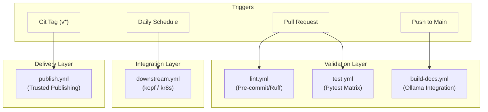
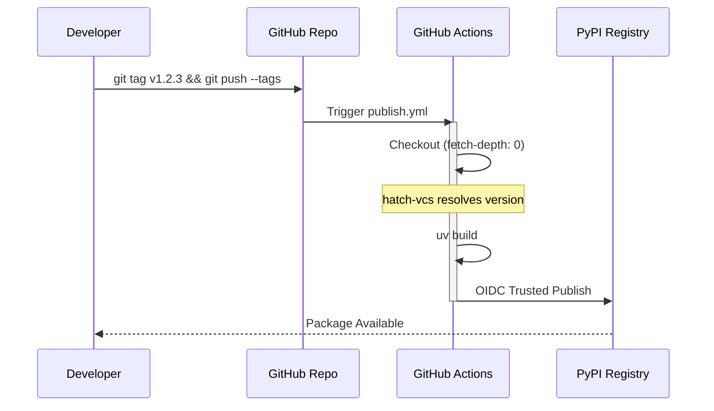

<!-- source: DeepWiki mcp.deepwiki.com · repo NVIDIA/sphinx-llm · page 4 CI/CD and Release Infrastructure · fetched 2026-10-26 -->

# CI/CD and Release Infrastructure

Relevant source files

The following files were used as context for generating this wiki page:

- [.github/workflows/build-docs.yml](.github/workflows/build-docs.yml)
- [.github/workflows/downstream.yml](.github/workflows/downstream.yml)
- [.github/workflows/lint.yml](.github/workflows/lint.yml)
- [.github/workflows/publish.yml](.github/workflows/publish.yml)
- [.github/workflows/test.yml](.github/workflows/test.yml)

This section provides an overview of the automation pipelines and release processes for `sphinx-llm`. The project utilizes GitHub Actions to manage a comprehensive suite of workflows including unit testing across multiple Python/Sphinx versions, documentation builds with live LLM services, downstream integration checks, and automated PyPI publishing.

### Workflow Orchestration

The infrastructure is designed to ensure that the complex interactions between Sphinx extensions, local LLM services (Ollama), and the generated Markdown artifacts remain stable across supported environments.

#### System Architecture: CI/CD Pipeline

**Sources:** [.github/workflows/lint.yml:3-8](), [.github/workflows/test.yml:3-8](), [.github/workflows/build-docs.yml:3-7](), [.github/workflows/downstream.yml:3-8](), [.github/workflows/publish.yml:3-6]()

---

### Build and Test Workflows
The core validation of the codebase is split between standard unit tests and functional documentation builds.

*   **`test.yml`**: Executes `pytest` against a matrix of Python versions (3.9–3.12) and Sphinx versions (5.x–8.x) [.github/workflows/test.yml:13-33](). It generates coverage reports uploaded to Codecov [.github/workflows/test.yml:45-53]().
*   **`build-docs.yml`**: Specifically validates the `sphinx_llm.docref` extension by spinning up an **Ollama** service in the runner [.github/workflows/build-docs.yml:21-22](). It verifies that LLM-powered summaries can be generated and written back to source files like `apples.rst` [.github/workflows/build-docs.yml:30-32]().

For details, see [Build and Test Workflows](#4.1).

**Sources:** [.github/workflows/test.yml:10-54](), [.github/workflows/build-docs.yml:9-42]()

---

### Downstream Compatibility Testing
Because `sphinx-llm` modifies the standard Sphinx build output, it is critical to ensure it does not break existing documentation projects.

The `downstream.yml` workflow performs "smoke tests" by:
1.  Cloning external projects such as `nolar/kopf` and `kr8s-org/kr8s` [.github/workflows/downstream.yml:20-27]().
2.  Injecting the local `sphinx-llm` build into their environments [.github/workflows/downstream.yml:50-52]().
3.  Running their native `sphinx-build` commands [.github/workflows/downstream.yml:54-58]().
4.  Verifying the presence of `llms.txt` and `llms-full.txt` artifacts [.github/workflows/downstream.yml:60-69]().

If a downstream build fails, the workflow automatically opens a GitHub issue in the `sphinx-llm` repository [.github/workflows/downstream.yml:70-80]().

For details, see [Downstream Compatibility Testing](#4.2).

**Sources:** [.github/workflows/downstream.yml:13-81]()

---

### Linting and Publishing
The project maintains strict code quality and automated release cycles.

*   **Linting**: The `lint.yml` workflow utilizes `pre-commit/action` to enforce `ruff` formatting, license header presence, and `codespell` checks [.github/workflows/lint.yml:10-17]().
*   **Publishing**: Releases are triggered by pushing a git tag. The `publish.yml` workflow uses **Trusted Publishing** to securely upload the built distribution to PyPI [.github/workflows/publish.yml:9-30](). Versioning is handled dynamically by `hatch-vcs` based on the git tag [.github/workflows/publish.yml:19]().

For details, see [Linting, Pre-commit, and Publishing](#4.3).

#### Release Process Mapping

**Sources:** [.github/workflows/publish.yml:1-31]()

---

