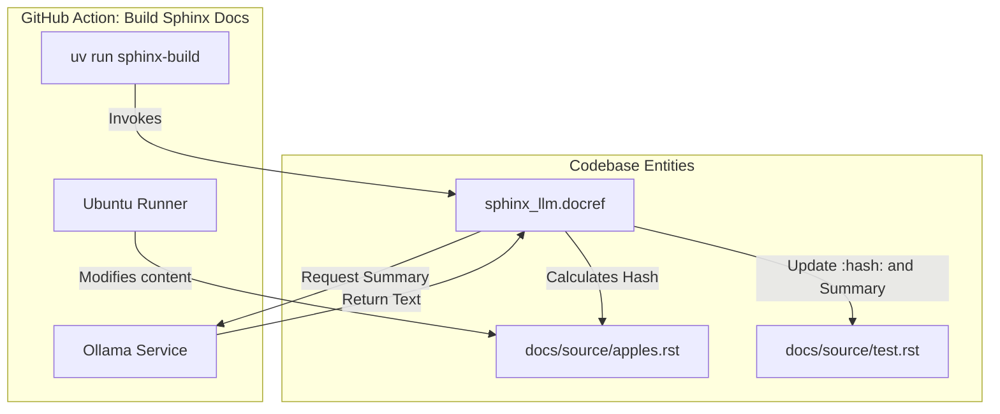
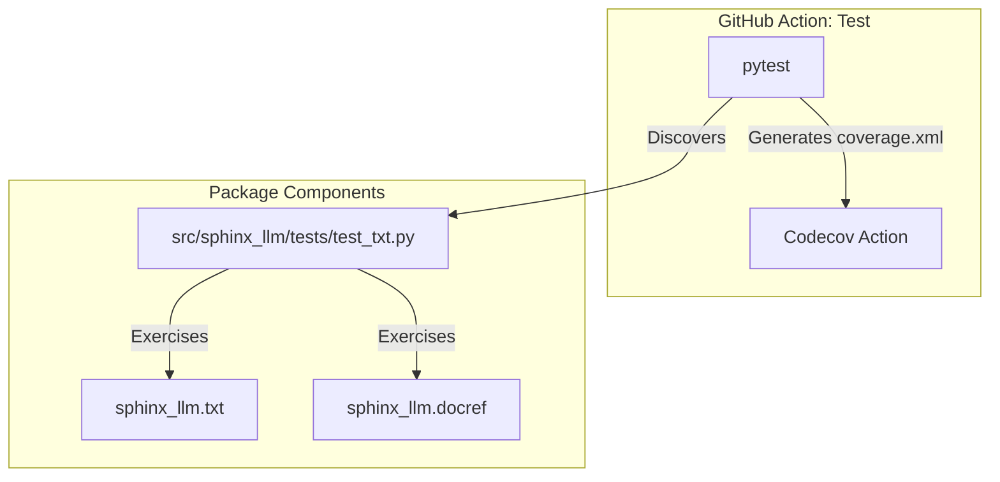

<!-- source: DeepWiki mcp.deepwiki.com · repo NVIDIA/sphinx-llm · page 4.1 Build and Test Workflows · fetched 2026-10-26 -->

# Build and Test Workflows

Relevant source files

The following files were used as context for generating this wiki page:

- [.github/workflows/build-docs.yml](.github/workflows/build-docs.yml)
- [.github/workflows/test.yml](.github/workflows/test.yml)

The `sphinx-llm` repository utilizes GitHub Actions to ensure cross-version compatibility for both Python and the Sphinx framework. The CI/CD pipeline is divided into specialized workflows that validate documentation generation (including LLM-powered features) and execute the test suite with comprehensive coverage reporting.

## Documentation Build Workflow (`build-docs.yml`)

The `build-docs.yml` workflow is designed to verify that the documentation can be built successfully across multiple versions of Sphinx. This workflow is unique because it exercises the `sphinx_llm.docref` extension, which requires a live LLM service to generate page summaries.

### Ollama Service Integration
To support the `.. docref::` directive during the build, the workflow initializes an Ollama instance using the `ai-action/setup-ollama` action [.github/workflows/build-docs.yml:21-22](). This allows the `sphinx-build` process to communicate with a local LLM to generate summaries for pages that do not have a cached summary in their source RST files.

### Cache Invalidation and Write-Back Testing
A critical part of this workflow is verifying the "write-back" mechanism of `sphinx_llm.docref`. The workflow performs the following steps to force a cache miss and observe the extension's behavior:
1.  **Invalidate Cache**: It appends a unique `GITHUB_RUN_ID` to `docs/source/apples.rst` [.github/workflows/build-docs.yml:30-32](). Since `docref` uses an MD5 hash of the target file's content to determine if a summary is stale, this modification forces the extension to request a new summary from Ollama.
2.  **Backup State**: It creates a backup of `docs/source/test.rst` [.github/workflows/build-docs.yml:33]().
3.  **Build and Compare**: After the build completes, it runs a `diff` between the original and updated source files [.github/workflows/build-docs.yml:39-41](). This confirms that the extension successfully updated the RST source on disk with the new summary and hash.

### Build Matrix and Environment
The build runs on `ubuntu-latest` using a matrix of Sphinx versions to ensure compatibility with legacy and modern Sphinx releases [.github/workflows/build-docs.yml:12-15]().

| Environment Variable / Tool | Purpose |
| :--- | :--- |
| `uv` | Used for fast dependency resolution and execution [.github/workflows/build-docs.yml:24-28](). |
| `--extra gen` | Ensures `langchain` and `ollama` dependencies are installed for `docref` [.github/workflows/build-docs.yml:37](). |
| `sphinx-version` matrix | Tests ranges from `5.1` through `9.0` [.github/workflows/build-docs.yml:15](). |

### Workflow Data Flow: Documentation Build
The following diagram illustrates how the build workflow interacts with the codebase and external services.

**Build Workflow Entity Map**

**Sources:** [.github/workflows/build-docs.yml:1-42]()

## Test Execution Workflow (`test.yml`)

The `test.yml` workflow focuses on unit and integration testing of the `sphinx_llm` package. It validates the logic of both `sphinx_llm.txt` (Markdown generation) and `sphinx_llm.docref` (referencing and summarization).

### Multi-Dimension Compatibility Matrix
The test suite is executed against a comprehensive matrix that covers:
1.  **Sphinx Versioning**: Latest Python (3.12) against Sphinx versions `5.x`, `6.x`, `7.x`, and `8.x` [.github/workflows/test.yml:16-23]().
2.  **Python Versioning**: Latest supported Sphinx (7.x) against Python `3.9`, `3.10`, `3.11`, and `3.12` [.github/workflows/test.yml:25-32]().

### Execution and Coverage
Tests are executed using `pytest` targeting the `src/sphinx_llm/tests/` directory [.github/workflows/test.yml:45](). The workflow includes:
*   **Coverage Tracking**: Uses `pytest-cov` to generate an XML coverage report for the `sphinx_llm` package [.github/workflows/test.yml:45]().
*   **Codecov Integration**: The resulting `coverage.xml` is uploaded to Codecov [.github/workflows/test.yml:47-54](). This provides visibility into which lines of the extensions are exercised by the test suite, specifically tracking the complex path mapping and subprocess logic in the `.txt` extension.

### Workflow Data Flow: Testing
This diagram maps the test execution process to the specific components of the package being validated.

**Test Workflow Entity Map**

**Sources:** [.github/workflows/test.yml:1-54]()

## Key Workflow Components Summary

| Feature | `build-docs.yml` | `test.yml` |
| :--- | :--- | :--- |
| **Primary Goal** | End-to-end doc build & summary write-back | Code correctness & version compatibility |
| **LLM Support** | Active (via `ai-action/setup-ollama`) | Not required (mocks/fixtures used in tests) |
| **Python Versions** | 3.12 | 3.9, 3.10, 3.11, 3.12 |
| **Sphinx Versions** | 5.x, 6.x, 7.x, 8.x | 5.x, 6.x, 7.x, 8.x |
| **Key Command** | `sphinx-build -b html` | `pytest src/sphinx_llm/tests/` |
| **Artifacts** | Updated `.rst` source files (verified via diff) | `coverage.xml` (uploaded to Codecov) |

**Sources:** [.github/workflows/build-docs.yml:1-42](), [.github/workflows/test.yml:1-54]()

---

