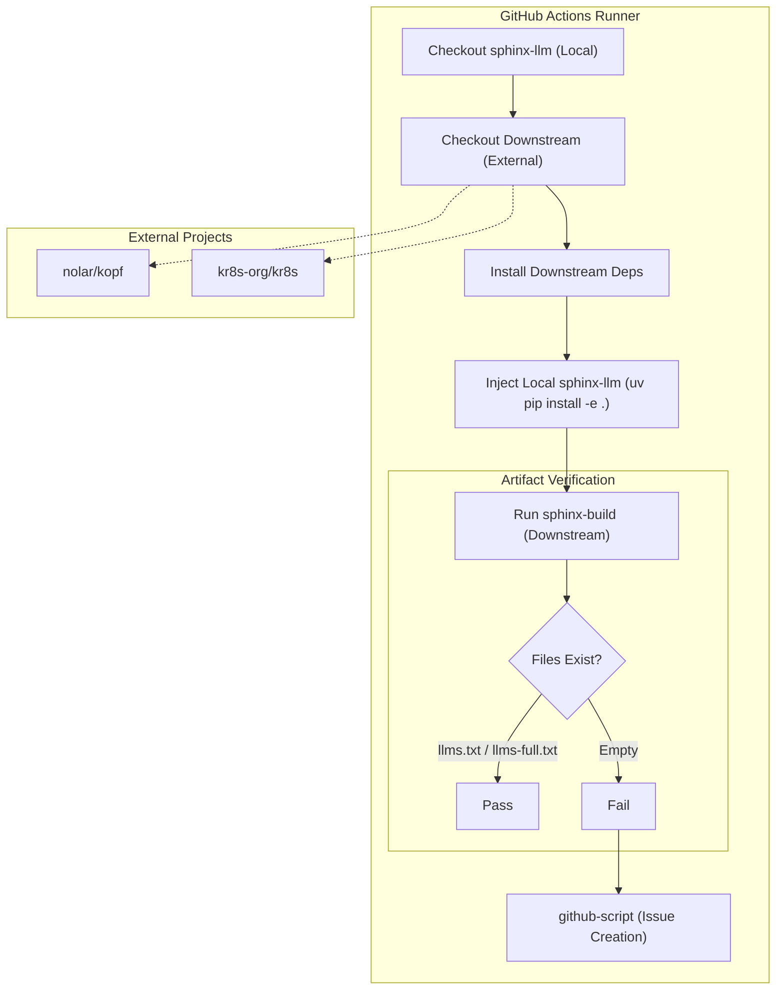

<!-- source: DeepWiki mcp.deepwiki.com · repo NVIDIA/sphinx-llm · page 4.2 Downstream Compatibility Testing · fetched 2026-10-26 -->

# Downstream Compatibility Testing

Relevant source files

The following files were used as context for generating this wiki page:

- [.github/workflows/downstream.yml](.github/workflows/downstream.yml)

The `sphinx-llm` project maintains a robust compatibility layer by validating its extensions against real-world, high-traffic documentation projects. This is achieved through the **Downstream Compatibility Testing** suite, which ensures that changes to the core library do not break existing Sphinx integrations in consumer projects.

The primary mechanism for this validation is the `downstream.yml` GitHub Actions workflow. This workflow treats external projects as integration test cases, injecting the local version of `sphinx-llm` into their environments to verify that the generated LLM artifacts (`llms.txt`, `llms-full.txt`, and `.html.md` files) remain consistent and valid.

### Workflow Execution and Strategy

The compatibility suite is designed to run both on internal code changes and as a recurring health check. It targets specific "Downstream Projects" that are known to use complex Sphinx configurations.

| Trigger | Condition |
| :--- | :--- |
| **Push** | Triggered on every push to the `main` branch [.github/workflows/downstream.yml:4-6](). |
| **Schedule** | Runs daily at 01:00 UTC to catch regressions caused by external dependency updates [.github/workflows/downstream.yml:7-8](). |

#### Downstream Project Matrix
The workflow utilizes a GitHub Actions strategy matrix to define the target projects and their specific build requirements.

| Project Repo | Install Command | Build Command |
| :--- | :--- | :--- |
| `nolar/kopf` | `uv pip install --group docs -e .` | `sphinx-build docs/ docs/_build/ -b html` |
| `kr8s-org/kr8s` | `uv sync --dev` | `uv run --dev sphinx-build docs/ docs/_build/` |

**Sources:** [.github/workflows/downstream.yml:17-26]()

### Implementation Details

The workflow follows a strict sequence to ensure the local version of `sphinx-llm` is the one being tested, rather than a version from PyPI.

#### 1. Environment Initialization
The runner checks out the `sphinx-llm` repository first [.github/workflows/downstream.yml:29-30](), followed by the downstream project into a sub-directory [.github/workflows/downstream.yml:32-36](). It uses `astral-sh/setup-uv` to manage Python 3.12 environments [.github/workflows/downstream.yml:38-43]().

#### 2. Local Injection
This is the critical step for compatibility testing. The workflow:
1.  Installs the downstream project's own dependencies [.github/workflows/downstream.yml:45-48]().
2.  Performs an editable install of the local `sphinx-llm` source code into that same environment using `uv pip install -e .` [.github/workflows/downstream.yml:50-52](). This "injects" the current PR or commit's code into the consumer project.

#### 3. Build and Artifact Verification
The downstream project's documentation is built using its standard `sphinx-build` command [.github/workflows/downstream.yml:54-58](). After the build completes, the workflow executes a search to verify that the `sphinx_llm.txt` extension successfully hooked into the process and generated the expected artifacts.

**Artifact Validation Logic:**
The workflow uses `find` to locate the following specific files in the build directory:
*   `llms.txt` (The sitemap)
*   `llms-full.txt` (The concatenated corpus)
*   `*.html.md` (The Markdown shadow-build files)

If no files are found, the step exits with an error code [.github/workflows/downstream.yml:60-69]().

### Automated Issue Reporting

To ensure visibility of regressions, the workflow is granted `issues: write` permissions [.github/workflows/downstream.yml:10-11](). If any step in the matrix fails—either the Sphinx build itself or the artifact verification—a GitHub issue is automatically opened in the `NVIDIA/sphinx-llm` repository [.github/workflows/downstream.yml:70-80]().

The issue includes:
*   The short SHA of the commit that caused the failure [.github/workflows/downstream.yml:78]().
*   The name of the downstream project that failed [.github/workflows/downstream.yml:78]().
*   A direct link to the failed Action run for log inspection [.github/workflows/downstream.yml:79]().

### System Architecture Diagram

The following diagram illustrates the data flow and execution logic of the `downstream.yml` workflow.

**Downstream Build Lifecycle**

**Sources:** [.github/workflows/downstream.yml:13-81]()

### Code Entity Mapping

This table maps the conceptual steps in the testing process to the specific configuration entities within the workflow file.

| Logic Step | Code Entity / Command |
| :--- | :--- |
| **Dependency Management** | `astral-sh/setup-uv@v7` [.github/workflows/downstream.yml:39]() |
| **Local Injection** | `uv pip install -e .` [.github/workflows/downstream.yml:52]() |
| **Artifact Search** | `find ... \( -name "llms.txt" -o -name "llms-full.txt" -o -name "*.html.md" \)` [.github/workflows/downstream.yml:62]() |
| **Failure Handling** | `actions/github-script@v7` [.github/workflows/downstream.yml:72]() |
| **Issue Generation** | `github.rest.issues.create` [.github/workflows/downstream.yml:75]() |

**Sources:** [.github/workflows/downstream.yml:1-81]()

---

