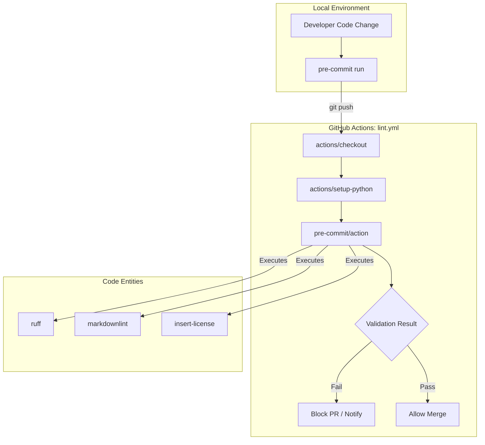
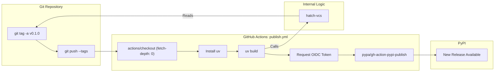

<!-- source: DeepWiki mcp.deepwiki.com · repo NVIDIA/sphinx-llm · page 4.3 Linting, Pre-commit, and Publishing · fetched 2026-10-26 -->

# Linting, Pre-commit, and Publishing

Relevant source files

The following files were used as context for generating this wiki page:

- [.github/workflows/lint.yml](.github/workflows/lint.yml)
- [.github/workflows/publish.yml](.github/workflows/publish.yml)
- [.pre-commit-config.yaml](.pre-commit-config.yaml)
- [LICENSE_HEADER](LICENSE_HEADER)

This section describes the automated quality assurance and distribution infrastructure for `sphinx-llm`. The project utilizes a comprehensive suite of pre-commit hooks to maintain code standards, a linting workflow for CI validation, and a "Trusted Publishing" pipeline for releasing the package to PyPI.

## Code Quality and Pre-commit Hooks

The project enforces code quality through `pre-commit`, which runs a series of specialized tools to validate code formatting, linting, and licensing requirements before commits are finalized.

### Hook Configuration and Tools

The hooks are configured in `.pre-commit-config.yaml` and cover Python code, Markdown files, YAML configuration, and general text health.

| Tool | Hook ID | Purpose | Configuration/Arguments |
| :--- | :--- | :--- | :--- |
| **Ruff** | `ruff` | Python linting and auto-fixing | `--fix` [`.pre-commit-config.yaml`:5-6]() |
| **Ruff Format** | `ruff-format` | Python code formatting | [`.pre-commit-config.yaml`:7]() |
| **Prettier** | `prettier` | YAML file formatting | Restricted to `[yaml]` types [`.pre-commit-config.yaml`:11-12]() |
| **Markdownlint** | `markdownlint` | Markdown style enforcement | [`.pre-commit-config.yaml`:16]() |
| **Codespell** | `codespell` | Spelling error detection | Ignores "trough" [`.pre-commit-config.yaml`:20-21]() |
| **Insert License** | `insert-license` | License header enforcement | Targets `.py` files using `LICENSE_HEADER` [`.pre-commit-config.yaml`:25-28]() |

### License Header Management
The `insert-license` hook ensures that every Python source file begins with the standard NVIDIA copyright notice and Apache-2.0 SPDX identifier defined in `LICENSE_HEADER` [`LICENSE_HEADER`:1-2](). It is configured to detect existing licenses within the top 5 lines to avoid duplicates [`.pre-commit-config.yaml`:31]().

**Sources:**
- [`.pre-commit-config.yaml`:1-32]()
- [`LICENSE_HEADER`:1-3]()

---

## Linting Workflow (`lint.yml`)

The `lint.yml` GitHub Action provides server-side verification of the pre-commit hooks. It ensures that no code enters the `main` branch without meeting the project's quality standards.

### Execution Logic
The workflow is triggered on every `push` to `main` and all `pull_request` events [`.github/workflows/lint.yml`:3-8](). It uses the official `pre-commit/action` to execute the hooks defined in the repository.

### Data Flow: Linting Process
The following diagram illustrates how code moves from a local environment through the CI linting gates.

**Linting Pipeline Architecture**

**Sources:**
- [`.github/workflows/lint.yml`:1-17]()
- [`.pre-commit-config.yaml`:1-32]()

---

## Publishing and Release Workflow (`publish.yml`)

`sphinx-llm` uses a modern "Trusted Publishing" (OIDC) flow to release packages to PyPI. This eliminates the need for long-lived PyPI tokens stored as repository secrets.

### Release Trigger
The publishing workflow is triggered exclusively by the creation of a git tag [`.github/workflows/publish.yml`:3-6]().

### Versioning with `hatch-vcs`
The project uses `hatch-vcs` to derive the package version dynamically from Git tags. For this reason, the `publish` job performs a full checkout with `fetch-depth: 0` to ensure the build backend can access the tag history [`.github/workflows/publish.yml`:19]().

### Build and Distribution
The workflow utilizes `uv` to build the distribution packages (sdist and wheel) before uploading them to PyPI.

**Publishing Data Flow**

### Trusted Publishing Configuration
The workflow requires `id-token: write` permissions to authenticate with PyPI via OpenID Connect (OIDC) [`.github/workflows/publish.yml`:12-13](). This allows the `pypa/gh-action-pypi-publish` action to securely exchange a GitHub token for a short-lived PyPI upload session [`.github/workflows/publish.yml`:29-30]().

**Sources:**
- [`.github/workflows/publish.yml`:1-31]()
- [`.pre-commit-config.yaml`:1-32]()

---

