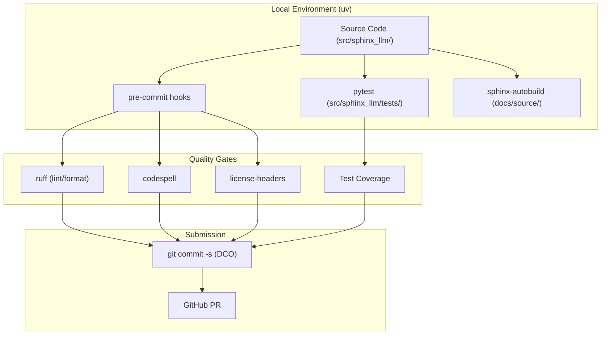

<!-- source: DeepWiki mcp.deepwiki.com · repo NVIDIA/sphinx-llm · page 5 Contributing · fetched 2026-10-26 -->

# Contributing

<details>
<summary>Relevant source files</summary>

The following files were used as context for generating this wiki page:

- [.claude/skills/resolve-issue/SKILL.md](.claude/skills/resolve-issue/SKILL.md)
- [.coderabbit.yaml](.coderabbit.yaml)
- [.gitignore](.gitignore)
- [.readthedocs.yaml](.readthedocs.yaml)
- [CLAUDE.md](CLAUDE.md)
- [CONTRIBUTING.md](CONTRIBUTING.md)
- [LICENSE](LICENSE)

</details>


This page provides a high-level guide for developers looking to contribute to `sphinx-llm`. It covers the mandatory legal requirements for code submissions, the recommended tooling for local development, and the standards used to maintain code quality.

## Developer Certificate of Origin (DCO)

All contributors must "sign-off" on their commits to certify that the contribution is their original work or that they have the right to submit it under the project's license [CONTRIBUTING.md:3-7](). This is a requirement for all contributors not employed by NVIDIA [CLAUDE.md:105-106]().

To sign off, use the `-s` flag during the commit process:
```bash
git commit -s -m "Add cool feature."
```
This appends a `Signed-off-by` line to the commit message [CONTRIBUTING.md:12-23]().

For more details on the DCO text and legal requirements, see **[Commit and Code Quality Standards](#5.2)**.

## Development Environment

The project uses `uv` for dependency management and environment orchestration [CLAUDE.md:22-24](). The environment includes specialized dependency groups for development and content generation.

### Tooling Overview
| Tool | Purpose |
| :--- | :--- |
| `uv` | Package installation and virtual environment management. |
| `pytest` | Test runner for the suite located in `src/sphinx_llm/tests/`. |
| `pre-commit` | Orchestrates linting, formatting, and license header checks. |
| `sphinx-autobuild` | Provides a live-reloading server for documentation development. |

For a step-by-step walkthrough on cloning the repo and initializing the environment, see **[Development Environment Setup](#5.1)**.

## Contribution Workflow

The following diagram illustrates the relationship between the local development environment, the code entities, and the quality gates required before a contribution is accepted.

### Contribution Pipeline

**Sources:** [CLAUDE.md:17-61](), [CONTRIBUTING.md:1-23]()

## Testing and Documentation

Contributors are expected to verify their changes using the internal test suite and by building the example documentation project.

*   **Tests:** Located in `src/sphinx_llm/tests/`, these utilize a `sphinx_build` fixture to test both `html` and `dirhtml` builders [CLAUDE.md:96-101]().
*   **Documentation:** The example docs in `docs/source/` serve as both a manual testing ground and the source for the test corpus [CLAUDE.md:97-98]().

### Local Build Commands
| Task | Command |
| :--- | :--- |
| **Run Tests** | `uv run pytest src/sphinx_llm/tests/` |
| **Lint Code** | `uv run pre-commit run --all-files` |
| **Live Docs** | `uv run --dev sphinx-autobuild docs/source docs/build/html` |

**Sources:** [CLAUDE.md:28-61]()

## Code Standards

The project enforces strict linting and formatting rules via `ruff`, as well as type checking and documentation standards.

### Standards Summary
*   **Linting:** Managed by `ruff` and `pre-commit` [CLAUDE.md:41-51]().
*   **Licensing:** Every `.py` file must contain the standard license header [CLAUDE.md:110-111]().
*   **Issue Resolution:** The project follows a test-driven development (TDD) workflow for resolving GitHub issues [.claude/skills/resolve-issue/SKILL.md:43-60]().

For detailed configuration of these tools and the full list of enforced rules, see **[Commit and Code Quality Standards](#5.2)**.

## Related Pages
- **[Development Environment Setup](#5.1)** — Detailed setup instructions for `uv` and local build tools.
- **[Commit and Code Quality Standards](#5.2)** — Deep dive into DCO, `ruff` rules, and pre-commit configurations.

---

