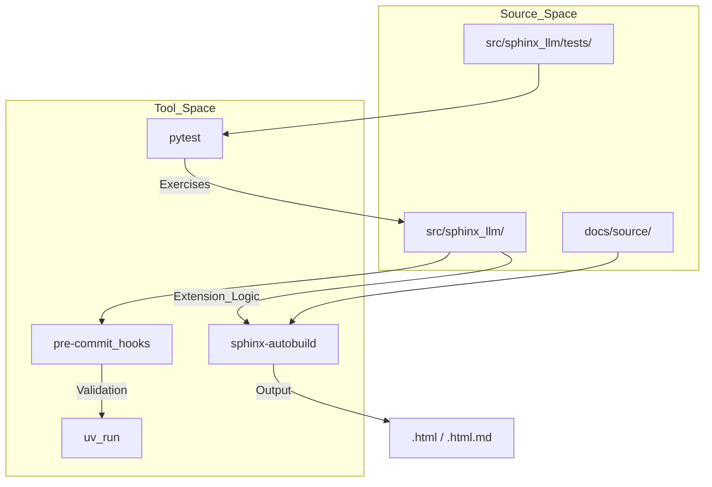
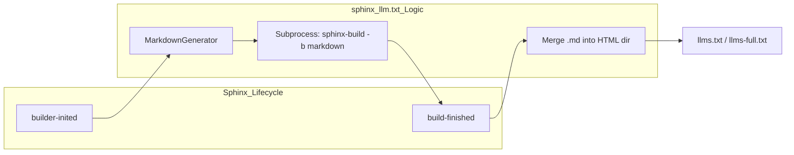

<!-- source: DeepWiki mcp.deepwiki.com · repo NVIDIA/sphinx-llm · page 5.1 Development Environment Setup · fetched 2026-10-26 -->

# Development Environment Setup

<details>
<summary>Relevant source files</summary>

The following files were used as context for generating this wiki page:

- [.claude/skills/resolve-issue/SKILL.md](.claude/skills/resolve-issue/SKILL.md)
- [CLAUDE.md](CLAUDE.md)
- [pyproject.toml](pyproject.toml)
- [uv.lock](uv.lock)

</details>


This page provides step-by-step instructions for setting up a local development environment for the `sphinx-llm` project. It covers dependency management, testing procedures, and local documentation preview.

## 1. Prerequisites and Repository Setup

The `sphinx-llm` project uses `uv` for Python package management and `hatch-vcs` for versioning [pyproject.toml:1-3](). To begin development, clone the repository and initialize the environment.

### 1.1 Cloning the Repository
```bash
git clone https://github.com/NVIDIA/sphinx-llm.git
cd sphinx-llm
```

### 1.2 Environment Initialization
The project defines two primary dependency groups:
1.  **Base Dependencies**: `sphinx` and `sphinx-markdown-builder` [pyproject.toml:24]().
2.  **Optional `gen` Extra**: `langchain-ollama` for LLM-powered content generation [pyproject.toml:27]().
3.  **Dev Group**: `pytest`, `pytest-cov`, and `sphinx-autobuild` [pyproject.toml:30]().

Use the following command to sync all necessary development dependencies:
```bash
uv sync --dev --extra gen
```
*Sources: [CLAUDE.md:21-24](), [pyproject.toml:24-30]()*

## 2. Development Workflow Components

The following diagram illustrates the relationship between the local development tools and the codebase entities.

### Tooling and Code Entity Mapping
| Component | Code Entity / Path | Role |
| :--- | :--- | :--- |
| **Test Runner** | `pytest` | Executes suites in `src/sphinx_llm/tests/` [CLAUDE.md:30]() |
| **Linter/Formatter** | `ruff` | Enforces styles defined in `[tool.ruff]` [pyproject.toml:61]() |
| **Type Checker** | `mypy` | Configured via `[tool.hatch.envs.types]` [pyproject.toml:43]() |
| **Doc Preview** | `sphinx-autobuild` | Serves `docs/source` with live reload [CLAUDE.md:57]() |

### Development Data Flow
This diagram shows how source code interacts with the development environment tools to produce validated artifacts.

"Development Data Flow"

*Sources: [CLAUDE.md:17-62](), [pyproject.toml:43-87]()*

## 3. Running the Test Suite

Tests are located within the source tree at `src/sphinx_llm/tests/` [CLAUDE.md:96](). The suite utilizes a `sphinx_build` fixture to test various configurations, including `html` and `dirhtml` builders [CLAUDE.md:100-101]().

### 3.1 Standard Test Execution
```bash
# Run all tests
uv run pytest src/sphinx_llm/tests/

# Run with coverage reporting
uv run pytest src/sphinx_llm/tests/ --cov=sphinx_llm --cov-report=xml
```

### 3.2 Matrix Testing
To verify compatibility across different Sphinx versions:
```bash
uv run --with "sphinx>=7,<8" pytest src/sphinx_llm/tests/
```
*Sources: [CLAUDE.md:29-37]()*

## 4. Linting and Pre-commit Hooks

The project enforces strict code quality standards via `pre-commit`. These hooks include `ruff` for linting and formatting, `prettier` for YAML, and `markdownlint` [CLAUDE.md:48-51]().

### 4.1 Running Hooks Manually
```bash
# Run all hooks on all files
uv run pre-commit run --all-files

# Run specific hooks
uv run pre-commit run ruff --all-files
```

### 4.2 Configuration Details
- **Ruff**: Configured to target Python 3.9 with specific rules like `I` (isort) and `B` (flake8-bugbear) [pyproject.toml:62-72]().
- **License Headers**: A `LICENSE_HEADER` file is enforced on all `.py` files [CLAUDE.md:110]().
- **DCO**: All commits must be signed off using `git commit -s` [CLAUDE.md:105-107]().

*Sources: [CLAUDE.md:41-51](), [pyproject.toml:61-87]()*

## 5. Building and Previewing Documentation

The repository includes an example documentation project in `docs/source/` [CLAUDE.md:57](). This serves as both the project's documentation and a live test-bed for the extensions.

### 5.1 Sphinx Autobuild
For an interactive development experience with live-reloading:
```bash
uv run --dev sphinx-autobuild docs/source docs/build/html
```

### 5.2 Manual Build
To perform a single build and verify the `llms.txt` and `llms-full.txt` artifacts:
```bash
uv run --dev sphinx-build docs/source docs/build/html
```

### Extension Interaction in Build
The build process triggers the `MarkdownGenerator` within `src/sphinx_llm/txt.py` to spawn a subprocess for markdown generation [CLAUDE.md:67-72]().

"Build Process Logic"

*Sources: [CLAUDE.md:55-61](), [CLAUDE.md:67-83]()*

---

