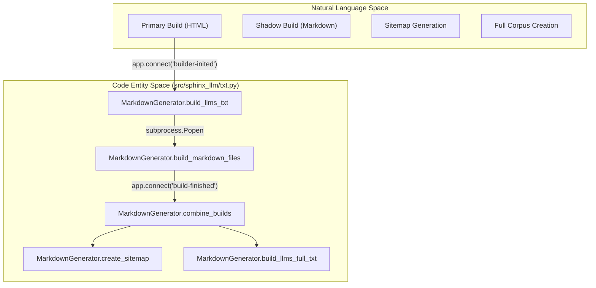
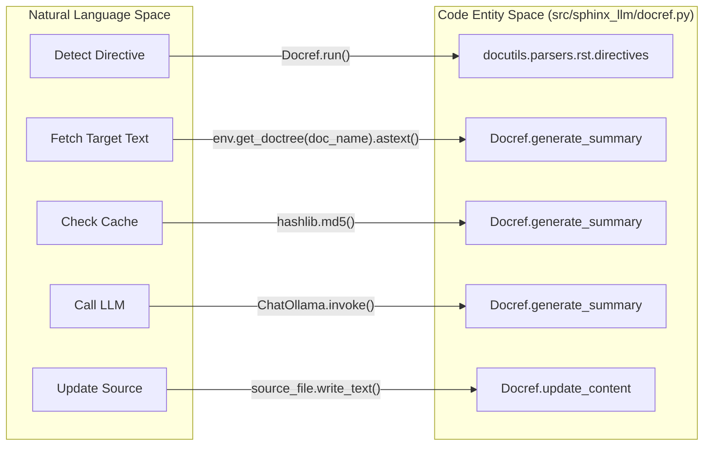

<!-- source: DeepWiki mcp.deepwiki.com · repo NVIDIA/sphinx-llm · page 6 Glossary · fetched 2026-10-26 -->

# Glossary

Relevant source files

The following files were used as context for generating this wiki page:

- [.github/workflows/build-docs.yml](.github/workflows/build-docs.yml)
- [.github/workflows/test.yml](.github/workflows/test.yml)
- [README.md](README.md)
- [pyproject.toml](pyproject.toml)
- [src/sphinx_llm/docref.py](src/sphinx_llm/docref.py)
- [src/sphinx_llm/txt.py](src/sphinx_llm/txt.py)
- [uv.lock](uv.lock)

This page provides definitions for codebase-specific terms, jargon, and domain concepts used in the `sphinx-llm` project. It serves as a technical reference for onboarding engineers to understand how these concepts map to the implementation.

## Core Concepts

### llms.txt
A proposed standard for providing documentation in a format easily consumable by LLMs and AI agents. It consists of a sitemap (`llms.txt`) and a full corpus concatenation (`llms-full.txt`).
*   **Implementation**: Managed by the `MarkdownGenerator` class [src/sphinx_llm/txt.py:28-29]().
*   **Sitemap**: Created in `create_sitemap` [src/sphinx_llm/txt.py:237-237]().
*   **Full Corpus**: Created in `build_llms_full_txt` [src/sphinx_llm/txt.py:209-209]().

### Shadow Build
The process of spawning a background Sphinx subprocess using the `markdown` builder while the primary HTML build is running. This ensures that Markdown artifacts are generated without interfering with the main HTML output generation.
*   **Trigger**: Initiated in `build_markdown_files` [src/sphinx_llm/txt.py:125-125]().
*   **Subprocess Command**: Uses `sys.executable -m sphinx -b markdown` [src/sphinx_llm/txt.py:130-138]().

### Suffix Modes
Configuration options that determine the file naming convention for generated Markdown files, particularly important for `dirhtml` (directory-style) builds.
*   **auto**: Default mode. For `dirhtml`, it generates both `.html.md` and `.md` extensions [src/sphinx_llm/txt.py:177-179]().
*   **file-suffix**: Generates spec-compliant `index.html.md` files [src/sphinx_llm/txt.py:173-174]().
*   **url-suffix**: Generates cleaner `.md` files at the directory level (e.g., `page.md`) [src/sphinx_llm/txt.py:175-176]().
*   **replace**: Replaces `.html` with `.md` directly [src/sphinx_llm/txt.py:182-183]().

### Docref
A custom Sphinx directive (`.. docref::`) that leverages an LLM to generate a summary of a referenced document and inserts it into the source documentation.
*   **Class**: `Docref` [src/sphinx_llm/docref.py:25-25]().
*   **Registration**: Added via `app.add_directive("docref", Docref)` [src/sphinx_llm/docref.py:167-167]().

### Write-back Pattern
The mechanism where the `Docref` directive modifies the local `.rst` source files on disk to cache the LLM-generated summary and its associated hash.
*   **Logic**: Implemented in `update_content` [src/sphinx_llm/docref.py:129-129]().
*   **File Update**: Performed via `source_file.write_text()` [src/sphinx_llm/docref.py:163-163]().

---

## Technical Mapping: Natural Language to Code Entity

The following diagrams bridge the gap between high-level system concepts and the specific classes or functions that implement them.

### LLM Output Generation Pipeline
This diagram shows how the "llms.txt standard" is realized through specific method calls in `txt.py`.

**Sources:** [src/sphinx_llm/txt.py:44-46](), [src/sphinx_llm/txt.py:155-159](), [src/sphinx_llm/txt.py:83-85](), [src/sphinx_llm/txt.py:116-119]()

### Docref Summarization Flow
This diagram maps the process of "summarizing a page" to the internal logic of the `Docref` class.

**Sources:** [src/sphinx_llm/docref.py:30-30](), [src/sphinx_llm/docref.py:71-76](), [src/sphinx_llm/docref.py:94-99](), [src/sphinx_llm/docref.py:163-163]()

---

## Technical Glossary Table

| Term | Definition | Code Pointer |
| :--- | :--- | :--- |
| **Ollama** | The local LLM runner used for text generation. | [src/sphinx_llm/docref.py:22-22]() |
| **ChatOllama** | LangChain wrapper for interacting with the Ollama API. | [src/sphinx_llm/docref.py:10-10]() |
| **MD5 Hash** | Used to detect if a referenced document has changed since the last summary. | [src/sphinx_llm/docref.py:76-77]() |
| **System Prompt** | The instructions provided to the LLM to ensure concise documentation summaries. | [src/sphinx_llm/docref.py:21-21]() |
| **Parallel Build** | Building Markdown in a subprocess simultaneously with HTML. | [src/sphinx_llm/txt.py:50-50]() |
| **Sequential Build** | Building Markdown after the HTML build completes to reuse doctrees. | [src/sphinx_llm/txt.py:81-81]() |
| **llms_txt_suffix_mode** | Config value determining how `.md` files are mapped to `.html` URLs. | [src/sphinx_llm/txt.py:51-51]() |
| **pending_xref** | Sphinx node used to create the "Read more >>" link in Docref. | [src/sphinx_llm/docref.py:52-52]() |

**Sources:** [src/sphinx_llm/docref.py:10-10](), [src/sphinx_llm/docref.py:21-22](), [src/sphinx_llm/docref.py:52-52](), [src/sphinx_llm/docref.py:76-77](), [src/sphinx_llm/txt.py:50-51](), [src/sphinx_llm/txt.py:81-81]()