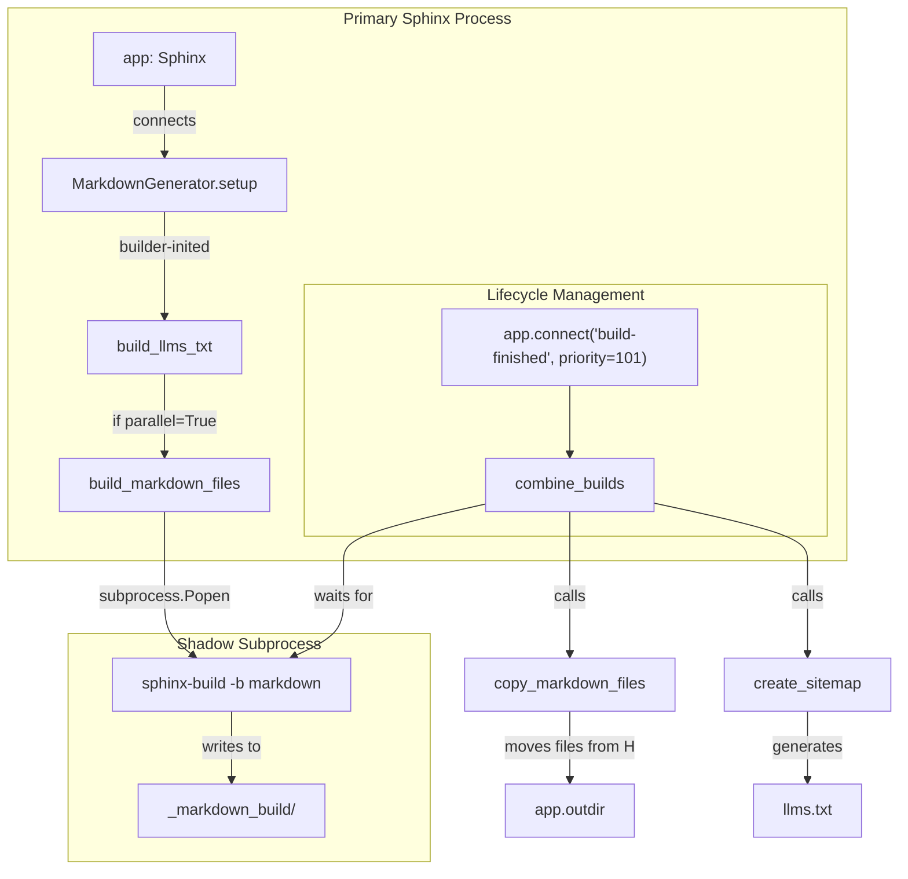
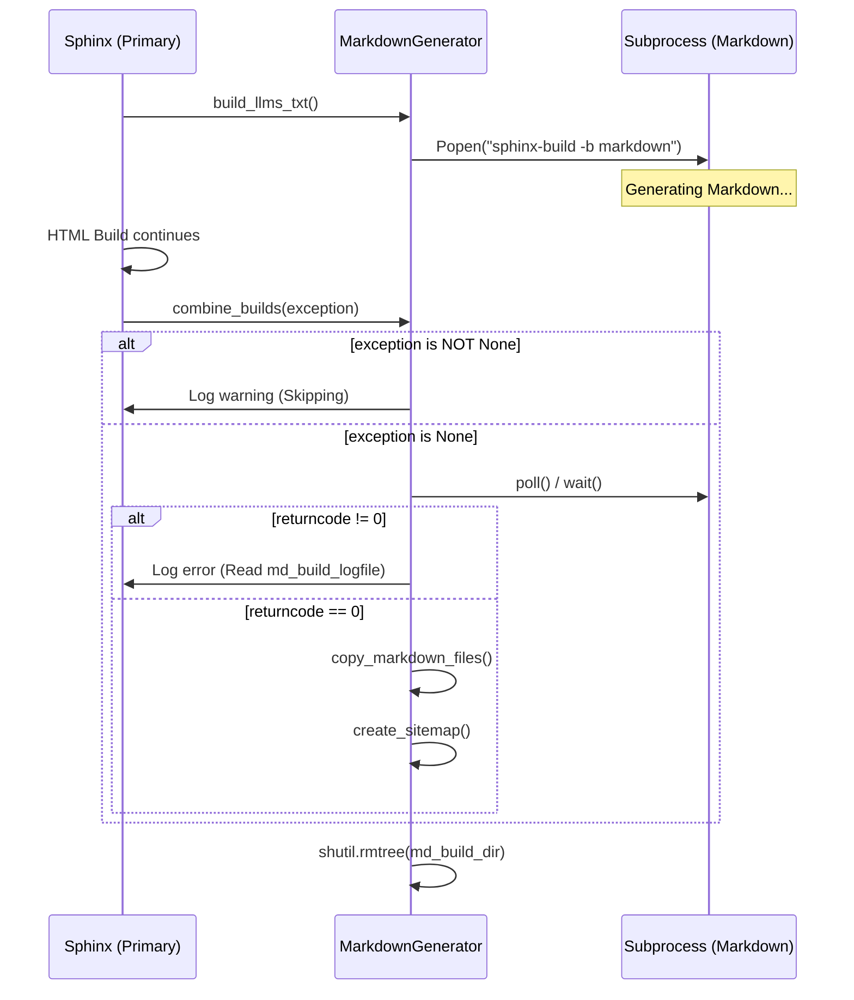

<!-- source: DeepWiki mcp.deepwiki.com · repo NVIDIA/sphinx-llm · extra page Build Pipeline and Subprocess Management · fetched 2026-10-26 -->

# Build Pipeline and Subprocess Management

Relevant source files

The following files were used as context for generating this wiki page:

- [src/sphinx_llm/txt.py](src/sphinx_llm/txt.py)

The `sphinx_llm.txt` extension implements a "shadow-build" architecture to generate LLM-consumable Markdown content without interfering with the primary HTML build. This is achieved by spawning a secondary `sphinx-build` process that uses the `markdown` builder, then merging its artifacts back into the main output directory.

## Shadow-Build Architecture

The core of the build pipeline is managed by the `MarkdownGenerator` class. It intercepts the Sphinx lifecycle to initiate a subprocess that mirrors the source configuration but targets a different output format.

### Build Initiation and Lifecycle Hooks

The pipeline integrates into the Sphinx lifecycle using several key event connections:

1.  **`builder-inited`**: The `MarkdownGenerator.setup` method connects `build_llms_txt` to this event [[src/sphinx_llm/txt.py:42-44]](). This is where the configuration is validated and the build strategy (parallel vs. sequential) is determined.
2.  **`build-finished`**: Two separate handlers are attached to this event with specific priorities:
    *   **Priority 100**: If sequential building is enabled, `build_markdown_files` is called here [[src/sphinx_llm/txt.py:81]]().
    *   **Priority 101**: `combine_builds` is called to wait for the subprocess, copy files, and generate the final `llms.txt` and `llms-full.txt` files [[src/sphinx_llm/txt.py:83]]().

### Subprocess Management

The secondary build is executed via `subprocess.Popen` using the current Python executable and the `markdown` builder [[src/sphinx_llm/txt.py:130-159]]().

| Component | Code Entity | Description |
| :--- | :--- | :--- |
| **Command Generator** | `build_markdown_files` | Constructs the `sphinx-build -b markdown` command [[src/sphinx_llm/txt.py:125-148]](). |
| **Process Handle** | `self.md_build_process` | Stores the `Popen` object to track state and wait for completion [[src/sphinx_llm/txt.py:155-159]](). |
| **Logging** | `self.md_build_logfile` | A `NamedTemporaryFile` that captures `stdout` and `stderr` from the subprocess [[src/sphinx_llm/txt.py:37-39]](). |

**Sources:** [[src/sphinx_llm/txt.py:28-83]](), [[src/sphinx_llm/txt.py:125-164]]()

## Parallel vs. Sequential Execution

The extension supports two modes of operation controlled by the `llms_txt_build_parallel` configuration option [[src/sphinx_llm/txt.py:50]]().

### Parallel Build (Default)
In parallel mode, the subprocess is spawned immediately during the `builder-inited` phase [[src/sphinx_llm/txt.py:75-76]](). This allows the Markdown generation to run alongside the HTML generation. To prevent file system conflicts, the parallel build uses its own temporary doctree directory (managed by Sphinx's default behavior when `-d` is omitted in the subprocess call) [[src/sphinx_llm/txt.py:141-142]]().

### Sequential Build
If `llms_txt_build_parallel` is `False`, the subprocess is delayed until the primary build's `build-finished` event [[src/sphinx_llm/txt.py:78-81]](). In this mode, the extension optimizes performance by reusing the existing doctree directory via the `-d` flag [[src/sphinx_llm/txt.py:142-144]]().

### Data Flow and Code Entity Mapping

The following diagram illustrates how the `MarkdownGenerator` coordinates the two Sphinx builds and manages the transition from source files to the final merged output.

**Title: Build Pipeline Execution Flow**

**Sources:** [[src/sphinx_llm/txt.py:42-50]](), [[src/sphinx_llm/txt.py:75-83]](), [[src/sphinx_llm/txt.py:125-159]](), [[src/sphinx_llm/txt.py:85-123]]()

## Output Merging and Cleanup

Once the primary build and the shadow subprocess are both complete, the `combine_builds` method orchestrates the final assembly [[src/sphinx_llm/txt.py:85-86]]().

### Merging Logic
1.  **Poll and Wait**: The system checks `self.md_build_process.poll()`. If the subprocess is still running, it calls `.wait()` [[src/sphinx_llm/txt.py:97-100]]().
2.  **Error Check**: If `returncode` is non-zero, the contents of `md_build_logfile` are dumped to the main logger and the merge is aborted [[src/sphinx_llm/txt.py:102-108]]().
3.  **File Transfer**: `copy_markdown_files` iterates through the temporary `_markdown_build` directory and moves the generated `.md` files into the main `outdir` based on the configured suffix mode [[src/sphinx_llm/txt.py:112]]().
4.  **Artifact Generation**: `build_llms_full_txt` and `create_sitemap` are called to generate the aggregate LLM files [[src/sphinx_llm/txt.py:115-119]]().

### Cleanup
The temporary build directory `_markdown_build` is deleted in a `finally` block to ensure the environment remains clean even if artifact generation fails [[src/sphinx_llm/txt.py:121-123]]().

**Sources:** [[src/sphinx_llm/txt.py:85-123]]()

## Error Handling

The pipeline includes robust error handling to ensure that a failure in the LLM-specific build does not necessarily crash the primary documentation build.

| Scenario | Handling Mechanism | Code Entity |
| :--- | :--- | :--- |
| **Subprocess Startup Failure** | Caught via `try...except` and logged as an error [[src/sphinx_llm/txt.py:160-161]](). | `build_markdown_files` |
| **Primary Build Failure** | `combine_builds` checks the `exception` argument; if present, it skips merging [[src/sphinx_llm/txt.py:87-89]](). | `combine_builds` |
| **Subprocess Runtime Error** | Checked via `returncode`. If it fails, the log file is read and printed to the console [[src/sphinx_llm/txt.py:102-108]](). | `combine_builds` |
| **Missing Subprocess** | If the process handle is missing, a warning is issued and the merge is skipped [[src/sphinx_llm/txt.py:91-95]](). | `combine_builds` |

### Process Interaction Diagram

This diagram shows the interaction between the primary build state and the subprocess lifecycle.

**Title: Subprocess Error and State Management**

**Sources:** [[src/sphinx_llm/txt.py:85-123]](), [[src/sphinx_llm/txt.py:149-164]]()

---

