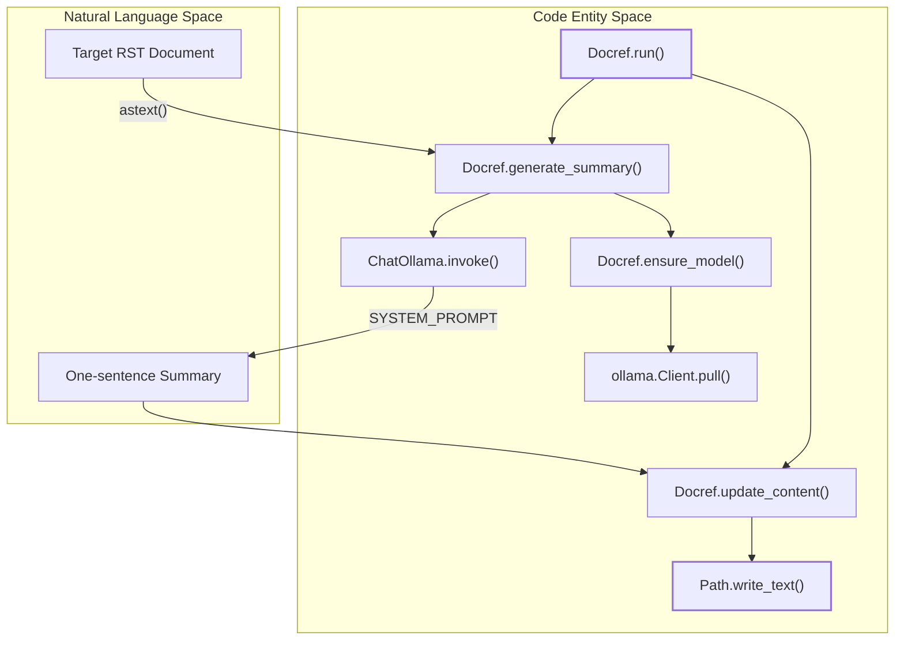
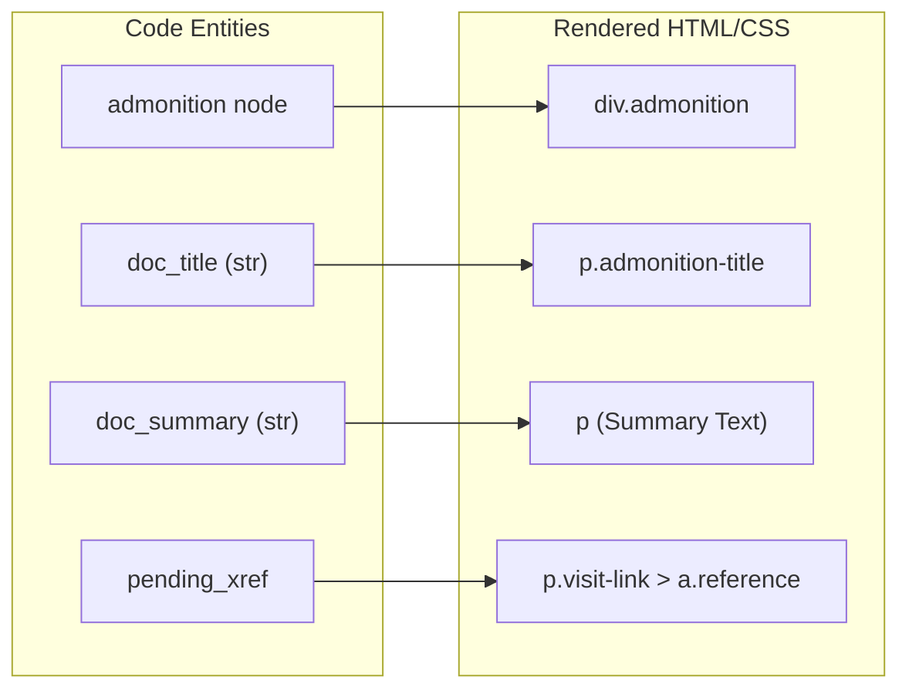

<!-- source: DeepWiki mcp.deepwiki.com · repo NVIDIA/sphinx-llm · extra page Docref Directive Reference · fetched 2026-10-26 -->

# Docref Directive Reference

<details>
<summary>Relevant source files</summary>

The following files were used as context for generating this wiki page:

- [README.md](README.md)
- [docs/source/conf.py](docs/source/conf.py)
- [src/sphinx_llm/docref.py](src/sphinx_llm/docref.py)

</details>


The `.. docref::` directive is provided by the `sphinx_llm.docref` extension. It allows documentation authors to reference other pages within the project while automatically generating a concise, LLM-powered summary of the target page's content.

## Purpose and Scope

The `Docref` directive automates the creation of "See also" style blocks. Unlike standard cross-references, `docref` includes a summary generated by a Large Language Model (LLM) via Ollama. It features a write-back mechanism that updates the original `.rst` source file with the generated summary and a content hash to minimize redundant API calls and ensure summaries stay in sync with the source material [src/sphinx_llm/docref.py:158-163]().

## Directive Syntax

The directive requires a single argument (the target document name) and supports optional configuration through directive options.

### Arguments and Options

| Component | Requirement | Description |
| :--- | :--- | :--- |
| `docname` | **Required** | The relative path to the document to be summarized (e.g., `apples` or `folder/page`). |
| `:model:` | Optional | Overrides the global LLM model for this specific summary. Defaults to `llama3.2:3b`. |
| `:hash:` | Optional | The MD5 hash of the target document. Usually managed automatically by the extension. |

### Usage Example

**Initial Input in RST:**
```rst
.. docref:: apples
```

**After Sphinx Build (Source Updated):**
```rst
.. docref:: apples
   :hash: 31ec12a54205539af3cde39b254ec766
   :model: llama3.2:3b

   Feeding apples to a friendly pig involves selecting ripe, pesticide-free
   apples, washing them thoroughly, and monitoring the pig's reaction.
```

Sources: [src/sphinx_llm/docref.py:25-28](), [README.md:148-174]()

## Implementation Details

The `Docref` class inherits from `BaseAdmonition` and `SphinxDirective` [src/sphinx_llm/docref.py:25](). It leverages the Sphinx environment to access document trees and the `langchain_ollama` client to communicate with the LLM.

### Data Flow and Logic

1.  **Title Retrieval**: The directive fetches the target document's doctree and extracts the first `title` node to use as the admonition header [src/sphinx_llm/docref.py:31-38]().
2.  **Hash Verification**: It calculates the MD5 hash of the target document's text. If it matches the `:hash:` option, the existing summary is reused [src/sphinx_llm/docref.py:75-78]().
3.  **LLM Generation**: If the hash mismatches or is missing, it invokes the LLM using a strict `SYSTEM_PROMPT` to generate a one-sentence summary [src/sphinx_llm/docref.py:21](), [src/sphinx_llm/docref.py:99-108]().
4.  **Source Write-back**: The extension identifies the exact lines in the original `.rst` file and overwrites them with the new summary and hash [src/sphinx_llm/docref.py:132-163]().
5.  **Cross-Reference**: A `pending_xref` node is appended to the end of the summary, which Sphinx resolves into a "Read more >>" link during the standard build phase [src/sphinx_llm/docref.py:51-66]().

### Component Interaction Diagram

This diagram shows how the `Docref` directive bridges the gap between the local filesystem (RST files) and the LLM inference service.

**Docref Execution Flow**

Sources: [src/sphinx_llm/docref.py:30-67](), [src/sphinx_llm/docref.py:69-110](), [src/sphinx_llm/docref.py:129-163]()

## Rendered Output

The directive renders as a standard Sphinx admonition with a custom class.

### Structure
1.  **Title**: Prefixed with "See also: ", followed by the title of the target document [src/sphinx_llm/docref.py:33-38]().
2.  **Body**: The LLM-generated summary text.
3.  **Link**: A paragraph with the CSS class `visit-link` containing a `pending_xref` to the target page [src/sphinx_llm/docref.py:63-65]().

### Visual Representation
The following diagram maps the code objects to the visual elements rendered in the final documentation.

**Mapping Code Entities to Rendered Output**

Sources: [src/sphinx_llm/docref.py:26](), [src/sphinx_llm/docref.py:33-39](), [src/sphinx_llm/docref.py:63-66]()

## Configuration Options

Global behavior for all `docref` instances can be configured in `conf.py` via the `sphinx_llm_options` dictionary.

| Option | Default | Description |
| :--- | :--- | :--- |
| `model` | `"llama3.2:3b"` | The default model used for generation if not specified in the directive. |
| `warn_on_cache_miss` | `True` | If `True`, Sphinx emits a warning when a summary is missing or out of date. |

Sources: [src/sphinx_llm/docref.py:20](), [src/sphinx_llm/docref.py:81](), [docs/source/conf.py:23-25]()

---

