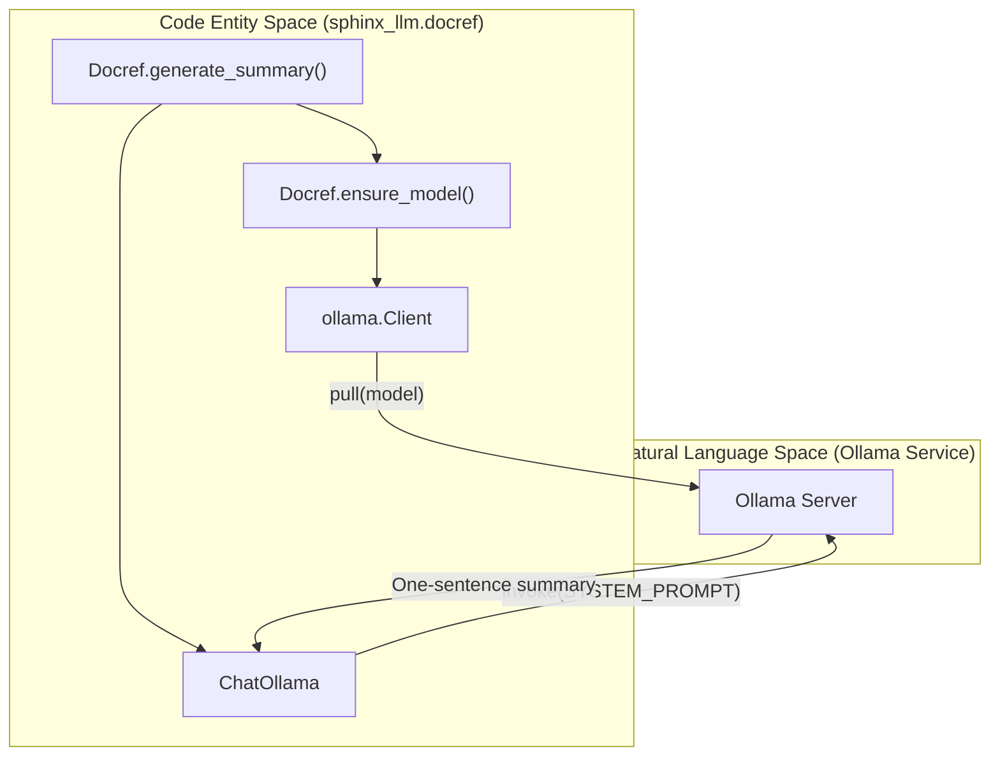
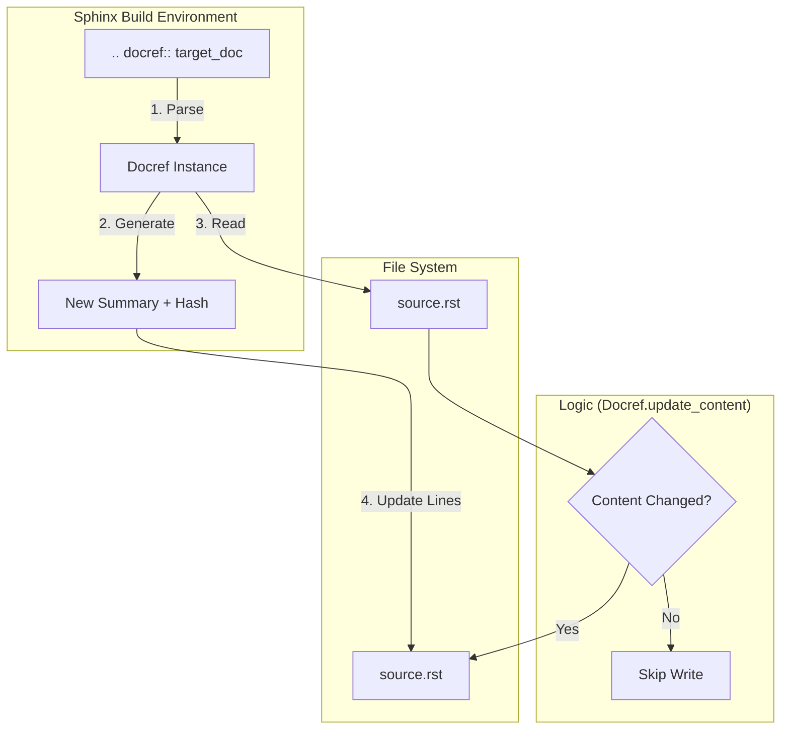

<!-- source: DeepWiki mcp.deepwiki.com · repo NVIDIA/sphinx-llm · extra page Ollama Integration and Summary Caching · fetched 2026-10-26 -->

# Ollama Integration and Summary Caching

Relevant source files

The following files were used as context for generating this wiki page:

- [src/sphinx_llm/docref.py](src/sphinx_llm/docref.py)
- [uv.lock](uv.lock)

The `sphinx_llm.docref` extension provides a mechanism to generate and cache document summaries using Large Language Models (LLMs) via the Ollama API. It integrates directly into the Sphinx build process, utilizing an MD5 hash-based caching system to minimize redundant API calls and a write-back pattern to update source `.rst` files with generated content.

## Ollama Connection and Model Management

The extension connects to an Ollama instance to perform inference. By default, it attempts to connect to `http://localhost:11434`, but this can be overridden using the `OLLAMA_BASE_URL` environment variable [[src/sphinx_llm/docref.py:22-22]]().

### ChatOllama and System Prompt
The integration uses the `ChatOllama` class from `langchain_ollama` to handle communication with the model [[src/sphinx_llm/docref.py:10-10]](). Every request is governed by a hardcoded `SYSTEM_PROMPT` designed to ensure the output is a concise, one-sentence summary without bullet points or nested structures [[src/sphinx_llm/docref.py:21-21]]().

### Model Lifecycle (ensure_model)
Before invoking the LLM, the extension verifies the availability of the requested model through the `ensure_model` method [[src/sphinx_llm/docref.py:112-127]]():
1. It initializes an `ollama.Client` using the configured `OLLAMA_BASE_URL` [[src/sphinx_llm/docref.py:114-114]]().
2. It checks if the model exists on the server using `ollama_client.show(model)` [[src/sphinx_llm/docref.py:118-118]]().
3. If the model is missing (triggering a `ResponseError`), it automatically triggers `ollama_client.pull(model)` to download the weights [[src/sphinx_llm/docref.py:122-122]]().

### LLM Interaction Flow
The following diagram illustrates the transition from the Sphinx environment to the Ollama service.

**Natural Language Space to Code Entity Space: Ollama Integration**

Sources: [[src/sphinx_llm/docref.py:69-127]]()

## Hash-Based Caching Mechanism

To prevent expensive re-generation of summaries during every build, `docref` implements a local caching strategy based on the MD5 hash of the target document's content.

### Cache Validation
When the `Docref.run()` method is executed, it calls `generate_summary(doc_name)` [[src/sphinx_llm/docref.py:42-42]](). The validation logic proceeds as follows:
1. **Content Extraction**: The text content of the referenced document is extracted from the Sphinx environment's doctree [[src/sphinx_llm/docref.py:71-73]]().
2. **Hash Generation**: An MD5 hex digest is calculated from this content [[src/sphinx_llm/docref.py:76-76]]().
3. **Comparison**: The calculated hash is compared against the `:hash:` option provided in the RST directive [[src/sphinx_llm/docref.py:77-77]]().
4. **Cache Hit**: If the hashes match, the existing content in the directive is returned without calling the LLM [[src/sphinx_llm/docref.py:78-78]]().
5. **Cache Miss**: If the hashes differ or the `:hash:` option is missing, the extension logs a warning (if `warn_on_cache_miss` is enabled) and proceeds to regenerate the summary [[src/sphinx_llm/docref.py:79-85]]().

### Configuration Options
The caching behavior is influenced by the `sphinx_llm_options` dictionary in `conf.py` [[src/sphinx_llm/docref.py:168-168]]():
| Option | Type | Description |
| :--- | :--- | :--- |
| `model` | `str` | The Ollama model to use (defaults to `llama3.2:3b`) [[src/sphinx_llm/docref.py:20-20]](). |
| `warn_on_cache_miss` | `bool` | Whether to log a warning when a summary is out of date (defaults to `True`) [[src/sphinx_llm/docref.py:81-81]](). |

Sources: [[src/sphinx_llm/docref.py:69-110]](), [[src/sphinx_llm/docref.py:166-174]]()

## Source Write-Back Pattern

A unique feature of `sphinx_llm.docref` is its ability to update the developer's source files on disk. This ensures that once a summary is generated, it is persisted directly into the `.rst` file.

### Implementation of update_content
The `update_content` method performs in-place modification of the source file [[src/sphinx_llm/docref.py:129-163]]():
1. **File Identification**: It identifies the source file path using `self.state.document.current_source` [[src/sphinx_llm/docref.py:133-133]](). Currently, only `.rst` files are supported [[src/sphinx_llm/docref.py:135-136]]().
2. **Line Mapping**: It calculates the correct indentation level and line indices by inspecting the directive's position (`self.lineno`) and existing content [[src/sphinx_llm/docref.py:139-143]]().
3. **Substitution**: It removes the old summary lines and inserts the new LLM-generated summary at the correct indentation [[src/sphinx_llm/docref.py:146-151]]().
4. **Hash Update**: It searches for the `:hash:` option within the directive block. If found, it updates the value; if not, it inserts the new `:hash:` line [[src/sphinx_llm/docref.py:154-159]]().
5. **Atomic Write**: The file is only written back to disk if the new content differs from the `original_source` [[src/sphinx_llm/docref.py:162-163]]().

**Data Flow: Source File Synchronization**

Sources: [[src/sphinx_llm/docref.py:129-163]]()

## Build Integration

The extension hooks into the Sphinx lifecycle by registering the `docref` directive and defining configuration values during the `setup` phase [[src/sphinx_llm/docref.py:166-174]]().

### Dependency Tracking
To ensure summaries stay current, the extension calls `self.state.document.settings.env.note_dependency(doc_name)` [[src/sphinx_llm/docref.py:46-46]](). This informs Sphinx that the current page must be rebuilt whenever the referenced document (`doc_name`) is modified.

### Output Rendering
The final output in the HTML documentation consists of:
- A standard Sphinx `admonition` containing the summary text [[src/sphinx_llm/docref.py:26-26]]().
- A `pending_xref` node that renders as a "Read more >>" link pointing to the referenced document [[src/sphinx_llm/docref.py:52-66]]().

Sources: [[src/sphinx_llm/docref.py:25-67]](), [[src/sphinx_llm/docref.py:166-174]]()

---

