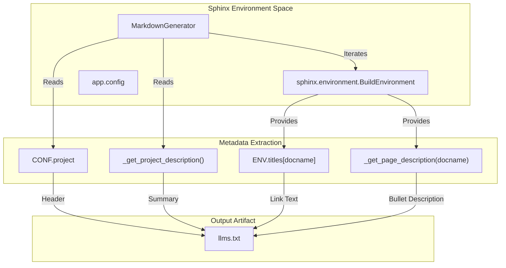
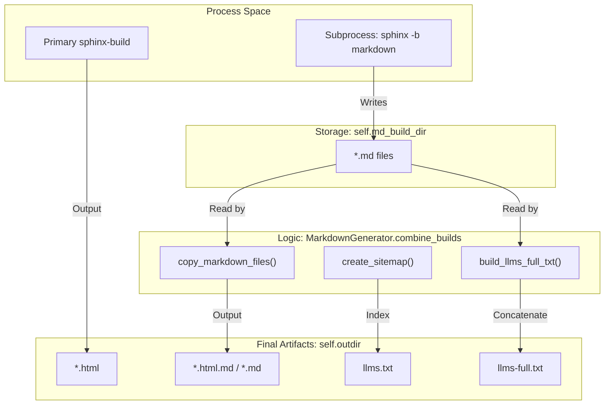

<!-- source: DeepWiki mcp.deepwiki.com · repo NVIDIA/sphinx-llm · extra page llms.txt and llms-full.txt Output Files · fetched 2026-10-26 -->

# llms.txt and llms-full.txt Output Files

Relevant source files

The following files were used as context for generating this wiki page:

- [README.md](README.md)
- [src/sphinx_llm/txt.py](src/sphinx_llm/txt.py)

This page provides a technical deep dive into the two primary artifacts generated by the `sphinx_llm.txt` extension: `llms.txt` and `llms-full.txt`. These files are designed to facilitate documentation consumption by Large Language Models (LLMs) and autonomous agents by providing a machine-readable sitemap and a concatenated corpus of the entire project.

## The llms.txt Sitemap

The `llms.txt` file serves as a discoverable index for LLMs, following the emerging [llmstxt.org](https://llmstxt.org/) standard [README.md:34-39](). It provides a high-level description of the project followed by a structured list of all available documentation pages in Markdown format.

### Content Extraction Logic

The `MarkdownGenerator` class handles the creation of this file through the `create_sitemap` method [src/sphinx_llm/txt.py:119-119]().

1.  **Project Title and Description**:
    *   The title is derived from the Sphinx `project` configuration [src/sphinx_llm/txt.py:236-236]().
    *   The description is retrieved via `_get_project_description()` [src/sphinx_llm/txt.py:237-237](). It first checks the `llms_txt_description` config override. If not present, it attempts to extract the `Summary` from the package metadata using the project name [src/sphinx_llm/txt.py:270-285]().
2.  **Document Metadata**:
    *   For every document in the Sphinx environment, the extension extracts the document title using `app.env.titles[docname].astext()` [src/sphinx_llm/txt.py:246-246]().
    *   It attempts to find a "description" for each page by looking for the first `paragraph` node in the document's doctree that is not empty [src/sphinx_llm/txt.py:251-262]().
3.  **Link Formatting**:
    *   Links are formatted based on the `llms_txt_suffix_mode` [src/sphinx_llm/txt.py:51-51]().
    *   By default, it uses the "primary" target path determined by the builder type (e.g., `.html.md` for standard HTML or a cleaner URL-style for `dirhtml`) [src/sphinx_llm/txt.py:173-183]().

### Sitemap Data Flow

The following diagram illustrates how project and page metadata are transformed into the `llms.txt` structure.

**llms.txt Generation Flow**

**Sources:** [src/sphinx_llm/txt.py:231-268](), [src/sphinx_llm/txt.py:270-285]()

---

## The llms-full.txt Concatenated Corpus

The `llms-full.txt` file is a single, large Markdown file containing the entire documentation set. This is intended for "full context" ingestion by LLMs [README.md:38-41]().

### Sort Order and Structure
The file is generated by the `build_llms_full_txt` method [src/sphinx_llm/txt.py:210-229](). To ensure a logical flow for the LLM, the extension sorts the documents:
1.  The `index` (root) document is always placed first [src/sphinx_llm/txt.py:214-214]().
2.  All other documents are sorted alphabetically by their `docname` [src/sphinx_llm/txt.py:215-215]().

### File Headers and Merging
When concatenating, the extension injects a clear delimiter between files to help the LLM identify document boundaries:
*   Each section starts with `# <docname>` [src/sphinx_llm/txt.py:221-221]().
*   The actual Markdown content of the page follows the header [src/sphinx_llm/txt.py:223-223]().
*   Two newlines are inserted between documents to prevent content bleed [src/sphinx_llm/txt.py:224-224]().

### Configuration: llms_txt_full_build
Because `llms-full.txt` can become extremely large for massive documentation projects, its generation can be disabled by setting `llms_txt_full_build = False` in `conf.py` [src/sphinx_llm/txt.py:115-116](), [README.md:115-115]().

---

## Implementation Details

The generation of these files occurs during the `combine_builds` phase, which is triggered after the primary Sphinx build and the shadow Markdown build are both complete [src/sphinx_llm/txt.py:83-85]().

### Process Interaction Diagram

This diagram shows how the `MarkdownGenerator` interacts with the file system and the subprocess to produce the final artifacts.

**File Aggregation Logic**

**Sources:** [src/sphinx_llm/txt.py:85-125](), [src/sphinx_llm/txt.py:186-208](), [src/sphinx_llm/txt.py:210-229]()

### Summary of Artifacts

| File | Purpose | Logic Source |
| :--- | :--- | :--- |
| `llms.txt` | Machine-readable sitemap and project summary. | `create_sitemap()` [src/sphinx_llm/txt.py:231]() |
| `llms-full.txt` | Full-text concatenation of all documentation. | `build_llms_full_txt()` [src/sphinx_llm/txt.py:210]() |
| `[page].md` | Individual Markdown version of an HTML page. | `copy_markdown_files()` [src/sphinx_llm/txt.py:186]() |

**Sources:** [src/sphinx_llm/txt.py:110-120](), [README.md:66-88]()

---

