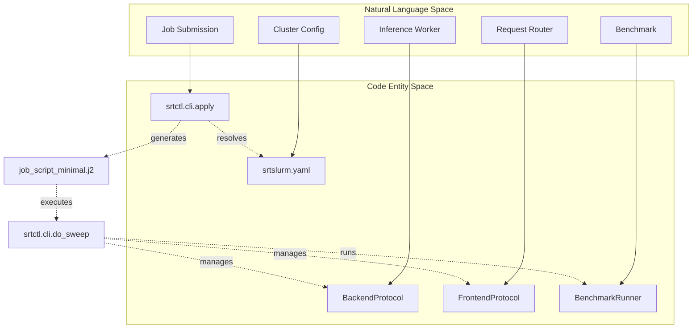
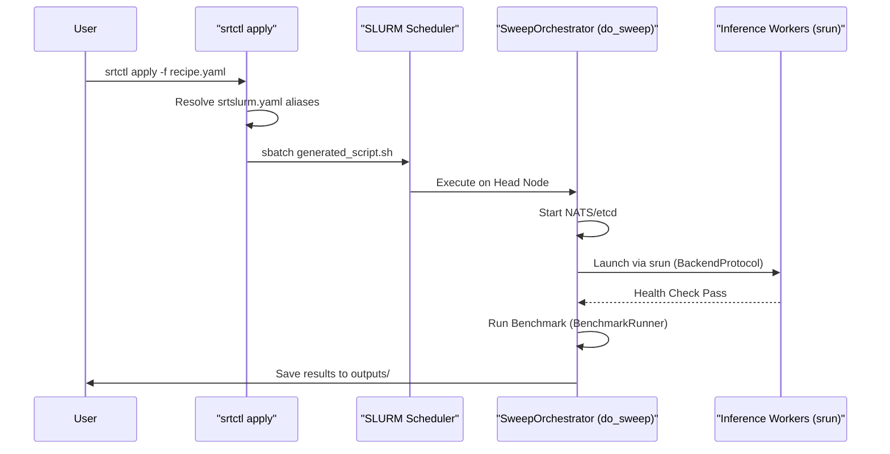

<!-- source: DeepWiki mcp.deepwiki.com · repo NVIDIA/srt-slurm · page 1 Overview · fetched 2026-10-26 -->

# Overview

Relevant source files

The following files were used as context for generating this wiki page:

- [.github/workflows/copyright-check.yml](.github/workflows/copyright-check.yml)
- [.gitignore](.gitignore)
- [CONTRIBUTING.md](CONTRIBUTING.md)
- [LICENSE](LICENSE)
- [Makefile](Makefile)
- [NOTICE](NOTICE)
- [README.md](README.md)
- [THIRD_PARTY_LICENSES.md](THIRD_PARTY_LICENSES.md)
- [docs/README.md](docs/README.md)
- [docs/SUMMARY.md](docs/SUMMARY.md)
- [docs/analyzing.md](docs/analyzing.md)
- [docs/installation.md](docs/installation.md)
- [docs/profiling.md](docs/profiling.md)
- [src/srtctl/frontends/dynamo.py](src/srtctl/frontends/dynamo.py)
- [src/srtctl/templates/job_script_minimal.j2](src/srtctl/templates/job_script_minimal.j2)
- [tests/test_profiling.py](tests/test_profiling.py)

`srtctl` (SLURM Runtime Control) is a command-line utility designed to orchestrate distributed LLM inference benchmarks on SLURM clusters [README.md:1-3](). It abstracts the complexity of multi-node GPU coordination by replacing brittle shell scripts and manual SLURM directive management with a declarative YAML-based configuration system [README.md:12-16]().

The tool provides a unified interface for benchmarking leading inference engines, including **SGLang**, **vLLM**, and **TensorRT-LLM**, across various hardware topologies such as aggregated and Prefill/Decode (PD) disaggregated modes [docs/README.md:1-3]().

### Core Philosophy
*   **Declarative Over Imperative:** Define the desired state (model, hardware, backend settings) in YAML; `srtctl` handles the `sbatch` generation and worker discovery [docs/README.md:18-23]().
*   **Reproducibility:** Every job generates a detailed lockfile and environment fingerprint to ensure benchmarks can be audited and repeated [docs/README.md:20-20]().
*   **Automation-First:** Built-in support for parameter sweeps, profiling (nsys/torch), and post-processing pipelines [README.md:21-25]().

---

### System Architecture

The system operates in a two-phase execution model: **Submission** (local/login node) and **Orchestration** (compute node) [docs/README.md:24-40]().

#### Phase 1: Submission
When a user runs `srtctl apply`, the tool validates the configuration, resolves cluster-specific aliases (from `srtslurm.yaml`), and generates a specialized SLURM batch script [docs/README.md:26-32]().
*   **Key Entity:** `srtctl apply` command.
*   **Source:** [src/srtctl/templates/job_script_minimal.j2:1-40]()

#### Phase 2: Orchestration
Once SLURM allocates nodes, the generated script executes the `SweepOrchestrator` on the primary compute node [src/srtctl/templates/job_script_minimal.j2:115-132](). This orchestrator manages the lifecycle of the benchmark:
1.  **Infrastructure Launch:** Starts NATS and etcd for service discovery [src/srtctl/frontends/dynamo.py:7-12]().
2.  **Worker Deployment:** Spawns containerized inference workers (prefill/decode/agg) via `srun` [src/srtctl/frontends/dynamo.py:103-114]().
3.  **Frontend Setup:** Deploys routers (e.g., Dynamo or SGLang Router) and optional Nginx load balancers [src/srtctl/frontends/dynamo.py:62-70]().
4.  **Benchmark Execution:** Runs the specified benchmark (e.g., `sa-bench`) once workers are healthy [docs/README.md:39-40]().

#### Code Entity Mapping
The following diagram illustrates how high-level concepts map to specific classes and modules within the codebase.

**Concept to Code Mapping**

Sources: [src/srtctl/templates/job_script_minimal.j2:1-145](), [src/srtctl/frontends/dynamo.py:26-35](), [docs/README.md:24-40]()

---

### Workflow and Orchestration

The lifecycle of an `srtctl` job is managed by the `SweepOrchestrator` (invoked via `do_sweep`). It coordinates between the physical SLURM topology and the logical inference backend.

**Execution Lifecycle**

Sources: [src/srtctl/templates/job_script_minimal.j2:121-132](), [src/srtctl/frontends/dynamo.py:62-126](), [docs/README.md:24-40]()

---

### Navigating the Wiki

This wiki is structured to take you from initial setup to advanced performance analysis:

*   **[Getting Started & Installation](#1.1)**: Instructions for the `make setup` process, installing dependencies like `uv`, `nats-server`, and `etcd`, and configuring your `srtslurm.yaml`.
*   **[Project Structure & Development Guide](#1.2)**: A guide for developers looking to extend `srtctl`, covering the directory layout and core Python patterns (Dataclasses, Protocols).
*   **Configuration System**: Deep dive into the YAML schema, including parameter sweeps and cluster-level overrides.
*   **Core Architecture**: Detailed explanation of the `RuntimeContext`, `Endpoint` allocation, and the orchestrator's stage-based mixin architecture.
*   **Backends & Frontends**: Technical details on how SGLang, vLLM, and TRT-LLM are integrated and how request routing is handled via Dynamo or Nginx.
*   **Benchmarking & Profiling**: How to run performance/accuracy suites and capture `nsys` or `torch` profiles.
*   **Results Analysis**: Using the `srtlog` library and the Streamlit dashboard to visualize benchmark data.

For a complete list of all pages, see the **Wiki Table of Contents** in the sidebar.

Sources: [README.md:17-25](), [docs/SUMMARY.md:1-35]()

---

