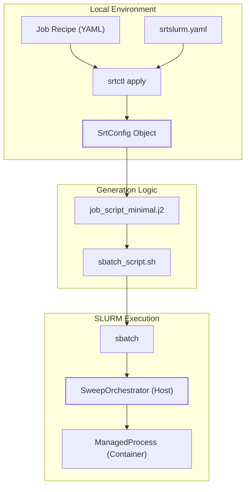
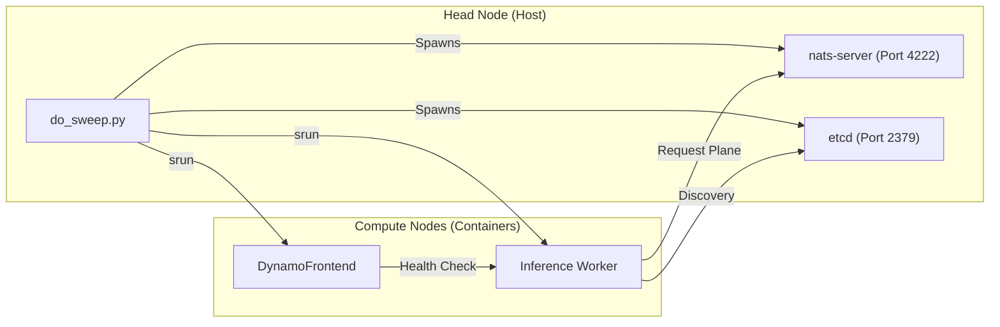

<!-- source: DeepWiki mcp.deepwiki.com · repo NVIDIA/srt-slurm · page 1.1 Getting Started & Installation · fetched 2026-10-26 -->

# Getting Started & Installation

<details>
<summary>Relevant source files</summary>

The following files were used as context for generating this wiki page:

- [.gitignore](.gitignore)
- [Makefile](Makefile)
- [README.md](README.md)
- [docs/README.md](docs/README.md)
- [docs/SUMMARY.md](docs/SUMMARY.md)
- [docs/analyzing.md](docs/analyzing.md)
- [docs/installation.md](docs/installation.md)
- [docs/profiling.md](docs/profiling.md)
- [recipes/gb200-fp4/1k1k-dsv4/README.md](recipes/gb200-fp4/1k1k-dsv4/README.md)
- [recipes/gb200-fp4/1k1k-dsv4/agg-2n-low-latency.yaml](recipes/gb200-fp4/1k1k-dsv4/agg-2n-low-latency.yaml)
- [recipes/gb200-fp4/1k1k-dsv4/agg-2n-nomtp.yaml](recipes/gb200-fp4/1k1k-dsv4/agg-2n-nomtp.yaml)
- [src/srtctl/frontends/dynamo.py](src/srtctl/frontends/dynamo.py)
- [src/srtctl/templates/job_script_minimal.j2](src/srtctl/templates/job_script_minimal.j2)
- [srtslurm.yaml.example](srtslurm.yaml.example)
- [tests/test_profiling.py](tests/test_profiling.py)

</details>


This page provides a comprehensive guide for setting up `srtctl` (SLURM Runtime Control) on a SLURM cluster. It covers prerequisites, the automated installation process via `Makefile`, cluster-level configuration, and submitting your first distributed LLM inference benchmark.

## Prerequisites

Before beginning the installation, ensure the following requirements are met on your cluster:

*   **SLURM Environment**: Access to a SLURM cluster with GPU nodes (e.g., H100, B200, GB200) [README.md:1-3]().
*   **Python**: Version 3.10 or higher [docs/installation.md:22]().
*   **Container Runtime**: `enroot` and `pyxis` must be configured for containerized execution [docs/installation.md:23]().
*   **Architecture Knowledge**: Identify if your compute nodes are `x86_64` (Intel/AMD) or `aarch64` (NVIDIA Grace) [docs/installation.md:48-51]().

## Installation Steps

### 1. Clone and Local Install
First, clone the repository and install the package in editable mode. This installs the `srtctl` CLI tool to your environment.

```bash
git clone https://github.com/NVIDIA/srt-slurm.git
cd srt-slurm
pip install -e .
```
Sources: [README.md:8-11](), [docs/installation.md:29-33]()

### 2. Automated Setup
The `Makefile` contains a `setup` target that automates binary downloads and initial configuration. You must specify the `ARCH` variable based on your **compute nodes**.

```bash
# For Grace-based systems (GB200, GH200)
make setup ARCH=aarch64

# For x86-based systems (H100, B200)
make setup ARCH=x86_64
```
Sources: [Makefile:43-52](), [docs/installation.md:51]()

The `make setup` command performs the following actions:
1.  **Directory Creation**: Creates a `logs/` directory for benchmark outputs [Makefile:45]().
2.  **Binary Downloads**:
    *   **NATS Server**: Downloads the `nats-server` binary to `configs/` for the request plane [Makefile:53-76]().
    *   **etcd**: Downloads `etcd` and `etcdctl` to `configs/` for worker discovery and metadata [Makefile:78-91]().
    *   **uv**: Downloads the `uv` package manager to `bin/` to manage the compute-node virtual environment [Makefile:93-103]().
3.  **Interactive Configuration**: Prompts for SLURM account, partition, GPUs per node, and time limits to generate the initial `srtslurm.yaml` [Makefile:105-140]().

## Cluster Configuration (`srtslurm.yaml`)

The `srtslurm.yaml` file acts as the global source of truth for your cluster environment. It allows you to define aliases for containers and models, simplifying job recipes.

### Key Configuration Fields

| Field | Description |
| :--- | :--- |
| `default_account` | The SLURM account used for job submissions [srtslurm.yaml.example:10]() |
| `default_partition` | The target SLURM partition [srtslurm.yaml.example:11]() |
| `model_paths` | A mapping of short aliases to absolute filesystem paths (e.g., Lustre/GPFS) [srtslurm.yaml.example:41-49]() |
| `containers` | A mapping of aliases to `.sqsh` container images [srtslurm.yaml.example:23-38]() |
| `use_gpus_per_node_directive` | Boolean to enable/disable `#SBATCH --gpus-per-node` [srtslurm.yaml.example:16]() |

### Implementation Flow: Config to Submission
The following diagram illustrates how `srtctl` merges the cluster configuration with a job recipe to generate the final SLURM submission.

**System Entity Mapping: Submission Pipeline**

Sources: [src/srtctl/templates/job_script_minimal.j2:4-32](), [docs/README.md:25-32](), [src/srtctl/frontends/dynamo.py:117-125]()

## First Job Submission

### 1. Create a Recipe
Create a file named `configs/test-job.yaml`. You can use aliases defined in your `srtslurm.yaml`.

```yaml
name: "quick-start"
model:
  path: "deepseek-r1" # Alias from srtslurm.yaml
  container: "sglang-latest" # Alias from srtslurm.yaml
resources:
  gpu_type: "h100"
  agg_nodes: 1
  agg_workers: 1
  gpus_per_node: 8
benchmark:
  type: "sa-bench"
  isl: 1024
  osl: 1024
  concurrencies: [32]
```
Sources: [docs/installation.md:142-190](), [srtslurm.yaml.example:73-82]()

### 2. Submit and Monitor
Submit the job using the `apply` command.

```bash
srtctl apply -f configs/test-job.yaml
```
Sources: [README.md:31](), [docs/installation.md:197]()

Upon submission, `srtctl` performs the following:
1.  **Validation**: Checks the YAML against the `SrtConfig` schema [docs/README.md:28]().
2.  **Script Generation**: Renders `job_script_minimal.j2`, populating `#SBATCH` directives and environment variables like `SRTCTL_SOURCE` [src/srtctl/templates/job_script_minimal.j2:4-44]().
3.  **Orchestration**: Launches the `SweepOrchestrator` on the head node. This orchestrator manages the lifecycle of `nats-server`, `etcd`, and the inference workers [src/srtctl/templates/job_script_minimal.j2:115-132]().

### Data Flow: Runtime Infrastructure
When the SLURM job starts, the `srtctl` orchestrator sets up the communication plane before launching inference backends.

**Code Entity Mapping: Infrastructure Startup**

Sources: [src/srtctl/frontends/dynamo.py:82-87](), [src/srtctl/templates/job_script_minimal.j2:71-72](), [src/srtctl/frontends/dynamo.py:75-79]()

## Troubleshooting the Setup

*   **Architecture Mismatch**: If you see "Exec format error", ensure you ran `make setup ARCH=...` with the architecture of the **compute nodes**, not the login node [src/srtctl/templates/job_script_minimal.j2:85-87]().
*   **`uv` Not Found**: The orchestrator expects `uv` in `${SRTCTL_SOURCE}/bin`. If missing, re-run the setup [src/srtctl/templates/job_script_minimal.j2:93-97]().
*   **Config Discovery**: `srtctl` searches for `srtslurm.yaml` in the current directory and up to two parent directories. You can override this by setting `export SRTSLURM_CONFIG="/path/to/config.yaml"` [srtslurm.yaml.example:5-7]().

Sources: [Makefile:1-178](), [src/srtctl/templates/job_script_minimal.j2:1-146](), [docs/installation.md:1-256](), [srtslurm.yaml.example:1-82]()

---

