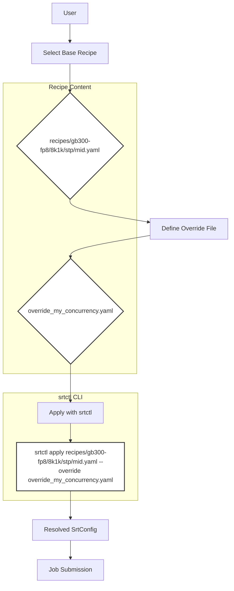

<!-- source: DeepWiki mcp.deepwiki.com · repo NVIDIA/srt-slurm · page 10 Recipes & Hardware Configurations · fetched 2026-10-26 -->

# Recipes & Hardware Configurations

<details>
<summary>Relevant source files</summary>

The following files were used as context for generating this wiki page:

- [configs/install-nixl-dsv4.sh](configs/install-nixl-dsv4.sh)
- [recipes/dsv4-pro/README.md](recipes/dsv4-pro/README.md)
- [recipes/dsv4-pro/sglang/gb300-fp4/1k1k/agg/mtp/agg-2n-low-latency.yaml](recipes/dsv4-pro/sglang/gb300-fp4/1k1k/agg/mtp/agg-2n-low-latency.yaml)
- [recipes/dsv4-pro/sglang/gb300-fp4/1k1k/agg/mtp/agg-balanced-tep.yaml](recipes/dsv4-pro/sglang/gb300-fp4/1k1k/agg/mtp/agg-balanced-tep.yaml)
- [recipes/dsv4-pro/sglang/gb300-fp4/1k1k/agg/mtp/agg-low-latency-chat.yaml](recipes/dsv4-pro/sglang/gb300-fp4/1k1k/agg/mtp/agg-low-latency-chat.yaml)
- [recipes/dsv4-pro/sglang/gb300-fp4/1k1k/agg/mtp/agg-low-latency.yaml](recipes/dsv4-pro/sglang/gb300-fp4/1k1k/agg/mtp/agg-low-latency.yaml)
- [recipes/dsv4-pro/sglang/gb300-fp4/1k1k/agg/stp/agg-2n-nomtp.yaml](recipes/dsv4-pro/sglang/gb300-fp4/1k1k/agg/stp/agg-2n-nomtp.yaml)
- [recipes/dsv4-pro/sglang/gb300-fp4/1k1k/agg/stp/agg-max-tpt-tep.yaml](recipes/dsv4-pro/sglang/gb300-fp4/1k1k/agg/stp/agg-max-tpt-tep.yaml)
- [recipes/dsv4-pro/sglang/gb300-fp4/1k1k/agg/stp/agg-nomtp.yaml](recipes/dsv4-pro/sglang/gb300-fp4/1k1k/agg/stp/agg-nomtp.yaml)
- [recipes/dsv4-pro/sglang/gb300-fp4/1k1k/disagg/stp/disagg-1p1d-dep4-mega-moe.yaml](recipes/dsv4-pro/sglang/gb300-fp4/1k1k/disagg/stp/disagg-1p1d-dep4-mega-moe.yaml)
- [recipes/dsv4-pro/sglang/gb300-fp4/1k1k/disagg/stp/disagg-1p1d-tp4-mxfp4.yaml](recipes/dsv4-pro/sglang/gb300-fp4/1k1k/disagg/stp/disagg-1p1d-tp4-mxfp4.yaml)
- [recipes/gb200-fp4/1k1k-dsv4/README.md](recipes/gb200-fp4/1k1k-dsv4/README.md)
- [recipes/gb200-fp4/1k1k-dsv4/agg-2n-low-latency.yaml](recipes/gb200-fp4/1k1k-dsv4/agg-2n-low-latency.yaml)
- [recipes/gb200-fp4/1k1k-dsv4/agg-2n-nomtp.yaml](recipes/gb200-fp4/1k1k-dsv4/agg-2n-nomtp.yaml)
- [recipes/gb300-fp8/1k1k/stp/low-latency.yaml](recipes/gb300-fp8/1k1k/stp/low-latency.yaml)
- [recipes/gb300-fp8/1k1k/stp/max.yaml](recipes/gb300-fp8/1k1k/stp/max.yaml)
- [recipes/gb300-fp8/1k1k/stp/mid.yaml](recipes/gb300-fp8/1k1k/stp/mid.yaml)
- [recipes/gb300-fp8/1k8k/stp/low-latency.yaml](recipes/gb300-fp8/1k8k/stp/low-latency.yaml)
- [recipes/gb300-fp8/1k8k/stp/max.yaml](recipes/gb300-fp8/1k8k/stp/max.yaml)
- [recipes/gb300-fp8/1k8k/stp/mid.yaml](recipes/gb300-fp8/1k8k/stp/mid.yaml)
- [recipes/gb300-fp8/8k1k/stp/low-latency.yaml](recipes/gb300-fp8/8k1k/stp/low-latency.yaml)
- [recipes/gb300-fp8/8k1k/stp/max.yaml](recipes/gb300-fp8/8k1k/stp/max.yaml)
- [recipes/gb300-fp8/8k1k/stp/mid.yaml](recipes/gb300-fp8/8k1k/stp/mid.yaml)
- [recipes/h200/8k1k/bs128-1p1d-dep.yaml](recipes/h200/8k1k/bs128-1p1d-dep.yaml)
- [recipes/h200/8k1k/bs128-agg-tp.yaml](recipes/h200/8k1k/bs128-agg-tp.yaml)
- [recipes/h200/8k1k/bs16-1p3d.yaml](recipes/h200/8k1k/bs16-1p3d.yaml)
- [recipes/h200/8k1k/bs4-1p7d.yaml](recipes/h200/8k1k/bs4-1p7d.yaml)
- [recipes/h200/8k1k/bs64-2p3d.yaml](recipes/h200/8k1k/bs64-2p3d.yaml)
- [recipes/h200/8k1k/bs8-1p6d.yaml](recipes/h200/8k1k/bs8-1p6d.yaml)
- [recipes/vllm/deepseek-r1/disagg-h100-16gpu.yaml](recipes/vllm/deepseek-r1/disagg-h100-16gpu.yaml)
- [recipes/vllm/qwen3-32b/agg-round-robin.yaml](recipes/vllm/qwen3-32b/agg-round-robin.yaml)
- [recipes/vllm/qwen3-32b/disagg-kv-router.yaml](recipes/vllm/qwen3-32b/disagg-kv-router.yaml)
- [recipes/vllm/test/qwen3-0.6b-single-gpu.yaml](recipes/vllm/test/qwen3-0.6b-single-gpu.yaml)
- [srtslurm.yaml.example](srtslurm.yaml.example)

</details>


This page provides an overview of the pre-built recipe library within the `srt-slurm` codebase, organized by GPU hardware and model. These recipes are YAML configuration files that define specific job parameters for running LLM inference benchmarks. We'll explain the naming conventions used for these recipes, such as ISL/OSL patterns, topology labels, and precision suffixes, and how to use and customize them for various hardware targets.

The `srt-slurm` project includes a comprehensive set of recipes designed to test different hardware configurations and software backends. These recipes are located in the `recipes/` directory and are structured to make it easy to find configurations relevant to your specific needs. Each recipe is a YAML file that specifies the model, hardware resources, backend (SGLang, vLLM, or TRT-LLM), and benchmark parameters.

For detailed information on specific recipe types and hardware configurations, please refer to the child pages:
- [SGLang Recipes (GB200, GB300, H100, H200, B200)](#10.1)
- [TRT-LLM Recipes](#10.2)
- [vLLM Recipes](#10.3)

## Recipe Naming Conventions

The recipe filenames and their `name` fields follow a consistent convention to quickly convey key characteristics of the configuration. This helps in identifying the target hardware, model, input/output sequence lengths, and parallelism strategy at a glance.

### ISL/OSL Patterns

Many recipes incorporate "ISL" (Input Sequence Length) and "OSL" (Output Sequence Length) values directly into their directory structure or name. These values are crucial for benchmarking LLM performance, as they define the workload characteristics. For example, `8k1k` indicates an Input Sequence Length of 8192 tokens and an Output Sequence Length of 1024 tokens.

Example:
- `recipes/h200/8k1k/bs64-2p3d.yaml` [recipes/h200/8k1k/bs64-2p3d.yaml:1]() specifies `isl: 8192` and `osl: 1024` [recipes/h200/8k1k/bs64-2p3d.yaml:105-106]().
- `recipes/gb300-fp8/1k8k/stp/max.yaml` [recipes/gb300-fp8/1k8k/stp/max.yaml:170-171]() specifies `isl: 1024` and `osl: 8192`.

### Topology Labels

Topology labels describe the distribution of prefill and decode workers across nodes. Common patterns include:
- `1p4d`: 1 prefill node, 4 decode nodes.
- `2p3d`: 2 prefill nodes, 3 decode nodes.
- `agg`: Aggregated workers, where prefill and decode workers run on the same nodes.

These labels are typically found in the recipe name and correspond to the `resources.prefill_nodes`, `resources.decode_nodes`, `resources.prefill_workers`, and `resources.decode_workers` fields in the YAML.

Example:
- `bs64-2p3d-h200-fp8` [recipes/h200/8k1k/bs64-2p3d.yaml:1]() uses `prefill_nodes: 2` and `decode_nodes: 3` [recipes/h200/8k1k/bs64-2p3d.yaml:13-16]().
- `bs8-1p6d-h200-fp8` [recipes/h200/8k1k/bs8-1p6d.yaml:1]() uses `prefill_nodes: 1` and `decode_nodes: 6` [recipes/h200/8k1k/bs8-1p6d.yaml:13-16]().

### Precision Suffixes

Recipes often include suffixes like `fp8` or `fp4` to indicate the floating-point precision used for model weights and KV cache. This is a critical performance and memory characteristic. `mtp` (Multi-Token Prediction) indicates recipes optimized for generating multiple tokens per decode step.

Example:
- `gb300-8k1k-fp8-mid` [recipes/gb300-fp8/8k1k/stp/mid.yaml:3]() uses `precision: "fp8"` [recipes/gb300-fp8/8k1k/stp/mid.yaml:8]() and `kv-cache-dtype: "fp8_e4m3"` [recipes/gb300-fp8/8k1k/stp/mid.yaml:75]().
- Recipes for DeepSeek-V4-Pro on GB300 often specify `fp4` precision, such as those found in `recipes/dsv4-pro/sglang/gb300-fp4/`.

### Operating Points

For a given hardware and model, recipes might be categorized by their operating point:
- `low-latency`: Optimized for minimal Time To First Token (TTFT).
- `mid`: Balanced performance.
- `max`: Optimized for maximum throughput (tokens per second).

Example:
- `gb300-8k1k-fp8-low-latency` [recipes/gb300-fp8/8k1k/stp/low-latency.yaml:1]()
- `gb300-8k1k-fp8-mid` [recipes/gb300-fp8/8k1k/stp/mid.yaml:3]()
- `gb300-8k1k-fp8-max` [recipes/gb300-fp8/8k1k/stp/max.yaml:3]()

### Diagram: Recipe Naming Convention Breakdown

```mermaid
graph TD
    A[Recipe Name] --> B[Hardware Type]
    A --> C[ISL/OSL Pattern]
    A --> D[Precision]
    A --> E[Topology Label]
    A --> F[Operating Point]

    B[Hardware Type] --> B_H100("h100")
    B[Hardware Type] --> B_H200("h200")
    B[Hardware Type] --> B_GB200("gb200")
    B[Hardware Type] --> B_GB300("gb300")
    B[Hardware Type] --> B_B200("b200")

    C[ISL/OSL Pattern] --> C_8k1k("8k1k (ISL=8192, OSL=1024)")
    C[ISL/OSL Pattern] --> C_1k8k("1k8k (ISL=1024, OSL=8192)")
    C[ISL/OSL Pattern] --> C_1k1k("1k1k (ISL=1024, OSL=1024)")

    D[Precision] --> D_FP8("fp8")
    D[Precision] --> D_FP4("fp4")
    D[Precision] --> D_MTP("mtp (Multi-Token Prediction)")

    E[Topology Label] --> E_1p4d("1p4d (1 Prefill Node, 4 Decode Nodes)")
    E[Topology Label] --> E_2p3d("2p3d (2 Prefill Nodes, 3 Decode Nodes)")
    E[Topology Label] --> E_Agg("agg (Aggregated Workers)")
    E[Topology Label] --> E_Disagg("disagg (Disaggregated Workers)")

    F[Operating Point] --> F_LL("low-latency")
    F[Operating Point] --> F_Mid("mid")
    F[Operating Point] --> F_Max("max-throughput")

    style B_H100 fill:#fff,stroke:#333,stroke-width:2px
    style B_H200 fill:#fff,stroke:#333,stroke-width:2px
    style B_GB200 fill:#fff,stroke:#333,stroke-width:2px
    style B_GB300 fill:#fff,stroke:#333,stroke-width:2px
    style B_B200 fill:#fff,stroke:#333,stroke-width:2px
    style C_8k1k fill:#fff,stroke:#333,stroke-width:2px
    style C_1k8k fill:#fff,stroke:#333,stroke-width:2px
    style C_1k1k fill:#fff,stroke:#333,stroke-width:2px
    style D_FP8 fill:#fff,stroke:#333,stroke-width:2px
    style D_FP4 fill:#fff,stroke:#333,stroke-width:2px
    style D_MTP fill:#fff,stroke:#333,stroke-width:2px
    style E_1p4d fill:#fff,stroke:#333,stroke-width:2px
    style E_2p3d fill:#fff,stroke:#333,stroke-width:2px
    style E_Agg fill:#fff,stroke:#333,stroke-width:2px
    style E_Disagg fill:#fff,stroke:#333,stroke-width:2px
    style F_LL fill:#fff,stroke:#333,stroke-width:2px
    style F_Mid fill:#fff,stroke:#333,stroke-width:2px
    style F_Max fill:#fff,stroke:#333,stroke-width:2px
```


Sources:
- [recipes/h200/8k1k/bs64-2p3d.yaml:1-106]()
- [recipes/gb300-fp8/1k8k/stp/max.yaml:1-171]()
- [recipes/h200/8k1k/bs8-1p6d.yaml:1-107]()
- [recipes/gb300-fp8/8k1k/stp/mid.yaml:1-172]()
- [recipes/gb300-fp8/8k1k/stp/low-latency.yaml:1-122]()

## Using and Customizing Recipes

Recipes are YAML files that define the `SrtConfig` for a job. You can use them directly with `srtctl apply <recipe_file.yaml>` or customize them using config overrides and parameter sweeps.

### Base Recipes and Overrides

The `recipes/` directory contains base configurations. You can create an `override_*.yaml` file to modify specific parameters without altering the original recipe. This is particularly useful for adjusting `benchmark` parameters like `concurrencies` or `req_rate`, or `resources` like `prefill_nodes` or `decode_nodes`.

For example, to change the concurrency for a `gb300-8k1k-fp8-mid` recipe, you could create an override file:
```yaml
# override_my_concurrency.yaml
benchmark:
  concurrencies: [1024, 2048]
```
Then apply it with `srtctl apply recipes/gb300-fp8/8k1k/stp/mid.yaml --override override_my_concurrency.yaml`.
For more details on overrides, see [Config Overrides & Parameter Sweeps](#2.2).

### Model and Container Aliases

The `srtslurm.yaml` cluster configuration file allows defining aliases for frequently used model paths and container images [srtslurm.yaml.example:40-49](). This simplifies recipes by letting you refer to models and containers by short names instead of full paths.

Example `srtslurm.yaml` aliases:
```yaml
# srtslurm.yaml
containers:
  sglang-latest: "/shared/containers/sglang-v0.4.sqsh"
  dsv4-blackwell: "/shared/containers/sglang-deepseek-v4-blackwell.sqsh"
model_paths:
  deepseek-r1: "/shared/models/deepseek/DeepSeek-R1"
  dsv4-pro: "/shared/models/deepseek/DeepSeek-V4-Pro"
```
A recipe can then use these aliases:
```yaml
# my_recipe.yaml
model:
  path: "dsv4-pro"         # Resolves to /shared/models/deepseek/DeepSeek-V4-Pro
  container: "dsv4-blackwell" # Resolves to /shared/containers/sglang-deepseek-v4-blackwell.sqsh
```
Sources:
- [srtslurm.yaml.example:40-49]()
- [srtslurm.yaml.example:73-77]()

### Diagram: Recipe Customization Flow


Sources:
- [recipes/gb300-fp8/8k1k/stp/mid.yaml]()

## Backend-Specific Recipes

The `srt-slurm` project supports multiple LLM inference backends, each with its own set of optimized recipes.

### SGLang Recipes

SGLang recipes are available for various hardware generations, including GB200/GB300 NVL racks, H100/H200 Hopper, and B200 Blackwell. These recipes cover both aggregated and disaggregated topologies, different precisions (fp8/fp4), and Multi-Token Prediction (MTP) variants. They also include configurations for low-latency, max-throughput, and mid-curve operating points, as well as specific DeepSeek-V4-Pro recipes.
For details, see [SGLang Recipes (GB200, GB300, H100, H200, B200)](#10.1).

### TRT-LLM Recipes

TensorRT-LLM recipes are provided for B200/B300, GB200/GB300, and H100/H200 hardware, supporting fp8 and fp4 precision. These recipes often feature aggregated Tensor Parallel (TP) configurations and may include Expert Parallel Load Balancing (EPLB) settings. Examples include recipes for the gpt-oss-120b model.
For details, see [TRT-LLM Recipes](#10.2).

### vLLM Recipes

vLLM-based recipes are available for models like DeepSeek-R1 on H100 (disaggregated) and DeepSeek-V4-Pro on GB200 (with DP+EP offload). They also include configurations for Qwen3-32B in both aggregated round-robin and disaggregated KV router modes. Some vLLM recipes may require specific patch scripts, such as `vllm-container-deps.sh`.
For details, see [vLLM Recipes](#10.3).

---

