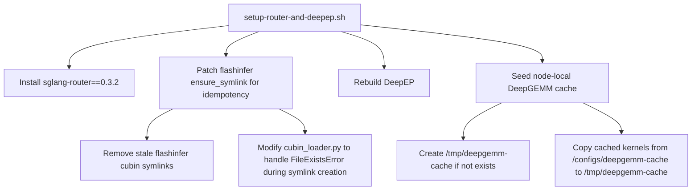

<!-- source: DeepWiki mcp.deepwiki.com · repo NVIDIA/srt-slurm · page 10.1 SGLang Recipes (GB200, GB300, H100, H200, B200) · fetched 2026-10-26 -->

# SGLang Recipes (GB200, GB300, H100, H200, B200)

<details>
<summary>Relevant source files</summary>

The following files were used as context for generating this wiki page:

- [configs/install-nixl-dsv4.sh](configs/install-nixl-dsv4.sh)
- [configs/setup-router-and-deepep.sh](configs/setup-router-and-deepep.sh)
- [recipes/dsv4-pro/README.md](recipes/dsv4-pro/README.md)
- [recipes/dsv4-pro/sglang/gb300-fp4/1k1k/agg/mtp/agg-2n-low-latency.yaml](recipes/dsv4-pro/sglang/gb300-fp4/1k1k/agg/mtp/agg-2n-low-latency.yaml)
- [recipes/dsv4-pro/sglang/gb300-fp4/1k1k/agg/mtp/agg-balanced-tep.yaml](recipes/dsv4-pro/sglang/gb300-fp4/1k1k/agg/mtp/agg-balanced-tep.yaml)
- [recipes/dsv4-pro/sglang/gb300-fp4/1k1k/agg/mtp/agg-low-latency-chat.yaml](recipes/dsv4-pro/sglang/gb300-fp4/1k1k/agg/mtp/agg-low-latency-chat.yaml)
- [recipes/dsv4-pro/sglang/gb300-fp4/1k1k/agg/mtp/agg-low-latency.yaml](recipes/dsv4-pro/sglang/gb300-fp4/1k1k/agg/mtp/agg-low-latency.yaml)
- [recipes/dsv4-pro/sglang/gb300-fp4/1k1k/agg/stp/agg-2n-nomtp.yaml](recipes/dsv4-pro/sglang/gb300-fp4/1k1k/agg/stp/agg-2n-nomtp.yaml)
- [recipes/dsv4-pro/sglang/gb300-fp4/1k1k/agg/stp/agg-max-tpt-tep.yaml](recipes/dsv4-pro/sglang/gb300-fp4/1k1k/agg/stp/agg-max-tpt-tep.yaml)
- [recipes/dsv4-pro/sglang/gb300-fp4/1k1k/agg/stp/agg-nomtp.yaml](recipes/dsv4-pro/sglang/gb300-fp4/1k1k/agg/stp/agg-nomtp.yaml)
- [recipes/dsv4-pro/sglang/gb300-fp4/1k1k/disagg/stp/disagg-1p1d-dep4-mega-moe.yaml](recipes/dsv4-pro/sglang/gb300-fp4/1k1k/disagg/stp/disagg-1p1d-dep4-mega-moe.yaml)
- [recipes/dsv4-pro/sglang/gb300-fp4/1k1k/disagg/stp/disagg-1p1d-tp4-mxfp4.yaml](recipes/dsv4-pro/sglang/gb300-fp4/1k1k/disagg/stp/disagg-1p1d-tp4-mxfp4.yaml)
- [recipes/gb200-fp8/1k1k/low-latency-mtp.yaml](recipes/gb200-fp8/1k1k/low-latency-mtp.yaml)
- [recipes/gb200-fp8/1k8k/low-latency-mtp.yaml](recipes/gb200-fp8/1k8k/low-latency-mtp.yaml)
- [recipes/gb200-fp8/8k1k/low-latency-mtp.yaml](recipes/gb200-fp8/8k1k/low-latency-mtp.yaml)
- [recipes/gb300-fp8/1k1k/mtp/low-latency.yaml](recipes/gb300-fp8/1k1k/mtp/low-latency.yaml)
- [recipes/gb300-fp8/1k1k/stp/low-latency.yaml](recipes/gb300-fp8/1k1k/stp/low-latency.yaml)
- [recipes/gb300-fp8/1k1k/stp/max.yaml](recipes/gb300-fp8/1k1k/stp/max.yaml)
- [recipes/gb300-fp8/1k1k/stp/mid.yaml](recipes/gb300-fp8/1k1k/stp/mid.yaml)
- [recipes/gb300-fp8/1k8k/mtp/low-latency.yaml](recipes/gb300-fp8/1k8k/mtp/low-latency.yaml)
- [recipes/gb300-fp8/1k8k/stp/low-latency.yaml](recipes/gb300-fp8/1k8k/stp/low-latency.yaml)
- [recipes/gb300-fp8/1k8k/stp/max.yaml](recipes/gb300-fp8/1k8k/stp/max.yaml)
- [recipes/gb300-fp8/1k8k/stp/mid.yaml](recipes/gb300-fp8/1k8k/stp/mid.yaml)
- [recipes/gb300-fp8/8k1k/mtp/low-latency.yaml](recipes/gb300-fp8/8k1k/mtp/low-latency.yaml)
- [recipes/gb300-fp8/8k1k/stp/low-latency.yaml](recipes/gb300-fp8/8k1k/stp/low-latency.yaml)
- [recipes/gb300-fp8/8k1k/stp/max.yaml](recipes/gb300-fp8/8k1k/stp/max.yaml)
- [recipes/gb300-fp8/8k1k/stp/mid.yaml](recipes/gb300-fp8/8k1k/stp/mid.yaml)
- [recipes/h200/1k1k/bs128-agg-tp.yaml](recipes/h200/1k1k/bs128-agg-tp.yaml)
- [recipes/h200/1k1k/bs256-1p6d-dep.yaml](recipes/h200/1k1k/bs256-1p6d-dep.yaml)
- [recipes/h200/1k1k/bs256-1p6d-tp.yaml](recipes/h200/1k1k/bs256-1p6d-tp.yaml)
- [recipes/h200/1k1k/low-latency-1p9d.yaml](recipes/h200/1k1k/low-latency-1p9d.yaml)
- [recipes/h200/8k1k/bs128-1p1d-dep.yaml](recipes/h200/8k1k/bs128-1p1d-dep.yaml)
- [recipes/h200/8k1k/bs128-agg-tp.yaml](recipes/h200/8k1k/bs128-agg-tp.yaml)
- [recipes/h200/8k1k/bs16-1p3d.yaml](recipes/h200/8k1k/bs16-1p3d.yaml)
- [recipes/h200/8k1k/bs4-1p7d.yaml](recipes/h200/8k1k/bs4-1p7d.yaml)
- [recipes/h200/8k1k/bs64-2p3d.yaml](recipes/h200/8k1k/bs64-2p3d.yaml)
- [recipes/h200/8k1k/bs8-1p6d.yaml](recipes/h200/8k1k/bs8-1p6d.yaml)
- [recipes/qwen3.5/fp8/disagg/mooncake/stp_prefix_off/wideep-1p1d-dep16-dpep-ccsweep.yaml](recipes/qwen3.5/fp8/disagg/mooncake/stp_prefix_off/wideep-1p1d-dep16-dpep-ccsweep.yaml)
- [recipes/qwen3.5/fp8/disagg/mooncake/stp_prefix_off/wideep-1p1d-dep32-dpep-ccsweep.yaml](recipes/qwen3.5/fp8/disagg/mooncake/stp_prefix_off/wideep-1p1d-dep32-dpep-ccsweep.yaml)
- [recipes/qwen3.5/fp8/disagg/mooncake/stp_prefix_off/wideep-1p1d-dep8-dpep-ccsweep.yaml](recipes/qwen3.5/fp8/disagg/mooncake/stp_prefix_off/wideep-1p1d-dep8-dpep-ccsweep.yaml)
- [recipes/qwen3.5/fp8/disagg/mooncake/stp_prefix_off/wideep-2p1d-dep16-dpep-cc2048x4096.yaml](recipes/qwen3.5/fp8/disagg/mooncake/stp_prefix_off/wideep-2p1d-dep16-dpep-cc2048x4096.yaml)
- [recipes/qwen3.5/fp8/disagg/mooncake/stp_prefix_off/wideep-2p1d-dep32-dpep-cc1024x2048.yaml](recipes/qwen3.5/fp8/disagg/mooncake/stp_prefix_off/wideep-2p1d-dep32-dpep-cc1024x2048.yaml)
- [recipes/qwen3.5/fp8/disagg/mooncake/stp_prefix_off/wideep-3p1d-dep32-dpep-cc4096.yaml](recipes/qwen3.5/fp8/disagg/mooncake/stp_prefix_off/wideep-3p1d-dep32-dpep-cc4096.yaml)
- [recipes/qwen3.5/fp8/disagg/mooncake/stp_prefix_off/wideep-6p1d-dep32-dpep-cc8192.yaml](recipes/qwen3.5/fp8/disagg/mooncake/stp_prefix_off/wideep-6p1d-dep32-dpep-cc8192.yaml)

</details>


This page serves as a comprehensive reference for SGLang-based inference recipes across various NVIDIA hardware generations, including GB200/GB300 NVL racks, H100/H200 Hopper, and B200 Blackwell. It details configurations for different precision levels (fp8/fp4), explores aggregated versus disaggregated topologies, covers Multi-Token Prediction (MTP) variants, and outlines recipes optimized for low-latency, maximum-throughput, and mid-curve operating points. Special attention is given to DeepSeek-V4-Pro recipes.

## SGLang Configuration Overview

SGLang recipes are defined in YAML files, typically located under `recipes/`. These files specify the model, hardware resources, and detailed SGLang backend configurations for both prefill and decode stages.

A typical SGLang recipe YAML file includes:
*   `name`: A unique identifier for the recipe.
*   `setup_script`: An optional script to run before SGLang workers start, often used for environment setup or patching.
*   `model`: Specifies the model path, container image, and precision (e.g., `fp8`, `fp4`).
*   `resources`: Defines the hardware allocation, including `gpu_type`, `gpus_per_node`, `prefill_nodes`, `decode_nodes`, `prefill_workers`, and `decode_workers`.
*   `backend`: Contains SGLang-specific configurations, separated into `prefill_environment`, `decode_environment`, and `sglang_config` for prefill and decode stages.
*   `benchmark`: Details the benchmarking parameters, such as `type` (e.g., `sa-bench`), `isl` (input sequence length), `osl` (output sequence length), and `concurrencies`.

### SGLang Backend Configuration (`sglang_config`)

The `sglang_config` section is crucial for tuning SGLang's behavior. It is divided into `prefill` and `decode` subsections, allowing for distinct configurations for each stage of the inference process.

Key parameters include:
*   `served-model-name`, `model-path`, `quantization`, `kv-cache-dtype`, `trust-remote-code`: Model-specific settings.
*   `tensor-parallel-size` (`tp-size`), `data-parallel-size` (`dp-size`), `expert-parallel-size` (`ep-size`): Control model parallelism.
*   `attention-backend`: Specifies the attention mechanism (e.g., `trtllm_mha`, `flashinfer`).
*   `moe-runner-backend`, `moe-a2a-backend`, `deepep-mode`, `ep-dispatch-algorithm`, `eplb-algorithm`: MoE (Mixture of Experts) specific settings, particularly relevant for DeepSeek-V4-Pro.
*   `disaggregation-mode`, `disaggregation-bootstrap-port`, `disaggregation-transfer-backend`: Parameters for disaggregated deployments.
*   `mem-fraction-static`, `max-total-tokens`, `chunked-prefill-size`, `max-mamba-cache-size`, `max-running-requests`, `cuda-graph-max-bs`: Memory management and batching parameters.
*   `speculative-algorithm`, `speculative-num-steps`, `speculative-eagle-topk`, `speculative-num-draft-tokens`: Parameters for Multi-Token Prediction (MTP) or speculative decoding.

Sources:
*   [recipes/qwen3.5/fp8/disagg/mooncake/stp_prefix_off/wideep-6p1d-dep32-dpep-cc8192.yaml:1-151]()
*   [recipes/qwen3.5/fp8/disagg/mooncake/stp_prefix_off/wideep-1p1d-dep32-dpep-ccsweep.yaml:1-152]()
*   [recipes/qwen3.5/fp8/disagg/mooncake/stp_prefix_off/wideep-2p1d-dep16-dpep-cc2048x4096.yaml:1-152]()
*   [recipes/qwen3.5/fp8/disagg/mooncake/stp_prefix_off/wideep-2p1d-dep32-dpep-cc1024x2048.yaml:1-151]()
*   [recipes/qwen3.5/fp8/disagg/mooncake/stp_prefix_off/wideep-1p1d-dep8-dpep-ccsweep.yaml:1-158]()
*   [recipes/qwen3.5/fp8/disagg/mooncake/stp_prefix_off/wideep-1p1d-dep16-dpep-ccsweep.yaml:1-153]()
*   [recipes/qwen3.5/fp8/disagg/mooncake/stp_prefix_off/wideep-3p1d-dep32-dpep-cc4096.yaml:1-151]()
*   [recipes/h200/8k1k/bs64-2p3d.yaml:1-110]()
*   [recipes/gb200-fp8/1k1k/low-latency-mtp.yaml:1-129]()
*   [recipes/gb300-fp8/8k1k/stp/mid.yaml:1-172]()
*   [recipes/gb300-fp8/8k1k/stp/max.yaml:1-171]()

### SGLang Recipe Structure

The following diagram illustrates the typical structure of an SGLang recipe YAML file and its key components.

```mermaid
graph TD
    A[SGLang Recipe YAML] --> B{name: "recipe-name"}
    A --> C{setup_script: "script.sh"}
    A --> D[model]
    A --> E[resources]
    A --> F[backend]
    A --> G[benchmark]

    D --> D1{path: "model-id"}
    D --> D2{container: "image"}
    D --> D3{precision: "fp8" | "fp4"}

    E --> E1{gpu_type: "gb200" | "h100"}
    E --> E2{gpus_per_node: N}
    E --> E3{prefill_nodes: N}
    E --> E4{decode_nodes: N}
    E --> E5{prefill_workers: N}
    E --> E6{decode_workers: N}

    F --> F1[prefill_environment]
    F --> F2[decode_environment]
    F --> F3[sglang_config]

    F1 --> F1a{ENV_VAR: "value"}
    F2 --> F2a{ENV_VAR: "value"}

    F3 --> F3a[prefill]
    F3 --> F3b[decode]

    F3a --> F3a1{served-model-name: "..."}
    F3a --> F3a2{model-path: "..."}
    F3a --> F3a3{quantization: "fp8"}
    F3a --> F3a4{kv-cache-dtype: "fp8_e4m3"}
    F3a --> F3a5{tensor-parallel-size: N}
    F3a --> F3a6{disaggregation-mode: "prefill"}
    F3a --> F3a7{mem-fraction-static: 0.8}
    F3a --> F3a8{attention-backend: "trtllm_mha"}
    F3a --> F3a9{moe-runner-backend: "flashinfer_trtllm"}
    F3a --> F3a10{speculative-algorithm: "EAGLE"}

    F3b --> F3b1{served-model-name: "..."}
    F3b --> F3b2{model-path: "..."}
    F3b --> F3b3{quantization: "fp8"}
    F3b --> F3b4{kv-cache-dtype: "fp8_e4m3"}
    F3b --> F3b5{tensor-parallel-size: N}
    F3b --> F3b6{disaggregation-mode: "decode"}
    F3b --> F3b7{mem-fraction-static: 0.8}
    F3b --> F3b8{attention-backend: "trtllm_mha"}
    F3b --> F3b9{moe-runner-backend: "deep_gemm"}
    F3b --> F3b10{moe-a2a-backend: "deepep"}
    F3b --> F3b11{deepep-mode: "low_latency"}
    F3b --> F3b12{speculative-algorithm: "EAGLE"}

    G --> G1{type: "sa-bench"}
    G --> G2{isl: N}
    G --> G3{osl: N}
    G --> G4{concurrencies: "X" | "[X,Y,Z]"}
```
Sources:
*   [recipes/qwen3.5/fp8/disagg/mooncake/stp_prefix_off/wideep-6p1d-dep32-dpep-cc8192.yaml:1-151]()
*   [recipes/qwen3.5/fp8/disagg/mooncake/stp_prefix_off/wideep-1p1d-dep32-dpep-ccsweep.yaml:1-152]()
*   [recipes/qwen3.5/fp8/disagg/mooncake/stp_prefix_off/wideep-2p1d-dep16-dpep-cc2048x4096.yaml:1-152]()
*   [recipes/qwen3.5/fp8/disagg/mooncake/stp_prefix_off/wideep-2p1d-dep32-dpep-cc1024x2048.yaml:1-151]()
*   [recipes/qwen3.5/fp8/disagg/mooncake/stp_prefix_off/wideep-1p1d-dep8-dpep-ccsweep.yaml:1-158]()
*   [recipes/qwen3.5/fp8/disagg/mooncake/stp_prefix_off/wideep-1p1d-dep16-dpep-ccsweep.yaml:1-153]()
*   [recipes/qwen3.5/fp8/disagg/mooncake/stp_prefix_off/wideep-3p1d-dep32-dpep-cc4096.yaml:1-151]()
*   [recipes/h200/8k1k/bs64-2p3d.yaml:1-110]()
*   [recipes/gb200-fp8/1k1k/low-latency-mtp.yaml:1-129]()
*   [recipes/gb300-fp8/8k1k/stp/mid.yaml:1-172]()
*   [recipes/gb300-fp8/8k1k/stp/max.yaml:1-171]()

## Hardware Generations and Precision

### GB200/GB300 NVL Racks (fp8/fp4)

GB200 and GB300 systems leverage NVLink for high-bandwidth inter-GPU communication, enabling large-scale distributed inference. Recipes for these platforms often utilize disaggregated topologies to optimize resource utilization.

*   **Precision**: Both `fp8` and `fp4` are supported. `kv-cache-dtype: "fp8_e4m3"` is common for FP8.
*   **Disaggregated Topologies**: Many recipes for GB200/GB300 are disaggregated, meaning prefill and decode operations run on separate sets of nodes/workers.
    *   `disaggregation-mode: "prefill"` for prefill workers.
    *   `disaggregation-mode: "decode"` for decode workers.
    *   `disaggregation-bootstrap-port`: A common port (e.g., `31000`) is used for coordination between prefill and decode workers.
    *   `disaggregation-transfer-backend: nixl` is used for efficient KV cache transfer.
*   **DeepEP (Deep Expert Parallelism)**: For MoE models like DeepSeek-V4-Pro, DeepEP is frequently used.
    *   `moe-a2a-backend: "deepep"`
    *   `deepep-mode`: Can be `low_latency` or `normal`.
    *   `ep-dispatch-algorithm`: `static` or `dynamic`.
    *   `eplb-algorithm: "deepseek"` for DeepSeek-specific load balancing.
    *   Environment variables like `SGLANG_DEEPEP_NUM_MAX_DISPATCH_TOKENS_PER_RANK` are used to tune DeepEP behavior.
*   **Memory Management**: `mem-fraction-static` is crucial for preventing Out-Of-Memory (OOM) errors, especially with large `expert-parallel-size` values. For example, `mem-fraction-static: 0.75` is seen in DEP32 configurations to avoid OOM during graph capture [recipes/qwen3.5/fp8/disagg/mooncake/stp_prefix_off/wideep-1p1d-dep32-dpep-ccsweep.yaml:126]().
*   **Example Recipes**:
    *   `recipes/qwen3.5/fp8/disagg/mooncake/stp_prefix_off/wideep-1p1d-dep32-dpep-ccsweep.yaml`: Demonstrates a disaggregated setup for Qwen3.5-397B-A17B-FP8 on GB200, with 1 prefill node (4 GPUs, DEP4) and 8 decode nodes (32 GPUs, DEP32). It includes a concurrency sweep for benchmarking.
    *   `recipes/gb300-fp8/8k1k/stp/mid.yaml`: A mid-throughput configuration for DeepSeek-R1 on GB300, using 10 prefill nodes and 8 decode nodes. It specifies `tp-size: 8`, `dp-size: 8`, `ep-size: 8` for prefill and `tp-size: 32`, `dp-size: 32`, `ep-size: 32` for decode.
    *   `recipes/gb300-fp8/8k1k/stp/max.yaml`: A max-throughput configuration for DeepSeek-R1 on GB300, with 12 prefill nodes and 6 decode nodes.

Sources:
*   [recipes/qwen3.5/fp8/disagg/mooncake/stp_prefix_off/wideep-6p1d-dep32-dpep-cc8192.yaml:1-151]()
*   [recipes/qwen3.5/fp8/disagg/mooncake/stp_prefix_off/wideep-1p1d-dep32-dpep-ccsweep.yaml:1-152]()
*   [recipes/qwen3.5/fp8/disagg/mooncake/stp_prefix_off/wideep-2p1d-dep16-dpep-cc2048x4096.yaml:1-152]()
*   [recipes/qwen3.5/fp8/disagg/mooncake/stp_prefix_off/wideep-2p1d-dep32-dpep-cc1024x2048.yaml:1-151]()
*   [recipes/qwen3.5/fp8/disagg/mooncake/stp_prefix_off/wideep-1p1d-dep8-dpep-ccsweep.yaml:1-158]()
*   [recipes/qwen3.5/fp8/disagg/mooncake/stp_prefix_off/wideep-1p1d-dep16-dpep-ccsweep.yaml:1-153]()
*   [recipes/qwen3.5/fp8/disagg/mooncake/stp_prefix_off/wideep-3p1d-dep32-dpep-cc4096.yaml:1-151]()
*   [recipes/gb300-fp8/8k1k/stp/mid.yaml:1-172]()
*   [recipes/gb300-fp8/8k1k/stp/max.yaml:1-171]()

### H100/H200 Hopper (fp8)

Hopper-based systems (H100, H200) also support SGLang with `fp8` precision. These recipes often focus on optimizing for specific latency or throughput targets.

*   **Precision**: Primarily `fp8`.
*   **Disaggregated Topologies**: Similar to GB200/GB300, disaggregated setups are common.
    *   `disaggregation-transfer-backend: nixl` is used for efficient KV cache transfer [recipes/h200/8k1k/bs64-2p3d.yaml:62]().
*   **Attention Backend**: `attention-backend: "flashinfer"` is frequently used [recipes/h200/8k1k/bs64-2p3d.yaml:47]().
*   **Example Recipes**:
    *   `recipes/h200/8k1k/bs64-2p3d.yaml`: A disaggregated recipe for DeepSeek-R1 on H200, with 2 prefill nodes and 3 decode nodes. It uses `tp-size: 8` for both prefill and decode.
    *   `recipes/h200/1k1k/low-latency-1p9d.yaml`: A low-latency configuration for H200.

Sources:
*   [recipes/h200/8k1k/bs64-2p3d.yaml:1-110]()

### B200 Blackwell (fp8/fp4)

Blackwell (B200) is the next generation of NVIDIA GPUs, offering enhanced performance. SGLang recipes for B200 will leverage its capabilities, supporting both `fp8` and `fp4`.

*   **Precision**: Both `fp8` and `fp4` are expected to be widely used.
*   **DeepSeek-V4-Pro**: Recipes for DeepSeek-V4-Pro on B200 are available, often utilizing `fp4` precision.
    *   `recipes/dsv4-pro/sglang/gb300-fp4/1k1k/agg/mtp/agg-low-latency-chat.yaml`: An aggregated, low-latency MTP recipe for DeepSeek-V4-Pro on GB300 (which shares architecture with B200 for SGLang purposes).
    *   `recipes/dsv4-pro/sglang/gb300-fp4/1k1k/disagg/stp/disagg-1p1d-dep4-mega-moe.yaml`: A disaggregated recipe for DeepSeek-V4-Pro, showcasing DeepEP with `mega-moe` configuration.
    *   `recipes/dsv4-pro/sglang/gb300-fp4/1k1k/agg/stp/agg-max-tpt-tep.yaml`: An aggregated max-throughput recipe with TEP (Tensor Expert Parallelism).

Sources:
*   `recipes/dsv4-pro/sglang/gb300-fp4/1k1k/agg/mtp/agg-low-latency-chat.yaml`
*   `recipes/dsv4-pro/sglang/gb300-fp4/1k1k/disagg/stp/disagg-1p1d-dep4-mega-moe.yaml`
*   `recipes/dsv4-pro/sglang/gb300-fp4/1k1k/agg/stp/agg-max-tpt-tep.yaml`

## Aggregated vs. Disaggregated Topologies

SGLang supports both aggregated and disaggregated inference topologies.

### Aggregated Topologies

In aggregated setups, prefill and decode operations typically run on the same set of workers or nodes. This simplifies deployment but might not offer the same level of resource optimization as disaggregated setups for certain workloads.

*   **Characteristics**:
    *   `prefill_nodes` and `decode_nodes` might be the same or closely related.
    *   `disaggregation-mode` might not be explicitly set or defaults to a unified mode.
*   **Example**: `recipes/dsv4-pro/sglang/gb300-fp4/1k1k/agg/mtp/agg-low-latency-chat.yaml`

Sources:
*   `recipes/dsv4-pro/sglang/gb300-fp4/1k1k/agg/mtp/agg-low-latency-chat.yaml`

### Disaggregated Topologies

Disaggregated topologies separate prefill and decode workers onto different nodes or groups of GPUs. This allows for independent scaling and optimization of each stage, which is particularly beneficial for large models and high-throughput scenarios.

*   **Characteristics**:
    *   `prefill_nodes` and `decode_nodes` are distinct.
    *   `disaggregation-mode: "prefill"` for prefill workers and `disaggregation-mode: "decode"` for decode workers.
    *   Requires a `disaggregation-bootstrap-port` for communication.
    *   Often uses `disaggregation-transfer-backend: nixl` for efficient KV cache transfer.
*   **Example**: `recipes/qwen3.5/fp8/disagg/mooncake/stp_prefix_off/wideep-1p1d-dep32-dpep-ccsweep.yaml` [recipes/qwen3.5/fp8/disagg/mooncake/stp_prefix_off/wideep-1p1d-dep32-dpep-ccsweep.yaml:86, 118]()

Sources:
*   [recipes/qwen3.5/fp8/disagg/mooncake/stp_prefix_off/wideep-1p1d-dep32-dpep-ccsweep.yaml:86, 118]()

## Multi-Token Prediction (MTP) Variants

Multi-Token Prediction (MTP), also known as speculative decoding, aims to accelerate inference by predicting multiple tokens at once. SGLang supports MTP through various configurations.

*   **Speculative Decoding Parameters**:
    *   `speculative-algorithm`: (e.g., `EAGLE`) [recipes/gb200-fp8/1k1k/low-latency-mtp.yaml:89, 118]()
    *   `speculative-num-steps`: Number of speculative steps.
    *   `speculative-eagle-topk`: Top-K tokens considered for EAGLE.
    *   `speculative-num-draft-tokens`: Number of draft tokens generated.
*   **Example**: `recipes/gb200-fp8/1k1k/low-latency-mtp.yaml` demonstrates a low-latency MTP configuration for DeepSeek-R1 on GB200.

Sources:
*   [recipes/gb200-fp8/1k1k/low-latency-mtp.yaml:89, 118]()

## Operating Points: Low-Latency, Max-Throughput, Mid-Curve

Recipes are often tuned for specific operating points to meet different application requirements.

### Low-Latency Recipes

These recipes prioritize minimizing the time to first token (TTFT) and inter-token latency (ITL).

*   **Characteristics**:
    *   Lower `max-running-requests` or `concurrencies`.
    *   Aggressive `mem-fraction-static` to maximize KV cache.
    *   Potentially smaller `chunked-prefill-size`.
    *   `deepep-mode: "low_latency"` for DeepEP configurations.
*   **Example**: `recipes/gb200-fp8/1k1k/low-latency-mtp.yaml` [recipes/gb200-fp8/1k1k/low-latency-mtp.yaml:1]()

Sources:
*   [recipes/gb200-fp8/1k1k/low-latency-mtp.yaml:1]()

### Max-Throughput Recipes

These recipes aim to maximize the total output tokens per second (Goodput).

*   **Characteristics**:
    *   Higher `max-running-requests` and `concurrencies`.
    *   Larger `chunked-prefill-size`.
    *   Optimized `cuda-graph-max-bs` for larger batch sizes.
    *   `deepep-mode: "normal"` or `dynamic` dispatch for DeepEP.
*   **Example**: `recipes/gb300-fp8/8k1k/stp/max.yaml` [recipes/gb300-fp8/8k1k/stp/max.yaml:1]()

Sources:
*   [recipes/gb300-fp8/8k1k/stp/max.yaml:1]()

### Mid-Curve Operating Points

These recipes strike a balance between latency and throughput, suitable for general-purpose workloads.

*   **Characteristics**:
    *   Intermediate values for `max-running-requests`, `concurrencies`, and `chunked-prefill-size`.
    *   Often used for initial performance characterization.
*   **Example**: `recipes/gb300-fp8/8k1k/stp/mid.yaml` [recipes/gb300-fp8/8k1k/stp/mid.yaml:1]()

Sources:
*   [recipes/gb300-fp8/8k1k/stp/mid.yaml:1]()

## DeepSeek-V4-Pro Recipes

DeepSeek-V4-Pro is a Mixture-of-Experts (MoE) model that benefits significantly from specialized SGLang configurations, particularly on GB200/GB300 systems.

*   **Key Features**:
    *   **FP4 Precision**: Many DeepSeek-V4-Pro recipes utilize `fp4` quantization for reduced memory footprint and increased throughput.
    *   **DeepEP Integration**: Deep Expert Parallelism (DeepEP) is critical for efficient MoE execution.
        *   `moe-a2a-backend: "deepep"`
        *   `eplb-algorithm: "deepseek"`
        *   `ep-num-redundant-experts`: Configures redundancy for expert dispatch.
        *   `deepep-config: "/configs/deepep_config.json"`: Specifies a custom DeepEP configuration file.
    *   **Mega-MoE**: Some disaggregated recipes are specifically tuned for "mega-moe" configurations, indicating very large MoE setups.
*   **Example Recipes**:
    *   `recipes/dsv4-pro/sglang/gb300-fp4/1k1k/agg/mtp/agg-low-latency-chat.yaml`: Aggregated, low-latency MTP for chat applications.
    *   `recipes/dsv4-pro/sglang/gb300-fp4/1k1k/disagg/stp/disagg-1p1d-dep4-mega-moe.yaml`: Disaggregated, single prefill node, single decode node with DEP4 and mega-MoE.
    *   `recipes/dsv4-pro/sglang/gb300-fp4/1k1k/agg/stp/agg-max-tpt-tep.yaml`: Aggregated, max-throughput with Tensor Expert Parallelism (TEP).

Sources:
*   `recipes/dsv4-pro/sglang/gb300-fp4/1k1k/agg/mtp/agg-low-latency-chat.yaml`
*   `recipes/dsv4-pro/sglang/gb300-fp4/1k1k/disagg/stp/disagg-1p1d-dep4-mega-moe.yaml`
*   `recipes/dsv4-pro/sglang/gb300-fp4/1k1k/agg/stp/agg-max-tpt-tep.yaml`

## Setup Scripts and Environment Variables

Many SGLang recipes utilize `setup_script` and environment variables to fine-tune the SGLang runtime.

### `setup-router-and-deepep.sh`

This script is a common `setup_script` used in many SGLang recipes, particularly those involving DeepEP.


Sources:
*   [configs/setup-router-and-deepep.sh:1-57]()

The script performs several critical steps:
1.  **Installs `sglang-router`**: Ensures the correct version of the SGLang router is installed [configs/setup-router-and-deepep.sh:8-9]().
2.  **Patches `flashinfer`**: Modifies `flashinfer/jit/cubin_loader.py` to make `ensure_symlink` idempotent. This prevents race conditions when multiple Data Parallel (DP) workers try to create the same symlink concurrently, which can lead to `FileExistsError` [configs/setup-router-and-deepep.sh:13-37]().
3.  **Rebuilds DeepEP**: Executes `rebuild-deepep.sh` to rebuild the DeepEP library, often with specific configurations like `kNumMaxTopK=16` [configs/setup-router-and-deepep.sh:41]().
4.  **Seeds DeepGEMM Cache**: Copies DeepGEMM kernels from a shared NFS location (`/configs/deepgemm-cache`) to a node-local writable cache (`/tmp/deepgemm-cache`). This prevents race conditions and crashes that can occur when multiple nodes JIT-compile the same kernels to a shared NFS directory [configs/setup-router-and-deepep.sh:44-55]().

### Environment Variables

Numerous environment variables are used to control SGLang's behavior, especially in disaggregated and MoE setups.

*   `SGLANG_DISAGGREGATION_HEARTBEAT_MAX_FAILURE`, `SGLANG_DISAGGREGATION_BOOTSTRAP_TIMEOUT`, `SGLANG_DISAGGREGATION_WAITING_TIMEOUT`: Control the robustness and timeouts for disaggregated communication [recipes/qwen3.5/fp8/disagg/mooncake/stp_prefix_off/wideep-6p1d-dep32-dpep-cc8192.yaml:36-38]().
*   `SGLANG_MOONCAKE_CUSTOM_MEM_POOL`: Enables custom memory pooling for Mooncake [recipes/qwen3.5/fp8/disagg/mooncake/stp_prefix_off/wideep-6p1d-dep32-dpep-cc8192.yaml:39]().
*   `SGLANG_USE_MESSAGE_QUEUE_BROADCASTER`: Controls the use of message queue for broadcasting [recipes/qwen3.5/fp8/disagg/mooncake/stp_prefix_off/wideep-6p1d-dep32-dpep-cc8192.yaml:40]().
*   `SGLANG_DISABLE_TP_MEMORY_INBALANCE_CHECK`: Disables memory imbalance checks for Tensor Parallelism [recipes/qwen3.5/fp8/disagg/mooncake/stp_prefix_off/wideep-6p1d-dep32-dpep-cc8192.yaml:41]().
*   `SGLANG_DG_CACHE_DIR`, `FLASHINFER_WORKSPACE_BASE`: Specify cache directories for DeepGEMM and FlashInfer [recipes/qwen3.5/fp8/disagg/mooncake/stp_prefix_off/wideep-6p1d-dep32-dpep-cc8192.yaml:34-35]().
*   `MC_FORCE_MNNVL`, `NCCL_MNNVL_ENABLE`, `NCCL_CUMEM_ENABLE`: Related to NVIDIA NVLink and CUDA memory management [recipes/qwen3.5/fp8/disagg/mooncake/stp_prefix_off/wideep-6p1d-dep32-dpep-cc8192.yaml:31-33]().
*   `SGLANG_DEEPEP_NUM_MAX_DISPATCH_TOKENS_PER_RANK`: Specific to DeepEP, controlling token dispatch per rank [recipes/qwen3.5/fp8/disagg/mooncake/stp_prefix_off/wideep-6p1d-dep32-dpep-cc8192.yaml:63]().

Sources:
*   [configs/setup-router-and-deepep.sh:1-57]()
*   [recipes/qwen3.5/fp8/disagg/mooncake/stp_prefix_off/wideep-6p1d-dep32-dpep-cc8192.yaml:27-44]()
*   [recipes/qwen3.5/fp8/disagg/mooncake/stp_prefix_off/wideep-6p1d-dep32-dpep-cc8192.yaml:45-67]()

---

