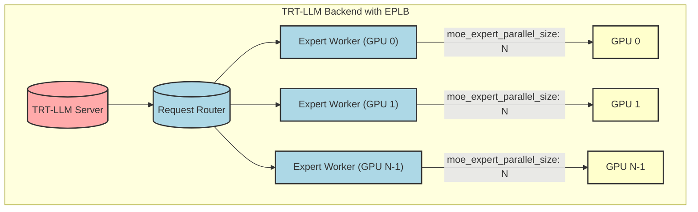

<!-- source: DeepWiki mcp.deepwiki.com · repo NVIDIA/srt-slurm · page 10.2 TRT-LLM Recipes · fetched 2026-10-26 -->

# TRT-LLM Recipes

<details>
<summary>Relevant source files</summary>

The following files were used as context for generating this wiki page:

- [recipes/gb300-fp4/128k8k/highthroughput-ctx5_pp4_gen1_dep16_batch16_eplb0_mtp0.yaml](recipes/gb300-fp4/128k8k/highthroughput-ctx5_pp4_gen1_dep16_batch16_eplb0_mtp0.yaml)
- [recipes/gb300-fp4/128k8k/maxthroughput-ctx3_pp4_gen1_dep8_batch32_eplb0_mtp0.yaml](recipes/gb300-fp4/128k8k/maxthroughput-ctx3_pp4_gen1_dep8_batch32_eplb0_mtp0.yaml)
- [recipes/gb300-fp4/128k8k/middlecurve-ctx8_pp4_gen1_dep32_batch8_eplb0_mtp0.yaml](recipes/gb300-fp4/128k8k/middlecurve-ctx8_pp4_gen1_dep32_batch8_eplb0_mtp0.yaml)
- [recipes/gb300-fp4/128k8k/minttft-ctx1_pp4_gen1_tp4_eplb0_mtp0-chunked-32k-dynchunk.yaml](recipes/gb300-fp4/128k8k/minttft-ctx1_pp4_gen1_tp4_eplb0_mtp0-chunked-32k-dynchunk.yaml)
- [recipes/gb300-fp4/128k8k_mtp/highthroughput-ctx3_pp4_gen1_dep8_batch16_eplb0_mtp1.yaml](recipes/gb300-fp4/128k8k_mtp/highthroughput-ctx3_pp4_gen1_dep8_batch16_eplb0_mtp1.yaml)
- [recipes/gb300-fp4/128k8k_mtp/midcurve-ctx5_pp4_gen1_dep16_batch8_eplb0_mtp2.yaml](recipes/gb300-fp4/128k8k_mtp/midcurve-ctx5_pp4_gen1_dep16_batch8_eplb0_mtp2.yaml)
- [recipes/trtllm/gpt-oss-120b/b200-fp4/1k1k/agg-tp1.yaml](recipes/trtllm/gpt-oss-120b/b200-fp4/1k1k/agg-tp1.yaml)
- [recipes/trtllm/gpt-oss-120b/b200-fp4/1k8k/agg-tp1.yaml](recipes/trtllm/gpt-oss-120b/b200-fp4/1k8k/agg-tp1.yaml)
- [recipes/trtllm/gpt-oss-120b/b200-fp4/8k1k/agg-tp1.yaml](recipes/trtllm/gpt-oss-120b/b200-fp4/8k1k/agg-tp1.yaml)

</details>


This page provides a reference for TensorRT-LLM (TRT-LLM) inference recipes supported by `srtctl`. These recipes cover various hardware configurations including B200/B300, GB200/GB300, and H100/H200 GPUs, with a focus on `fp8` and `fp4` precision. The recipes demonstrate aggregated Tensor Parallel (TP) configurations, and for certain models, Expert Parallel Load Balancing (EPLB). Specifically, this page details recipes for the `gpt-oss-120b` model.

## TRT-LLM Backend Configuration

The `trtllm` backend is configured within the `backend` section of the `SrtConfig` YAML. Key parameters include `aggregated_environment` for setting environment variables specific to the TRT-LLM server, and `trtllm_config` for specifying model-specific parameters like `tensor_parallel_size`, `moe_expert_parallel_size`, and `max_seq_len`.

A typical TRT-LLM backend configuration looks like this:
```yaml
backend:
  type: trtllm

  aggregated_environment:
    PYTHONUNBUFFERED: "1"
    DYN_HEALTH_CHECK_ENABLED: "false"
    TRTLLM_ENABLE_PDL: "1"
    TRTLLM_SERVER_DISABLE_GC: "1"
    TRTLLM_WORKER_DISABLE_GC: "1"
    TLLM_LOG_LEVEL: "INFO"

  trtllm_config:
    aggregated:
      backend: "pytorch"
      tensor_parallel_size: 1
      moe_expert_parallel_size: 1
      max_batch_size: 512
      max_num_tokens: 20000
      max_seq_len: 2248
      trust_remote_code: true
```
Sources: [recipes/trtllm/gpt-oss-120b/b200-fp4/1k1k/agg-tp1.yaml:22-41]()

### Environment Variables

The `aggregated_environment` section allows setting various environment variables that influence the TRT-LLM server's behavior. Some common ones include:
*   `PYTHONUNBUFFERED`: Ensures Python output is unbuffered.
*   `DYN_HEALTH_CHECK_ENABLED`: Controls health check behavior.
*   `TRTLLM_ENABLE_PDL`: Enables Paged Attention.
*   `TRTLLM_SERVER_DISABLE_GC`, `TRTLLM_WORKER_DISABLE_GC`: Disables garbage collection for server and worker processes, respectively.
*   `TLLM_LOG_LEVEL`: Sets the logging level for TRT-LLM.

### TRT-LLM Specific Configuration (`trtllm_config`)

The `trtllm_config` block contains parameters directly passed to the TRT-LLM engine.
*   `backend`: Specifies the backend for model loading, typically "pytorch".
*   `tensor_parallel_size`: Defines the number of GPUs used for Tensor Parallelism.
*   `moe_expert_parallel_size`: Specifies the number of GPUs used for Expert Parallelism in Mixture-of-Experts (MoE) models.
*   `max_batch_size`: Maximum number of requests processed in a single batch.
*   `max_num_tokens`: Maximum total number of tokens (input + output) across all requests in a batch.
*   `max_seq_len`: Maximum sequence length supported by the model.
*   `trust_remote_code`: Allows execution of remote code for model loading.

## GPT-OSS-120B Recipes on B200 (FP4)

These recipes demonstrate running the `gpt-oss-120b` model on B200 GPUs using `fp4` precision. They focus on aggregated Tensor Parallel (TP) configurations.

### Aggregated TP1 Configuration

The `agg-tp1.yaml` recipes configure a single GPU for both Tensor Parallelism and Expert Parallelism (`tensor_parallel_size: 1`, `moe_expert_parallel_size: 1`).

#### 1k1k ISL/OSL
This recipe is configured for an Input Sequence Length (ISL) of 1024 and an Output Sequence Length (OSL) of 1024.
*   **Name**: `gpt-oss-120b-trtllm-agg-b200-tp1-1k1k`
*   **Model Path**: `hf:openai/gpt-oss-120b`
*   **Container**: `nvcr.io/nvidia/ai-dynamo/tensorrtllm-runtime:1.1.0-dev.3`
*   **Precision**: `fp4`
*   **Resources**: 1 B200 GPU, 1 aggregated node, 1 aggregated worker.
*   **TRT-LLM Config**: `max_seq_len: 2248`
*   **Benchmark**: SA-Bench with `isl: 1024`, `osl: 1024`, `concurrencies: 256`.
Sources: [recipes/trtllm/gpt-oss-120b/b200-fp4/1k1k/agg-tp1.yaml:1-52]()

#### 8k1k ISL/OSL
This recipe is configured for an Input Sequence Length (ISL) of 8192 and an Output Sequence Length (OSL) of 1024.
*   **Name**: `gpt-oss-120b-trtllm-agg-b200-tp1-8k1k`
*   **Model Path**: `hf:openai/gpt-oss-120b`
*   **Container**: `nvcr.io/nvidia/ai-dynamo/tensorrtllm-runtime:1.1.0-dev.3`
*   **Precision**: `fp4`
*   **Resources**: 1 B200 GPU, 1 aggregated node, 1 aggregated worker.
*   **TRT-LLM Config**: `max_seq_len: 9416`
*   **Benchmark**: SA-Bench with `isl: 8192`, `osl: 1024`, `concurrencies: 256`.
Sources: [recipes/trtllm/gpt-oss-120b/b200-fp4/8k1k/agg-tp1.yaml:1-52]()

#### 1k8k ISL/OSL
This recipe is configured for an Input Sequence Length (ISL) of 1024 and an Output Sequence Length (OSL) of 8192.
*   **Name**: `gpt-oss-120b-trtllm-agg-b200-tp1-1k8k`
*   **Model Path**: `hf:openai/gpt-oss-120b`
*   **Container**: `nvcr.io/nvidia/ai-dynamo/tensorrtllm-runtime:1.1.0-dev.3`
*   **Precision**: `fp4`
*   **Resources**: 1 B200 GPU, 1 aggregated node, 1 aggregated worker.
*   **TRT-LLM Config**: `max_seq_len: 9416`
*   **Benchmark**: SA-Bench with `isl: 1024`, `osl: 8192`, `concurrencies: 256`.
Sources: [recipes/trtllm/gpt-oss-120b/b200-fp4/1k8k/agg-tp1.yaml:1-52]()

### Diagram: TRT-LLM Aggregated TP1 Configuration
```mermaid
graph TD
    subgraph "SLURM Job"
        Job["srtctl apply <recipe.yaml>"] --> SbatchScript[("sbatch script")]
        SbatchScript --> HeadNode[("Head Node")]
    end

    subgraph "Head Node Processes"
        HeadNode --> DynamoFrontend[Frontend: "dynamo.frontend"]
        DynamoFrontend --> TRTLLMServer[Backend: "trtllm-llmapi-launch"]
    end

    subgraph "TRT-LLM Server (Aggregated)"
        TRTLLMServer --> TRTLLM_Process_0["TRT-LLM Worker (GPU 0)"]
        TRTLLM_Process_0 -- "tensor_parallel_size: 1" --> GPU_0["GPU 0 (B200)"]
        TRTLLM_Process_0 -- "moe_expert_parallel_size: 1" --> GPU_0
    end

    subgraph "Benchmark"
        DynamoFrontend --> SABench[Benchmark: "sa-bench"]
    end

    style Job fill:#f9f,stroke:#333,stroke-width:2px
    style SbatchScript fill:#bbf,stroke:#333,stroke-width:2px
    style HeadNode fill:#ccf,stroke:#333,stroke-width:2px
    style DynamoFrontend fill:#afa,stroke:#333,stroke-width:2px
    style TRTLLMServer fill:#faa,stroke:#333,stroke-width:2px
    style TRTLLM_Process_0 fill:#add8e6,stroke:#333,stroke-width:2px
    style GPU_0 fill:#ffc,stroke:#333,stroke-width:2px
    style SABench fill:#f9f,stroke:#333,stroke-width:2px
```
Sources: [recipes/trtllm/gpt-oss-120b/b200-fp4/1k1k/agg-tp1.yaml:1-52](), [recipes/trtllm/gpt-oss-120b/b200-fp4/8k1k/agg-tp1.yaml:1-52](), [recipes/trtllm/gpt-oss-120b/b200-fp4/1k8k/agg-tp1.yaml:1-52]()

## Expert Parallel Load Balancing (EPLB)

While the `gpt-oss-120b` recipes shown above use `moe_expert_parallel_size: 1`, TRT-LLM supports Expert Parallel Load Balancing (EPLB) for Mixture-of-Experts (MoE) models. This is typically configured via the `moe_expert_parallel_size` parameter in `trtllm_config` and potentially specific environment variables.

For example, in SGLang recipes that leverage TRT-LLM as an attention backend, you might see configurations like `expert-parallel-size: 8` or `expert-parallel-size: 32` for decode workers, along with environment variables such as `SGLANG_DEEPEP_NUM_MAX_DISPATCH_TOKENS_PER_RANK` and `SGLANG_MOE_NVFP4_DISPATCH`. These settings are crucial for distributing the workload of experts across multiple GPUs.

```yaml
  decode_environment:
    # ...
    SGLANG_DEEPEP_NUM_MAX_DISPATCH_TOKENS_PER_RANK: "1024"
    SGLANG_MOE_NVFP4_DISPATCH: "1"
    # ...
  sglang_config:
    decode:
      # ...
      expert-parallel-size: 8
      moe-a2a-backend: deepep
      deepep-mode: low_latency
      # ...
```
Sources: [recipes/gb300-fp4/128k8k/maxthroughput-ctx3_pp4_gen1_dep8_batch32_eplb0_mtp0.yaml:38-39](), [recipes/gb300-fp4/128k8k/maxthroughput-ctx3_pp4_gen1_dep8_batch32_eplb0_mtp0.yaml:82-84]()

### Diagram: TRT-LLM with Expert Parallelism (Conceptual)

Sources: [recipes/gb300-fp4/128k8k/maxthroughput-ctx3_pp4_gen1_dep8_batch32_eplb0_mtp0.yaml:82-84]()

## Multi-Token Prediction (MTP) with TRT-LLM

Some recipes, particularly those leveraging SGLang with TRT-LLM as an attention backend, incorporate Multi-Token Prediction (MTP) for improved generation throughput. This is enabled through specific environment variables and `sglang_config` parameters.

For example, MTP-enabled recipes on GB300 might include:
*   `SGLANG_CUTEDSL_MOE_NVFP4_DISPATCH: "1"`
*   `SGLANG_ENABLE_SPEC_V2: "1"`
*   `speculative-algorithm: "EAGLE"`
*   `speculative-num-steps: 2`
*   `speculative-num-draft-tokens: 3`

These settings configure speculative decoding using the EAGLE algorithm, allowing the model to predict multiple tokens at once, which can significantly boost performance.
Sources: [recipes/gb300-fp4/128k8k_mtp/midcurve-ctx5_pp4_gen1_dep16_batch8_eplb0_mtp2.yaml:43-45](), [recipes/gb300-fp4/128k8k_mtp/midcurve-ctx5_pp4_gen1_dep16_batch8_eplb0_mtp2.yaml:103-108]()

## General TRT-LLM Recipe Structure

All TRT-LLM recipes follow the general `SrtConfig` structure, defining `model`, `resources`, `frontend`, `backend`, and `benchmark` sections.

*   **`model`**: Specifies the model path (e.g., HuggingFace ID), the container image to use, and the desired precision (`fp4`, `fp8`).
*   **`resources`**: Defines the hardware configuration, including `gpu_type`, `gpus_per_node`, and the number of `agg_nodes` and `agg_workers` for aggregated setups, or `prefill_nodes`/`decode_nodes` for disaggregated setups.
*   **`frontend`**: Typically `type: dynamo` for TRT-LLM recipes, managing request routing.
*   **`backend`**: Set to `type: trtllm`, containing the `aggregated_environment` and `trtllm_config` as detailed above.
*   **`benchmark`**: Defines the benchmarking strategy, usually `type: "sa-bench"`, with parameters like `isl` (input sequence length), `osl` (output sequence length), `concurrencies`, and `req_rate`.

This consistent structure allows for easy modification and extension of existing recipes to new hardware or model configurations.
Sources: [recipes/trtllm/gpt-oss-120b/b200-fp4/1k1k/agg-tp1.yaml:3-52]()

---

