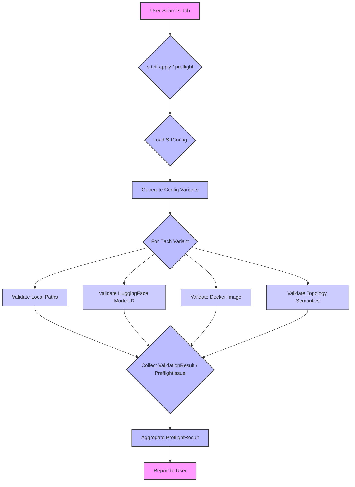

<!-- source: DeepWiki mcp.deepwiki.com · repo NVIDIA/srt-slurm · page 11 Validation, Status API & MCP Server · fetched 2026-10-26 -->

# Validation, Status API & MCP Server

<details>
<summary>Relevant source files</summary>

The following files were used as context for generating this wiki page:

- [docs/status-api-spec.md](docs/status-api-spec.md)
- [src/srtctl/core/status.py](src/srtctl/core/status.py)
- [src/srtctl/core/validation.py](src/srtctl/core/validation.py)
- [src/srtctl/mcp/server.py](src/srtctl/mcp/server.py)
- [src/srtctl/mcp/spec_tools.py](src/srtctl/mcp/spec_tools.py)
- [src/srtctl/mock.py](src/srtctl/mock.py)
- [tests/test_apply_json.py](tests/test_apply_json.py)
- [tests/test_apply_mock.py](tests/test_apply_mock.py)
- [tests/test_mcp_spec.py](tests/test_mcp_spec.py)
- [tests/test_status.py](tests/test_status.py)
- [tests/test_validation.py](tests/test_validation.py)

</details>


This page provides a high-level overview of `srtctl`'s mechanisms for ensuring configuration correctness, reporting job status externally, and facilitating AI-assisted recipe authoring. These systems enhance reliability, observability, and user experience by catching issues early, providing real-time updates, and simplifying complex configuration tasks.

## Config Validation & Preflight Checks

`srtctl` incorporates a robust validation framework to ensure that job configurations (`SrtConfig`) are syntactically and semantically correct before submission. This framework includes various checks, from verifying local file paths to validating external registry references and ensuring the logical consistency of resource allocations. These validations are designed to be fault-tolerant, meaning network errors or missing resources will not block job submission but will instead report issues.

The core validation logic is encapsulated in functions like `run_all_validations()` and `preflight_config_variants()`. These functions perform checks such as:
*   **Local Path Existence:** Verifying that paths specified for models or containers exist on the local filesystem.
*   **HuggingFace Model ID Verification:** Checking if a given HuggingFace model ID resolves via the HuggingFace API.
*   **Docker Registry Manifest Checks:** Confirming the existence and optionally the digest of Docker images in registries.
*   **Topology Semantic Validation:** Ensuring that resource configurations (e.g., `prefill_nodes`, `decode_nodes`, `agg_nodes`) are consistent with aggregated or disaggregated deployment patterns.

The results of these checks are captured in `ValidationResult` and `PreflightResult` data structures, providing clear feedback on any identified issues. For details, see [Config Validation & Preflight Checks](#11.1).


**Diagram: High-Level Validation Flow**
Sources: [src/srtctl/core/validation.py:1-10](), [tests/test_validation.py:17-21]()

## Status Reporting API & Contract

`srtctl` includes an optional external status reporting system that provides real-time updates on job lifecycle events. This system is designed to be fire-and-forget, meaning that failures in reporting do not block or fail the job execution itself. It's configured via the `reporting.status` section in `srtslurm.yaml` or the job recipe.

The `StatusReporter` class manages sending updates to one or more configured API endpoints. Key interactions include:
*   **`POST /api/jobs`**: Sent at job submission to create an initial job record.
*   **`PUT /api/jobs/{job_id}`**: Used to send lifecycle updates (e.g., `submitted`, `workers`, `benchmark`, `completed`, `failed`) as the job progresses through its stages.

The API contract, including request/response payloads and status/stage enums, is formally defined in the `srtctl.contract` module. A mock status server is also available for testing purposes. For details, see [Status Reporting API & Contract](#11.2).

```mermaid
graph TD
    A[srtctl CLI] --> B{submit_cli.main()};
    B --> C[StatusReporter.from_config()];
    C --> D{reporter.report_started()};
    D -- POST /api/jobs --> E[External Status API];
    E --> F[Job Record Created];

    subgraph Job Execution (SweepOrchestrator)
        G[Job Stages] --> H{reporter.report(status, stage)};
        H -- PUT /api/jobs/{job_id} --> E;
        H --> I[Job Lifecycle Updates];
    end

    I --> J{reporter.report_completed()};
    J -- PUT /api/jobs/{job_id} --> E;
    J --> K[Job Status: Completed/Failed];

    style A fill:#f9f,stroke:#333,stroke-width:2px
    style B fill:#bbf,stroke:#333,stroke-width:2px
    style C fill:#bbf,stroke:#333,stroke-width:2px
    style D fill:#bbf,stroke:#333,stroke-width:2px
    style E fill:#f9f,stroke:#333,stroke-width:2px
    style F fill:#f9f,stroke:#333,stroke-width:2px
    style G fill:#bbf,stroke:#333,stroke-width:2px
    style H fill:#bbf,stroke:#333,stroke-width:2px
    style I fill:#f9f,stroke:#333,stroke-width:2px
    style J fill:#bbf,stroke:#333,stroke-width:2px
    style K fill:#f9f,stroke:#333,stroke-width:2px
```
**Diagram: Status Reporting Flow**
Sources: [src/srtctl/core/status.py:70-100](), [src/srtctl/core/status.py:127-154](), [src/srtctl/core/status.py:156-198](), [docs/status-api-spec.md:19-70]()

## MCP Server (srtctl-mcp)

The `srtctl-mcp` server provides a Model Context Protocol (MCP) interface, enabling AI-assisted authoring and validation of `srtctl` recipes. It exposes a set of tools that allow external agents (like LLMs) to interact with the `srtctl` configuration schema and documentation.

The `FastMCP` server, defined in `src/srtctl/mcp/server.py` and implemented via `spec_tools.py`, offers several key functionalities:
*   `schema_summary()`: Provides a compact overview of top-level `SrtConfig` fields.
*   `get_config_reference()`: Searches the `config-reference.md` documentation for relevant snippets.
*   `explain_field()`: Combines schema introspection with documentation to explain a specific configuration field.
*   `validate_config()`: Validates a given configuration against the `SrtConfig` schema, including topology checks.
*   `preflight_config()`: Performs local path checks for models and containers, without relying on cluster-specific `srtslurm.yaml` settings.
*   `resolve_config()`: Applies schema-only defaults to a configuration, without considering host-side `srtslurm.yaml`.

A crucial concept is the "operator boundary," which distinguishes between checks that can be performed client-side (e.g., schema validation) and those requiring compute-side context (e.g., actual cluster resource availability). The MCP server explicitly avoids using host-side `srtslurm.yaml` for cluster defaults, ensuring that its responses are consistent regardless of where the server is run. For details, see [MCP Server (srtctl-mcp)](#11.3).

```mermaid
graph TD
    A[AI Agent / User] --> B{FastMCP Server (srtctl-mcp)};
    B -- /schema_summary --> C[schema_summary_impl()];
    B -- /get_config_reference --> D[get_config_reference_impl()];
    B -- /explain_field --> E[explain_field_impl()];
    B -- /validate_config --> F[validate_config_impl()];
    B -- /preflight_config --> G[preflight_config_impl()];
    B -- /resolve_config --> H[resolve_config_impl()];

    C --> I[SrtConfig Dataclass Introspection];
    D --> J[docs/config-reference.md];
    E --> I & J;
    F --> K[SrtConfig.Schema().load()];
    F --> L[validate_topology()];
    G --> M[preflight_config_variants()];
    H --> N[resolve_config_with_defaults()];

    subgraph "Code Entity Space"
        I["srtctl.core.schema.SrtConfig"]
        J["docs/config-reference.md"]
        K["srtctl.core.schema.SrtConfig.Schema().load()"]
        L["srtctl.core.validation.validate_topology()"]
        M["srtctl.core.validation.preflight_config_variants()"]
        N["srtctl.core.config.resolve_config_with_defaults()"]
        C["srtctl.mcp.spec_tools.schema_summary()"]
        D["srtctl.mcp.spec_tools.get_config_reference()"]
        E["srtctl.mcp.spec_tools.explain_field()"]
        F["srtctl.mcp.spec_tools.validate_config()"]
        G["srtctl.mcp.spec_tools.preflight_config()"]
        H["srtctl.mcp.spec_tools.resolve_config()"]
    end

    style A fill:#f9f,stroke:#333,stroke-width:2px
    style B fill:#bbf,stroke:#333,stroke-width:2px
    style C fill:#ccf,stroke:#333,stroke-width:1px
    style D fill:#ccf,stroke:#333,stroke-width:1px
    style E fill:#ccf,stroke:#333,stroke-width:1px
    style F fill:#ccf,stroke:#333,stroke-width:1px
    style G fill:#ccf,stroke:#333,stroke-width:1px
    style H fill:#ccf,stroke:#333,stroke-width:1px
    style I fill:#ccf,stroke:#333,stroke-width:1px
    style J fill:#ccf,stroke:#333,stroke-width:1px
    style K fill:#ccf,stroke:#333,stroke-width:1px
    style L fill:#ccf,stroke:#333,stroke-width:1px
    style M fill:#ccf,stroke:#333,stroke-width:1px
    style N fill:#ccf,stroke:#333,stroke-width:1px
```
**Diagram: MCP Server Functionality**
Sources: [src/srtctl/mcp/server.py:9-28](), [src/srtctl/mcp/spec_tools.py:29-187]()

---

