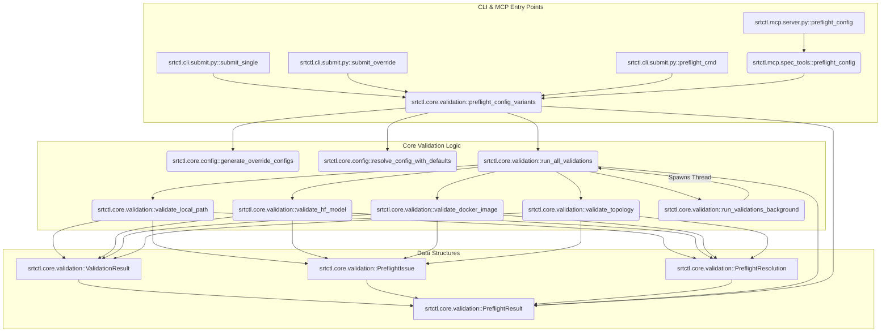

<!-- source: DeepWiki mcp.deepwiki.com · repo NVIDIA/srt-slurm · page 11.1 Config Validation & Preflight Checks · fetched 2026-10-26 -->

# Config Validation & Preflight Checks

<details>
<summary>Relevant source files</summary>

The following files were used as context for generating this wiki page:

- [.github/workflows/ci.yaml](.github/workflows/ci.yaml)
- [docs/overrides.md](docs/overrides.md)
- [examples/example-override.yaml](examples/example-override.yaml)
- [src/srtctl/cli/submit.py](src/srtctl/cli/submit.py)
- [src/srtctl/core/config.py](src/srtctl/core/config.py)
- [src/srtctl/core/validation.py](src/srtctl/core/validation.py)
- [src/srtctl/mcp/server.py](src/srtctl/mcp/server.py)
- [src/srtctl/mcp/spec_tools.py](src/srtctl/mcp/spec_tools.py)
- [tests/test_mcp_spec.py](tests/test_mcp_spec.py)
- [tests/test_override.py](tests/test_override.py)
- [tests/test_validation.py](tests/test_validation.py)

</details>


This page details the configuration validation and preflight check mechanisms within `srtctl`. These checks ensure that job configurations are syntactically correct, semantically valid, and that external resources (like model paths, HuggingFace models, and Docker images) are accessible before a job is submitted to SLURM. The system is designed to be fault-tolerant, providing informative feedback without blocking job submission in all cases.

## Validation Data Structures

The validation system uses specific data structures to report the outcomes of checks:

*   `ValidationResult`: Represents the outcome of a single validation check. It includes a `check` identifier, a boolean `ok` indicating success or failure, and a `message` providing details. [src/srtctl/core/validation.py:37-43]()
*   `PreflightIssue`: Describes a specific problem found during preflight checks, including a `code`, the `field` it relates to, and a `message`. [src/srtctl/core/validation.py:46-50]()
*   `PreflightResolution`: Details how a configuration field (like a model path or container image) was resolved, including its `raw` value, `resolved` value, `source` of resolution (e.g., literal, alias), `ok` status, and a `message`. [src/srtctl/core/validation.py:53-60]()
*   `PreflightResult`: Aggregates the results for a specific configuration variant, including its `variant` name, overall `ok` status, `model` and `container` resolution details, and a list of `errors`. [src/srtctl/core/validation.py:63-69]()

## Core Validation Functions

### `run_all_validations()`

The `run_all_validations()` function orchestrates a series of checks on a given `SrtConfig` object. It is designed to be fault-tolerant, meaning it will always return a list of `ValidationResult` objects, even if the configuration is severely malformed. [tests/test_validation.py:177-192]()

This function performs checks such as:
*   **Local Path Existence**: Verifies that local file paths specified in the configuration (e.g., for models or containers) actually exist on the filesystem.
*   **HuggingFace Model ID Verification**: For model paths prefixed with `hf:`, it attempts to verify the model ID against the HuggingFace API.
*   **Docker Registry Manifest Checks**: For container images, it attempts to verify the image's existence and optionally its digest against a Docker registry.
*   **Topology Semantic Validation**: Ensures that the resource configuration (e.g., `prefill_nodes`, `decode_nodes`, `agg_nodes`) is semantically consistent, preventing invalid combinations like mixing disaggregated and aggregated topology definitions. [src/srtctl/core/validation.py:229-230]()

Sources: [src/srtctl/core/validation.py:173-230](), [tests/test_validation.py:177-192]()

### `preflight_config_variants()`

The `preflight_config_variants()` function is a higher-level entry point for validating potentially multiple configuration variants (e.g., from an override file). It takes a raw configuration dictionary and an optional cluster configuration, then generates and validates each variant. [src/srtctl/core/validation.py:233-244]()

This function leverages `generate_override_configs()` to expand `base`, `override_*`, and `zip_override_*` sections into individual configuration variants. For each variant, it resolves the configuration with cluster defaults and then performs detailed preflight checks on the model path and container image. [src/srtctl/core/validation.py:233-244]()

Sources: [src/srtctl/core/validation.py:233-244](), [src/srtctl/core/config.py:290-300]()

#### Preflight Check Flow

The preflight checks for model paths and container images follow a specific resolution and validation logic:

1.  **Path Expansion**: Environment variables and user home directories are expanded in paths using `_expand_path()`. [src/srtctl/core/validation.py:81-82]()
2.  **Model Path Resolution (`_preflight_model`)**:
    *   Checks if `model.path` is defined. If not, it reports an error. [src/srtctl/core/validation.py:105-121]()
    *   If the path starts with `hf:`, it's treated as a HuggingFace model ID and marked as `ok` (runtime will handle the download). [src/srtctl/core/validation.py:129-139]()
    *   Otherwise, it checks if the resolved path exists on the local filesystem and is a directory using `_check_path()`. [src/srtctl/core/validation.py:142-154]()
    *   If the path was an alias from `srtslurm.yaml:model_paths` but doesn't exist, a specific warning is issued. [src/srtctl/core/validation.py:156-161]()
3.  **Container Image Resolution (`_preflight_container`)**:
    *   Checks if `model.container` is defined. If not, it reports an error. [src/srtctl/core/validation.py:194-210]()
    *   If the container string does not start with `/` or `./` and contains a `:`, it's treated as a remote container URI (e.g., `nvcr.io/nvidia/sglang:latest`). These are marked as `ok` as `srun --container-image` handles their pulling. [src/srtctl/core/validation.py:218-227]()
    *   Otherwise, it checks if the resolved path exists on the local filesystem and is a file using `_check_path()`. [src/srtctl/core/validation.py:229-230]()

Sources: [src/srtctl/core/validation.py:95-227]()

### Topology Semantic Validation (`validate_topology`)

This function ensures that the `resources` section of the configuration defines a valid and unambiguous topology. It specifically checks for:
*   **Mixed Aggregated/Disaggregated Definitions**: Prevents configurations that simultaneously define `prefill_nodes`/`decode_nodes` (disaggregated) and `agg_nodes` (aggregated), as these are mutually exclusive. [src/srtctl/core/validation.py:250-257]()
*   **Zero Workers/Nodes**: Ensures that if a disaggregated topology is specified, both prefill and decode nodes/workers are greater than zero. Similarly, for aggregated topologies, `agg_nodes` and `agg_workers` must be greater than zero. [src/srtctl/core/validation.py:259-280]()
*   **Worker/Node Consistency**: Checks that `prefill_workers` is not greater than `prefill_nodes` and `decode_workers` is not greater than `decode_nodes`. [src/srtctl/core/validation.py:282-289]()

Sources: [src/srtctl/core/validation.py:247-289](), [tests/test_mcp_spec.py:102-169]()

## Background Validation Threading

To avoid blocking the main submission process, `srtctl` can run validations in a background thread. The `run_validations_background()` function spawns a new thread to execute `run_all_validations()`. This allows the CLI to provide immediate feedback to the user while more time-consuming checks (like network calls to HuggingFace or Docker registries) complete asynchronously. [src/srtctl/core/validation.py:292-300]()

The results of these background checks are logged, but they do not prevent the job from being submitted. This design prioritizes user experience and allows `srtctl` to function even in environments with limited external network access.

Sources: [src/srtctl/core/validation.py:292-300]()

## `srtctl preflight` Command

The `srtctl preflight` CLI command allows users to explicitly run these checks without submitting a job. This is useful for debugging and verifying configurations before a full submission. [src/srtctl/cli/submit.py:56]()

```bash
srtctl preflight -f my_config.yaml
```

This command will output the `PreflightResult` for each configuration variant, detailing the resolution of model paths and container images, and any errors found.

Sources: [src/srtctl/cli/submit.py:56]()

## Integration with MCP Server

The MCP (Model Context Protocol) server (`srtctl-mcp`) also exposes `preflight_config` as a tool. This allows external clients (like AI assistants) to perform preflight checks on configurations without direct filesystem access or cluster context. The MCP's `preflight_config` explicitly states its scope is "explicit-local-paths" and does not apply cluster defaults or perform checks that require host-side `srtslurm.yaml` or network access to private registries. [src/srtctl/mcp/server.py:76-86]()

Sources: [src/srtctl/mcp/server.py:76-86](), [src/srtctl/mcp/spec_tools.py:134-154](), [tests/test_mcp_spec.py:74-100]()

## Diagram: Preflight Check Data Flow

```mermaid
graph TD
    subgraph "User Interaction"
        A[srtctl apply -f config.yaml] --> B{Load Raw Config}
        C[srtctl preflight -f config.yaml] --> B
    end

    subgraph "Configuration Processing"
        B --> D{Generate Config Variants}
        D -- "List of (variant_name, raw_config_dict)" --> E[Resolve Config with Cluster Defaults]
        E -- "List of (variant_name, resolved_config_dict)" --> F{Preflight Each Variant}
    end

    subgraph "Per-Variant Preflight"
        F --> G[Validate Model Path]
        F --> H[Validate Container Image]
        F --> I[Validate Topology Semantics]

        G -- "model.path" --> G1{Is HF ID?}
        G1 -- Yes --> G2[Mark OK (runtime handles)]
        G1 -- No --> G3[Check Local Path Existence]

        H -- "model.container" --> H1{Is Remote URI?}
        H1 -- Yes --> H2[Mark OK (srun handles)]
        H1 -- No --> H3[Check Local Path Existence]

        I --> I1[Check Aggregated/Disaggregated Consistency]
        I --> I2[Check Worker/Node Counts]
    end

    subgraph "Results Aggregation"
        G2 & G3 & H2 & H3 & I1 & I2 --> J[Aggregate PreflightResult for Variant]
        J --> K{All Variants Processed?}
        K -- Yes --> L[Return List of PreflightResult]
    end

    subgraph "Output"
        L --> M[Display to User (CLI)]
        L --> N[Log to File]
        L --> O[MCP Server Response]
    end

    style A fill:#ace,stroke:#333,stroke-width:2px
    style C fill:#ace,stroke:#333,stroke-width:2px
    style M fill:#ace,stroke:#333,stroke-width:2px
    style N fill:#ace,stroke:#333,stroke-width:2px
    style O fill:#ace,stroke:#333,stroke-width:2px
```
**Diagram 1: Preflight Check Data Flow**

Sources: [src/srtctl/cli/submit.py:56](), [src/srtctl/core/config.py:290-300](), [src/srtctl/core/validation.py:95-289](), [src/srtctl/mcp/server.py:76-86]()

## Diagram: Code Entity Relationship for Validation


**Diagram 2: Code Entity Relationship for Validation**

Sources: [src/srtctl/cli/submit.py:56](), [src/srtctl/core/config.py:290-300](), [src/srtctl/core/validation.py:37-69](), [src/srtctl/core/validation.py:95-289](), [src/srtctl/core/validation.py:292-300](), [src/srtctl/mcp/server.py:76-86](), [src/srtctl/mcp/spec_tools.py:134-154]()

---

