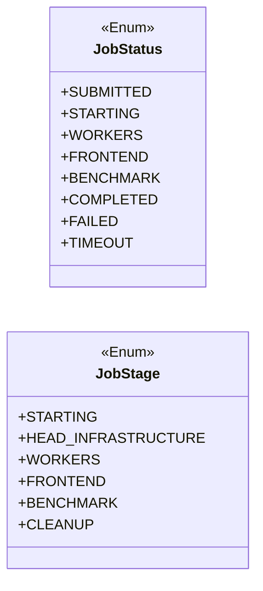
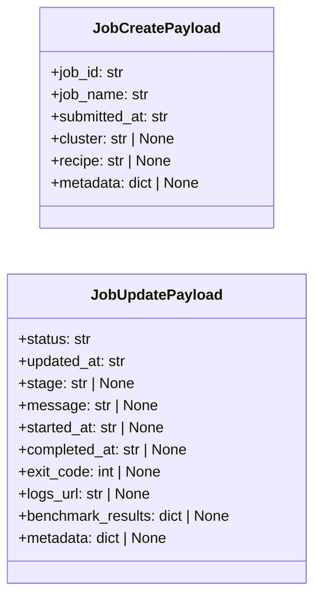
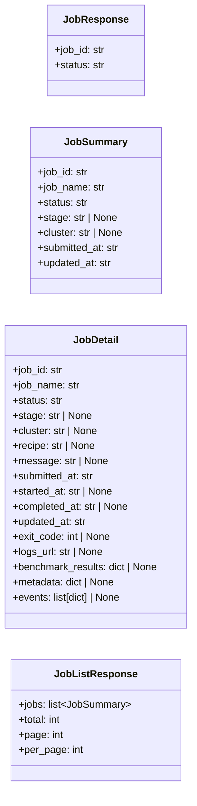

<!-- source: DeepWiki mcp.deepwiki.com · repo NVIDIA/srt-slurm · page 11.2 Status Reporting API & Contract · fetched 2026-10-26 -->

# Status Reporting API & Contract

<details>
<summary>Relevant source files</summary>

The following files were used as context for generating this wiki page:

- [docs/status-api-spec.md](docs/status-api-spec.md)
- [src/srtctl/contract/__init__.py](src/srtctl/contract/__init__.py)
- [src/srtctl/contract/enums.py](src/srtctl/contract/enums.py)
- [src/srtctl/contract/requests.py](src/srtctl/contract/requests.py)
- [src/srtctl/contract/responses.py](src/srtctl/contract/responses.py)
- [src/srtctl/core/status.py](src/srtctl/core/status.py)
- [src/srtctl/mock.py](src/srtctl/mock.py)
- [tests/mock_status_server.py](tests/mock_status_server.py)
- [tests/test_apply_json.py](tests/test_apply_json.py)
- [tests/test_apply_mock.py](tests/test_apply_mock.py)
- [tests/test_status.py](tests/test_status.py)

</details>


This page details the optional external status reporting system within `srtctl`. It covers the API contract for submitting new jobs and updating their lifecycle status, the `StatusReporter`'s fire-and-forget design, the `srtctl.contract` module defining requests, responses, and enums, and the mock status server used for testing.

## Overview of the Status Reporting System

`srtctl` can optionally report job status to one or more external HTTP API endpoints. This allows for integration with external job tracking or monitoring systems. The reporting mechanism is designed to be fire-and-forget, meaning that `srtctl` operations silently continue even if status reporting fails or endpoints are unreachable [src/srtctl/core/status.py:6-8, 72-76]().

The system uses two primary API calls:
*   `POST /api/jobs`: Called when a job is initially submitted [docs/status-api-spec.md:19-20]().
*   `PUT /api/jobs/{job_id}`: Called throughout the job's lifecycle to update its status and stage [docs/status-api-spec.md:45-46]().

### Configuration

Status reporting is configured in `srtslurm.yaml` or a job recipe YAML under the `reporting.status` section [src/srtctl/core/status.py:11-29]().

```yaml
reporting:
  status:
    # Single endpoint (backward-compatible)
    endpoint: "https://status.example.com"
    # Multiple endpoints (merged and deduplicated with 'endpoint' if both are present)
    endpoints:
      - "https://status2.example.com"
      - "https://status3.example.com"
```
If no endpoints are configured, status reporting is disabled [src/srtctl/core/status.py:75-76, 87-97]().

Sources:
*   [src/srtctl/core/status.py:6-29, 72-76, 87-97]()
*   [docs/status-api-spec.md:19-20, 45-46]()

## StatusReporter Implementation

The `StatusReporter` class [src/srtctl/core/status.py:70-84]() is responsible for sending status updates. It's initialized with a `job_id` and a tuple of API endpoints [src/srtctl/core/status.py:81-82]().

### Initialization and Endpoint Resolution

The `StatusReporter.from_config` class method [src/srtctl/core/status.py:86-100]() creates an instance based on the `ReportingConfig`. It uses the `_resolve_endpoints` helper function [src/srtctl/core/status.py:48-67]() to merge and deduplicate endpoints specified in `endpoint` and `endpoints` fields, also stripping any trailing slashes [src/srtctl/core/status.py:62-64]().

```mermaid
graph TD
    A[ReportingConfig] --> B{StatusReporter.from_config(reporting, job_id)}
    B --> C{_resolve_endpoints(reporting.status)}
    C -- "endpoint: str | None" --> D[Strip trailing slash]
    C -- "endpoints: list[str] | None" --> E[Strip trailing slash for each]
    D --> F{Deduplicate and merge}
    E --> F
    F --> G[tuple[str, ...]]
    G --> H{StatusReporter(job_id, api_endpoints=G)}
    H -- "enabled = len(api_endpoints) > 0" --> I[StatusReporter instance]
```
**Figure 1: StatusReporter Initialization Flow**

Sources:
*   [src/srtctl/core/status.py:48-67, 70-84, 86-100]()
*   [tests/test_status.py:21-54, 61-127]()

### Reporting Lifecycle

The `StatusReporter` provides methods to report different stages of a job's lifecycle:
*   `report(status, stage, message)`: Sends a `PUT` request to update the job's general status, stage, and an optional message [src/srtctl/core/status.py:128-154]().
*   `report_started(config, runtime)`: Sends a `PUT` request with initial job metadata when the job starts [src/srtctl/core/status.py:156-197]().
*   `report_completed(exit_code, logs_url)`: Sends a `PUT` request when the job finishes, including the exit code and a URL to logs [src/srtctl/core/status.py:199-214]().
*   `report_failed(message, logs_url)`: Sends a `PUT` request when the job fails [src/srtctl/core/status.py:216-229]().

All reporting methods internally call the `_put` method [src/srtctl/core/status.py:111-126](), which iterates through all configured `api_endpoints` and sends the payload. It uses a 5-second timeout for each request [src/srtctl/core/status.py:83, 117]() and logs failures at the `DEBUG` level, ensuring that job execution is not blocked [src/srtctl/core/status.py:122-124]().

```mermaid
sequenceDiagram
    participant S as srtctl
    participant SR as StatusReporter
    participant E as External Status API Endpoint(s)

    S->>SR: StatusReporter.from_config(config, job_id)
    SR->>SR: _resolve_endpoints()
    SR-->>S: reporter instance (enabled/disabled)

    alt If reporter.enabled
        S->>SR: reporter.report_started(config, runtime)
        SR->>SR: _now_iso()
        SR->>SR: Build JobUpdatePayload (status=STARTING, stage=STARTING, metadata)
        SR->>SR: _put(payload)
        loop For each api_endpoint
            SR->>E: PUT /api/jobs/{job_id} (payload)
            alt Success (HTTP 200)
                E-->>SR: HTTP 200 OK
                SR->>SR: Log debug "Status reported"
            else Failure (non-200 or exception)
                E-->>SR: HTTP Error / Exception
                SR->>SR: Log debug "Status report failed/error (ignored)"
        end
        SR-->>S: True (if any endpoint succeeded) / False

        S->>SR: reporter.report(JobStatus.WORKERS, JobStage.WORKERS)
        SR->>SR: _now_iso()
        SR->>SR: Build JobUpdatePayload (status=WORKERS, stage=WORKERS)
        SR->>SR: _put(payload)
        SR-->>S: True / False

        S->>SR: reporter.report_completed(exit_code, logs_url)
        SR->>SR: _now_iso()
        SR->>SR: Build JobUpdatePayload (status=COMPLETED, exit_code, logs_url)
        SR->>SR: _put(payload)
        SR-->>S: True / False
    else If reporter.disabled
        S->>SR: reporter.report(...)
        SR-->>S: False (no action taken)
    end
```
**Figure 2: StatusReporter Interaction Flow**

Sources:
*   [src/srtctl/core/status.py:83, 111-126, 128-154, 156-197, 199-214, 216-229]()
*   [tests/test_status.py:130-175]()

## Status API Contract (`srtctl.contract`)

The `srtctl.contract` module [src/srtctl/contract/__init__.py:1-16]() defines the canonical Pydantic models and enums for the Status API. This module has zero internal dependencies, relying only on `pydantic` [src/srtctl/contract/__init__.py:8](). This ensures that both `srtctl` and any external status server can use the same definitions for requests and responses.

### Enums

*   `JobStatus` [src/srtctl/contract/enums.py:9-24](): Defines the possible states of a job, such as `submitted`, `starting`, `workers`, `frontend`, `benchmark`, `completed`, `failed`, and `timeout`. These represent the status when *entering* a stage, not when it's complete.
*   `JobStage` [src/srtctl/contract/enums.py:27-35](): Defines the execution stages that align with the `do_sweep.py` flow, including `starting`, `head_infrastructure`, `workers`, `frontend`, `benchmark`, and `cleanup`.


**Figure 3: JobStatus and JobStage Enums**

### Request Payloads

*   `JobCreatePayload` [src/srtctl/contract/requests.py:9-17](): Used for `POST /api/jobs` at submission time. It includes `job_id`, `job_name`, `submitted_at`, `cluster`, `recipe`, and `metadata`.
*   `JobUpdatePayload` [src/srtctl/contract/requests.py:20-33](): Used for `PUT /api/jobs/{job_id}` to update job status. It includes `status`, `updated_at`, `stage`, `message`, `started_at`, `completed_at`, `exit_code`, `logs_url`, `benchmark_results`, and `metadata`.


**Figure 4: Request Payload Models**

### Response Models

*   `JobResponse` [src/srtctl/contract/responses.py:9-14](): A simple response for `POST /api/jobs` and `PUT /api/jobs/{job_id}` operations, containing `job_id` and `status`.
*   `JobSummary` [src/srtctl/contract/responses.py:17-25](): Provides a summary view of a job for list endpoints, including `job_id`, `job_name`, `status`, `stage`, `cluster`, `submitted_at`, and `updated_at`.
*   `JobDetail` [src/srtctl/contract/responses.py:28-45](): Offers a detailed view of a job, including all fields from `JobSummary` plus `recipe`, `message`, `started_at`, `completed_at`, `exit_code`, `logs_url`, `benchmark_results`, `metadata`, and `events`.
*   `JobListResponse` [src/srtctl/contract/responses.py:48-54](): A wrapper for paginated lists of `JobSummary` objects, including `jobs`, `total`, `page`, and `per_page`.


**Figure 5: Response Models**

Sources:
*   [src/srtctl/contract/__init__.py:1-16]()
*   [src/srtctl/contract/enums.py:9-35]()
*   [src/srtctl/contract/requests.py:9-33]()
*   [src/srtctl/contract/responses.py:9-54]()
*   [docs/status-api-spec.md:119-134]()

## Mock Status Server for Testing

The `tests/mock_status_server.py` [tests/mock_status_server.py:1-60]() provides a FastAPI-based mock server for integration testing. It uses the shared contract models to validate incoming payloads and stores all job data and events in-memory.

Key features:
*   `reset()`: Clears all stored data between tests [tests/mock_status_server.py:28-31]().
*   `POST /api/jobs`: Implements job creation, storing the job data and an event record [tests/mock_status_server.py:34-41]().
*   `PUT /api/jobs/{job_id}`: Implements job updates, validating the `job_id` and updating the stored job data [tests/mock_status_server.py:44-52]().
*   `create_test_client()`: Returns a `TestClient` instance for interacting with the mock server in tests [tests/mock_status_server.py:55-59]().

This mock server is crucial for testing the `StatusReporter`'s behavior without requiring a live external service. For example, the `srtctl.mock` module uses a `_StatusSink` [src/srtctl/mock.py:154-175]() to replace `requests.put`/`post` calls, directing status reports to local files (`status.json` and `status_events.jsonl`) within the job's output directory [src/srtctl/mock.py:198-200](). This allows end-to-end tests of the `SweepOrchestrator` to verify status reporting artifacts [tests/test_apply_mock.py:115-117]().

Sources:
*   [tests/mock_status_server.py:1-60]()
*   [src/srtctl/mock.py:154-175, 198-200]()
*   [tests/test_apply_mock.py:115-117]()

---

