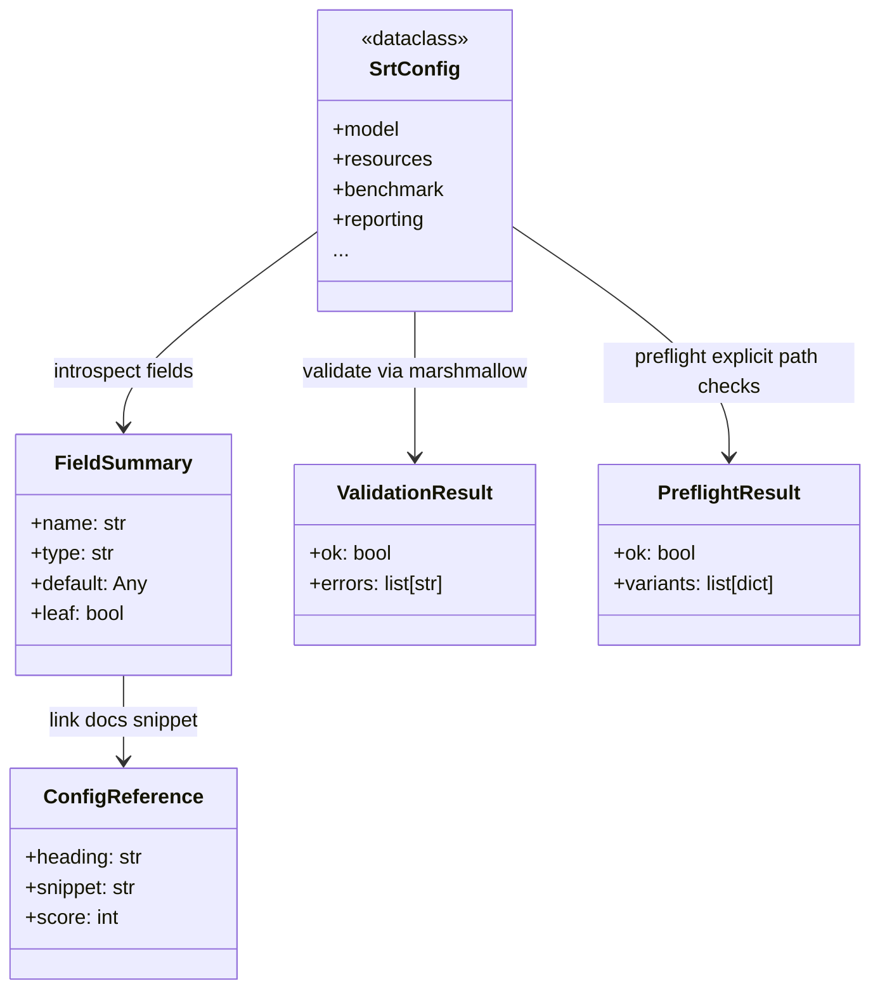

<!-- source: DeepWiki mcp.deepwiki.com · repo NVIDIA/srt-slurm · page 11.3 MCP Server (srtctl-mcp) · fetched 2026-10-26 -->

# MCP Server (srtctl-mcp)

<details>
<summary>Relevant source files</summary>

The following files were used as context for generating this wiki page:

- [src/srtctl/core/validation.py](src/srtctl/core/validation.py)
- [src/srtctl/mcp/__init__.py](src/srtctl/mcp/__init__.py)
- [src/srtctl/mcp/server.py](src/srtctl/mcp/server.py)
- [src/srtctl/mcp/spec_tools.py](src/srtctl/mcp/spec_tools.py)
- [tests/test_mcp_spec.py](tests/test_mcp_spec.py)
- [tests/test_validation.py](tests/test_validation.py)

</details>


The MCP Server, exposed via the `srtctl-mcp` binary, is a critical component in the srtctl ecosystem designed to facilitate AI-assisted recipe authoring for SLURM Runtime Control. This server implements the FastMCP protocol providing a suite of tools focused on introspection, validation, and schema-driven assistance for SrtConfig configurations.

This page documents the full technical details of the MCP Server, including its tools such as `schema_summary()`, `get_config_reference()`, `explain_field()`, `validate_config()`, `preflight_config()`, and `resolve_config()`. It thoroughly covers the design concept of the *operator boundary* — the distinction between compute-side and MCP-side operations — and explains the underlying implementation mechanisms like configuration parsing, schema introspection on dataclasses, and documentation extraction from markdown.

---

## Purpose and Scope

`srtctl-mcp` acts as the "FastMCP" server providing an interactive specification interface to clients such as IDEs or other tools that assist users in crafting and validating AI model deployment recipes.

Key capabilities include:

- Offering top-level summaries of the SrtConfig schema
- Searching and extracting marked-up documentation snippets from `config-reference.md`
- Schema-based explanation of individual config fields including type and default values
- Syntax and semantic validation of recipe YAMLs without cluster or host environment dependencies
- Preflight checking of explicit local filesystem paths (model and container), without accessing cluster state
- Resolving configuration variants while applying only schema-level defaults, excluding host cluster defaults

This boundary between *compute-side* and *MCP-side* responsibilities enables fast, local validation in user environments without requiring cluster access or mutable host-side configs.

---

## Operator Boundary: Compute-side vs MCP-side

The MCP Server follows a strict operator boundary, wherein:

- **Compute-side operations** have access to the cluster configuration (`srtslurm.yaml`), local file systems, network calls to container registries, HuggingFace APIs, and can perform comprehensive validations involving cluster state and host provisioning details.
- **MCP-side operations** (the MCP Server itself) deliberately *do not* read host-side cluster configuration files or attempt live environment queries beyond very minimal, explicit local path checks. This keeps the MCP Server lightweight, portable, and decoupled from cluster state.

This operator boundary is enforced strictly. Attempts to apply or use host-side cluster defaults in MCP tools raise explicit errors to avoid misuse.

The typical usage is that clients run MCP tools to perform fast, schema-level validation and explanation locally, then submit jobs which perform cluster-side validations during the actual orchestration phase.

This separation is summarized by this operator hint returned by the MCP tools:

> _"Host-side srtslurm.yaml is not used by srtctl MCP. For cluster defaults, aliases, containers, model paths, filesystem checks, or dry-run behavior, run srtctl on the compute side or use IBAR remote_preflight/remote_dry_run/cluster_aliases with the target compute profile."_

---

## Core MCP Tools and Their Implementations

The MCP Server exposes its functionality via RPC tools implemented on top of the FastMCP protocol. These are registered via the `@mcp.tool()` decorator.

### 1. schema_summary()

- Returns a compact summary of the top-level fields in the `SrtConfig` dataclass schema.
- Uses Python `dataclasses.fields` introspection to enumerate fields with their names, types, and defaults.
- Useful for clients to quickly present available top-level config options.

### 2. get_config_reference(query: str | None, max_matches: int = 5)

- Searches the `docs/config-reference.md` markdown file for headings and snippets matching the query string.
- Parses out text snippets providing the user with rich, human-readable documentation excerpts.
- Supports no query (returns top-level headings) or focused queries to return relevant sections.
- Results are sorted by textual relevance to the query.
- If no text matches, attempts fallback to returning schema leaf info.

### 3. explain_field(path: str)

- Resolves a dot-separated config field path (e.g., `"resources.gpu_type"`) against the `SrtConfig` dataclass schema.
- Returns schema metadata including type annotation, default values, and leaf node info.
- Augments this schema info by attaching documentation snippet results from `get_config_reference()`.
- Provides clients an integrated explanation combining precise schema typing and human documentation.

### 4. validate_config(config: dict | None, config_yaml: str | None, apply_cluster_defaults: bool = False)

- Validates a given config dictionary or YAML string against the `SrtConfig` marshmallow schema.
- Checks cross-field semantic constraints such as valid topologies and mutual exclusivity of disaggregated vs aggregated resource fields.
- Supports multi-variant configurations using override blocks.
- Crucially, disallows cluster default application by raising on `apply_cluster_defaults=True`, enforcing the compute vs MCP boundary.
- Returns a result including validity, error messages, normalized configs, and operator boundary hints.

### 5. preflight_config(config: dict | None, config_yaml: str | None, apply_cluster_defaults: bool)

- Performs preflight checks on explicit local paths referenced in the config (`model.path` and `model.container`).
- Ensures local filesystem presence where applicable but *does not* check against host-side cluster model aliases.
- Also disallows cluster default application on MCP side.
- Returns results for all variants including details of resolutions and missing items.
- Errors indicate missing containers or models but only in the explicitly provided paths.

### 6. resolve_config(config: dict | None, config_yaml: str | None, apply_cluster_defaults: bool)

- Resolves only schema-level defaults and multi-variant overrides without reading any host cluster configuration.
- Produces fully normalized variants from the input recipe without cluster-side effects.
- Also enforces the operator boundary rejecting attempts to apply cluster defaults.

---

## Implementation and Data Flow

The MCP Server implementation is primarily located in:

- `src/srtctl/mcp/server.py`
- `src/srtctl/mcp/spec_tools.py` (core logic for all tools)
- Documentation is parsed from `docs/config-reference.md`.

### Server Initialization (`server.py`)

- The MCP Server is instantiated as a `FastMCP` object with name `"srtctl-spec"`, default host `"127.0.0.1"` and port `18082` (env vars override).
- Tools are registered using `@mcp.tool()` decorators which wrap the implementations from `spec_tools.py`.
- The server supports two transports: default stdio versus `"streamable-http"` for HTTP-based RPC.

### Spec Tools (`spec_tools.py`)

- Implements detailed introspection on the `SrtConfig` dataclass using Python dataclasses APIs (`fields()`, `is_dataclass()`, type hints).
- Parses configuration documentation by dividing the markdown into sections based on headings and searching text matches.
- Resolves dotted field paths by recursively matching dataclass attributes and extracting leaf type, defaults, and nested structure.
- Validates config using marshmallow schema classes from `srtctl.core.schema`.
- Runs preflight checks which only check explicitly provided local paths by looking for directories/files (no cluster state lookup).
- Strongly disallows cluster default application by raising `ValueError` if that flag is set (`_reject_cluster_defaults`).
- Generates variants by processing overrides according to the srtctl config model to support multi-variant job configurations.

---

## Data Flow Diagram: From Client Request to MCP Tool Execution

```mermaid
graph LR
    A[Client (IDE / CLI)] -->|RPC Tool Call| B(FastMCP Server: srtctl-mcp)
    B --> C{Dispatch Tool}
    C --> D[schema_summary()]
    C --> E[get_config_reference(query)]
    C --> F[explain_field(path)]
    C --> G[validate_config(config, yaml)]
    C --> H[preflight_config(config, yaml)]
    C --> I[resolve_config(config, yaml)]

    E --> J[Parse docs/config-reference.md]
    F --> K[Schema path resolution via dataclass introspection]
    G --> L[Marshmallow schema validation & topology checks]
    H --> M[Local path existence checks]
    I --> N[Override config expansion, schema defaults resolution]

    style B fill:#f9f,stroke:#333,stroke-width:1px
    style J fill:#ccf,stroke:#333,stroke-width:1px
    style K fill:#ccf,stroke:#333,stroke-width:1px
    style L fill:#ccf,stroke:#333,stroke-width:1px
    style M fill:#ccf,stroke:#333,stroke-width:1px
    style N fill:#ccf,stroke:#333,stroke-width:1px
```

---

## Data Structure Bridge: SrtConfig Schema to MCP Tool Outputs



---

## Explanation of `spec_tools.py` Key Functions

- `_resolve_field_path(path: str)`  
  Recursively resolves a dotted config path into nested dataclass fields, constructing a detailed dict describing types, defaults, and children.

- `_parse_doc_sections()`  
  Parses `docs/config-reference.md` into a list of sections, each with a heading and body for text lookup.

- `schema_summary()`  
  Uses `fields(SrtConfig)` to list all top-level fields with concise metadata.

- `get_config_reference(query, max_matches)`  
  Performs case-insensitive substring matching in doc sections, returns snippets and headings sorted by relevance.

- `explain_field(path)`  
  Combines resolved schema metadata and documentation snippets for detailed field explanation.

- `validate_config(...)`  
  Loads configs via Marshmallow schema, checks semantic rules including valid GPU topology and aggregated/disaggregated flags.

- `preflight_config(...)`  
  Checks only explicit local paths in model and container fields; operates without cluster context or aliases.

- `resolve_config(...)`  
  Resolves schema defaults and expands variant overrides, disallowing cluster default usage in MCP context.

---

## Example Usage Scenario

A user editing a model recipe YAML can interact with an IDE plugin connected to the MCP Server. They can:

- Request `schema_summary()` to list configurable recipe options
- Query `explain_field("resources.gpus_per_node")` to get type info and docs
- Use `validate_config()` on the current YAML content to catch schema errors without submitting to cluster
- Run `preflight_config()` to detect missing containers or local model paths early
- Resolve variants with `resolve_config()` to preview expanded config permutations

This speeds up authoring and debugging of complex AI model deployment recipes offline without a full SLURM environment.

---

## Summary of the MCP Server Roles

| MCP Server Tool     | Purpose / Role                                             | Restrictions                               |
|---------------------|------------------------------------------------------------|--------------------------------------------|
| `schema_summary()`  | Report compact schema info for SrtConfig                   | Schema only, no config reading              |
| `get_config_reference()` | Query config-reference.md docs for human-readable help | Static docs, no side effects                 |
| `explain_field()`   | Show schema type + docs for a single config path           | Schema introspection only                    |
| `validate_config()` | Schema syntax and semantic validation without cluster data | Disallows cluster defaults, multi-variant support |
| `preflight_config()`| Check explicit local model and container paths exist after expansion | No cluster aliases or defaults               |
| `resolve_config()`  | Apply schema default values and override expansions         | No host cluster config involved              |

---

## References in Code

- MCP Server implementation and tool registration: `src/srtctl/mcp/server.py:1-115`  
- Core MCP tools logic (schema introspection, doc parsing, validation, preflight, resolve): `src/srtctl/mcp/spec_tools.py:1-251`  
- Validation logic emphasizing fault-tolerant path and remote checks: `src/srtctl/core/validation.py:1-172`  
- Tests verifying MCP tools behavior and operator boundary enforcement: `tests/test_mcp_spec.py:1-222`  

---

# Conclusion

The MCP Server (`srtctl-mcp`) is a well-factored, schema-driven RPC server designed to offload recipe authoring assistance and static validation from the compute cluster to a lightweight tool that can run anywhere. Its strict operator boundary isolating cluster state-dependent logic to the compute side enables fast, safe user feedback during AI model recipe development without requiring cluster access or dependencies.

---

# Summary Diagram: Natural Language to Code Mappings in MCP Server

```mermaid
graph TD
    NLClient["Natural Language Client (IDE, CLI)"] --> |calls tool| FastMCP["FastMCP Server (srtctl-mcp)"]

    FastMCP --> |@mcp.tool schema_summary()| schema_summary_impl["schema_summary()"]
    FastMCP --> |@mcp.tool get_config_reference()| get_config_reference_impl["get_config_reference()"]
    FastMCP --> |@mcp.tool explain_field()| explain_field_impl["explain_field()"]
    FastMCP --> |@mcp.tool validate_config()| validate_config_impl["validate_config()"]
    FastMCP --> |@mcp.tool preflight_config()| preflight_config_impl["preflight_config()"]
    FastMCP --> |@mcp.tool resolve_config()| resolve_config_impl["resolve_config()"]

    schema_summary_impl --> SrtConfigFields["Python dataclasses.fields(SrtConfig) in spec_tools.py"]
    get_config_reference_impl --> ConfigReferenceDoc["Parsed config-reference.md text"]
    explain_field_impl --> SchemaIntrospection["Recursive dataclass + typing introspection"]
    validate_config_impl --> SchemaValidation["Marshmallow schema + topology validation"]
    preflight_config_impl --> PreflightChecks["Local path checks (model/container)"]
    resolve_config_impl --> OverrideExpansion["Override configs + defaults, no cluster defaults"]

    style schema_summary_impl fill:#e6e6e6,stroke:#000,stroke-width:1px
    style get_config_reference_impl fill:#e6e6e6,stroke:#000,stroke-width:1px
    style explain_field_impl fill:#e6e6e6,stroke:#000,stroke-width:1px
    style validate_config_impl fill:#e6e6e6,stroke:#000,stroke-width:1px
    style preflight_config_impl fill:#e6e6e6,stroke:#000,stroke-width:1px
    style resolve_config_impl fill:#e6e6e6,stroke:#000,stroke-width:1px
```

---

Sources:  
- `src/srtctl/mcp/server.py:1-115`  
- `src/srtctl/mcp/spec_tools.py:1-251`  
- `src/srtctl/core/validation.py:1-172`  
- `tests/test_mcp_spec.py:1-222`

---

