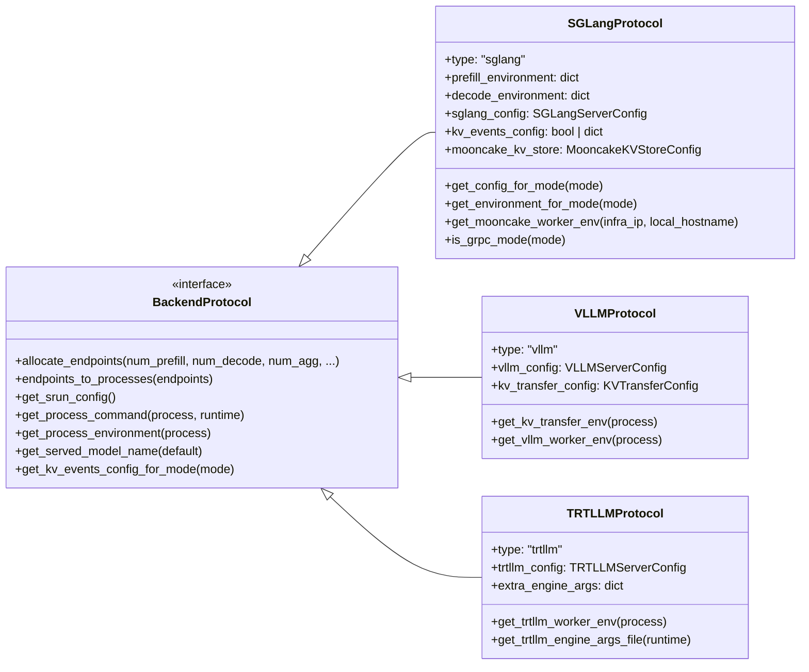

<!-- source: DeepWiki mcp.deepwiki.com · repo NVIDIA/srt-slurm · page 12 Glossary · fetched 2026-10-26 -->

# Glossary

<details>
<summary>Relevant source files</summary>

The following files were used as context for generating this wiki page:

- [.gitignore](.gitignore)
- [Makefile](Makefile)
- [README.md](README.md)
- [configs/aime/run.sh](configs/aime/run.sh)
- [docs/accuracy.md](docs/accuracy.md)
- [docs/config-reference.md](docs/config-reference.md)
- [examples/example.yaml](examples/example.yaml)
- [recipes/mocker/kimi-trace-agg.yaml](recipes/mocker/kimi-trace-agg.yaml)
- [src/srtctl/README.md](src/srtctl/README.md)
- [src/srtctl/backends/base.py](src/srtctl/backends/base.py)
- [src/srtctl/backends/sglang.py](src/srtctl/backends/sglang.py)
- [src/srtctl/backends/trtllm.py](src/srtctl/backends/trtllm.py)
- [src/srtctl/backends/vllm.py](src/srtctl/backends/vllm.py)
- [src/srtctl/benchmarks/__init__.py](src/srtctl/benchmarks/__init__.py)
- [src/srtctl/benchmarks/lm_eval.py](src/srtctl/benchmarks/lm_eval.py)
- [src/srtctl/benchmarks/mooncake_router.py](src/srtctl/benchmarks/mooncake_router.py)
- [src/srtctl/benchmarks/sa_bench.py](src/srtctl/benchmarks/sa_bench.py)
- [src/srtctl/benchmarks/scripts/lm-eval/bench.sh](src/srtctl/benchmarks/scripts/lm-eval/bench.sh)
- [src/srtctl/benchmarks/scripts/mooncake-router/bench.sh](src/srtctl/benchmarks/scripts/mooncake-router/bench.sh)
- [src/srtctl/benchmarks/scripts/sa-bench/bench.sh](src/srtctl/benchmarks/scripts/sa-bench/bench.sh)
- [src/srtctl/benchmarks/scripts/sa-bench/benchmark_dataset.py](src/srtctl/benchmarks/scripts/sa-bench/benchmark_dataset.py)
- [src/srtctl/benchmarks/scripts/sa-bench/benchmark_serving.py](src/srtctl/benchmarks/scripts/sa-bench/benchmark_serving.py)
- [src/srtctl/cli/do_sweep.py](src/srtctl/cli/do_sweep.py)
- [src/srtctl/cli/mixins/postprocess_stage.py](src/srtctl/cli/mixins/postprocess_stage.py)
- [src/srtctl/core/fingerprint.py](src/srtctl/core/fingerprint.py)
- [src/srtctl/core/lockfile.py](src/srtctl/core/lockfile.py)
- [src/srtctl/core/runtime.py](src/srtctl/core/runtime.py)
- [src/srtctl/core/schema.py](src/srtctl/core/schema.py)
- [src/srtctl/core/topology.py](src/srtctl/core/topology.py)
- [src/srtctl/core/yaml_utils.py](src/srtctl/core/yaml_utils.py)
- [src/srtctl/frontends/dynamo.py](src/srtctl/frontends/dynamo.py)
- [src/srtctl/templates/job_script_minimal.j2](src/srtctl/templates/job_script_minimal.j2)
- [tests/fixtures/trace_replay_sample.jsonl](tests/fixtures/trace_replay_sample.jsonl)
- [tests/test_benchmarks.py](tests/test_benchmarks.py)
- [tests/test_configs.py](tests/test_configs.py)
- [tests/test_endpoint_allocation.py](tests/test_endpoint_allocation.py)
- [tests/test_fingerprint.py](tests/test_fingerprint.py)
- [tests/test_frontends.py](tests/test_frontends.py)
- [tests/test_lockfile.py](tests/test_lockfile.py)
- [tests/test_postprocess.py](tests/test_postprocess.py)

</details>


This page defines key terms, abbreviations, and concepts specific to the `srtctl` codebase. It aims to provide an onboarding engineer with a comprehensive understanding of the system's terminology, linking concepts to their implementation in the code.

## Core Concepts

### `SrtConfig`
The central configuration object for any `srtctl` job. It's a frozen dataclass that encapsulates all parameters for a benchmark run, including model details, resource allocation, backend specifics, frontend settings, benchmarking parameters, and profiling options. `SrtConfig` instances are loaded from YAML files, validated, and then used to drive the entire job orchestration process.

*   **Implementation:** `src/srtctl/core/schema.py` defines the `SrtConfig` dataclass and its nested configuration classes (e.g., `ModelConfig`, `ResourceConfig`, `BackendConfig`).
*   **Usage:** `SrtConfig.from_yaml()` is used to load configurations from YAML files [src/srtctl/core/schema.py:700-700]().
*   **Validation:** `marshmallow_dataclass` is used for type-safe configuration with validation [src/srtctl/core/schema.py:8-9]().

Sources:
* `src/srtctl/core/schema.py`

### `srtslurm.yaml`
The cluster-level configuration file for `srtctl`. This YAML file defines default settings for a specific SLURM cluster, such as `default_account`, `default_partition`, `model_paths` aliases, `containers` aliases, and `default_mounts`. It can also include settings for `reporting` (e.g., `ai_analysis`, `s3` upload). `srtctl` discovers this file by checking the `SRTSLURM_CONFIG` environment variable or by searching up the directory hierarchy.

*   **Implementation:** The `ClusterConfig` dataclass in `src/srtctl/core/schema.py` defines the schema for `srtslurm.yaml` [src/srtctl/core/schema.py:180-210]().
*   **Discovery:** `srtctl` searches for `srtslurm.yaml` in a specific order [docs/config-reference.md:87-94]().
*   **Example:** A `srtslurm.yaml` file is created during the `make setup` process [Makefile:105-140]().

Sources:
* `src/srtctl/core/schema.py`
* `docs/config-reference.md`
* `Makefile`

### `RuntimeContext`
A central object that acts as the single source of truth for all runtime-specific values during a job's execution. This includes resolved paths, IP addresses of nodes, container mounts, and node roles (head, bench, infra, worker). It's constructed from the `SrtConfig` and SLURM environment variables.

*   **Implementation:** Defined in `src/srtctl/core/runtime.py`.
*   **Creation:** `RuntimeContext.from_config()` is used to initialize it [src/srtctl/cli/do_sweep.py:65-65]().
*   **Key attributes:** Contains `nodes` (topology), `container_image`, `log_dir`, `model_path`, etc.

Sources:
* `src/srtctl/cli/do_sweep.py`

### `SweepOrchestrator`
The main class responsible for orchestrating the entire lifecycle of a benchmark sweep. It coordinates starting infrastructure services (NATS, etcd), launching backend workers, deploying frontends (Nginx), running benchmarks, and performing post-processing steps. It uses a mixin-based architecture to organize these stages.

*   **Implementation:** The `SweepOrchestrator` class is defined in `src/srtctl/cli/do_sweep.py` [src/srtctl/cli/do_sweep.py:54-60]().
*   **Stages:** Inherits from `WorkerStageMixin`, `FrontendStageMixin`, `TelemetryStageMixin`, `BenchmarkStageMixin`, and `PostProcessStageMixin` [src/srtctl/cli/do_sweep.py:54-60]().
*   **Execution:** The `run()` method drives the orchestration [src/srtctl/cli/do_sweep.py:67-67]().

Sources:
* `src/srtctl/cli/do_sweep.py`

### `ProcessRegistry`
A component that manages the lifecycle of all `ManagedProcess` instances launched by the `SweepOrchestrator`. It keeps track of running processes, monitors their health, and ensures proper cleanup upon job completion or failure.

*   **Implementation:** Defined in `src/srtctl/core/processes.py`.
*   **Usage:** Passed to various stage mixins to register and manage processes [src/srtctl/cli/do_sweep.py:101-101]().

Sources:
* `src/srtctl/cli/do_sweep.py`

## Infrastructure & Services

### NATS
A high-performance, lightweight messaging system used as a message broker within `srtctl`. It facilitates communication between different components, particularly for worker discovery and event propagation.

*   **Role:** Used for worker discovery and event propagation.
*   **Port:** Typically runs on port `4222` [src/srtctl/cli/do_sweep.py:153-153]().
*   **Installation:** Downloaded and installed during `make setup` [Makefile:53-75]().
*   **Starting:** Started by `SweepOrchestrator.start_head_infrastructure()` [src/srtctl/cli/do_sweep.py:101-163]().

Sources:
* `src/srtctl/cli/do_sweep.py`
* `Makefile`

### etcd
A distributed key-value store used by `srtctl` for configuration sharing and service discovery. It provides a reliable way for different parts of the distributed system to store and retrieve small amounts of critical data.

*   **Role:** Key-value store for configuration and service discovery.
*   **Port:** Typically runs on port `2379` [src/srtctl/cli/do_sweep.py:157-157]().
*   **Installation:** Downloaded and installed during `make setup` [Makefile:78-91]().
*   **Starting:** Started by `SweepOrchestrator.start_head_infrastructure()` [src/srtctl/cli/do_sweep.py:101-163]().

Sources:
* `src/srtctl/cli/do_sweep.py`
* `Makefile`

### Mooncake KV Store
An optional, RDMA-based key-value store used specifically with the SGLang backend for disaggregated KV cache transfers. When configured, `srtctl` launches a `mooncake_master` process on the infra node.

*   **Implementation:** Configured via `MooncakeKVStoreConfig` in `src/srtctl/backends/sglang.py` [src/srtctl/backends/sglang.py:38-57]().
*   **Starting:** `SweepOrchestrator.start_mooncake_master()` launches the `mooncake_master` process [src/srtctl/cli/do_sweep.py:165-202]().
*   **Port:** `MOONCAKE_MASTER_PORT` is `50051` [src/srtctl/backends/sglang.py:33-33]().

Sources:
* `src/srtctl/backends/sglang.py`
* `src/srtctl/cli/do_sweep.py`

## Backends

### `BackendProtocol`
An interface (Python `Protocol`) that defines the contract for all LLM inference backends supported by `srtctl`. Each backend (SGLang, vLLM, TRT-LLM) implements this protocol, providing methods for allocating endpoints, converting endpoints to processes, and generating srun commands.

*   **Implementation:** Defined in `src/srtctl/backends/base.py`.
*   **Implementations:** `SGLangProtocol` [src/srtctl/backends/sglang.py:76-76](), `VLLMProtocol` [src/srtctl/backends/vllm.py:76-76](), `TRTLLMProtocol` [src/srtctl/backends/trtllm.py:76-76]().

Sources:
* `src/srtctl/backends/sglang.py`

### SGLang Backend
An implementation of `BackendProtocol` for the SGLang inference engine. It supports prefill/decode disaggregation and can integrate with the Mooncake KV store for RDMA-based KV cache transfers.

*   **Implementation:** `SGLangProtocol` in `src/srtctl/backends/sglang.py` [src/srtctl/backends/sglang.py:76-76]().
*   **Configuration:** Uses `SGLangServerConfig` for per-mode (prefill/decode/aggregated) CLI configurations [src/srtctl/backends/sglang.py:60-72]().
*   **Disaggregation:** Supports `kv_events_config` for enabling ZMQ-based KV events [src/srtctl/backends/sglang.py:107-109]().

Sources:
* `src/srtctl/backends/sglang.py`

### vLLM Backend
An implementation of `BackendProtocol` for the vLLM inference engine. It supports Data Parallel (DP) and Expert Parallel (EP) modes, including disaggregated KV transfer via connectors like NIXL, LMCache, or KVBM.

*   **Implementation:** `VLLMProtocol` in `src/srtctl/backends/vllm.py`.
*   **Disaggregation:** Uses `kv_transfer_config` for disaggregated KV transfer.

Sources:
* `src/srtctl/backends/vllm.py`

### TensorRT-LLM (TRT-LLM) Backend
An implementation of `BackendProtocol` for the NVIDIA TensorRT-LLM inference engine. It typically uses MPI-style launching with `srun --mpi=pmix` and supports features like Expert Parallel Load Balancing (EPLB).

*   **Implementation:** `TRTLLMProtocol` in `src/srtctl/backends/trtllm.py`.
*   **Launching:** Uses `srun --mpi=pmix` for launching [src/srtctl/templates/job_script_minimal.j2:6-8]().

Sources:
* `src/srtctl/templates/job_script_minimal.j2`
* `src/srtctl/backends/trtllm.py`

## Frontends

### `FrontendProtocol`
An interface that defines the contract for request routing frontends. Frontends are responsible for receiving incoming requests and forwarding them to the appropriate backend workers.

*   **Implementation:** Defined in `src/srtctl/frontends/base.py`.

Sources:
* `src/srtctl/frontends/base.py`

### Dynamo Frontend
A specific implementation of `FrontendProtocol` that uses `dynamo.frontend` for request routing. It discovers workers via NATS/etcd, performs health checks, and integrates with OpenTelemetry.

*   **Implementation:** `DynamoFrontend` in `src/srtctl/frontends/dynamo.py`.
*   **Worker Discovery:** Uses NATS/etcd for worker discovery.

Sources:
* `src/srtctl/frontends/dynamo.py`

### SGLang Router Frontend
A frontend specifically designed for SGLang, particularly for PD (Prefill/Decode) disaggregation. It handles bootstrap port handshakes and can use either gRPC or HTTP schemes.

*   **Implementation:** `SGLangFrontend` in `src/srtctl/frontends/sglang.py`.
*   **Disaggregation:** Supports `--pd-disaggregation` flag.

Sources:
* `src/srtctl/frontends/sglang.py`

### Nginx Load Balancing
Used to provide load balancing across multiple frontend instances. `srtctl` generates an `nginx.conf` file from a Jinja2 template and manages `ulimit` settings for the Nginx process.

*   **Configuration:** `nginx.conf.j2` template is used for rendering.
*   **Ulimit:** `nginx_raise_ulimit` setting in `srtslurm.yaml` controls the `ulimit` for Nginx [docs/config-reference.md:120-120]().

Sources:
* `docs/config-reference.md`

## Benchmarking

### `BenchmarkRunner`
A registry pattern that allows `srtctl` to dynamically discover and execute different types of benchmarks. Each benchmark type (e.g., SA-Bench, lm-eval) has its own `BenchmarkRunner` implementation.

*   **Implementation:** The base `BenchmarkRunner` and registry are in `src/srtctl/benchmarks/base.py`.
*   **Discovery:** `get_runner()` and `list_benchmarks()` are used to interact with the registry [tests/test_benchmarks.py:8-8]().

Sources:
* `tests/test_benchmarks.py`

### SA-Bench
A performance benchmark designed to measure throughput, latency (TTFT, TPOT, ITL, E2EL), and goodput of LLM serving systems. It supports various dataset types (ShareGPT, Sonnet, Random, Custom JSONL) and concurrency controls.

*   **Implementation:** `SABenchRunner` in `src/srtctl/benchmarks/sa_bench.py`.
*   **Script:** The core logic is in `src/srtctl/benchmarks/scripts/sa-bench/bench.sh` [src/srtctl/benchmarks/scripts/sa-bench/bench.sh:1-1]().
*   **Metrics:** Calculates TTFT (Time To First Token), TPOT (Time Per Output Token), ITL (Inter-Token Latency), E2EL (End-to-End Latency), and Goodput [src/srtctl/benchmarks/scripts/sa-bench/benchmark_serving.py:101-126]().

Sources:
* `src/srtctl/benchmarks/sa_bench.py`
* `src/srtctl/benchmarks/scripts/sa-bench/bench.sh`
* `src/srtctl/benchmarks/scripts/sa-bench/benchmark_serving.py`

### lm-eval
A benchmark runner that integrates with the EleutherAI `lm-evaluation-harness` for accuracy evaluations.

*   **Implementation:** `LMEvalRunner` in `src/srtctl/benchmarks/lm_eval.py`.
*   **Script:** The evaluation script is `src/srtctl/benchmarks/scripts/lm-eval/bench.sh`.

Sources:
* `src/srtctl/benchmarks/lm_eval.py`
* `src/srtctl/benchmarks/scripts/lm-eval/bench.sh`

### Profiling (nsys, torch)
`srtctl` integrates with NVIDIA Nsight Systems (`nsys`) and PyTorch Profiler for detailed performance analysis. Configuration options allow for iteration-based or time-based capture, and specific environment variables (`TLLM_PROFILE_START_STOP`, `PROFILE_PREFILL_START_STEP`) control profiling triggers.

*   **Configuration:** `ProfilingConfig` in `src/srtctl/core/schema.py`.
*   **Integration:** `get_nsys_prefix()` command wrapping, `--trace-fork-before-exec` for Dynamo frontend.
*   **Scripts:** `profiling.sh` library provides shared helpers [src/srtctl/benchmarks/scripts/sa-bench/bench.sh:125-126]().

Sources:
* `src/srtctl/core/schema.py`
* `src/srtctl/benchmarks/scripts/sa-bench/bench.sh`

## Reproducibility & Post-Processing

### Fingerprinting
The process of capturing detailed environment information (GPU, CUDA, NCCL, pip packages) within the container where a job runs. This fingerprint is used to ensure reproducibility and to identify environmental differences between runs.

*   **Implementation:** `capture_fingerprint()` and `generate_capture_script()` in `src/srtctl/core/fingerprint.py`.
*   **Comparison:** `diff_fingerprints()` is used to compare environments.

Sources:
* `src/srtctl/core/fingerprint.py`

### Lockfiles (`recipe.lock.yaml`)
A YAML file generated after a job completes, containing the exact `SrtConfig` used, environment fingerprints, and a SHA256 integrity hash. It serves as a record of a specific run, enabling exact reproduction.

*   **Format:** `recipe.lock.yaml` format [src/srtctl/core/lockfile.py:1-1]().
*   **Generation:** `write_lockfile()` creates the lockfile [src/srtctl/cli/mixins/postprocess_stage.py:185-190]().
*   **Verification:** `verify_lock_integrity()` checks the integrity.

Sources:
* `src/srtctl/core/lockfile.py`
* `src/srtctl/cli/mixins/postprocess_stage.py`

### Reproduction Report
A report generated by comparing fingerprints and metrics across different runs, often using lockfiles. It highlights environmental and performance differences, aiding in debugging and reproducibility.

*   **Generation:** `generate_reproduction_report()` in `src/srtctl/core/lockfile.py`.

Sources:
* `src/srtctl/core/lockfile.py`

### Rollup
A post-processing step that normalizes benchmark results into a standardized `benchmark-rollup.json` format. This makes it easier to compare results across different benchmarks and analyze them.

*   **Implementation:** `rollup.py` script.
*   **Execution:** Part of the `PostProcessStageMixin` [src/srtctl/cli/mixins/postprocess_stage.py:172-174]().

Sources:
* `src/srtctl/cli/mixins/postprocess_stage.py`

### `srtlog`
A Python library and data format used for parsing and analyzing job logs. It can convert raw worker logs into time-series node metrics (e.g., KV cache utilization, queue depth) and export them as Parquet files.

*   **Library:** `srtlog` Python library.
*   **Components:** `RunLoader` for scanning output directories, `to_dataframe()` for flattening results, `NodeAnalyzer` for parsing logs.

Sources:
* `src/srtctl/analysis/srtlog.py`

### AI Analysis
An optional feature that uses AI (specifically Claude Code via OpenRouter) to analyze benchmark failure logs. It identifies root causes, suggests next steps, and searches GitHub PRs for related changes.

*   **Configuration:** `AIAnalysisConfig` in `src/srtctl/core/schema.py` [src/srtctl/core/schema.py:108-154]().
*   **Execution:** Part of the `PostProcessStageMixin` [src/srtctl/cli/mixins/postprocess_stage.py:158-160]().
*   **Prompt:** Uses `DEFAULT_AI_ANALYSIS_PROMPT` [src/srtctl/core/schema.py:84-104]().

Sources:
* `src/srtctl/core/schema.py`
* `src/srtctl/cli/mixins/postprocess_stage.py`

## Topology & Allocation

### Endpoint
A logical representation of a worker instance, specifying its role (prefill, decode, aggregated), GPU assignment, and network ports. Endpoints are allocated based on the `ResourceConfig` and then converted into physical `Process` objects.

*   **Implementation:** Defined in `src/srtctl/core/topology.py`.
*   **Allocation:** `BackendProtocol.allocate_endpoints()` is responsible for this [src/srtctl/cli/do_sweep.py:81-94]().

Sources:
* `src/srtctl/core/topology.py`
* `src/srtctl/cli/do_sweep.py`

### Process
A physical representation of a running program, including its command, environment variables, node, and GPU assignment. `Process` objects are derived from `Endpoint` objects and are ultimately launched via `srun`.

*   **Implementation:** Defined in `src/srtctl/core/topology.py`.
*   **Conversion:** `BackendProtocol.endpoints_to_processes()` converts endpoints to processes [src/srtctl/cli/do_sweep.py:97-99]().

Sources:
* `src/srtctl/core/topology.py`
* `src/srtctl/cli/do_sweep.py`

### Node Roles (head, bench, infra, worker)
`srtctl` assigns specific roles to SLURM nodes within a job allocation:
*   **Head Node:** The node where the `SweepOrchestrator` runs and manages the job.
*   **Bench Node:** A dedicated node for running benchmarks.
*   **Infra Node:** A dedicated node for infrastructure services like NATS and etcd (if `etcd_nats_dedicated_node` is enabled).
*   **Worker Nodes:** Nodes where backend inference workers (prefill, decode, aggregated) run.

*   **Assignment:** `Nodes.from_slurm()` determines node roles.
*   **Infra Node:** `infra_node` is used to start NATS and etcd [src/srtctl/cli/do_sweep.py:107-107]().

Sources:
* `src/srtctl/core/runtime.py`
* `src/srtctl/cli/do_sweep.py`

## Diagrams

### `SrtConfig` Structure and Data Flow

```mermaid
graph TD
    subgraph "User Input"
        A[YAML Config File] --> B(srtctl apply -f config.yaml)
    end

    subgraph "Configuration Loading & Validation"
        B --> C{load_config(config_path)}
        C --> D[SrtConfig.from_yaml()]
        D -- "Marshmallow Schema Validation" --> E[SrtConfig Object]
        E -- "Nested Dataclasses" --> F[ModelConfig]
        E -- "Nested Dataclasses" --> G[ResourceConfig]
        E -- "Nested Dataclasses" --> H[BackendConfig (Polymorphic)]
        E -- "Nested Dataclasses" --> I[FrontendConfig]
        E -- "Nested Dataclasses" --> J[BenchmarkConfig]
        E -- "Nested Dataclasses" --> K[ProfilingConfig]
        E -- "Nested Dataclasses" --> L[InfraConfig]
        E -- "Nested Dataclasses" --> M[DynamoConfig]
        E -- "Nested Dataclasses" --> N[IdentityConfig]
        E -- "Nested Dataclasses" --> O[FormattablePath]
    end

    subgraph "Cluster Configuration"
        P[srtslurm.yaml] --> Q{load_cluster_config()}
        Q --> R[ClusterConfig Object]
        R -- "Default Values" --> E
    end

    subgraph "Runtime Context Creation"
        E & R --> S[RuntimeContext.from_config(SrtConfig, job_id)]
    end

    subgraph "Orchestration"
        S --> T[SweepOrchestrator(SrtConfig, RuntimeContext)]
    end

    style A fill:#ace,stroke:#333,stroke-width:2px
    style B fill:#ace,stroke:#333,stroke-width:2px
    style C fill:#f9f,stroke:#333,stroke-width:2px
    style D fill:#f9f,stroke:#333,stroke-width:2px
    style E fill:#f9f,stroke:#333,stroke-width:2px
    style F fill:#f9f,stroke:#333,stroke-width:2px
    style G fill:#f9f,stroke:#333,stroke-width:2px
    style H fill:#f9f,stroke:#333,stroke-width:2px
    style I fill:#f9f,stroke:#333,stroke-width:2px
    style J fill:#f9f,stroke:#333,stroke-width:2px
    style K fill:#f9f,stroke:#333,stroke-width:2px
    style L fill:#f9f,stroke:#333,stroke-width:2px
    style M fill:#f9f,stroke:#333,stroke-width:2px
    style N fill:#f9f,stroke:#333,stroke-width:2px
    style O fill:#f9f,stroke:#333,stroke-width:2px
    style P fill:#ace,stroke:#333,stroke-width:2px
    style Q fill:#f9f,stroke:#333,stroke-width:2px
    style R fill:#f9f,stroke:#333,stroke-width:2px
    style S fill:#f9f,stroke:#333,stroke-width:2px
    style T fill:#f9f,stroke:#333,stroke-width:2px
```
Sources:
* `src/srtctl/core/schema.py`
* `src/srtctl/cli/do_sweep.py`
* `docs/config-reference.md`

### Job Orchestration Flow

```mermaid
graph TD
    A[srtctl apply -f config.yaml] --> B{SLURM sbatch}
    B --> C[job_script_minimal.j2]
    C --> D[uv run srtctl.cli.do_sweep]

    subgraph "SweepOrchestrator (Host)"
        D --> E[SweepOrchestrator.run()]
        E -- "start_head_infrastructure()" --> F[NATS (4222) & etcd (2379) on Infra Node]
        E -- "start_mooncake_master()" --> G[Mooncake Master (50051) on Infra Node (if SGLang + Mooncake)]
        E -- "allocate_endpoints()" --> H[Logical Endpoints (Prefill, Decode, Agg)]
        E -- "endpoints_to_processes()" --> I[Physical Processes (Command, Env, Node, GPU)]
        E -- "launch_workers()" --> J[Backend Workers (srun containerized)]
        E -- "launch_frontends()" --> K[Frontend (Dynamo/SGLang) & Nginx (srun containerized)]
        E -- "run_benchmark()" --> L[Benchmark Runner (srun containerized)]
        E -- "run_postprocess()" --> M[Rollup, Lockfile, S3 Upload, AI Analysis]
        M --> N[Job Completion/Failure]
    end

    subgraph "SLURM Compute Nodes"
        J -- "NATS/etcd for discovery" --> K
        K -- "HTTP/gRPC requests" --> J
        L -- "HTTP/gRPC requests" --> K
    end

    style A fill:#ace,stroke:#333,stroke-width:2px
    style B fill:#ace,stroke:#333,stroke-width:2px
    style C fill:#ace,stroke:#333,stroke-width:2px
    style D fill:#ace,stroke:#333,stroke-width:2px
    style E fill:#f9f,stroke:#333,stroke-width:2px
    style F fill:#f9f,stroke:#333,stroke-width:2px
    style G fill:#f9f,stroke:#333,stroke-width:2px
    style H fill:#f9f,stroke:#333,stroke-width:2px
    style I fill:#f9f,stroke:#333,stroke-width:2px
    style J fill:#f9f,stroke:#333,stroke-width:2px
    style K fill:#f9f,stroke:#333,stroke-width:2px
    style L fill:#f9f,stroke:#333,stroke-width:2px
    style M fill:#f9f,stroke:#333,stroke-width:2px
    style N fill:#f9f,stroke:#333,stroke-width:2px
```
Sources:
* `src/srtctl/cli/do_sweep.py`
* `src/srtctl/templates/job_script_minimal.j2`
* `src/srtctl/backends/sglang.py`
* `src/srtctl/core/topology.py`
* `src/srtctl/cli/mixins/postprocess_stage.py`

### BackendProtocol Implementations


Sources:
* `src/srtctl/backends/base.py`
* `src/srtctl/backends/sglang.py`
* `src/srtctl/backends/vllm.py`
* `src/srtctl/backends/trtllm.py`

### BenchmarkRunner Registry

```mermaid
graph TD
    subgraph "Benchmark Registry"
        A[BenchmarkRunner] -- "Registry" --> B{get_runner(type)}
        B --> C[SABenchRunner]
        B --> D[LMEvalRunner]
        B --> E[CustomBenchmarkRunner]
        B --> F[MooncakeRouterRunner]
        B --> G[...]
    end

    subgraph "SABenchRunner Details"
        C -- "script_path" --> H[src/srtctl/benchmarks/scripts/sa-bench/bench.sh]
        C -- "validate_config()" --> I[Checks for isl, osl, dataset_path]
        C -- "build_command()" --> J[Generates bash command for benchmark_serving.py]
    end

    subgraph "LMEvalRunner Details"
        D -- "script_path" --> K[src/srtctl/benchmarks/scripts/lm-eval/bench.sh]
        D -- "validate_config()" --> L[Checks for dataset, model_args]
        D -- "build_command()" --> M[Generates bash command for lm_eval.py]
    end

    subgraph "CustomBenchmarkRunner Details"
        E -- "validate_config()" --> N[Requires benchmark.command]
        E -- "build_command()" --> O[Executes user-defined command]
    end

    style A fill:#f9f,stroke:#333,stroke-width:2px
    style B fill:#ace,stroke:#333,stroke-width:2px
    style C fill:#f9f,stroke:#333,stroke-width:2px
    style D fill:#f9f,stroke:#333,stroke-width:2px
    style E fill:#f9f,stroke:#333,stroke-width:2px
    style F fill:#f9f,stroke:#333,stroke-width:2px
    style G fill:#f9f,stroke:#333,stroke-width:2px
    style H fill:#ace,stroke:#333,stroke-width:2px
    style I fill:#f9f,stroke:#333,stroke-width:2px
    style J fill:#f9f,stroke:#333,stroke-width:2px
    style K fill:#ace,stroke:#333,stroke-width:2px
    style L fill:#f9f,stroke:#333,stroke-width:2px
    style M fill:#f9f,stroke:#333,stroke-width:2px
    style N fill:#f9f,stroke:#333,stroke-width:2px
    style O fill:#f9f,stroke:#333,stroke-width:2px
```
Sources:
* `src/srtctl/benchmarks/__init__.py`
* `src/srtctl/benchmarks/base.py`
* `src/srtctl/benchmarks/sa_bench.py`
* `src/srtctl/benchmarks/lm_eval.py`
* `src/srtctl/benchmarks/custom.py`
* `src/srtctl/benchmarks/mooncake_router.py`
* `tests/test_benchmarks.py`