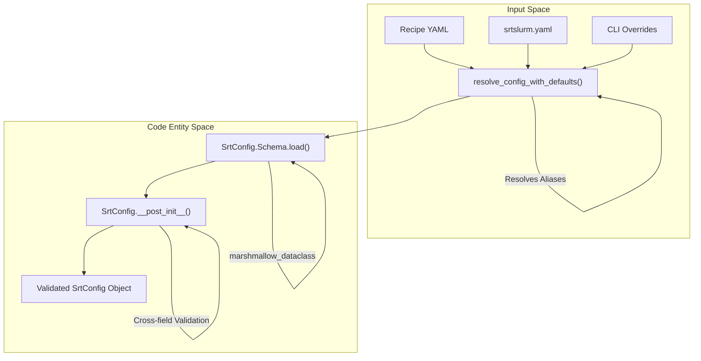
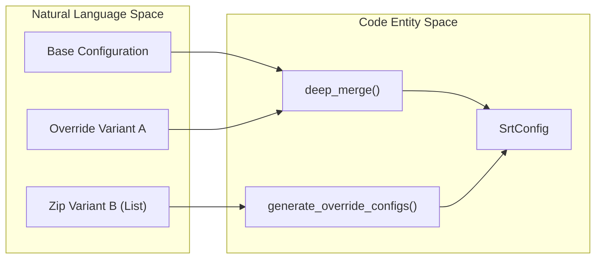

<!-- source: DeepWiki mcp.deepwiki.com · repo NVIDIA/srt-slurm · page 2 Configuration System · fetched 2026-10-26 -->

# Configuration System

Relevant source files

The following files were used as context for generating this wiki page:

- [.github/workflows/ci.yaml](.github/workflows/ci.yaml)
- [docs/config-reference.md](docs/config-reference.md)
- [docs/overrides.md](docs/overrides.md)
- [examples/example-override.yaml](examples/example-override.yaml)
- [src/srtctl/cli/submit.py](src/srtctl/cli/submit.py)
- [src/srtctl/core/config.py](src/srtctl/core/config.py)
- [src/srtctl/core/schema.py](src/srtctl/core/schema.py)
- [tests/test_configs.py](tests/test_configs.py)
- [tests/test_override.py](tests/test_override.py)

The configuration system in `srtctl` uses a two-layer hierarchical model to balance cluster-wide standardization with per-job flexibility. It enables users to define hardware-specific defaults in a central `srtslurm.yaml` while specifying job-specific parameters (model, precision, topology) in YAML recipes.

### Two-Layer Model

1.  **Cluster Configuration (`srtslurm.yaml`)**: Defines the environment. It contains SLURM account defaults, partition names, container image aliases, and model path mappings.
2.  **Job Recipes**: Define the workload. These files specify the model to run, resource requirements (nodes/GPUs), and benchmark parameters. Recipes can use aliases defined in the cluster config to remain portable across different environments.

For details on setting up the cluster-level file, see [Cluster Configuration (srtslurm.yaml)](#2.3).

### Configuration Resolution Flow

When a job is submitted via `srtctl apply`, the system follows a deterministic resolution path to produce a final, validated `SrtConfig` object.

Title: Configuration Resolution Pipeline

Sources: [src/srtctl/core/config.py:81-156](), [src/srtctl/core/schema.py:54-153]()

### The SrtConfig Schema

The core of the configuration system is the `SrtConfig` dataclass. It is defined using `marshmallow_dataclass` to provide strict type-safe validation and serialization. All configuration classes are `frozen=True` to ensure immutability once the job execution begins.

| Component | Code Entity | Responsibility |
| :--- | :--- | :--- |
| **Model** | `ModelConfig` | Path to weights, container image, and numerical precision (fp8, fp4, etc.). |
| **Resources** | `ResourceConfig` | GPU type, node counts, and worker-to-node mapping (Aggregated vs. Disaggregated). |
| **Backend** | `BackendConfig` | Polymorphic config for SGLang, vLLM, or TRT-LLM. |
| **Frontend** | `FrontendConfig` | Routing settings, Nginx load balancing, and ulimit overrides. |
| **Benchmark** | `BenchmarkConfig` | Throughput/Latency settings (ISL, OSL, concurrency). |

For a full field reference, see [SrtConfig Schema Reference](#2.1).

### Overrides and Parameter Sweeps

To support rapid experimentation, `srtctl` supports a "base + override" pattern within a single YAML file. This allows a user to define a shared configuration and then list multiple variants to be submitted as separate SLURM jobs.

*   **`override_*`**: Deep-merges a specific block with the `base` config.
*   **`zip_override_*`**: Generates $N$ jobs by zipping list-valued fields (e.g., sweeping across different Tensor Parallel sizes).
*   **`sweep:`**: Supports Cartesian product generation for large-scale parameter studies.

Title: Override Expansion Logic

Sources: [src/srtctl/core/config.py:13-26](), [src/srtctl/cli/submit.py:40-45](), [tests/test_override.py:26-50]()

For details on syntax and merging rules, see [Config Overrides & Parameter Sweeps](#2.2).

### Validation and Preflight

Before any code is executed on the cluster, `srtctl` performs extensive validation:
1.  **Schema Validation**: Ensures types match and required fields are present via `marshmallow`.
2.  **Semantic Validation**: Performed in `__post_init__`, checking that node counts match worker counts and that requested GPU types are compatible with the backend.
3.  **Preflight Checks**: The `preflight_config_variants` function verifies that local paths exist and (optionally) that container images are accessible in the registry before the SLURM job is even queued.

Sources: [src/srtctl/core/validation.py:56-57](), [src/srtctl/core/schema.py:31-33](), [tests/test_configs.py:15-48]()

---

