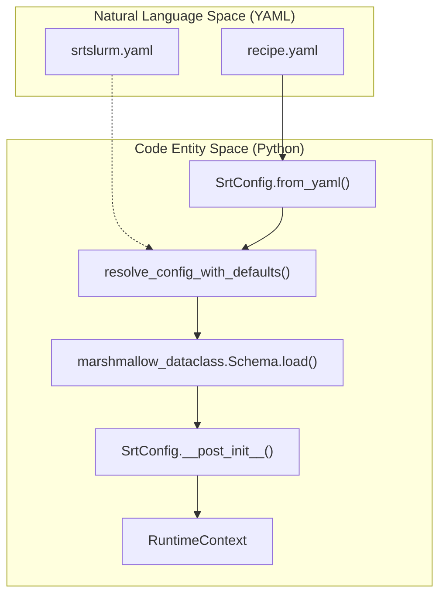
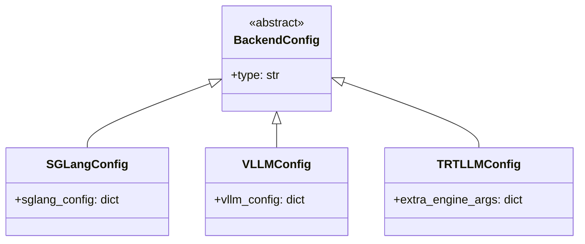

<!-- source: DeepWiki mcp.deepwiki.com · repo NVIDIA/srt-slurm · page 2.1 SrtConfig Schema Reference · fetched 2026-10-26 -->

# SrtConfig Schema Reference

Relevant source files

The following files were used as context for generating this wiki page:

- [docs/config-reference.md](docs/config-reference.md)
- [src/srtctl/core/schema.py](src/srtctl/core/schema.py)
- [src/srtctl/core/validation.py](src/srtctl/core/validation.py)
- [src/srtctl/mcp/server.py](src/srtctl/mcp/server.py)
- [src/srtctl/mcp/spec_tools.py](src/srtctl/mcp/spec_tools.py)
- [tests/test_configs.py](tests/test_configs.py)
- [tests/test_mcp_spec.py](tests/test_mcp_spec.py)
- [tests/test_validation.py](tests/test_validation.py)

The `SrtConfig` system provides a type-safe, validated, and hierarchical configuration framework for defining LLM serving jobs. It uses `marshmallow_dataclass` to bridge YAML-based recipes with Python dataclasses, enforcing strict schema validation and providing cross-field consistency checks via `__post_init__`.

## Architecture Overview

The configuration system is designed to be immutable (`frozen=True`) after loading, ensuring that the job state remains deterministic throughout the orchestration lifecycle.

### Configuration Data Flow
The following diagram illustrates how a raw YAML recipe is transformed into a validated `SrtConfig` object.

**Recipe to Code Entity Mapping**

Sources: [src/srtctl/core/schema.py:1-32](), [src/srtctl/core/config.py:23-26](), [src/srtctl/mcp/spec_tools.py:108-117]()

## Core Config Classes

### SrtConfig (Root)
The root container for all job settings. It defines the high-level identity and includes sub-configs for every subsystem.
*   **Implementation**: `src/srtctl/core/schema.py`
*   **Key Fields**: `name`, `model`, `resources`, `backend`, `frontend`, `benchmark`.

### ModelConfig
Defines the model weights, container environment, and numerical precision.
*   **Fields**: 
    *   `path`: Local path or alias (e.g., `hf:repo/id`).
    *   `container`: Path to `.sqsh` or Docker URI.
    *   `precision`: String literal (e.g., `fp8`, `bf16`).

### ResourceConfig
Manages the physical allocation of GPUs and nodes. It supports both aggregated (single pool) and disaggregated (split prefill/decode) topologies.
*   **Validation**: `__post_init__` ensures that if `prefill_nodes` > 0, `decode_nodes` is also defined or defaults to 0.
*   **Logic**: `is_disaggregated` property returns `True` if `prefill_nodes` or `decode_nodes` are set [src/srtctl/core/schema.py:53-72]().

### BackendConfig (Polymorphic)
`BackendConfig` is a polymorphic base class that resolves to specific backend implementations:
*   **SGLangProtocol**: Configures `--dist-init-addr` and node ranks.
*   **VLLMProtocol**: Configures DP+EP modes and `kv_transfer_config`.
*   **TRTLLMProtocol**: Manages MPI-style launches and engine arguments.

**Backend Hierarchy**

Sources: [src/srtctl/core/schema.py:34-40](), [src/srtctl/backends/__init__.py]()

## Validation & Preflight Checks

The schema employs a two-stage validation process: structural validation (via Marshmallow) and semantic/environmental validation (via the `validation` module).

### Structural Validation
`marshmallow_dataclass` ensures that types match (e.g., `int` vs `str`) and that required fields are present.

### Semantic Validation (`run_all_validations`)
The `srtctl.core.validation` module performs deeper checks that cannot be captured by types alone:
1.  **Topology Checks**: Validates that worker counts match GPU counts and that nodes are correctly assigned [src/srtctl/mcp/spec_tools.py:122-124]().
2.  **Local Path Probing**: `validate_local_path` checks if model directories or container images exist on the host filesystem [src/srtctl/core/validation.py:28-50]().
3.  **Remote Probing**: `validate_hf_model` and `validate_docker_image` perform non-blocking HTTP HEAD requests to verify remote availability [src/srtctl/core/validation.py:56-171]().

### Cross-Field Constraints
The `ResourceConfig` class performs internal arithmetic to ensure valid allocations:
*   **TP Calculation**: If `gpus_per_prefill` is not provided, it is calculated as `(prefill_nodes * gpus_per_node) / prefill_workers` [src/srtctl/core/schema.py:73-94]().
*   **Worker Inheritance**: When `decode_nodes=0` (shared nodes), `gpus_per_decode` inherits its value from the prefill TP configuration [src/srtctl/core/schema.py:73-88]().

## Specialized Config Blocks

| Config Class | Purpose | Key Fields |
| :--- | :--- | :--- |
| `FrontendConfig` | Routing and Load Balancing | `type` (dynamo/sglang), `nginx_raise_ulimit` |
| `BenchmarkConfig` | Load generation parameters | `type`, `isl`, `osl`, `concurrency` |
| `ProfilingConfig` | Performance tracing | `type` (nsys/torch), `start_step`, `duration` |
| `InfraConfig` | Orchestration services | `nats_port`, `etcd_port`, `mooncake_config` |
| `DynamoConfig` | Runtime versioning | `version`, `hash`, `wheel` |
| `IdentityConfig` | Runtime verification | `model.repo`, `frameworks` (dict) |

### FormattablePath
The `FormattablePath` field allows for dynamic string expansion in recipes. It supports templates like `{job_id}`, `{srtctl_root}`, and `{output_dir}`, which are resolved at runtime by the `RuntimeContext` [src/srtctl/core/formatting.py:41-44]().

## MCP Introspection
The `srtctl-mcp` server provides tools to inspect the schema programmatically.
*   **`explain_field(path)`**: Uses Python's `get_type_hints` and `dataclasses.fields` to provide technical details for any nested config path [src/srtctl/mcp/spec_tools.py:37-49]().
*   **`schema_summary()`**: Returns the top-level structure of `SrtConfig` [src/srtctl/mcp/spec_tools.py:29-34]().

Sources: [src/srtctl/core/schema.py:1-210](), [src/srtctl/core/validation.py:1-200](), [src/srtctl/mcp/spec_tools.py:1-150](), [tests/test_configs.py:1-120]()

---

