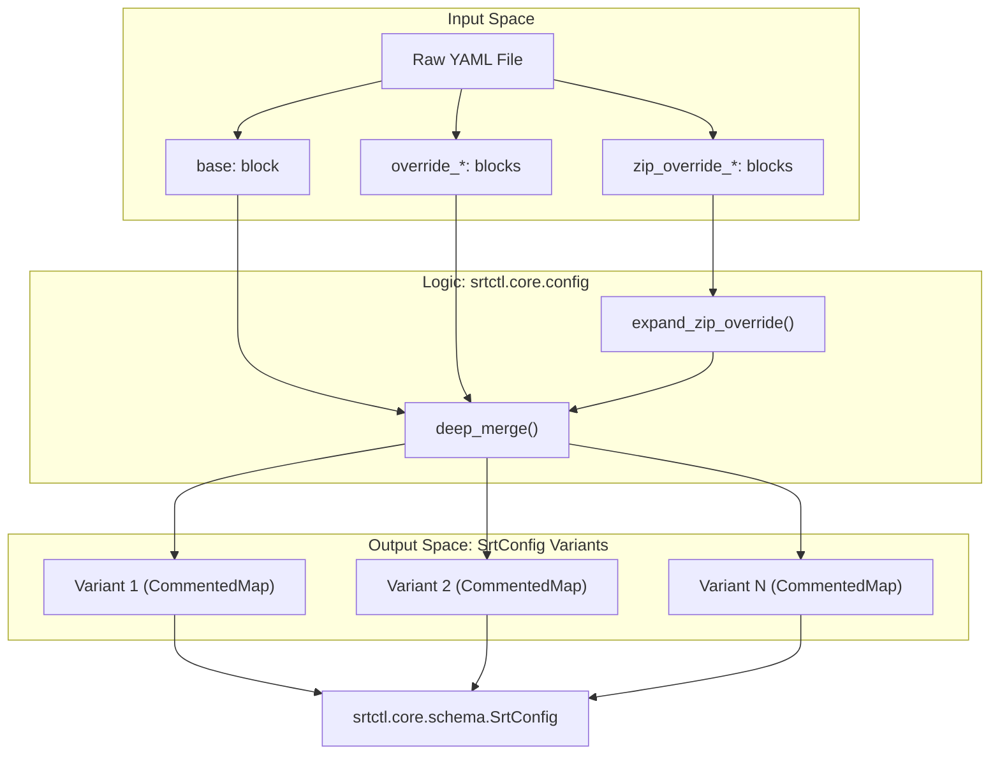
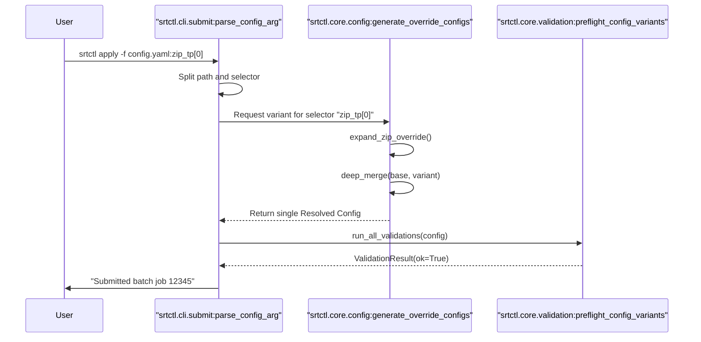

<!-- source: DeepWiki mcp.deepwiki.com · repo NVIDIA/srt-slurm · page 2.2 Config Overrides & Parameter Sweeps · fetched 2026-10-26 -->

# Config Overrides & Parameter Sweeps

Relevant source files

The following files were used as context for generating this wiki page:

- [.github/workflows/ci.yaml](.github/workflows/ci.yaml)
- [docs/README.md](docs/README.md)
- [docs/SUMMARY.md](docs/SUMMARY.md)
- [docs/analyzing.md](docs/analyzing.md)
- [docs/installation.md](docs/installation.md)
- [docs/overrides.md](docs/overrides.md)
- [docs/profiling.md](docs/profiling.md)
- [examples/example-override.yaml](examples/example-override.yaml)
- [src/srtctl/cli/submit.py](src/srtctl/cli/submit.py)
- [src/srtctl/core/config.py](src/srtctl/core/config.py)
- [src/srtctl/core/sweep.py](src/srtctl/core/sweep.py)
- [tests/test_formatting.py](tests/test_formatting.py)
- [tests/test_override.py](tests/test_override.py)
- [tests/test_profiling.py](tests/test_profiling.py)

`srtctl` provides a powerful configuration system for managing multi-variant experiments without duplicating YAML files. This is achieved through three primary mechanisms: manual deep-merged overrides (`override_*`), parallel zipped sweeps (`zip_override_*`), and the `sweep:` section for Cartesian product generation.

## Multi-Variant Configuration Model

An override-capable YAML file is defined by a `base` top-level key containing the shared configuration, followed by one or more variant blocks.

| Key Prefix | Variant Type | Behavior |
| :--- | :--- | :--- |
| `base` | Shared Foundation | The root configuration used as a template for all variants. |
| `override_<name>` | Manual Variant | Generates **one** job. Fields are deep-merged into the `base`. |
| `zip_override_<name>` | Parallel Zip | Generates **N** jobs. List-valued leaves are zipped in parallel (like Python's `zip()`). |

### Deep-Merge Semantics
The merging logic is implemented in `srtctl.core.config.deep_merge` [src/srtctl/core/config.py:18-50](). It follows these rules:
*   **Dictionaries**: Merged recursively. Unmentioned keys in the override are preserved from the base [tests/test_override.py:29-50]().
*   **Lists**: Fully replaced by the override, not appended [tests/test_override.py:38-38]().
*   **Scalars**: The override value replaces the base value [tests/test_override.py:37-37]().
*   **Nulls**: Setting a key to `null` in an override deletes it from the resulting configuration [tests/test_override.py:41-41]().

### Comment-Aware YAML Handling
To preserve user intent and documentation within YAML files, `srtctl` uses `ruamel.yaml` for "comment-aware" merging via `comment_aware_merge` [src/srtctl/core/yaml_utils.py:19-20](). This ensures that when configs are resolved or written to disk, the original comments from the `base` and the specific `override` blocks are maintained in the output [tests/test_override.py:14-20]().

**Sources:** [src/srtctl/core/config.py:18-50](), [tests/test_override.py:27-61](), [docs/overrides.md:92-98]()

---

## Zip Overrides & Sweeps

`zip_override_*` blocks allow for efficient parameter sweeps where multiple related variables must change together (e.g., increasing TP size while simultaneously adjusting node counts).

### Zip Rules
1.  **List Leaf**: Becomes a zip dimension. Every variant $i$ receives the $i$-th element [examples/example-override.yaml:83-83]().
2.  **Length-1 List**: Broadcasts the single element to all $N$ variants [examples/example-override.yaml:84-84]().
3.  **Scalar**: Broadcasts the value unchanged to all variants [examples/example-override.yaml:86-86]().
4.  **List-of-Lists**: To pass a literal list as a value (e.g., `concurrencies: [[1, 2], [4, 8]]`), wrap it in an outer list [examples/example-override.yaml:85-85]().

### Implementation Data Flow
The `generate_override_configs` function orchestrates the expansion of these blocks.

**Config Expansion Logic**
Title: Configuration Expansion Data Flow

**Sources:** [src/srtctl/core/config.py:13-18](), [tests/test_override.py:105-149](), [examples/example-override.yaml:79-88]()

---

## CLI Usage & Selectors

The `srtctl` CLI provides tools to manage these multi-variant files using a colon-based selector syntax: `path/to/config.yaml:selector`.

### Selectors
*   **`:base`**: Submits only the base configuration [docs/overrides.md:31-31]().
*   **`:override_name`**: Submits a specific manual override [docs/overrides.md:193-193]().
*   **`:zip_override_group`**: Submits all variants within that zip group [docs/overrides.md:196-196]().
*   **`:zip_override_group[N]`**: Submits only the $N$-th variant of a zip group [docs/overrides.md:199-199]().
*   **Glob Patterns**: `srtctl apply -f config.yaml:override_tp*` will match all overrides starting with "tp" [docs/overrides.md:203-217]().

### Commands for Debugging Overrides
1.  **`srtctl resolve-override`**: Expands the override file and prints the resulting fully-merged YAML to stdout. Useful for verifying merge logic before submission [docs/overrides.md:257-258]().
2.  **`srtctl dry-run`**: Performs full validation (schema, cluster paths, and model availability) for all matched variants without submitting to SLURM [src/srtctl/cli/submit.py:187-220]().

**CLI Interaction with Code Entities**
Title: CLI Selector Resolution

**Sources:** [src/srtctl/cli/submit.py:16-57](), [tests/test_override.py:67-80](), [docs/overrides.md:184-222]()

---

## Parameter Sweeps (Cartesian Product)

While `zip_override` is for parallel lists, the `sweep:` section (handled by the `SweepOrchestrator`) is designed for Cartesian product generation. This is typically used for grid searches across ISL, OSL, and concurrency levels.

### Sweep Generation Logic
The `SweepOrchestrator` [src/srtctl/core/sweep.py]() processes a `sweep:` block to generate a matrix of jobs.
*   **Input**: A single `SrtConfig` with list values in the `benchmark` or `resources` section.
*   **Output**: Multiple job submissions where every combination of parameters is exercised.

**Implementation Note**: The `srtctl dry-run --sweep` flag is essential when using this mode to visualize the total number of jobs that will be generated [src/srtctl/cli/submit.py:13-14]().

**Sources:** [src/srtctl/cli/submit.py:11-14](), [docs/README.md:21-21](), [docs/SUMMARY.md:12-12]()

---

