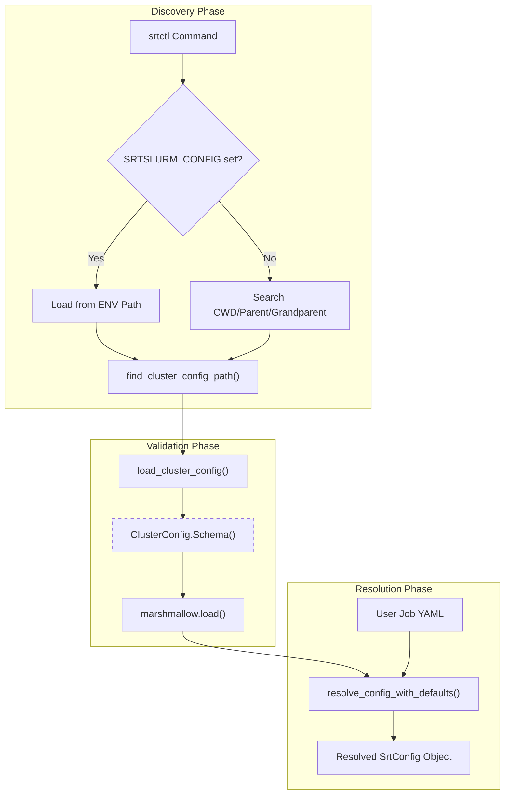
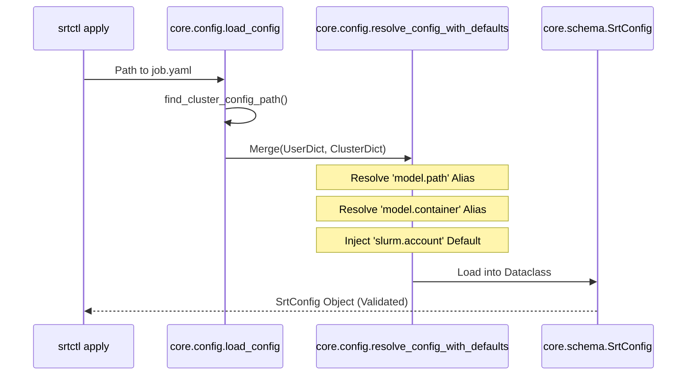

<!-- source: DeepWiki mcp.deepwiki.com · repo NVIDIA/srt-slurm · page 2.3 Cluster Configuration (srtslurm.yaml) · fetched 2026-10-26 -->

# Cluster Configuration (srtslurm.yaml)

Relevant source files

The following files were used as context for generating this wiki page:

- [.github/workflows/ci.yaml](.github/workflows/ci.yaml)
- [docs/overrides.md](docs/overrides.md)
- [examples/example-override.yaml](examples/example-override.yaml)
- [recipes/gb200-fp4/1k1k-dsv4/README.md](recipes/gb200-fp4/1k1k-dsv4/README.md)
- [recipes/gb200-fp4/1k1k-dsv4/agg-2n-low-latency.yaml](recipes/gb200-fp4/1k1k-dsv4/agg-2n-low-latency.yaml)
- [recipes/gb200-fp4/1k1k-dsv4/agg-2n-nomtp.yaml](recipes/gb200-fp4/1k1k-dsv4/agg-2n-nomtp.yaml)
- [src/srtctl/cli/submit.py](src/srtctl/cli/submit.py)
- [src/srtctl/core/config.py](src/srtctl/core/config.py)
- [srtslurm.yaml.example](srtslurm.yaml.example)
- [tests/test_override.py](tests/test_override.py)

The `srtslurm.yaml` file serves as the cluster-level configuration layer for `srtctl`. It defines the environmental context of the SLURM cluster, providing defaults for resource allocation, mapping logical aliases to physical paths or container images, and configuring global features like AI-powered failure analysis.

### Purpose and Discovery

The cluster configuration decouples the generic job recipe (which describes *what* to run) from the cluster-specific infrastructure (which describes *where* and *how* to run it). This allows the same recipe to be portable across different hardware clusters by simply updating the local `srtslurm.yaml`.

`srtctl` discovers this file using a hierarchical search strategy implemented in `find_cluster_config_path()` [src/srtctl/core/config.py:30-52]():

1.  **Environment Variable**: If `SRTSLURM_CONFIG` is set, it takes absolute precedence [src/srtctl/core/config.py:33-40]().
2.  **Directory Hierarchy**: The system searches the Current Working Directory (`cwd`), followed by its parent, and finally its grandparent [src/srtctl/core/config.py:42-46]().

### Configuration Discovery and Loading Flow

The following diagram illustrates how `srtctl` locates, validates, and merges the cluster configuration into the job execution context.

**Configuration Resolution Pipeline**

**Sources:** [src/srtctl/core/config.py:30-81](), [src/srtctl/core/schema.py:25-25]()

---

### Core Configuration Sections

#### 1. SLURM Defaults and Compatibility
The file provides fallback values for SLURM directives. If a job recipe omits `account` or `partition`, `srtctl` injects these defaults during the resolution phase [src/srtctl/core/config.py:104-115]().

It also manages hardware-specific directive compatibility via flags:
*   `use_gpus_per_node_directive`: Toggles `--gpus-per-node` vs generic resource requests [srtslurm.yaml.example:16-16]().
*   `use_segment_sbatch_directive`: Enables/disables segment-based scheduling [srtslurm.yaml.example:18-18]().
*   `use_exclusive_sbatch_directive`: Controls the injection of the `--exclusive` flag [srtslurm.yaml.example:20-20]().

#### 2. Alias Resolution (Containers & Models)
To prevent hardcoding absolute paths in shared recipes, `srtslurm.yaml` supports an alias system. This is processed in `resolve_config_with_defaults()` [src/srtctl/core/config.py:81-200]().

| Alias Category | Source Field in Recipe | Cluster Config Map | Description |
| :--- | :--- | :--- | :--- |
| **Containers** | `model.container` | `containers:` | Maps short names (e.g., `sglang-dev`) to `.sqsh` or URI paths. |
| **Models** | `model.path` | `model_paths:` | Maps model names (e.g., `dsv4-pro`) to host filesystem paths. |
| **Frontends** | `frontend.nginx_container` | `containers:` | Resolves Nginx images for load balancing. |
| **Telemetry** | `telemetry.container_image` | `containers:` | Resolves Prometheus/DCGM scraper images. |

**Sources:** [src/srtctl/core/config.py:117-183](), [srtslurm.yaml.example:23-49]()

#### 3. AI-Powered Analysis
The `ai_analysis` block configures automated post-job failure inspection. When enabled, `srtctl` uses the Claude Code CLI (via OpenRouter) to analyze logs and cross-reference GitHub PRs [srtslurm.yaml.example:50-72]().

*   **Implementation**: Managed by `PostProcessStageMixin` during the orchestration cleanup phase.
*   **Data Flow**: Failure logs $\rightarrow$ Claude $\rightarrow$ `ai_analysis.md` report.

---

### Technical Implementation: Deep Merging

The merging of `srtslurm.yaml` into a user config is not a simple dictionary update. It follows specific semantic rules implemented in `resolve_config_with_defaults` and `deep_merge` [src/srtctl/core/config.py:81-101]().

**Data Flow: From File to Runtime Object**

**Sources:** [src/srtctl/core/config.py:81-150](), [src/srtctl/cli/submit.py:41-45]()

### Data Structure Reference

The `ClusterConfig` schema (defined via `marshmallow_dataclass`) enforces the following structure for `srtslurm.yaml`:

| Key | Type | Role |
| :--- | :--- | :--- |
| `default_account` | `str` | Default SLURM account string [srtslurm.yaml.example:10-10]() |
| `default_partition` | `str` | Default SLURM partition [srtslurm.yaml.example:11-11]() |
| `containers` | `dict[str, str]` | Registry of container alias mappings [srtslurm.yaml.example:23-23]() |
| `model_paths` | `dict[str, str]` | Registry of model path mappings [srtslurm.yaml.example:41-41]() |
| `default_mounts` | `dict[str, str]` | Host:Container mounts applied to all jobs [src/srtctl/cli/submit.py:206-211]() |
| `nginx_raise_ulimit` | `int` | Global override for Nginx file descriptors [src/srtctl/core/config.py:152-155]() |

**Sources:** [src/srtctl/core/config.py:103-183](), [srtslurm.yaml.example:1-50]()

---

