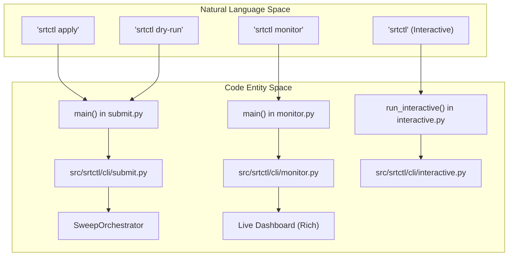
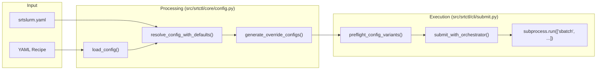

<!-- source: DeepWiki mcp.deepwiki.com · repo NVIDIA/srt-slurm · page 3 CLI Reference · fetched 2026-10-26 -->

# CLI Reference

Relevant source files

The following files were used as context for generating this wiki page:

- [.github/workflows/ci.yaml](.github/workflows/ci.yaml)
- [docs/cli.md](docs/cli.md)
- [docs/monitoring.md](docs/monitoring.md)
- [docs/overrides.md](docs/overrides.md)
- [examples/example-override.yaml](examples/example-override.yaml)
- [src/srtctl/cli/__init__.py](src/srtctl/cli/__init__.py)
- [src/srtctl/cli/monitor.py](src/srtctl/cli/monitor.py)
- [src/srtctl/cli/submit.py](src/srtctl/cli/submit.py)
- [src/srtctl/core/config.py](src/srtctl/core/config.py)
- [tests/test_monitor.py](tests/test_monitor.py)
- [tests/test_override.py](tests/test_override.py)

The `srtctl` CLI is the primary interface for interacting with the SLURM Runtime Control system. It provides a unified set of commands for job submission, configuration validation, and real-time cluster monitoring. The CLI is designed to handle both single-job applications and complex parameter sweeps with minimal manual intervention.

### Command Overview

The CLI is structured into several functional groups:
*   **Submission & Validation**: `apply`, `dry-run`, `resolve-override`, and `preflight`.
*   **Monitoring**: `monitor` (TUI dashboard).
*   **Interactive**: `srtctl` (or `srtctl -i`) launches a TUI for recipe browsing and parameter modification.

### CLI to Code Mapping

The following diagram maps CLI commands to their implementation entry points and core logic within the `srtctl` codebase.

**CLI Entry Point Mapping**

Sources: [src/srtctl/cli/submit.py:6-14](), [src/srtctl/cli/monitor.py:5-18](), [src/srtctl/cli/__init__.py:7-12]()

---

## Job Submission & Management

Job submission is handled primarily through the `srtctl apply` command. It processes YAML recipes, resolves cluster-level defaults from `srtslurm.yaml`, and generates the necessary `sbatch` scripts for SLURM.

| Command | Purpose | Key Flags |
| :--- | :--- | :--- |
| `apply` | Submits jobs to SLURM. | `-f` (file), `-o` (output dir), `--tags`, `--yes` |
| `dry-run` | Previews configuration and `sbatch` scripts without submitting. | `-f`, `--sweep` |
| `resolve-override` | Expands override/zip-sweep YAMLs into standalone configs. | `-f`, `-o` |
| `preflight` | Runs semantic validation (path checks, HF ID checks). | `-f` |

### The Submission Pipeline
The submission process follows a multi-stage pipeline from raw YAML to a running SLURM job.

**Submission Logic Flow**

Sources: [src/srtctl/cli/submit.py:39-56](), [src/srtctl/core/config.py:9-11](), [src/srtctl/core/config.py:81-96]()

For more details on selectors, tags, and the `sbatch` generation process, see [Job Submission Commands](#3.1).

---

## Interactive TUI

Running `srtctl` without arguments (or with `-i`) launches an interactive TUI. This mode is designed for rapid experimentation and recipe discovery.

*   **Recipe Browser**: Scans the `recipes/` directory and groups them by hardware/backend [docs/cli.md:60-75]().
*   **Parameter Modification**: Allows interactive editing of `name`, `prefill_workers`, `decode_workers`, `isl`, and `osl` before submission [docs/cli.md:144-166]().
*   **Previews**: Built-in syntax-highlighted viewers for generated `sbatch` scripts and sweep expansion tables [docs/cli.md:126-142]().

---

## Monitoring Dashboard

The `srtctl monitor` command provides a live, `rich`-powered dashboard for tracking job lifecycles. It aggregates data from SLURM's `squeue` and the internal orchestration logs.

### Key Features:
*   **Lifecycle Stages**: Tracks jobs through `Starting` → `Head Ready` → `Workers` → `Benchmarking` → `Completed/Failed` [src/srtctl/cli/monitor.py:80-88]().
*   **Worker Readiness**: Displays real-time counts of ready prefill and decode workers (e.g., `2/4P 4/4D`) [src/srtctl/cli/monitor.py:90-97]().
*   **Detail View**: Split-pane view with the main orchestrator log on the left and worker/benchmark logs on the right [docs/monitoring.md:58-67]().

For keyboard shortcuts and session management details, see [Job Monitoring Dashboard](#3.2).

Sources: [src/srtctl/cli/monitor.py:9-18](), [docs/monitoring.md:15-26](), [docs/monitoring.md:42-42]()

---

## Configuration Overrides & Sweeps

The CLI supports advanced YAML patterns for generating multiple job variants from a single file:
1.  **`override_*`**: Deep-merges a variant block with the `base` configuration [docs/overrides.md:39-41]().
2.  **`zip_override_*`**: Generates N jobs by zipping list-valued leaves in parallel, similar to Python's `zip()` function [docs/overrides.md:101-103]().
3.  **Selector Syntax**: Target specific variants using `file.yaml:selector` or glob patterns (e.g., `srtctl apply -f sweep.yaml:zip_override_tp*`) [docs/overrides.md:184-215]().

Sources: [src/srtctl/core/config.py:13-26](), [tests/test_override.py:27-51](), [examples/example-override.yaml:1-15]()

---

