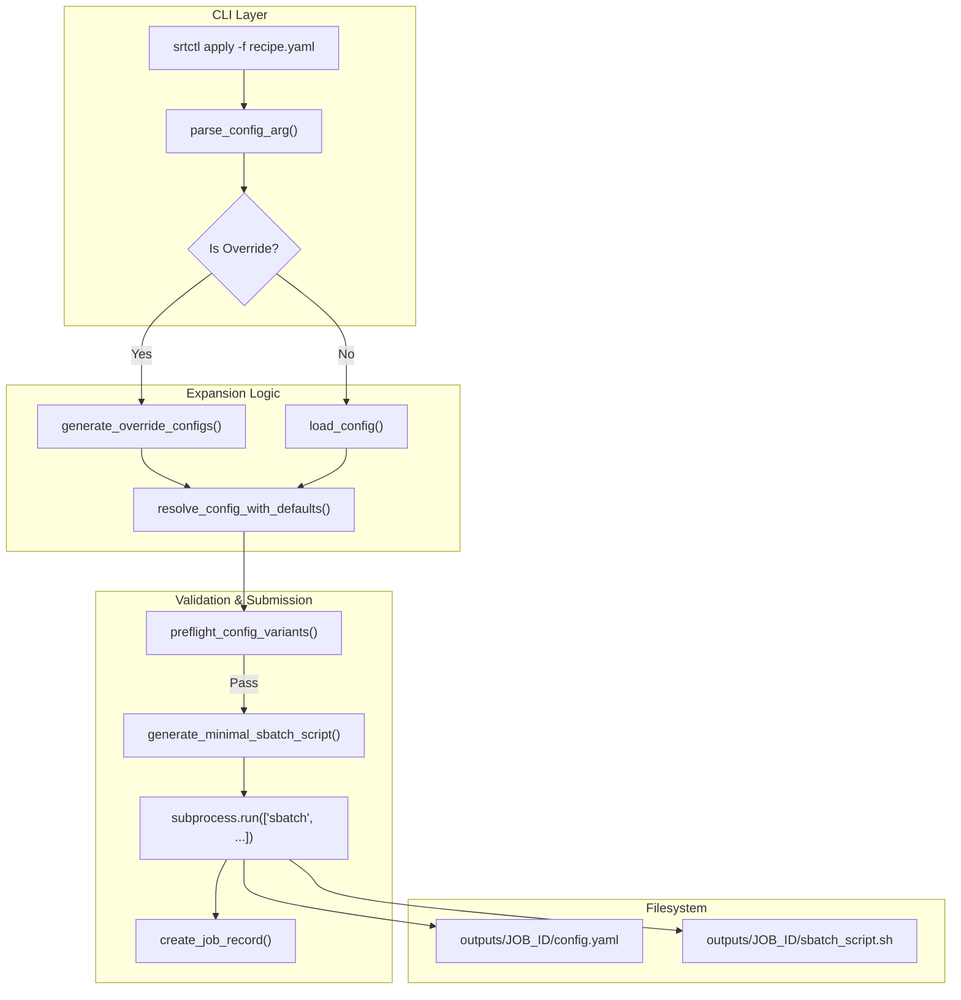
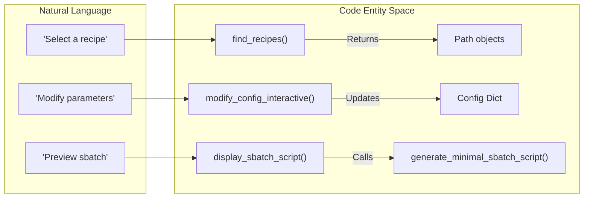

<!-- source: DeepWiki mcp.deepwiki.com · repo NVIDIA/srt-slurm · page 3.1 Job Submission Commands · fetched 2026-10-26 -->

# Job Submission Commands

Relevant source files

The following files were used as context for generating this wiki page:

- [.github/workflows/ci.yaml](.github/workflows/ci.yaml)
- [docs/cli.md](docs/cli.md)
- [docs/monitoring.md](docs/monitoring.md)
- [docs/overrides.md](docs/overrides.md)
- [examples/example-override.yaml](examples/example-override.yaml)
- [src/srtctl/cli/__init__.py](src/srtctl/cli/__init__.py)
- [src/srtctl/cli/interactive.py](src/srtctl/cli/interactive.py)
- [src/srtctl/cli/monitor.py](src/srtctl/cli/monitor.py)
- [src/srtctl/cli/submit.py](src/srtctl/cli/submit.py)
- [src/srtctl/core/config.py](src/srtctl/core/config.py)
- [tests/test_monitor.py](tests/test_monitor.py)
- [tests/test_override.py](tests/test_override.py)

The `srtctl` CLI provides a unified interface for submitting, validating, and dry-running benchmark jobs on a SLURM cluster. It manages the transformation of high-level YAML recipes into concrete `sbatch` scripts and handles complex multi-job expansions like sweeps and overrides.

## Command Overview

The primary entry point for job submission is `srtctl apply`, supported by several utility commands for validation and local inspection.

| Command | Purpose | Key Flags |
| :--- | :--- | :--- |
| `apply` | Submits one or more jobs to SLURM. | `-f`, `--tags`, `--yes`, `--json`, `--mock` |
| `dry-run` | Previews configuration and `sbatch` generation without submitting. | `-f`, `--sweep` |
| `resolve-override` | Expands override/zip files into standard YAML. | `-f`, `-o` |
| `preflight` | Runs semantic and environment validations. | `-f` |
| `diff` | Compares a local config against a remote job's lockfile. | `-f`, `--job-id` |
| `interactive` | Launches the TUI for recipe browsing and submission. | `-i` |

**Sources:** [src/srtctl/cli/submit.py:10-14](), [docs/cli.md:17-20]()

---

## Submission Pipeline

The submission process follows a structured pipeline from raw YAML to a scheduled SLURM job.

### 1. Configuration Resolution
When a file is passed via `-f`, `srtctl` first identifies if it is a standard config, an override config (containing a `base` key), or a sweep config [src/srtctl/cli/submit.py:39-45](). It then merges cluster-level defaults from `srtslurm.yaml` [src/srtctl/core/config.py:81-96]().

### 2. Job ID and Output Directory
Each job is assigned a unique SLURM ID upon submission. `srtctl` creates an output directory following the pattern: `outputs/<job_id>_<prefill>P_<decode>D_<timestamp>/` [docs/monitoring.md:99-102]().

### 3. Sbatch Generation
The system generates a minimal `sbatch` script that acts as a wrapper. Instead of containing the logic itself, it invokes `python -m srtctl.cli.do_sweep` [src/srtctl/cli/__init__.py:7-12](). This allows the orchestration logic to remain in Python while respecting SLURM resource allocations.

### Data Flow: From YAML to SLURM
The following diagram illustrates the transformation of a configuration through the submission system.

**Submission Logic Flow**

**Sources:** [src/srtctl/cli/submit.py:78-86](), [src/srtctl/core/config.py:81-96](), [src/srtctl/cli/interactive.py:204-209]()

---

## File and Selector Syntax

`srtctl` uses a `file:selector` syntax to target specific variants within a multi-job YAML file.

*   **`config.yaml`**: Submits all `override_*` and `zip_override_*` variants, but excludes `base` [docs/overrides.md:29-35]().
*   **`config.yaml:base`**: Submits only the base configuration [docs/overrides.md:31]().
*   **`config.yaml:override_name`**: Submits a specific deep-merged variant [docs/overrides.md:193]().
*   **`config.yaml:zip_override_name[N]`**: Submits the N-th variant of a zipped group [docs/overrides.md:199]().
*   **`config.yaml:pattern*`**: Supports glob matching against variant keys [docs/overrides.md:202-211]().

**Sources:** [src/srtctl/cli/submit.py:11-13](), [docs/overrides.md:184-217](), [tests/test_override.py:68-75]()

---

## Command Reference

### srtctl apply
The primary submission command. It performs preflight checks, generates the `sbatch` script, and submits to the SLURM queue.
*   `--tags`: Attaches metadata tags to the job for filtering in the dashboard or analysis [src/srtctl/cli/submit.py:604]().
*   `--json`: Outputs a JSON object per submitted job, useful for CI/CD integration [src/srtctl/cli/submit.py:61-63]().
*   `--mock`: Stubs out the `sbatch` call and spawns a local `mock_worker` to simulate the orchestration lifecycle without consuming cluster resources [src/srtctl/cli/submit.py:88-126]().

### srtctl dry-run
Validates the configuration and prints the effective resource requirements and container mounts.
*   **Implementation**: Calls `show_config_details()` to render tables of container paths, environment variables, and resolved model paths [src/srtctl/cli/submit.py:187-210]().
*   Use `--sweep` to see the full expansion of a Cartesian product sweep [src/srtctl/cli/submit.py:13]().

### srtctl interactive (TUI)
A `questionary` and `rich` powered interface for users who prefer guided submission.
*   **Recipe Browser**: Scans the `recipes/` directory and groups files by their parent folder [src/srtctl/cli/interactive.py:48-60]().
*   **Parameter Modification**: Allows interactive overrides of `name`, `prefill_workers`, `decode_workers`, `isl`, and `osl` before final submission [src/srtctl/cli/interactive.py:212-223]().

**Code Entity Association: Interactive Mode**

**Sources:** [src/srtctl/cli/interactive.py:48-60](), [src/srtctl/cli/interactive.py:118-123](), [src/srtctl/cli/interactive.py:212-223]()

---

## Output Directory Structure

Every successful `apply` results in a dedicated output directory. This directory is the source of truth for the `monitor` and `analysis` tools.

| File | Description |
| :--- | :--- |
| `config.yaml` | The fully resolved job configuration (defaults applied) [docs/monitoring.md:109](). |
| `sbatch_script.sh` | The exact script sent to `sbatch` [docs/monitoring.md:111](). |
| `log.out` / `log.err` | The primary orchestrator logs [docs/monitoring.md:115-116](). |
| `recipe.lock.yaml` | A reproducibility lockfile containing environment fingerprints [docs/monitoring.md:163](). |
| `*.out` / `*.err` | Per-node worker logs (e.g., `node0_prefill_w0.err`) [docs/monitoring.md:120-127](). |

**Sources:** [docs/monitoring.md:106-135](), [src/srtctl/cli/submit.py:135-150]()

---

