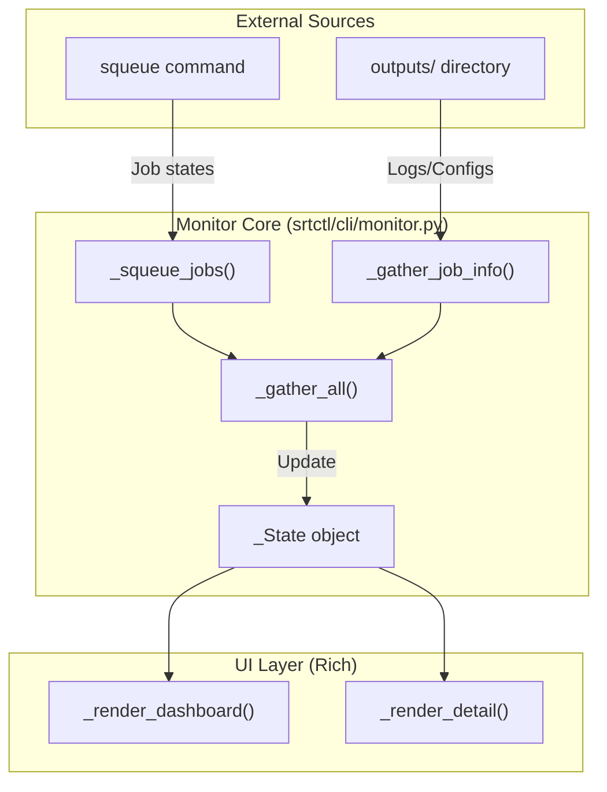
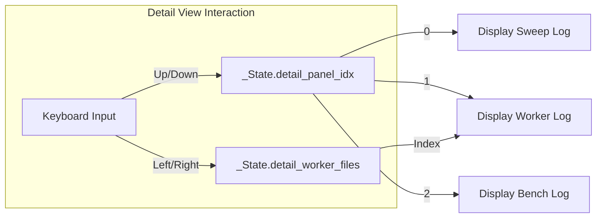

<!-- source: DeepWiki mcp.deepwiki.com · repo NVIDIA/srt-slurm · page 3.2 Job Monitoring Dashboard · fetched 2026-10-26 -->

# Job Monitoring Dashboard

Relevant source files

The following files were used as context for generating this wiki page:

- [docs/cli.md](docs/cli.md)
- [docs/monitoring.md](docs/monitoring.md)
- [src/srtctl/cli/__init__.py](src/srtctl/cli/__init__.py)
- [src/srtctl/cli/monitor.py](src/srtctl/cli/monitor.py)
- [tests/test_monitor.py](tests/test_monitor.py)

The `srtctl monitor` command provides a live, interactive Terminal User Interface (TUI) for tracking the lifecycle of SLURM jobs submitted via `srtctl`. It consolidates SLURM queue states, orchestration logs, worker readiness, and benchmark performance metrics into a single unified view.

## Overview

The monitoring dashboard is designed to replace manual `squeue` polling and `tail -f` log tracking. It operates by scanning the `outputs/` directory and querying the SLURM scheduler to reconstruct the state of active and historical jobs.

### Key Capabilities
*   **Live Updates**: Auto-refreshing view of job stages (default 5s interval) [src/srtctl/cli/monitor.py:12]().
*   **Lifecycle Tracking**: Infers job progress (e.g., "Head Ready", "Awaiting Workers", "Benchmarking") by parsing `log.out` patterns [src/srtctl/cli/monitor.py:80-88]().
*   **Worker Readiness**: Displays the count of active vs. expected prefill and decode workers [src/srtctl/cli/monitor.py:90-97]().
*   **Metrics Extraction**: Real-time parsing of throughput (tok/s) and latency (TTFT/TPOT) from benchmark logs [src/srtctl/cli/monitor.py:101-106]().
*   **Detail View**: A split-pane interface for tailing orchestration logs, worker logs, and benchmark results simultaneously [src/srtctl/cli/monitor.py:534-566]().

**Sources:** [src/srtctl/cli/monitor.py:5-18](), [docs/monitoring.md:15-28]()

---

## Technical Implementation

### Data Flow & Architecture
The dashboard follows a reactive pattern where a background loop gathers data from the filesystem and SLURM, updates a mutable `_State` object, and triggers a `rich.live.Live` render.

#### State Management and Data Gathering
The `_State` class [src/srtctl/cli/monitor.py:124-142]() maintains the UI state, including the currently selected job, scroll offsets, and active panels. Data gathering is strictly read-only [tests/test_monitor.py:4-5]() and occurs in `_gather_all()` [src/srtctl/cli/monitor.py:284-307]().

**Data Flow Diagram:**

**Sources:** [src/srtctl/cli/monitor.py:148-167](), [src/srtctl/cli/monitor.py:236-282](), [src/srtctl/cli/monitor.py:284-307]()

### Job Lifecycle Detection
The `_detect_stage` function [src/srtctl/cli/monitor.py:191-213]() uses regex patterns to determine the current execution phase. Stages are categorized into terminal, in-progress, or active states to drive UI coloring and status indicators.

| Stage Name | Regex Pattern Source | UI Color |
| :--- | :--- | :--- |
| **Benchmarking** | `Running \S+ benchmark` | `bright_green` |
| **Awaiting Workers** | `Waiting for server health` | `cyan` |
| **Starting Workers** | `Starting backend workers` | `yellow` |
| **Head Ready** | `etcd is ready\|NATS is ready` | `yellow` |
| **Starting Infra** | `Starting infrastructure services` | `dim yellow` |

**Sources:** [src/srtctl/cli/monitor.py:80-88](), [src/srtctl/cli/monitor.py:108-110]()

---

## Detailed View & Log Tailing

When a user selects a job and presses `Enter`, the dashboard enters a detail view [src/srtctl/cli/monitor.py:534](). This view implements a split-pane layout using `rich.layout.Layout` [src/srtctl/cli/monitor.py:41]().

### Log Pane Logic
1.  **Sweep Log (Left)**: Tails the main orchestration log (`log.out`) [src/srtctl/cli/monitor.py:545]().
2.  **Worker/Bench Log (Right)**: Toggles between worker stderr (SGLang/vLLM logs) and benchmark output [src/srtctl/cli/monitor.py:548-554]().
3.  **Automatic Rotation**: Users can cycle through different worker nodes using `Left`/`Right` arrow keys [src/srtctl/cli/monitor.py:133-135]().

**Log Navigation Logic:**

**Sources:** [src/srtctl/cli/monitor.py:124-142](), [src/srtctl/cli/monitor.py:543-566]()

---

## Usage and Shortcuts

### Command Line Options
*   `--all`: Includes older jobs from the `outputs/` directory that are no longer in the SLURM queue [src/srtctl/cli/monitor.py:10]().
*   `--resume <KEY>`: Restores a previous monitoring session, including the set of tracked job IDs [src/srtctl/cli/monitor.py:25]().
*   `--interval <SEC>`: Sets the refresh rate (default is 5 seconds) [src/srtctl/cli/monitor.py:12]().

### Keyboard Shortcuts

#### Main Dashboard
| Key | Action | Implementation |
| :--- | :--- | :--- |
| `↑` / `↓` | Navigate job list | `_State.selected_idx` adjustment |
| `Enter` | Open Detail View | Sets `_State.detail_job_id` |
| `c` | Toggle Concurrency | Flips `_State.show_all_concurrencies` |
| `d` | Delete/Cancel | Triggers `scancel` or `rm -rf` with confirmation |
| `y` | View Config | Opens `config.yaml` in `vi` |

#### Detail View
| Key | Action | Implementation |
| :--- | :--- | :--- |
| `←` / `→` | Switch Worker | Increments `_State.detail_worker_idx` |
| `r` | Toggle Refresh | Flips `_State.detail_auto_refresh` |
| `Esc` | Close Detail | Resets `_State.detail_job_id` |

**Sources:** [src/srtctl/cli/monitor.py:15-18](), [docs/monitoring.md:44-67]()

---

## Session Management

The dashboard supports session persistence. Upon exit, it saves the current state to `/tmp/srt-dash-<user>.json` [docs/monitoring.md:76](). This JSON blob stores the `seen_job_ids`, allowing users to resume monitoring a specific set of jobs even after they have finished and cleared from the active SLURM queue.

**Sources:** [src/srtctl/cli/monitor.py:615-635](), [docs/monitoring.md:68-76]()

---

