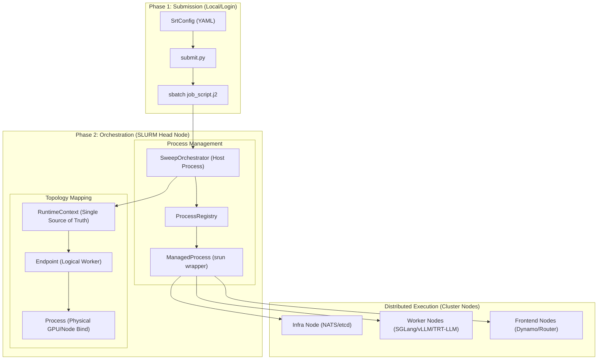

<!-- source: DeepWiki mcp.deepwiki.com · repo NVIDIA/srt-slurm · page 4 Core Architecture · fetched 2026-10-26 -->

# Core Architecture

Relevant source files

The following files were used as context for generating this wiki page:

- [.gitignore](.gitignore)
- [CLAUDE.md](CLAUDE.md)
- [Makefile](Makefile)
- [README.md](README.md)
- [docs/mooncake-kv-store.md](docs/mooncake-kv-store.md)
- [src/srtctl/README.md](src/srtctl/README.md)
- [src/srtctl/backends/base.py](src/srtctl/backends/base.py)
- [src/srtctl/backends/sglang.py](src/srtctl/backends/sglang.py)
- [src/srtctl/cli/do_sweep.py](src/srtctl/cli/do_sweep.py)
- [src/srtctl/core/slurm.py](src/srtctl/core/slurm.py)
- [src/srtctl/core/topology.py](src/srtctl/core/topology.py)
- [src/srtctl/frontends/dynamo.py](src/srtctl/frontends/dynamo.py)
- [src/srtctl/templates/job_script_minimal.j2](src/srtctl/templates/job_script_minimal.j2)
- [tests/test_dry_run.py](tests/test_dry_run.py)
- [tests/test_e2e.py](tests/test_e2e.py)
- [tests/test_endpoint_allocation.py](tests/test_endpoint_allocation.py)
- [tests/test_slurm.py](tests/test_slurm.py)

The `srtctl` system operates on a **two-phase execution model** designed to bridge the gap between high-level declarative YAML configurations and the low-level complexities of SLURM multi-node orchestration. 

1.  **Submission Phase (Host/Login Node):** The CLI (e.g., `srtctl apply`) resolves overrides, validates the configuration, and generates a persistent output directory. It then submits a primary `sbatch` job using a Jinja2 template [src/srtctl/templates/job_script_minimal.j2:1-32]().
2.  **Orchestration Phase (Compute Node):** The SLURM-allocated "head" node executes the `SweepOrchestrator` [src/srtctl/cli/do_sweep.py:54-68](). This orchestrator runs on the host OS to maintain access to `srun`, while spawning all infrastructure, backends, and frontends as containerized processes across the allocated nodes.

### System Overview Diagram

This diagram maps high-level orchestration concepts to the specific Python classes and SLURM entities that implement them.

**Sources:** [src/srtctl/cli/do_sweep.py:54-100](), [src/srtctl/templates/job_script_minimal.j2:115-131](), [src/srtctl/core/processes.py:37-42]()

---

### Key Abstractions

The architecture relies on four primary abstractions to manage the complexity of distributed inference:

#### 1. RuntimeContext
The `RuntimeContext` is the immutable "source of truth" for a specific job execution. It resolves SLURM environment variables into concrete values, such as the `head_node_ip`, the list of available worker nodes, and the final container mount strings [src/srtctl/core/runtime.py:43-43](). It ensures that every component in the system uses consistent paths and network addresses.
*   **For details, see [RuntimeContext & Node Topology](#4.1)**

#### 2. Endpoint & Process
The system distinguishes between **logical** and **physical** topology:
*   **`Endpoint`**: Represents a logical serving unit (e.g., a Tensor Parallel rank-4 prefill worker). It defines *what* needs to run [src/srtctl/core/topology.py:47-47]().
*   **`Process`**: Represents a physical execution unit on a specific node with specific GPU indices and ports. One `Endpoint` might map to one or more `Process` entities depending on the backend's launch requirements [src/srtctl/core/topology.py:47-47]().
*   **For details, see [Endpoint & Process Allocation](#4.2)**

#### 3. SweepOrchestrator & Stage Mixins
The `SweepOrchestrator` uses a mixin-based architecture to organize the job lifecycle into discrete stages [src/srtctl/cli/do_sweep.py:54-60]():
*   **`WorkerStageMixin`**: Handles `srun` logic for inference backends.
*   **`FrontendStageMixin`**: Deploys routers and load balancers.
*   **`BenchmarkStageMixin`**: Orchestrates health checks and client execution.
*   **`PostProcessStageMixin`**: Manages log cleanup, S3 syncing, and AI analysis.
*   **For details, see [SweepOrchestrator & Stage Mixins](#4.3)**

#### 4. ProcessRegistry
The `ProcessRegistry` tracks every `ManagedProcess` spawned during the job [src/srtctl/core/processes.py:37-42](). It provides centralized signal handling (SIGINT/SIGTERM) and ensures that if a critical process (like a NATS server or a lead rank worker) fails, the entire sweep is shut down cleanly to avoid "zombie" SLURM allocations.

---

### Orchestration Lifecycle

The `SweepOrchestrator.run()` method executes a strictly ordered sequence to ensure dependencies are met before proceeding to the next stage.

| Stage | Action | Code Entity |
| :--- | :--- | :--- |
| **Infra** | Start NATS, etcd, and Mooncake Master | `start_head_infrastructure` [src/srtctl/cli/do_sweep.py:101]() |
| **Workers** | Launch backend processes (Prefill/Decode/Agg) | `WorkerStageMixin.start_workers` [src/srtctl/cli/mixins/worker_stage.py]() |
| **Frontends** | Launch Dynamo or SGLang Routers | `FrontendStageMixin.start_frontends` [src/srtctl/frontends/dynamo.py:62]() |
| **Health** | Poll `/health` or ports until workers are ready | `wait_for_port` [src/srtctl/core/health.py:35]() |
| **Benchmark** | Execute benchmark client (SA-Bench, etc.) | `BenchmarkStageMixin.run_benchmarks` [src/srtctl/cli/mixins/benchmark_stage.py]() |
| **Cleanup** | Terminate all processes in the `ProcessRegistry` | `ProcessRegistry.stop_all` [src/srtctl/core/processes.py]() |

### Infrastructure Services
By default, infrastructure services like NATS (port 4222) and etcd (port 2379) run on the head node. For large-scale runs, `srtctl` can be configured to use a dedicated `infra_node` to prevent interference with inference performance [src/srtctl/cli/do_sweep.py:101-110]().
*   **For details, see [Infrastructure Services (NATS, etcd, Mooncake)](#4.4)**

**Sources:** [src/srtctl/cli/do_sweep.py:7-13](), [src/srtctl/cli/do_sweep.py:101-163](), [src/srtctl/core/slurm.py:150-170]()

---

