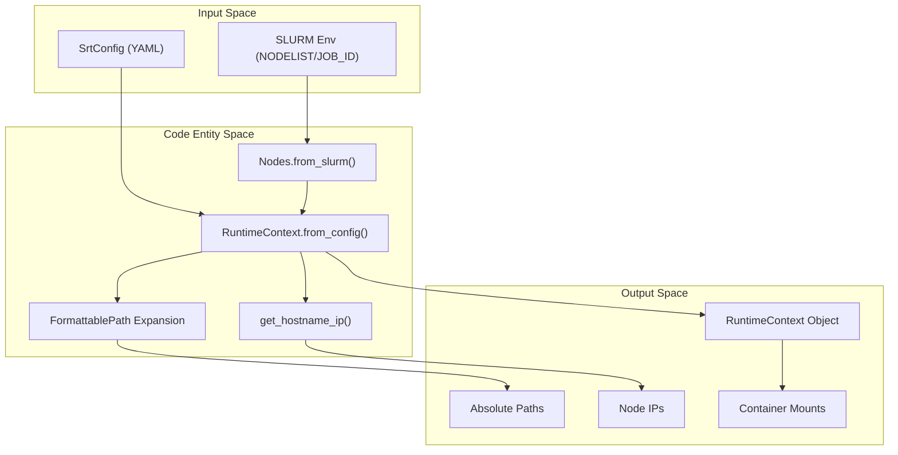
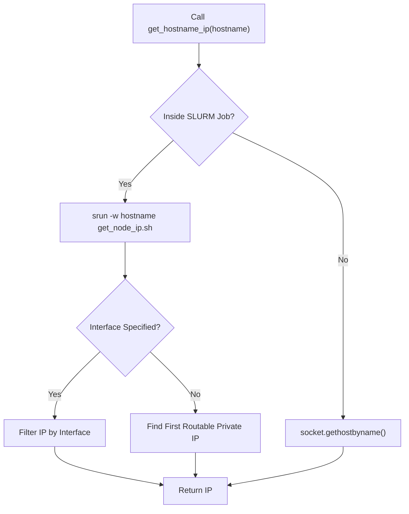

<!-- source: DeepWiki mcp.deepwiki.com · repo NVIDIA/srt-slurm · page 4.1 RuntimeContext & Node Topology · fetched 2026-10-26 -->

# RuntimeContext & Node Topology

Relevant source files

The following files were used as context for generating this wiki page:

- [CLAUDE.md](CLAUDE.md)
- [configs/aime/run.sh](configs/aime/run.sh)
- [docs/accuracy.md](docs/accuracy.md)
- [docs/mooncake-kv-store.md](docs/mooncake-kv-store.md)
- [examples/example.yaml](examples/example.yaml)
- [src/srtctl/benchmarks/__init__.py](src/srtctl/benchmarks/__init__.py)
- [src/srtctl/benchmarks/lm_eval.py](src/srtctl/benchmarks/lm_eval.py)
- [src/srtctl/benchmarks/scripts/lm-eval/bench.sh](src/srtctl/benchmarks/scripts/lm-eval/bench.sh)
- [src/srtctl/cli/setup_head.py](src/srtctl/cli/setup_head.py)
- [src/srtctl/core/ip_utils/get_node_ip.sh](src/srtctl/core/ip_utils/get_node_ip.sh)
- [src/srtctl/core/runtime.py](src/srtctl/core/runtime.py)
- [src/srtctl/core/slurm.py](src/srtctl/core/slurm.py)
- [src/srtctl/core/yaml_utils.py](src/srtctl/core/yaml_utils.py)
- [tests/test_benchmarks.py](tests/test_benchmarks.py)
- [tests/test_dry_run.py](tests/test_dry_run.py)
- [tests/test_e2e.py](tests/test_e2e.py)
- [tests/test_ip_utils.py](tests/test_ip_utils.py)
- [tests/test_slurm.py](tests/test_slurm.py)

The `RuntimeContext` serves as the single source of truth for all runtime values within the `srt-slurm` ecosystem [src/srtctl/core/runtime.py:7-9](). It centralizes configuration, network topology, and filesystem paths into a typed Python object, replacing scattered environment variables and complex shell scripting.

## RuntimeContext Overview

`RuntimeContext` is an immutable, frozen dataclass created at job startup via the `from_config` factory method [src/srtctl/core/runtime.py:81-129](). It computes all absolute paths, resolves node IP addresses, and prepares container mount strings once, ensuring consistency across all orchestration stages.

### Key Responsibilities
*   **Path Resolution**: Expands environment variables in model and container paths, resolving them to absolute filesystem locations [src/srtctl/core/runtime.py:164-190]().
*   **IP Resolution**: Maps SLURM hostnames to routable IP addresses for inter-node communication [src/srtctl/core/runtime.py:149-150]().
*   **Mount Construction**: Automatically generates the mapping between host paths and container internal paths [src/srtctl/core/runtime.py:111-112]().
*   **Topology Mapping**: Maintains the `Nodes` object which defines the roles of every node in the allocation [src/srtctl/core/runtime.py:93-94]().

### Data Flow: Config to Runtime
The following diagram illustrates how the static `SrtConfig` (loaded from YAML) is transformed into a live `RuntimeContext` using SLURM environment data.

**Runtime Initialization Flow**

Sources: [src/srtctl/core/runtime.py:82-129](), [src/srtctl/core/slurm.py:49-54]()

---

## Node Topology & Role Assignment

The `Nodes` class manages the allocation of hostnames to specific functional roles within a SLURM job [src/srtctl/core/runtime.py:24-38]().

### Node Roles
| Role | Description | Placement Logic |
| :--- | :--- | :--- |
| **Head** | Runs `nginx` and frontend routers. | Typically the first node in the list [src/srtctl/core/runtime.py:73](). |
| **Bench** | Runs the benchmark client (e.g., `sa-bench`). | Defaults to Head node, but can be isolated [src/srtctl/core/runtime.py:68-69](). |
| **Infra** | Runs `NATS`, `etcd`, and `mooncake_master`. | Defaults to Head node unless `etcd_nats_dedicated_node` is True [src/srtctl/core/runtime.py:58-64](). |
| **Worker** | Runs the actual inference engine processes. | Includes all nodes in the allocation [src/srtctl/core/runtime.py:76](). |

### Nodes.from_slurm()
This method parses the `SLURM_NODELIST` (using `scontrol show hostnames` for expansion) and partitions the nodes based on configuration flags [src/srtctl/core/runtime.py:40-78](), [src/srtctl/core/slurm.py:49-71]().

*   **Standard Mode**: The first node acts as Head, Bench, and Infra. All nodes (including the first) act as Workers.
*   **Dedicated Infra Mode**: Enabled via `infra.etcd_nats_dedicated_node`. The first node is reserved strictly for Infra; the second node becomes the Head/Bench [src/srtctl/core/runtime.py:58-64]().
*   **Separate Benchmark Mode**: The first node is reserved for the benchmark client to prevent CPU/Network interference with the inference frontend [src/srtctl/core/runtime.py:65-71]().

Sources: [src/srtctl/core/runtime.py:24-80](), [src/srtctl/core/slurm.py:49-71]()

---

## Network Resolution Utilities

Accurate IP resolution is critical for distributed inference backends (like SGLang or vLLM) that require a `dist-init-addr` or `master_addr`.

### get_hostname_ip()
Located in `srtctl.core.slurm`, this function uses a multi-tiered strategy to find a routable IP [src/srtctl/core/slurm.py:78-118]():
1.  **SLURM Context**: If a `SLURM_JOB_ID` exists, it executes the `get_node_ip.sh` script via `srun` on the target node to find the actual IP on the requested interface [src/srtctl/core/slurm.py:94-98]().
2.  **Socket Fallback**: Falls back to `socket.gethostbyname(hostname)` if not in a SLURM job [src/srtctl/core/slurm.py:105-114]().

### get_node_ip.sh
A specialized shell utility [src/srtctl/core/ip_utils/get_node_ip.sh]() used to probe network interfaces inside the SLURM allocation. It prioritizes the interface specified in `network_interface` (from `srtslurm.yaml`) or finds the first non-loopback private IP address [src/srtctl/cli/setup_head.py:29-110]().

**IP Resolution Logic**

Sources: [src/srtctl/core/slurm.py:78-118](), [src/srtctl/core/ip_utils/get_node_ip.sh](), [src/srtctl/cli/setup_head.py:29-110]()

---

## Container Mount Construction

The `RuntimeContext` automatically constructs the `--container-mounts` string required by `srun` (Pyxis/Enroot) [src/srtctl/core/runtime.py:111-112]().

### Mount Sources
1.  **Implicit Mounts**:
    *   `model_path` → `/model` [src/srtctl/core/runtime.py:175-179]()
    *   `log_dir` → `/logs` [src/srtctl/core/runtime.py:152-162]()
2.  **Cluster Mounts**: Defined in `srtslurm.yaml` under `default_mounts` [tests/test_dry_run.py:70-79]().
3.  **Recipe Mounts**: Defined in the job YAML under `extra_mount` using the `host:container` syntax [tests/test_dry_run.py:60-69]().

### FormattablePath Expansion
The system uses `FormattablePath` to allow template expansion in YAML configurations. This allows paths to include dynamic tokens like `${SRTCTL_SOURCE_DIR}` or `${USER}`, which are resolved during the `RuntimeContext` creation [src/srtctl/core/runtime.py:164-166](), [src/srtctl/core/slurm.py:27-36]().

Sources: [src/srtctl/core/runtime.py:111-112](), [src/srtctl/core/slurm.py:206-235](), [tests/test_dry_run.py:50-105]()

---

