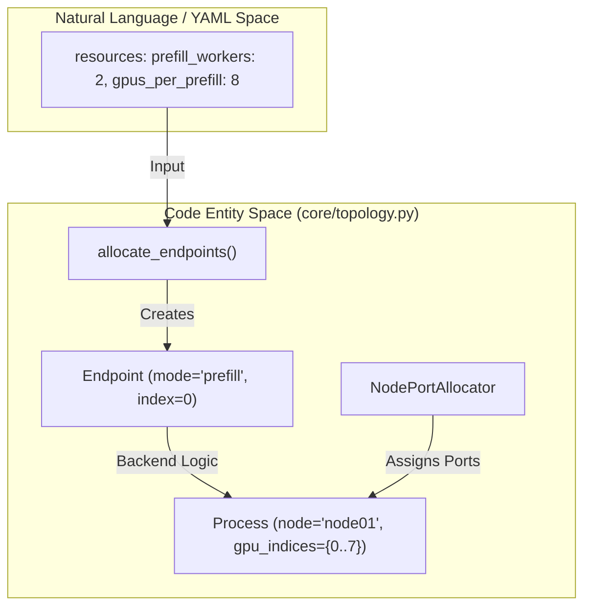
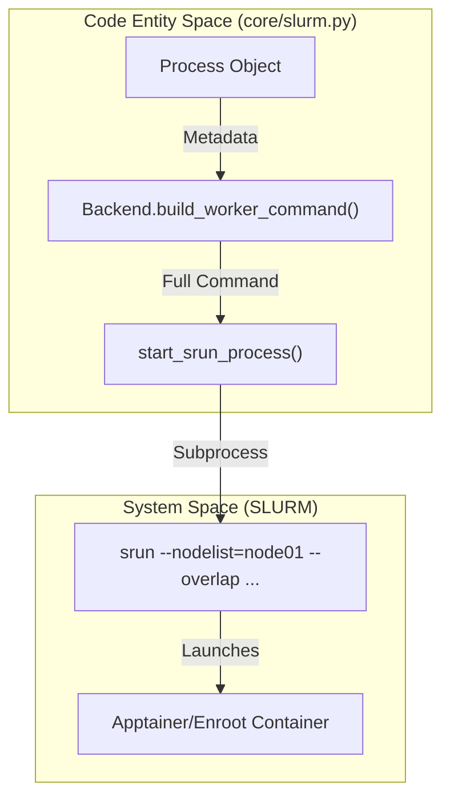

<!-- source: DeepWiki mcp.deepwiki.com · repo NVIDIA/srt-slurm · page 4.2 Endpoint & Process Allocation · fetched 2026-10-26 -->

# Endpoint & Process Allocation

Relevant source files

The following files were used as context for generating this wiki page:

- [CLAUDE.md](CLAUDE.md)
- [docs/mooncake-kv-store.md](docs/mooncake-kv-store.md)
- [src/srtctl/README.md](src/srtctl/README.md)
- [src/srtctl/backends/base.py](src/srtctl/backends/base.py)
- [src/srtctl/backends/sglang.py](src/srtctl/backends/sglang.py)
- [src/srtctl/cli/do_sweep.py](src/srtctl/cli/do_sweep.py)
- [src/srtctl/core/slurm.py](src/srtctl/core/slurm.py)
- [src/srtctl/core/topology.py](src/srtctl/core/topology.py)
- [tests/test_dry_run.py](tests/test_dry_run.py)
- [tests/test_e2e.py](tests/test_e2e.py)
- [tests/test_endpoint_allocation.py](tests/test_endpoint_allocation.py)
- [tests/test_slurm.py](tests/test_slurm.py)

This section describes how `srtctl` maps logical inference workers to physical SLURM nodes and GPUs. The system replaces complex Jinja2/Bash arithmetic with a typed Python topology engine that handles Tensor Parallelism (TP) spanning multiple nodes, packing multiple workers per node, and automatic network port arbitration.

## Topology Concepts

The allocation logic distinguishes between logical units of serving and physical execution units:

| Entity | Code Class | Description |
| :--- | :--- | :--- |
| **Endpoint** | `Endpoint` | A logical worker (e.g., "Prefill Worker 0"). Can span multiple nodes if its TP degree exceeds GPUs per node. |
| **Process** | `Process` | A physical execution unit. Usually one per node per endpoint. Holds specific GPU indices and ports. |
| **Allocator** | `NodePortAllocator` | Tracks and increments port assignments per node to prevent collisions when multiple workers share a host. |

**Sources:** [src/srtctl/core/topology.py:98-111](), [src/srtctl/core/topology.py:141-158](), [src/srtctl/core/topology.py:30-52]()

## Allocation Logic (`allocate_endpoints`)

The `allocate_endpoints()` function is the core of the topology engine. It takes resource requirements and a list of available nodes to produce a deterministic mapping.

### Mapping Strategy
1.  **Sequential Packing**: Workers are allocated in order: Prefill → Decode → Aggregated. [src/srtctl/core/topology.py:182-210]()
2.  **TP Spanning**: If `gpus_per_worker` > `gpus_per_node`, the endpoint is assigned multiple nodes. [src/srtctl/core/topology.py:101-103]()
3.  **Worker Packing**: If `gpus_per_worker` < `gpus_per_node`, multiple endpoints are packed onto the same node until GPUs are exhausted. [src/srtctl/README.md:120-129]()
4.  **Role Isolation**: Prefill and Decode workers are strictly prevented from sharing the same physical node to ensure performance isolation in disaggregated deployments. [src/srtctl/core/topology.py:228-234]()

### Endpoint-to-Process Conversion
Once `Endpoint` objects are created, the backend's `endpoints_to_processes()` method converts them into physical `Process` objects. For most backends (SGLang, vLLM), this results in one process per node per endpoint. [src/srtctl/backends/base.py:91-95]()

### Natural Language to Code Entity Mapping: Topology
The following diagram bridges the high-level request for resources to the internal code structures.

**Title: Resource to Topology Mapping**

**Sources:** [src/srtctl/core/topology.py:182-191](), [src/srtctl/backends/base.py:91-95]()

## Port Allocation (`NodePortAllocator`)

When multiple processes reside on the same node, `NodePortAllocator` ensures they do not collide by incrementing ports from specific base ranges.

| Port Type | Base Port | Increment | Description |
| :--- | :--- | :--- | :--- |
| **HTTP** | 30000 | +1000 | Inference API serving port. |
| **Bootstrap** | 31000 | +1 | P/D coordination (Prefill leaders only). |
| **KV Events** | 5550 | +1 | ZMQ publisher port (Globally unique). |
| **NIXL** | 6550 | +1 | Side channel for vLLM KV transfers. |

**Sources:** [src/srtctl/core/topology.py:54-62](), [src/srtctl/core/topology.py:64-94]()

## Process Implementation Details

### SGLang Disaggregated Allocation
For SGLang, the allocation includes specific support for Mooncake (RDMA-based KV cache transfer). The orchestrator launches a `mooncake_master` on the infrastructure node (port 50051) and injects the master's IP and port into every worker process via the `MOONCAKE_MASTER` environment variable. [src/srtctl/cli/do_sweep.py:164-200](), [src/srtctl/backends/sglang.py:158-180]()

### Launch Configuration (`SrunConfig`)
Backends define how `srun` should treat these processes via `get_srun_config()`. 
- **SGLang/vLLM**: Use `launch_per_endpoint=False`, meaning `srtctl` triggers one `srun` per node/process. [src/srtctl/backends/sglang.py:121-125]()
- **TRT-LLM**: Uses MPI-style launching (`mpi="pmix"`) where a single `srun` may manage multiple ranks across nodes. [src/srtctl/backends/base.py:30-45]()

### Natural Language to Code Entity Mapping: Execution
This diagram shows how the logical `Process` becomes a physical `srun` command.

**Title: Process Execution Flow**

**Sources:** [src/srtctl/backends/base.py:99-107](), [src/srtctl/core/slurm.py:150-169]()

## Summary Table: Resource Fields vs. Allocation

| YAML Field | Impact on `Endpoint` | Impact on `Process` |
| :--- | :--- | :--- |
| `gpus_per_node` | Determines node capacity for packing. | Sets default `gpu_indices` range. |
| `gpus_per_prefill` | Determines `num_nodes` per endpoint. | Determines `CUDA_VISIBLE_DEVICES`. |
| `prefill_nodes` | Implicitly calculated if not provided. | Limits the total `nodelist` available. |
| `kv_events_config` | N/A | Triggers allocation of `kv_events_port`. |

**Sources:** [src/srtctl/core/topology.py:116-118](), [src/srtctl/core/topology.py:177-179](), [src/srtctl/backends/sglang.py:106-109]()

---

