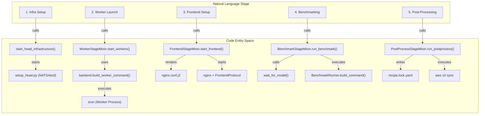
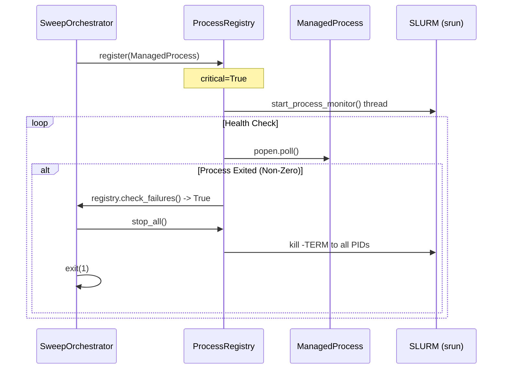

<!-- source: DeepWiki mcp.deepwiki.com · repo NVIDIA/srt-slurm · page 4.3 SweepOrchestrator & Stage Mixins · fetched 2026-10-26 -->

# SweepOrchestrator & Stage Mixins

Relevant source files

The following files were used as context for generating this wiki page:

- [docs/architecture.md](docs/architecture.md)
- [docs/sglang-router.md](docs/sglang-router.md)
- [recipes/dsv4-pro/sglang/gb300-fp4/1k1k/disagg/stp/max-tpt.yaml](recipes/dsv4-pro/sglang/gb300-fp4/1k1k/disagg/stp/max-tpt.yaml)
- [recipes/mocker/kimi-trace-agg.yaml](recipes/mocker/kimi-trace-agg.yaml)
- [src/srtctl/README.md](src/srtctl/README.md)
- [src/srtctl/backends/base.py](src/srtctl/backends/base.py)
- [src/srtctl/backends/sglang.py](src/srtctl/backends/sglang.py)
- [src/srtctl/cli/do_sweep.py](src/srtctl/cli/do_sweep.py)
- [src/srtctl/cli/mixins/benchmark_stage.py](src/srtctl/cli/mixins/benchmark_stage.py)
- [src/srtctl/cli/mixins/frontend_stage.py](src/srtctl/cli/mixins/frontend_stage.py)
- [src/srtctl/cli/mixins/postprocess_stage.py](src/srtctl/cli/mixins/postprocess_stage.py)
- [src/srtctl/cli/mixins/worker_stage.py](src/srtctl/cli/mixins/worker_stage.py)
- [src/srtctl/core/fingerprint.py](src/srtctl/core/fingerprint.py)
- [src/srtctl/core/lockfile.py](src/srtctl/core/lockfile.py)
- [src/srtctl/core/topology.py](src/srtctl/core/topology.py)
- [src/srtctl/templates/nginx.conf.j2](src/srtctl/templates/nginx.conf.j2)
- [tests/test_endpoint_allocation.py](tests/test_endpoint_allocation.py)
- [tests/test_fingerprint.py](tests/test_fingerprint.py)
- [tests/test_frontend_topology.py](tests/test_frontend_topology.py)
- [tests/test_lockfile.py](tests/test_lockfile.py)
- [tests/test_postprocess.py](tests/test_postprocess.py)

The `SweepOrchestrator` is the central coordination class of the `srtctl` system. It executes within a SLURM job allocation and manages the end-to-end lifecycle of a benchmark sweep, from infrastructure setup to post-processing. Its implementation relies on a mixin-based architecture where discrete pipeline stages are encapsulated in specialized classes.

## SweepOrchestrator Overview

The `SweepOrchestrator` [src/srtctl/cli/do_sweep.py:53-60]() integrates multiple stage mixins to form a complete execution pipeline. It uses the `RuntimeContext` as its source of truth for node topologies and the `SrtConfig` for workload definitions.

### Key Responsibilities
1.  **Infrastructure Startup**: Launches NATS and etcd services required for worker coordination [src/srtctl/cli/do_sweep.py:101-162]().
2.  **Topology Resolution**: Resolves logical endpoints into physical processes using the backend protocol [src/srtctl/cli/do_sweep.py:79-99]().
3.  **Process Management**: Tracks all sub-processes (workers, frontends, infra) via a `ProcessRegistry` to ensure critical failures trigger a job-wide shutdown [src/srtctl/cli/do_sweep.py:216-240]().
4.  **Stage Coordination**: Sequences the execution of worker, frontend, benchmark, and post-process stages.

### Orchestration Lifecycle
The `run()` method [src/srtctl/cli/do_sweep.py:216-291]() executes the following sequence:
1.  Initialize `ProcessRegistry` and setup signal handlers.
2.  Start `infra_services` (NATS/etcd) on the designated infra node.
3.  Launch backend workers (Prefill/Decode/Aggregated) via `WorkerStageMixin`.
4.  Launch the frontend layer (Nginx/Routers) via `FrontendStageMixin`.
5.  Execute the benchmark suite via `BenchmarkStageMixin`.
6.  Perform cleanup and trigger `PostProcessStageMixin`.

**Sources:** [src/srtctl/cli/do_sweep.py:53-291](), [src/srtctl/core/processes.py:37-42]()

---

## Stage Mixins Architecture

The pipeline is decomposed into five primary mixins, each handling a specific domain of the job lifecycle.

### 1. WorkerStageMixin
Handles the deployment of inference backend processes. It translates the `backend_processes` list into `srun` commands.

*   **Preamble Injection**: Generates a bash preamble to handle custom setup scripts and optional Dynamo installation [src/srtctl/cli/mixins/worker_stage.py:61-92]().
*   **Environment Composition**: Merges global environment variables (e.g., `HEAD_NODE_IP`, `NATS_SERVER`) with backend-specific and mode-specific (prefill vs. decode) variables [src/srtctl/cli/mixins/worker_stage.py:155-180]().
*   **Process Launching**: Uses `start_srun_process` to launch containers on specific nodes, often mapping ports deterministically based on endpoint indices [src/srtctl/cli/mixins/worker_stage.py:123-153]().

### 2. FrontendStageMixin
Manages the request entry point, including optional load balancing via Nginx.

*   **Topology Calculation**: Determines if Nginx is required. If `enable_multiple_frontends` is true and >1 node is available, it places Nginx on the head node and distributes routers across worker nodes [src/srtctl/cli/mixins/frontend_stage.py:72-118]().
*   **Nginx Configuration**: Renders `nginx.conf.j2` using Jinja2, dynamically populating upstream blocks with the resolved IPs of frontend routers [src/srtctl/cli/mixins/frontend_stage.py:166-182]().
*   **Service Launch**: Starts the frontend (e.g., `sglang_router` or `dynamo.frontend`) and monitors their health [src/srtctl/cli/mixins/frontend_stage.py:184-214]().

### 3. BenchmarkStageMixin
Coordinates the execution of the actual benchmark runner (e.g., SA-Bench).

*   **Health Checks**: Executes `wait_for_model` to ensure the frontend and all required workers (prefill/decode counts) are ready before starting traffic [src/srtctl/cli/mixins/benchmark_stage.py:61-96]().
*   **Identity Verification**: Compares the container/model fingerprint of running workers against the recipe's `identity` block to ensure reproducibility [src/srtctl/cli/mixins/benchmark_stage.py:99-119]().
*   **Runner Execution**: Fetches the appropriate `BenchmarkRunner` from the registry and executes its command [src/srtctl/cli/mixins/benchmark_stage.py:143-170]().

### 4. PostProcessStageMixin
Handles artifact collection and analysis after the benchmark completes.

*   **Rollup & Normalization**: Runs `rollup.py` to standardize raw benchmark outputs into a common JSON format [src/srtctl/cli/mixins/postprocess_stage.py:174]().
*   **S3 Synchronization**: Syncs the log directory to S3 if configured in `srtslurm.yaml` [src/srtctl/cli/mixins/postprocess_stage.py:192-205]().
*   **AI Failure Analysis**: If a job fails, it can optionally invoke the Claude Code CLI to analyze logs and suggest fixes [src/srtctl/cli/mixins/postprocess_stage.py:207-220]().

**Sources:** [src/srtctl/cli/mixins/worker_stage.py:32-180](), [src/srtctl/cli/mixins/frontend_stage.py:48-214](), [src/srtctl/cli/mixins/benchmark_stage.py:33-170](), [src/srtctl/cli/mixins/postprocess_stage.py:46-220]()

---

## Data Flow & Process Lifecycle

The following diagrams illustrate how the Orchestrator moves from logical configuration to physical process management.

### Orchestrator Pipeline Flow
This diagram bridges the natural language stages to the internal class methods and entities.

**Sources:** [src/srtctl/cli/do_sweep.py:216-291](), [src/srtctl/cli/mixins/worker_stage.py:123-153](), [src/srtctl/cli/mixins/frontend_stage.py:184-214](), [src/srtctl/cli/mixins/postprocess_stage.py:145-220]()

### Process Registry Lifecycle Management
The `ProcessRegistry` ensures that if a critical process (like a GPU worker) dies, the entire job is terminated to avoid hung resources.

**Sources:** [src/srtctl/core/processes.py:37-142](), [src/srtctl/cli/do_sweep.py:245-280]()

---

## Implementation Details

### Endpoint to Process Translation
The `SweepOrchestrator` computes the physical layout using two cached properties:
1.  `endpoints`: Logical units of inference (e.g., a 4-GPU SGLang instance) [src/srtctl/cli/do_sweep.py:79-94]().
2.  `backend_processes`: The actual `srun` commands required to realize those endpoints [src/srtctl/cli/do_sweep.py:96-99]().

### Frontend Topology Rules
The system automatically adapts the frontend architecture based on the scale of the job:
| Scenario | Topology | Port |
| :--- | :--- | :--- |
| **Single Node** | Direct frontend on head node | 8000 |
| **Multi-Node** | Nginx on head -> Multiple routers on workers | 8000 (public) / 8180 (internal) |

**Sources:** [src/srtctl/cli/mixins/frontend_stage.py:72-118](), [tests/test_frontend_topology.py:84-177]()

### Infrastructure Services
NATS and etcd are launched on a dedicated node (if configured) or the head node. The orchestrator waits for ports `4222` (NATS) and `2379` (etcd) to be available before proceeding [src/srtctl/cli/do_sweep.py:152-160]().

**Sources:** [src/srtctl/cli/do_sweep.py:101-162]()

---

