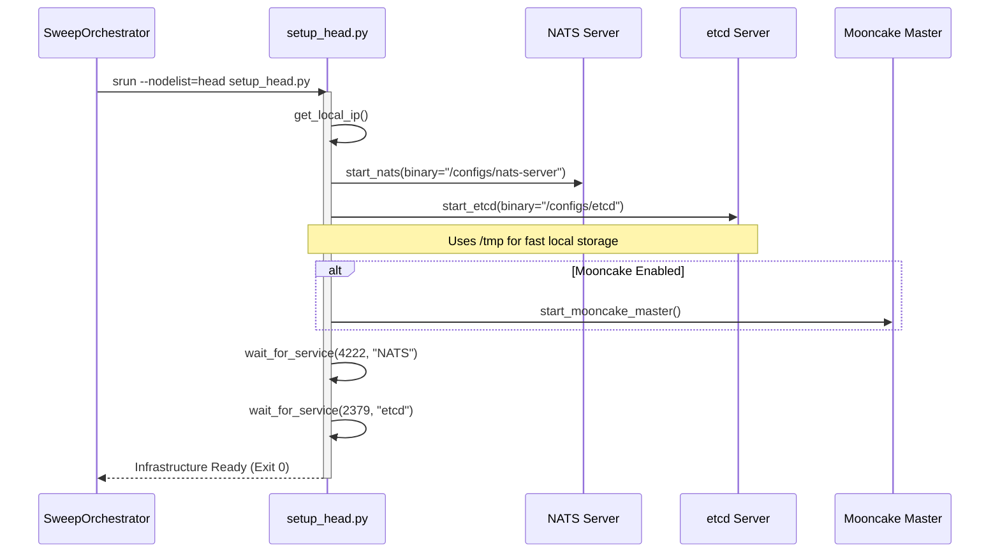
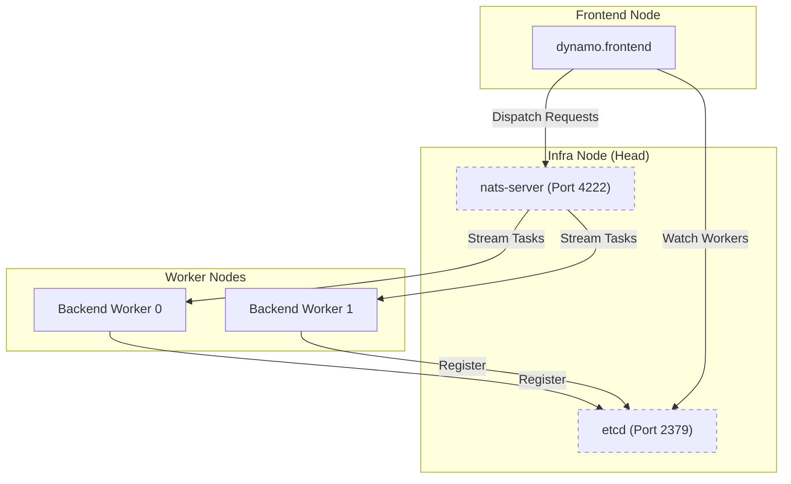

<!-- source: DeepWiki mcp.deepwiki.com · repo NVIDIA/srt-slurm · page 4.4 Infrastructure Services (NATS, etcd, Mooncake) · fetched 2026-10-26 -->

# Infrastructure Services (NATS, etcd, Mooncake)

<details>
<summary>Relevant source files</summary>

The following files were used as context for generating this wiki page:

- [.gitignore](.gitignore)
- [CLAUDE.md](CLAUDE.md)
- [Makefile](Makefile)
- [README.md](README.md)
- [docs/mooncake-kv-store.md](docs/mooncake-kv-store.md)
- [src/srtctl/cli/setup_head.py](src/srtctl/cli/setup_head.py)
- [src/srtctl/core/ip_utils/get_node_ip.sh](src/srtctl/core/ip_utils/get_node_ip.sh)
- [src/srtctl/core/slurm.py](src/srtctl/core/slurm.py)
- [src/srtctl/frontends/dynamo.py](src/srtctl/frontends/dynamo.py)
- [src/srtctl/templates/job_script_minimal.j2](src/srtctl/templates/job_script_minimal.j2)
- [tests/test_dry_run.py](tests/test_dry_run.py)
- [tests/test_e2e.py](tests/test_e2e.py)
- [tests/test_ip_utils.py](tests/test_ip_utils.py)
- [tests/test_slurm.py](tests/test_slurm.py)

</details>


Infrastructure services provide the communication and storage backbone for distributed inference. `srtctl` manages these services by launching them on a designated "infra" node (typically the head node of the SLURM allocation) to facilitate worker discovery, state synchronization, and RDMA-based KV cache transfers.

## Overview of Infrastructure Services

The orchestrator ensures these services are running and healthy before any backend workers or frontends are launched.

| Service | Default Port | Role | Backend Support |
| :--- | :--- | :--- | :--- |
| **NATS** | `4222` | Message broker for request/response cycles and control plane events. | Dynamo (SGLang/vLLM) |
| **etcd** | `2379` | Key-value store for worker registration and configuration discovery. | Dynamo (SGLang/vLLM) |
| **Mooncake** | `50051` | Master process for RDMA-based disaggregated KV cache transfers. | SGLang |

Sources: `[src/srtctl/cli/setup_head.py:21-25]()`, `[CLAUDE.md:152-160]()`

## Implementation: `setup_head.py`

The infrastructure is bootstrapped by `src/srtctl/cli/setup_head.py`. This script is executed by the orchestrator inside the container on the infra node. It performs local IP resolution and spawns the service binaries downloaded during `make setup`.

### Service Lifecycle Flow

Title: Infrastructure Bootstrap Sequence

Sources: `[src/srtctl/cli/setup_head.py:122-164]()`, `[src/srtctl/cli/setup_head.py:167-217]()`, `[src/srtctl/cli/setup_head.py:219-230]()`

### Key Functions
*   **`get_local_ip()`**: Attempts multiple strategies (`hostname -I`, `ip route`, `socket`) to find a routable private IP, avoiding loopback addresses that would prevent cross-node communication `[src/srtctl/cli/setup_head.py:29-110]()`.
*   **`start_nats()`**: Launches the NATS binary. It configures `max_payload` (essential for large KV transfers) and uses `/tmp/nats` for JetStream storage to avoid slow network filesystems `[src/srtctl/cli/setup_head.py:122-164]()`.
*   **`start_etcd()`**: Launches etcd with `--advertise-client-urls` set to the resolved host IP. It maps data to `/tmp/etcd` to prevent Raft consensus timeouts on network storage `[src/srtctl/cli/setup_head.py:167-217]()`.

## NATS and etcd Management

For backends using the **Dynamo** frontend (e.g., disaggregated SGLang or vLLM), `srtctl` automatically injects connection environment variables into all spawned processes.

Title: Dynamo Worker Discovery via Infrastructure

Sources: `[src/srtctl/frontends/dynamo.py:82-87]()`, `[CLAUDE.md:143-150]()`

### Dedicated Infra Node
By default, infrastructure services run on the first node of the allocation. The `InfraConfig` allows reserving a dedicated node solely for these services:
```yaml
infra:
  etcd_nats_dedicated_node: true
```
Sources: `[CLAUDE.md:143-150]()`

## Mooncake KV Store Master

Mooncake is used for RDMA-accelerated KV cache transfers in disaggregated SGLang deployments. When enabled in the `BackendConfig`, `srtctl` manages the `mooncake_master` process.

### Implementation Details
*   **Master Placement**: The `mooncake_master` is launched on the same node as NATS and etcd `[CLAUDE.md:152-157]()`.
*   **Environment Injection**: `srtctl` automatically computes `MOONCAKE_MASTER` using the infra node's IP and port `50051`. It also sets `MOONCAKE_LOCAL_HOSTNAME` for each worker to its specific NIC IP to ensure peer-to-peer RDMA transfers work correctly `[CLAUDE.md:177-179]()`.
*   **Validation**: The system rejects configurations where `mooncake_kv_store` is defined but the SGLang backend is not configured with `disaggregation-transfer-backend: mooncake` `[CLAUDE.md:181-182]()`.

### Mooncake Configuration Example
```yaml
backend:
  type: sglang
  mooncake_kv_store:
    container: nvcr.io/nvidia/mooncake:latest
    env:
      MOONCAKE_PROTOCOL: rdma
      MOONCAKE_DEVICE: mlx5_0
```
Sources: `[CLAUDE.md:159-167]()`

## Port Allocation Summary

Infrastructure ports are static and must be reachable across the cluster fabric.

| Service | Port | Protocol | Config Reference |
| :--- | :--- | :--- | :--- |
| NATS | `4222` | TCP | `NATS_PORT` `[src/srtctl/cli/setup_head.py:23]()` |
| etcd Client | `2379` | TCP | `ETCD_CLIENT_PORT` `[src/srtctl/cli/setup_head.py:21]()` |
| etcd Peer | `2380` | TCP | `ETCD_PEER_PORT` `[src/srtctl/cli/setup_head.py:22]()` |
| Mooncake Master | `50051` | gRPC/TCP | `MOONCAKE_MASTER` `[CLAUDE.md:156]()` |

Sources: `[src/srtctl/cli/setup_head.py:21-23]()`, `[CLAUDE.md:156]()`

---

